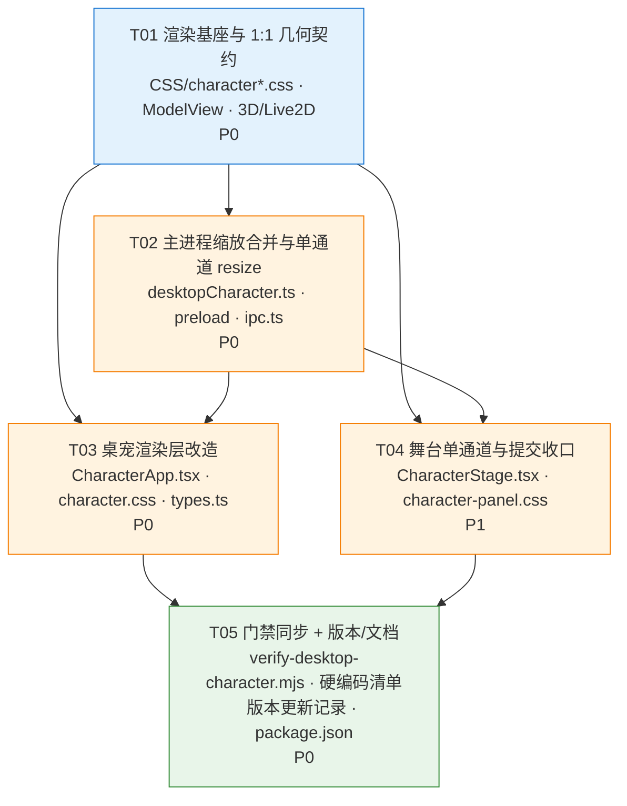

# 念语 Nianyu-Chat · 桌宠缩放架构重构设计（v3.0.12）

> 角色：架构师 高见远（Bob） · 团队：software-nianyu-window-refactor
> 输入：主理人转述的本轮用户反馈 + `v3.0.11` 源码/门禁实侦（只读研究，未改任何源码）
> 目标：根治「滚轮抖动 / 舞台放大超界+闪动 / 右键菜单离本体很远」三问题，并正面回应
> 用户质疑「靠撑大窗口 + CSS transform 放大角色是错误架构」。
> 产物：`docs/desktop-scale-refactor-v3.0.12-design.md`（本文）、
> `docs/desktop-scale-refactor-v3.0.12-class.mermaid`、
> `docs/desktop-scale-refactor-v3.0.12-sequence.mermaid`。
> 不覆盖任何历史文档（`dynamic-window-v3.0.11-*`、`pet-v3.0.3-*` 等全部保留）。

---

## 0. TL;DR（给决策者）

1. **采纳路线 B（贴合式重构）**：角色在窗口内 **按真实尺寸 1:1 渲染**（布局盒 `width/height =
   `calc(190px/228px × scale)`），**删除** `transform: translateX(-50%) scale(var(--dc-scale))`；
   `--dc-scale` 上移到 `.dc-root`，气泡/菜单改为**相对角色本体**定位。舞台本就走这条
   「布局盒放大」路径，两通道归一为一套渲染语义。
2. **窗口几何数学一律不动**：`winSizeForScale` / `footFromStored` / `storedFromFoot` /
   `clampPos` / `clampAxis` / `moved` 的 >0.5px 守卫**逐字保留** ⇒ v3.0.11 的「零坐标迁移、
   反转钳制、零漂移」全部成果不倒退，**存量 x/y/scale 数据零迁移**。
3. **抖动根因不止 setBounds**：`resolutionScale = max(1.5, scale)` 每档变化 → 3D/Live2D
   `setPixelRatio` → **帧缓冲重分配**（真正的「闪」源），叠加 transform 合成层缩放 + 窗口
   setBounds + moved 回响 + 弹簧循环的同帧竞争。修法：桌面 `resolutionScale` 恒 1（窗口物理
   变大，靠 dpr 即 1:1 清晰）+ 新增 `ResizeCoalescer` 把 setBounds 合并到每帧一次。
4. **舞台闪动根因是双通道**：`applyZoom` 每档 `dcSetScaleLive` → 主进程 resize 桌宠窗，与舞台
   自身 `setZoom` 并行竞争；「显示不全」另有独立真因——`.stage-inner` 的 **flex 居中溢出**
   会让大于视口的模型顶部/左侧不可滚动。修法：手势内只动舞台 zoom，手势末**一次** `dcSetScale`
   提交；`.stage-inner` 去 flex 居中改安全居中（见 §3.3）。
5. **用户「这不应该是一个窗口」的判断（a/b 二义）**：Electron 桌宠**必须有窗口**。Live2D
   Viewer、Shimeji 也都有窗口，只是窗口**紧贴角色**且 UI 锚定本体。判断用户实指 **(a)「窗口
   贴合角色，不要大透明容器」**，而非 (b)「完全不用窗口」（需原生 Win32 叠层 + Direct2D，脱离
   React 栈，本轮不可行）。依据与拍板项见 §6。
6. **门禁影响可控**：`verify-dynamic-window-behavior.mjs` **零改动**；`verify-desktop-character.mjs`
   仅 I3 / K6 两条、K20 桌面超采样段、K21 预览段共约 **4 处断言 + 3 个可证伪用例**需改写，
   逐条清单见 §8.2。其余断言（尺寸公式、脚点、clampAxis、moved、视线除数、舞台盒子）全部保留。

---

# Part A · 系统设计

## 1. Implementation Approach（实现方案）

### 1.1 核心难点（本轮真正的技术根因，已逐条定位到代码）

| # | 用户现象 | 直接触发链 | 根因（代码级） |
|---|---|---|---|
| R1 | 滚轮放大时桌宠**抖动** | `CharacterApp:760-773` 每档 `setState(scale)` + `dcSetScale` → 主 `:1075-1094` `saveSettings`(同步 IO) + `resizeCharacterWindow` → `setBounds` → `moved`(:644-661) → webContents 重排；同时弹簧 `dragTick`(60Hz) 在跑 | **多通道同帧竞争**；且 `resolutionScale={max(1.5,scale)}`(:895) 每档变化 → `ThreeModelView:216-225 applyPixelRatio` / `Live2DView:101 ` 重算 pr → `setPixelRatio` → WebGL/Pixi **帧缓冲重分配**，这是「一跳一跳」的**首要视觉闪源**；transform 合成层缩放是第二源 |
| R2 | 舞台放大**显示不全** | `CharacterStage:360` 写 `--stage-zoom`；`.stage-model` `calc(190px*zoom)` 真实放大到 950×1100；`.stage-viewport`(:308-327) `overflow:auto` + `.stage-inner`(:332-338) **`display:flex; align-items:center; justify-content:center; min-width/height:100%`** | **flex 居中溢出经典缺陷**：子元素大于容器时，主轴起点侧（top/left）溢出不可滚动 ⇒ 头部/左侧被裁且滚不到 |
| R3 | 舞台放大**闪动** | `applyZoom`(:238-249) 每档 `setZoom(v)` **且** `api.dcSetScaleLive` → 主 `:1105-1113` resize 桌宠窗 + 推 `dc:scale-preview` + 重置 3.1s 兜底；另有 200ms 去抖 `dcSetScale` | **双缩放通道**：舞台 zoom 与桌宠窗 resize 并行，两套渲染/两套布局互相追帧；预览兜底计时反复重置 |
| R4 | 菜单**离本体很远** | `.dc-menu{ right:6px; bottom:96px }`(character.css:212-216) 锚在**窗口右下角** | S=5 窗口 1100 宽，角色中心在 x=550，菜单在 x≈926~1094 ⇒ 相距 ~450px；同理 `.dc-bubble{bottom:246px}` 固定，不随本体缩放，S=5 与角色重叠约 904px（硬编码清单 #298 已记录） |
| R5 | 用户质疑架构 | 窗口随 scale 扩到 1100×1332，角色靠 transform 在里头放大 | 语义错位：窗口被当成「容器」，角色是被 CSS 拉伸的内容；而真实桌宠软件是「窗口 = 角色渲染面」，UI 锚定本体 |

### 1.2 路线评估（两条都认真评估，给出推荐）

| 维度 | 路线 A：改良现有 | 路线 B：贴合式重构（推荐） |
|---|---|---|
| 核心手法 | 保留 transform 撑大窗口 + 菜单改 JS 锚定 + resize 去抖 + 舞台预览时暂停桌宠 resize | 角色 1:1 布局盒渲染、删除 transform scale；窗口几何公式**沿用**；UI 锚定本体；resize 合并；舞台单通道 |
| R1 抖动 | 只能**缓解**：去抖降低 setBounds 频率，但 transform 合成层 + `resolutionScale` 帧缓冲重分配仍在 → 每档仍有一次「重采样跳变」 | **根治**：无 transform、pr 恒定、每帧最多一次 setBounds ⇒ 三条闪源同时消除 |
| R2 显示不全 | 与桌宠路径无关，**不修就仍在**（须单独修 flex 溢出） | 同样必须单独修 flex 溢出；但渲染语义统一后不会再引入新的越界 |
| R3 舞台闪动 | 暂停预览期桌宠 resize 可显著改善；但两套渲染语义仍在（transform vs 布局盒），残留竞态 | **根治**：舞台与桌宠同为布局盒 1:1 语义；手势期单通道、提交期一次 resize |
| R4 菜单错位 | 可根治：JS 算角色中心 | 可根治：窗口本就贴合 + JS 锚定本体（双保险） |
| 回应用户质疑 | **没有回应**——窗口依旧 1100×1332，用户会认为「没听进去」 | 正面回应：角色与窗口同一尺寸语义，UI 是「贴在本体上」而非「贴在窗口角」 |
| 数据迁移 | 无 | **无**（窗口公式与脚点空间不动） |
| 门禁改写量 | 小（I3/K6/K21 基本不动） | 中（I3/K6/K20 桌面段/K21 预览段，见 §8.2） |
| 工作量/风险 | ~1.5 人日 / 低（但问题根治度不足，可能返工第二轮） | ~3.5 人日 / 中（集中在 CSS + 主进程薄封装，几何零风险） |

**采纳：路线 B。** 理由：用户的反馈本质是架构性质疑，改良方案即使修好三个症状，也会因「窗口仍被
当成容器」在下一轮反馈里再次被打回；而路线 B 的几何数学零改动，把风险锁在「渲染语义 + 事件时序」
这一可控范围内，且与 v3.0.3 起舞台既有的「按真实大小放大、不靠 transform 插值」路线一致——
**本质是让桌宠追上舞台，而不是再发明一套新机制**。

### 1.3 「这不应该是一个窗口」的可行性判断（关键）

* **(b) 完全不用窗口：Electron 不可行。** 桌宠要「始终置顶 + 全屏穿透/命中切换 + 接收滚轮/
  右键 + 跨屏拖拽」，在 Electron 里唯一载体就是 `BrowserWindow{transparent, frame:false,
  alwaysOnTop}`。真去做无窗口方案需 Win32 分层窗口 + Direct2D/GDI 原生插件，抛弃 React/3D/
  Live2D 渲染栈，工作量为数量级差异，本轮不建议。
* **(a) 窗口贴合角色：正是路线 B。** Live2D Viewer 的模型窗、Shimeji 的精灵窗，**都是窗口**，
  只是「窗口尺寸 ≡ 角色尺寸」且菜单是系统/贴身浮层，不存在「大容器 + 角落菜单」。用户的真实
  痛点是**窗口与角色尺寸语义脱钩 + UI 锚在窗口角**，不是窗口这个技术形态本身。
* 结论：按 (a) 实施，并在拍板项 §6 里请主理人向用户明确说明 (b) 的不可行性，避免期望错位。

### 1.4 架构模式

* 沿用「主进程物理层 / 渲染层纯展示」分层；新增一个薄的 **ResizeCoalescer**（主进程，帧合并），
  不改 `resizeCharacterWindow` 的原子语义（脚点钉死、单次 setBounds、先写 `st.scale` 后钳制）。
* 渲染层以 **CSS 自定义属性 `--dc-scale` 为单一渲染驱动**，从 `.dc-character` 上移到 `.dc-root`：
  角色本体、气泡、菜单同处一个真实像素空间，不再有「布局盒 190×228 但视觉 950×1140」的分裂。
* 舞台以 `settings.desktopCharacters[].scale` 为**唯一权威**，手势期只改本地镜像，提交期一次写回；
  删除「预览期推桌宠窗 resize」这条通道，从根上消除双通道竞争。

---

## 2. File List（文件清单）

| # | 文件（相对路径） | 改动性质 | 关键位置 | 说明 |
|---|---|---|---|---|
| 1 | `src/styles/character.css` | **主改** | `:39-51` `.dc-character`；`:143-147` `.dc-bubble`；`:211-228` `.dc-menu`；新增 `.dc-menu-anchor` | 删 transform scale；宽高改 `calc(190/228px*var(--dc-scale))`；气泡 bottom 改 calc；菜单由 wrapper 锚定 |
| 2 | `src/character/CharacterApp.tsx` | **主改** | `:120-140` state/refs；`:350-392` dc:state/预览；`:760-784` 滚轮；`:786-800`/`:911-941` 右键与菜单渲染 | `--dc-scale` 写 `.dc-root`；滚轮本地即时更新 + `dcSetScaleLive`；右键算 `MenuAnchor`；提交去抖 180ms |
| 3 | `electron/desktopCharacter.ts` | 中改 | `:1075-1113` 两个 scale IPC；新增 `ResizeCoalescer`（`:370` 前）；`:379-402` resize 保留 | 预览 resize 走合并器；提交取消合并；几何段/脚点/clamp/moved **一字不改** |
| 4 | `src/components/CharacterStage.tsx` | 中改 | `:238-263` applyZoom/commit；`:201-215` scheduleCommit | 手势内**只** `setZoom`，删 `dcSetScaleLive`；提交仍一次 `dcSetScale`；保留回声抑制 |
| 5 | `src/styles/character-panel.css` | 小改 | `:332-338` `.stage-inner` | 修 flex 居中溢出：改 `margin:auto` 安全居中方案（§3.3） |
| 6 | `src/character/ThreeModelView.tsx` / `src/character/Live2DView.tsx` | 小改 | `:216-225`/`:98-105` pr 计算 | 桌面路径 resolutionScale 恒 1 ⇒ pr=dpr 恒定，不再随 scale 重分配帧缓冲；K20 相关常量可保留但不再被桌面使用 |
| 7 | `src/character/ModelView.tsx` | 微改 | `:71` 默认值 | 明确 `resolutionScale` 默认 1、仅用于桌面且恒 1；舞台不传 |
| 8 | `electron/preload.ts` / `src/ipc.ts` | 微改 | `:501-508`/`:1163-1165`、`:562-569`/`:654-656` | 通道签名**不变**（`dcSetScale`/`dcSetScaleLive`/`onDcScalePreview` 全保留）；仅注释更新 |
| 9 | `scripts/verify-desktop-character.mjs` | 门禁同步 | `:678-687` I3；`:965-1001` K6；`:1400-1410`/`:1445-1452` 桌面超采样；`:1690-1731` K21 | 逐条改写见 §8.2；可证伪用例同步 |
| 10 | `硬编码清单.md` / `版本更新记录.md` / `README.md` / `使用说明.md` | 文档 | 追加 v3.0.12 条目 | 见 §5 |
| 11 | `package.json` | 版本 | `:3` | `3.0.11` → `3.0.12`（由发布任务执行） |
| 12 | `docs/desktop-scale-refactor-v3.0.12-*` | 新增 | — | 本文 + 两份 mermaid |

> **明确不改**：`winSizeForScale` / `footFromStored` / `storedFromFoot` / `clampAxis` / `clampPos` /
> `resizeCharacterWindow` 的函数体与字面量；`moved` 的 >0.5px 守卫；`src/types.ts` 字段定义；
> 所有 i18n 词条（无新增用户可见字符串）。

---

## 3. Data Structures and Interfaces（数据结构与接口）

完整 `classDiagram` 见 `docs/desktop-scale-refactor-v3.0.12-class.mermaid`。核心新增/变更如下。

### 3.1 新增：ResizeCoalescer（主进程，`electron/desktopCharacter.ts`）

```ts
/**
 * 高频 scale 变更合并器（路线 B / R1）：
 * 滚轮每档、舞台预览每帧都会请求 resize；这里保证「每个 id 每帧至多一次」真正的
 * resizeCharacterWindow。真正执行仍走原原子函数（脚点钉死 + 单次 setBounds），
 * 故 K21/行为脚本对 resizeCharacterWindow 的所有断言不受影响。
 */
class ResizeCoalescer {
  private pendingScale = new Map<string, number>();      // id → 最新 scale
  private scheduled    = new Map<string, boolean>();      // id → 本帧是否已排程
  private readonly FRAME_MS = 16;                         // ≈60Hz，与 TICK_MS 同口径

  /** 登记一次 resize 请求；同帧内后来的值覆盖前值，不额外排程 */
  request(id: string, scale: number): void {
    this.pendingScale.set(id, clampScale(scale));
    if (this.scheduled.get(id)) return;                   // 本帧已排程 → 早退
    this.scheduled.set(id, true);
    setTimeout(() => this.flush(id), this.FRAME_MS);
  }

  /** 帧到期：取最新值执行一次原子 resize；尺寸未变由 resizeCharacterWindow 内部早退 */
  flush(id: string): void {
    this.scheduled.delete(id);
    const s = this.pendingScale.get(id);
    if (s === undefined) return;
    this.pendingScale.delete(id);
    resizeCharacterWindow(id, s);
  }

  /** 提交/关窗时清空待合并项，保证「提交值 = 终值」且不与排队预览竞争 */
  cancel(id: string): void {
    this.pendingScale.delete(id);
    this.scheduled.delete(id); // 已排程的 flush 会因 pendingScale 缺失而空转
  }
}
const resizeCoalescer = new ResizeCoalescer();
```

### 3.2 新增：MenuAnchor（渲染层，`CharacterApp.tsx`）

```ts
interface MenuAnchor { localX: number; localY: number; } // 相对 .dc-root（=窗口内容区）的 DIP

/** 右键时按「角色本体真实矩形」算锚点；窗口放大后仍贴本体，而非贴窗口右下角。 */
function computeMenuAnchor(charEl: HTMLElement, rootEl: HTMLElement, win: {w:number;h:number}): MenuAnchor {
  const r = charEl.getBoundingClientRect();              // 1:1 布局盒 ⇒ 真实像素，无需乘 scale
  const rr = rootEl.getBoundingClientRect();
  const x = r.left - rr.left + r.width / 2;              // 角色水平中心
  const y = r.top  - rr.top;                             // 角色头顶
  // 菜单自身 min-width 168 / 高约 200；贴角色上方， clamp 防溢出窗口
  return {
    localX: Math.max(90, Math.min(win.w - 90, x)),
    localY: Math.max(210, Math.min(win.h - 8, y - 8)),
  };
}
```
渲染结构变为（`.dc-menu` 的 class / 动画 / 关闭逻辑全保留，I5 断言不受影响）：
```tsx
<div className="dc-menu-anchor" style={{ left: menuAnchor.localX, top: menuAnchor.localY }}>
  <div className={`dc-menu${menuClosing ? ' closing' : ''}`} ...>{/* 原菜单项，逐字保留 */}</div>
</div>
```

### 3.3 舞台溢出修复（`.stage-inner`，`character-panel.css`）

```css
/* 旧：flex 居中 + min-size:100% ⇒ 子项大于视口时起点侧不可滚动（R2 根因） */
.stage-inner {
  display: flex; align-items: center; justify-content: center;
  min-width: 100%; min-height: 100%;
}
/* 新：用 auto margin 安全居中——溢出时两端都可滚动，不会裁掉头顶 */
.stage-inner {
  display: block;                 /* 去掉 flex 居中 */
  min-width: 100%; min-height: 100%;
  padding: 12px;                  /* 给滚动留边 */
}
.stage-model {
  margin: auto;                   /* block 布局下 auto margin 居中；溢出时退化为起点对齐，可滚 */
}
```

> **实现回填（Engineer 实侦补充，v3.0.12）**：仅改 `.stage-inner` 仍不够——外层 `.stage-viewport`
> 自身是 `display:flex; align-items:center; justify-content:center`，作为交叉轴 flex 容器仍会把
> 超高内容的起点侧（top）推到负坐标且不可滚。故实装**追加**把外层两轴改为
> `align-items: safe center; justify-content: safe center`（Chromium 128 支持），与
> `block + margin:auto` 叠加后 top/left 均可滚；`safe` 关键字在内容不溢出时退化为普通居中，
> 常规尺寸观感不变。行为脚本已实跑断言起点偏移 = padding 12px ≥ 0。本补充**不改变** R2 的
> 根因判定与修法方向，只是把修复闭环延伸到外层容器。

### 3.4 缩放 IPC 语义变更（通道签名不变）

| 通道 | v3.0.11 行为 | v3.0.12 行为 |
|---|---|---|
| `dc:set-scale` | 落盘 + resize + 广播 + state | **不变**；追加 `resizeCoalescer.cancel(id)`（先取消排队预览再落终值） |
| `dc:set-scale-live` | 同步 `resizeCharacterWindow` + 推 `scale-preview` + 3.1s 兜底 | 改为 `resizeCoalescer.request(id, clamped)`（每帧一次）+ 推 `scale-preview` + 3.1s 兜底；**不落盘、不广播**（K6 守恒） |
| `dc:scale-preview` | 主 → 角色窗改本地 `--dc-scale` | **不变**（渲染层上移到 `.dc-root` 后语义更强） |
| 舞台 `applyZoom` | `setZoom` + `dcSetScaleLive` + 200ms 去抖提交 | **只** `setZoom` + 200ms 去抖提交；删除 `dcSetScaleLive` 调用 |

### 3.5 关键公式（实现时直接抄，与 v3.0.11 完全一致，禁止改动）

```
S = clampScale(raw)                                  // [0.6, 5.0]
winW(S) = max(340, ceil(190·S + 2·75))               // S=5 → 1100
winH(S) = max(420, ceil(228·S + 10 + 182))            // S=5 → 1332
foot(S) = (originX + winW(S)/2, originY + winH(S) − 10)
stored  = (footX − 170, footY − 410)                  // 基准脚点空间，零迁移
resize  : foot 固定 ⇒ newOrigin = foot − (newW/2, newH−10) → clampPos → 单次 setBounds
角色 1:1 渲染盒: width = calc(190px × S), height = calc(228px × S), left:50%, bottom:10px
气泡: bottom = calc(10px + 228px × S + 8px)           // S=1 时 = 246px，与旧值对齐
视线除数: (cursor − center) / (170 × S)               // K21 断言保留（1:1 盒 rect 已含 S）
```

---

## 4. Program Call Flow（程序调用流程）

完整 `sequenceDiagram` 见 `docs/desktop-scale-refactor-v3.0.12-sequence.mermaid`，覆盖 5 条主流程：
①建窗与初始 `--dc-scale`；②滚轮（合并 resize + 180ms 提交）；③舞台单通道；④右键锚定；⑤拖拽零漂移。

关键时序要点（文字版）：

1. **滚轮**：每档 → `setState(scale)` 即时改 `.dc-root` 的 `--dc-scale`（布局盒真实放大，pr 恒定 ⇒
   不闪）→ `dcSetScaleLive` → `ResizeCoalescer.request` → 每帧一次 `resizeCharacterWindow`（脚点钉死）
   → `dc:scale-preview` 兜底；停手 180ms → `dcSetScale` 一次落盘/广播，`cancel(id)` 清队列。
2. **舞台**：`applyZoom(v)` 只 `setZoom(v)`；`scheduleCommit` 200ms 或 pointerup → `commitZoom`
   判重 → **唯一一次** `dcSetScale` → 主进程一次 resize + 广播；舞台 `onSettingsChanged` 回声抑制
   命中，不回写 ⇒ 无回环。
3. **右键**：`getBoundingClientRect()` 取 1:1 角色真实矩形 → `computeMenuAnchor` → clamp →
   `.dc-menu-anchor{left,top}`，`.dc-menu` 原样动画。

---

## 5. Anything UNCLEAR（待明确事项 / 假设）

1. 用户是否确实指「窗口贴合」而非「无窗口」——见 §6 拍板项 P1。
2. 「5× 时窗口仍约 1100×1332」是物理必然（角色本体 950×1140）；需向用户澄清，避免因预期
   「窗口也应该小」而再次不满——P2。
3. 桌面 `resolutionScale` 从 `max(1.5,S)` 改为恒 1 后画质：窗口物理变大 → canvas 物理像素随窗口
   增长，`pr=dpr` 即屏幕 1:1；理论上等价且不浪费显存，但需 QA 目视确认 3D/Live2D 无糊边——P4。
4. 舞台预览期桌宠**不再实时跟随**（改为提交时一次性同步）——这是单通道的必要代价，需用户确认
   —P3。
5. 气泡固定 `bottom:246px` 的既有重叠问题（#298）本轮随 calc 化一并解决，属**顺带修复**，若
   产品希望维持旧观感需回退该行——P5。

---

# Part B · 任务分解

## 6. Required Packages（依赖）

**无新增第三方依赖。** 全部基于现有：`react@^18.3.1`、`electron@^32.1.2`、`three@^0.170.0`、
`pixi.js@^6.5.10` + `pixi-live2d-display@^0.4.0`、`typescript@^5.6.2`、`vite@^5.4.8`。
`ResizeCoalescer` 用原生 `setTimeout(16)`，不引入 raf/调度库；QA 仍用
`node --test`（`scripts/verify-*.mjs`，零依赖）。

## 7. Task List（按依赖排序，≤5 个任务）

### T01 · 渲染基座与 1:1 几何契约（基础设施 / 契约层）
- **优先级**：P0
- **依赖**：无
- **源文件**：`src/styles/character.css`、`src/styles/character-panel.css`、
  `src/character/ModelView.tsx`、`src/character/ThreeModelView.tsx`、
  `src/character/Live2DView.tsx`
- **交付**：
  1. `.dc-character` 删除 `transform: scale(...)`，仅留 `translateX(-50%)`；宽高改 `calc(190/228px × var(--dc-scale))`。
  2. `--dc-scale` 的作用域契约上移到 `.dc-root`（本任务只改 CSS 选择器预期，渲染层写入在 T03）。
  3. `.dc-bubble` bottom 改 `calc(10px + 228px × var(--dc-scale) + 8px)`；新增 `.dc-menu-anchor`。
  4. `.stage-inner` / `.stage-model` 溢出修复（§3.3）。
  5. 桌面路径 `resolutionScale` 恒 1 的 pr 逻辑（保留 `MAX_PIXEL_RATIO=12` 常量避免 K20 连锁改动）。
- **验收**：`npm run typecheck` 通过；CSS 中不再出现 `scale(var(--dc-scale`；stage 放大到 5× 顶部可滚动到。

### T02 · 主进程缩放合并与单通道 resize
- **优先级**：P0
- **依赖**：T01
- **源文件**：`electron/desktopCharacter.ts`、`electron/preload.ts`、`src/ipc.ts`
- **交付**：
  1. 新增 `ResizeCoalescer`（§3.1）；`dc:set-scale-live` 改走 `request()`；`dc:set-scale` 追加 `cancel(id)`；关窗/兜底路径追加 `cancel(id)`。
  2. **几何段与 `resizeCharacterWindow` / `moved` 一字不改**（K21 + 行为脚本守恒）。
  3. preload/ipc.ts 通道签名不变，仅注释说明「合并预览」。
- **验收**：`node scripts/verify-dynamic-window-behavior.mjs` **全绿且零改动**；连续 20 档滚轮只触发 ≤20 次（实测每帧合并后远小于档数）setBounds。

### T03 · 桌宠渲染层改造（--dc-scale 落点 / 滚轮 / 菜单锚定）
- **优先级**：P0
- **依赖**：T01、T02
- **源文件**：`src/character/CharacterApp.tsx`、`src/styles/character.css`（配合 T01 微调）、`src/types.ts`（仅注释）
- **交付**：
  1. `--dc-scale` 写到 `.dc-root`（不再写 `.dc-character` 内联 style）；滚轮钳制公式/步长保持。
  2. 滚轮提交加 180ms 去抖：每档 `dcSetScaleLive`，停手后一次 `dcSetScale`；拖拽中（`draggingRef`）暂停滚轮响应避免与弹簧抢尺寸。
  3. `computeMenuAnchor`（§3.2）+ `.dc-menu-anchor` 渲染；I5 的 `.dc-menu` class/关闭链路不变。
  4. 视线除数 `/(DC_EYE_DIVISOR * scale)` 保留（K21 断言不动）。
- **验收**：滚轮放大无逐档跳动；S=5 右键菜单贴角色头顶；菜单收回动画仍可辨。

### T04 · 舞台单通道与提交收口
- **优先级**：P1
- **依赖**：T01、T02
- **源文件**：`src/components/CharacterStage.tsx`、`src/styles/character-panel.css`（配合 T01）、`src/character/ModelView.tsx`
- **交付**：
  1. `applyZoom` 删除 `api.dcSetScaleLive(...)` 调用，仅 `setZoom(v)` + `scheduleCommit(v)`。
  2. 保留 `zoomSourceRef` / `lastCommittedZoomRef` / 回声抑制 / 去抖判重（K6 守恒）。
  3. 舞台 `--stage-zoom` 布局盒放大保持不变（K7 断言不动）。
- **验收**：拖滑块 5× 无闪动、无「舞台↔桌宠」互相追帧；一次拖动仅一次 `saveSettings`。

### T05 · 门禁同步 + 版本与发布产物
- **优先级**：P0
- **依赖**：T01、T02、T03、T04
- **源文件**：`scripts/verify-desktop-character.mjs`、
  `scripts/verify-scale-refactor-behavior.mjs`（实现期新增）、`硬编码清单.md`、
  `版本更新记录.md`、`README.md`、`使用说明.md`、`package.json`
- **交付**：
  1. 按 §8.2 改写 I3 / K6 / K20 桌面段 / K21 预览段断言 + 可证伪用例。
  2. `npm run verify:desktop-character`、`node scripts/verify-dynamic-window-behavior.mjs` 全绿。
  3. 版本 3.0.12、硬编码清单新增条目、更新记录/文档。
- **验收**：全部门禁绿；无新增 i18n key（`verify:i18n-coverage` 绿）。
- **实现回填**：Engineer 新增 `scripts/verify-scale-refactor-behavior.mjs`（32 条行为断言，用
  `ts.transpileModule` 抽真实 `ResizeCoalescer` / `computeMenuAnchor` 实跑）。这是**增量**验证，
  §8.2「`verify-dynamic-window-behavior.mjs` 全文零改动」的约束未被破坏——旧脚本一字未动，
  新脚本独立覆盖新增逻辑。该脚本建议纳入 CI。

## 8. Shared Knowledge（跨模块约定 / 门禁同步清单）

### 8.1 全体约定
- `--dc-scale` 是桌宠窗**唯一渲染驱动**，写在 `.dc-root`；角色/气泡/菜单必须消费它，**禁止**再写
  `.dc-character` 的 `transform: scale(...)`。
- 舞台与桌宠的唯一权威是 `settings.desktopCharacters[].scale`；手势期只动本地镜像，提交期一次写回。
- 主进程几何函数 + `resizeCharacterWindow` + `moved` 守卫是**冻结区**，本轮任何任务不得改动其字面量。
- 所有缩放钳制统一 `[0.6, 5.0]`、步长 0.05、两位小数；舞台常量 `STAGE_ZOOM_*` 与桌面保持同口径。
- `resolutionScale` 桌面恒 1（pr=dpr）；舞台仍不传。

### 8.2 门禁断言逐条同步（关键！）

| 门禁 | 行号 | 现状 | 处理 |
|---|---|---|---|
| Bug2 clampPos | `:567-570` | `halfW=(CHAR_BODY_W*scale)/2` | ✅ **保留**（clampPos 未改） |
| **I3** | `:679-682` | 要求 `--dc-scale` 在 `.dc-character` 且 CSS `transform: translateX(-50%) scale(var(--dc-scale, 1))` | ✏️ **改写**：断言 `--dc-scale` 在 `.dc-root`；断言 `.dc-character` 有 `width: calc(190px * var(--dc-scale` 与 `height: calc(228px * var(--dc-scale`；断言 `.dc-character` 的 transform **不含** `scale(`（新增可证伪：把 transform 加回 scale 则红） |
| I3 | `:683-687` | onWheel + 0.6~5.0 钳制 + dcSetScale + passive:false | ✅ **保留**（滚轮链未动，仅追加去抖，正则仍命中） |
| I3 可证伪 | `:746-749` | 把 --dc-scale 挪回子元素 | ✏️ **改写**为「把 --dc-scale 挪回 `.dc-character` 后新断言失效」 |
| I5 | `:703-715`, `:231-233` | `.dc-menu` class + linear 动画 + 三条关闭路径 | ✅ **保留**（wrapper 不改 class/动画/关闭逻辑） |
| **K6** | `:968-971` | 舞台 0.6~5.0 | ✅ 保留 |
| K6 | `:972-979` | live/scale-preview 通道齐全 | ✅ 保留（通道未删） |
| K6 | `:980-982` | 预览不落盘不广播 | ✅ 保留 |
| **K6** | `:983-988` | `dc:set-scale-live … resizeCharacterWindow(id, clamped)` | ✏️ **改写**为 `… resizeCoalescer.request(id, clamped)`；`DC_PREVIEW_RESTORE_MS=3100`、`cancelPreviewRestore`、resize 内无 saveSettings 三条保留 |
| **K6** | `:989-992` | 舞台写回含 `dcSetScaleLive` | ✏️ **改写**：断言舞台**不含** `api.dcSetScaleLive(` 且仍含 `api.dcSetScale(`（单通道）；`zoomSourceRef` 保留 |
| K6 | `:993-1001` | 反向订阅 + 滑块 + 提交落盘 | ✅ 保留 |
| K6 可证伪 | — | 无现成可证伪 | ➕ 新增：把 `dcSetScaleLive` 加回 `applyZoom` 后断言失效 |
| K7 | `:1004+` | 舞台盒子 `calc(190px * var(--stage-zoom` | ✅ 保留 |
| **K20 桌面超采样** | `:1407-1410`, `:1450-1452`, `:1671-1674`, `:1686-1687` | `DESKTOP_RESOLUTION_SCALE_MIN=1.5`、`resolutionScale={max(MIN,scale)}`、`rs = max(1, resolutionScaleRef.current)` | ✏️ **改写**：断言桌面 `resolutionScale={1}`（或 prop 省略）、`rs` 恒 1；「不 clamp 1.6」语义保留；`MAX_PIXEL_RATIO=12` 断言保留；可证伪用例同步 |
| K20 | `:1675-1680` | pr 上限 12 + 舞台盒子解耦 | ✅ 保留 |
| **K21 尺寸/脚点/clamp/持久化** | `:1691-1725` | winSizeForScale、脚点、clampAxis、storedFromFoot | ✅ **全部保留**（几何冻结区） |
| **K21 预览** | `:1726-1731` | `dc:set-scale-live … resizeCharacterWindow` + 3100 兜底 | ✏️ **改写**为 `… resizeCoalescer.request`；`DC_PREVIEW_RESTORE_MS=3100` / `schedulePreviewRestore` / `cancelPreviewRestore` / 不落盘保留 |
| K21 moved | `:1733-1741` | >0.5px 守卫 | ✅ 保留 |
| K21 视线 | `:1743-1751` | `/(DC_EYE_DIVISOR * scale)` + 舞台 `/(STAGE_EYE_DIVISOR * zoom)` | ✅ 保留（1:1 盒 rect 已含 scale，除数语义不变） |
| K21 可证伪 | `:1753-1781` | 6 个变异用例 | ✅ 保留（均针对冻结区） |
| **行为脚本** | `verify-dynamic-window-behavior.mjs` 全文 | transpile 几何段实跑 | ✅ **零改动**（抽取标记 `const CHAR_BODY_W = 190;` / `function resizeCharacterWindow(` / `win.on('moved', ` 全保留） |

### 8.3 硬编码清单影响（`硬编码清单.md`）
- #249 `CHAR_BODY_W/H/GAP`：**保留**，说明追加「同时驱动 CSS `calc(190/228px × --dc-scale)`，改 CSS 必须同步」。
- #250 `DC_SCALE_MIN/MAX`：**保留**。
- #278 / #296 `DESKTOP_RESOLUTION_SCALE_MIN` / pixelRatio：**改写**为「桌面 resolutionScale 恒 1、pr=dpr；1.5 超采样与 dpr×S 公式退役」。
  > 实现回填：常量 `DESKTOP_RESOLUTION_SCALE_MIN=1.5` 采取「**保留导出 + 标注已退役**」策略——
  > `CharacterApp` 不再 import，`resolutionScale={1}` 落桌面；保留导出避免潜在外部引用报错，
  > 且不触发更多门禁连锁。`MAX_PIXEL_RATIO=12` 与 `rs=max(1, ref)` 原样保留，K20 上限/不 clamp1.6
  > 断言均绿。等价于原「改写」意图，属更稳妥的落地形态。
- #297 `DC_PAD_X/DC_HEAD_TOP`：**保留**，修正说明「菜单不再靠 right:6px 相对窗口角，改锚角色本体」。
- #298 `winSizeForScale`：**保留公式**，追加「1:1 渲染后气泡重叠问题已由 calc bottom 解决」。
- #299 `footFromStored/storedFromFoot`：**保留**（零迁移）。
- #301 `DC_PREVIEW_RESTORE_MS`：**保留**，追加「预览期 resize 经 ResizeCoalescer 合并」。
- #302 视线除数：**保留**。
- ➕ 新增条目：`ResizeCoalescer.FRAME_MS=16`、`.dc-menu-anchor` clamp 边界（90px / 210px）、滚轮提交去抖 180ms、舞台 `.stage-inner` 安全居中。

### 8.4 i18n 影响
**无新增/删除 key。** 菜单项、滑块文案、错误提示均复用现有 `characters.*` / 10 语言词条；
`verify:i18n-coverage` 应保持全绿。若 T03 引入任何新用户可见字符串，必须同步 10 语言（zh/en/ja/ko/de/es/fr/pt + 2），否则门禁红。

### 8.5 文档影响
`版本更新记录.md`（v3.0.12 条目：三大问题修复 + 架构说明）、`README.md` / `使用说明.md`（若含
「滚轮放大」「舞台模型大小」描述，补一句「窗口贴合角色、菜单贴身」）、`package.json` 版本号。

## 9. Task Dependency Graph



---

## 10. 风险与待用户拍板事项（请主理人一次性拍板）

| 编号 | 拍板项 | 我的建议 | 依据 / 若反对的后果 |
|---|---|---|---|
| **P1** | 用户「这不应该是一个窗口」是 (a) 窗口贴合角色，还是 (b) 完全无窗口？ | 按 **(a)** 实施；同时向用户说明 Electron 下 (b) 不可行 | Live2D Viewer/Shimeji 都用窗口；(b) 需原生叠层、脱离 React/3D 栈。若用户坚持 (b)，本方案作废，需另立原生渲染项目 |
| **P2** | 是否能接受 5× 时窗口仍约 1100×1332？ | 接受，并向用户解释：角色本体 950×1140，窗口必须容纳；改善的是「UI 贴身 + 不闪」 | 物理必然；若要求窗口小，只能降低最大 scale（与既有 500% 需求冲突） |
| **P3** | 舞台拖动时桌宠是否仍需实时跟随？ | **不需要**：手势期只动舞台，提交时一次性同步 | 双通道是 R3 闪动根因；若坚持实时跟随，需保留合并预览，闪动只能缓解不能根治 |
| **P4** | 桌面 `resolutionScale` 由 `max(1.5,S)` 改恒 1，是否接受？ | 接受（窗口物理变大，pr=dpr 已 1:1） | 消除帧缓冲重分配（R1 首因）；若保留，抖动/闪动会残留。QA 需目视确认 3D/Live2D 画质 |
| **P5** | 气泡 `bottom:246px` 随 calc 化改为贴角色头顶（顺带修 #298 重叠）是否接受？ | 接受 | 旧值在 S=5 与角色重叠约 904px，本就是缺陷；若维持旧观感则该重叠继续存在 |
| **P6** | 是否本轮就把气泡/菜单拆成独立浮窗（更贴近 Shimeji）？ | **不做**，放到后续版本 | 需新增窗口、IPC、Z 序、穿透协同，工作量为数量级；本轮先以「窗口贴合 + UI 锚定本体」达成用户目标 |

**风险登记**：① 门禁 I3/K6/K20/K21 改写若漏一处，CI 红——§8.2 已逐条列全；② `--dc-scale` 作用域
上移后，若有组件仍从 `.dc-character` 读该变量会失配——T01/T03 需全局 grep `--dc-scale` 确认；
③ 舞台 flex 改 block + auto margin 可能影响旋转交互命中——T04 需回归旋转拖拽；④ 数据迁移风险
为零（几何冻结区不动），是本项目最大安全垫。

---

## 附录 · 只读侦察证据索引（供 Engineer 复核）

- `electron/desktopCharacter.ts:45-46` 基准窗；`:202-216` 角色几何常量；`:234-240` winSizeForScale；
  `:242-249` 脚点互换；`:254-257` clampAxis；`:279-298` clampPos；`:379-402` resizeCharacterWindow
  （脚点反解 + 单次 setBounds + st.scale 先写）；`:644-661` moved >0.5px 守卫；`:928-960` 两 scale IPC。
- `src/styles/character.css:39-51` `.dc-character` transform scale；`:143-147` bubble bottom:246px；
  `:212-216` menu `right:6px/bottom:96px`。
- `src/character/CharacterApp.tsx:760-773` 滚轮链；`:871` --dc-scale 内联；`:895` resolutionScale；
  `:911-941` 菜单渲染。
- `src/components/CharacterStage.tsx:238-249` applyZoom 双通道；`:283-304` 预览/提交。
- `src/styles/character-panel.css:308-338` 舞台视口/居中溢出根因。
- `src/character/ThreeModelView.tsx:216-225` applyPixelRatio（帧缓冲重分配点）。
- `scripts/verify-desktop-character.mjs` / `verify-dynamic-window-behavior.mjs`：门禁断言行号见 §8.2。
