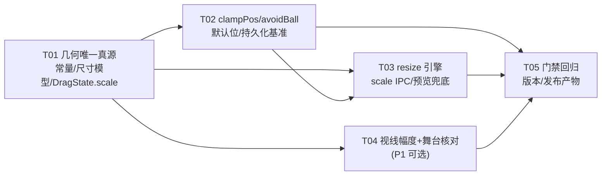

# 念语 Nianyu-Chat · 桌宠动态窗口尺寸架构设计（v3.0.11）

> 文档版本：v3.0.11-design-1　|　架构师：高见远（Bob）　|　基线：v3.0.10（package.json `3.0.10`）
> 性质：**只读研究 + 设计输出**。本轮不改任何源码；实现交由 Engineer 按第 7 节任务分解执行。
> 对应缺陷：用户把桌宠放大到较大尺寸（如 500%）后 ①角色头部被窗口顶部截断（只剩身体/腿，名字标签巨大）；②人物越大越拖不到画面边缘（"空气墙"）。

---

## 0. TL;DR（给决策者）

| 结论 | 内容 |
|---|---|
| 是否同根 | **主因同根**：窗口物理尺寸恒为 340×420，CSS `transform:scale()` 放大后溢出窗口被裁剪。**但"空气墙"还有一个独立的 clampPos 反转 bug**：当 `228×S > workArea.height`（1080p + S=5 即成立）时 `minY > maxY`，`Math.max(minY, Math.min(y,maxY))` 把 y 钳死为单一值，纵向拖拽完全失效。两个问题必须一起修。 |
| 推荐方案 | **方案 A：窗口尺寸随 scale 动态扩张 + 窗口原点补偿，保持角色脚点屏幕坐标不变**。改动集中在 `electron/desktopCharacter.ts`，不动舞台/3D/Live2D 渲染路径。 |
| 核心公式 | `w=max(340, ⌈190S+150⌉)`，`h=max(420, ⌈228S+192⌉)`；原点补偿 `nx=footX−w/2`，`ny=footY−(h−10)`，其中 `footX=old.x+oldW/2`、`footY=old.y+oldH−10`。 |
| 坐标基准 | **持久化 x/y 语义升级为"基准脚点空间"**：`foot=(x+170, y+410)` 恒定成立；`persistPos` 反写 `x=footX−170, y=footY−410`。这样 scale 变化只改窗口原点、**不改存储坐标**，零数据迁移、零双写、K6 门禁断言天然保留。 |
| clampPos | 公式形式不变，仅把 `DC_WIN_W/H` 换成 `winW/winH`；末尾用 `clampAxis()` 处理 `min>max`（物体大于工作区时**反转区间、让角色覆盖工作区**而非钳死）。 |
| 预览通道 | `dc:set-scale-live` **同步实时调窗口尺寸**（滑块 step=0.05，全程 ≤89 档，`setBounds` + 尺寸去重，性能可控），并加 3.1s 兜底定时器在无提交时恢复到落盘 scale 对应的尺寸。 |
| i18n | **不受影响**（无新增/改动文案，无新增用户可见字符串）。 |

---

## Part A · 系统设计

### 1. Implementation Approach（实现方案）

#### 1.1 核心难点

1. **CSS transform 的裁剪边界**：`transform: scale()` 不改变布局盒，渲染结果被 `BrowserWindow` 的 340×420 视口裁剪。放大后超出窗口的部分**物理上不可见**，任何"允许透明窗越界"的钳制策略都救不了被视口切掉的头像。
2. **锚点一致性**：`transform-origin: bottom center` ⇒ 角色脚点是所有几何变换的不动点。放大必须"以脚为钉"向上/左右扩展窗口，否则用户会看到角色跳位。
3. **多窗口 + 多 scale**：每个角色独立 scale，窗口尺寸必须按 id 各自计算；`clampPos` 现读 settings 取 scale，预览期读到的却是旧值，需要一个 per-window 的"有效 scale"缓存。
4. **坐标基准三套并存**：窗口原点（拖拽/持久化/getBounds）、角色脚点（几何锚点）、相对窗口的 DIP（光标广播）。改尺寸时只能改"原点 ← 脚点"这一层，其余两层必须保持自洽。
5. **预览高频**：舞台滑块实时推 scale，每帧 `setBounds` 有性能风险，需要去重与兜底恢复。
6. **门禁可读性**：`verify-desktop-character.mjs` 有大量逐字正则锁住 `clampPos`/`--dc-scale`/K6/I3 的具体代码形状，改造必须尽量保留这些字面量，只做最小必要同步。

#### 1.2 方案比选

**方案 A（推荐）：动态窗口尺寸 + 原点补偿**

- 窗口尺寸按角色当前 scale 计算，**保持角色脚点屏幕坐标恒定**。
- 放大时窗口顶部向上扩展、左右对称扩展；小时保持 340×420 不再收缩（保护气泡/菜单的固定像素布局）。
- 优点：改动集中在主进程一个文件；渲染层 CSS/舞台/3D/Live2D/命中/穿透全部零改动；I3 与 K20（高清渲染）断言不动。
- 缺点：窗口可能大于工作区（透明 + 穿透，无视觉副作用）；`setBounds` 需去重；需处理历史坐标语义（已用"基准脚点空间"无损解决）。

**方案 B（不推荐）：保持固定窗口，改用非 transform 渲染**

- 让 canvas / 舞台按最终像素直接渲染到 340×420 之外的布局：必须改 `.dc-character` 的 `width/height` 为 `calc(190px × scale)`、去掉 `transform: scale()`、同步改命中盒/气泡定位/`getBoundingClientRect`（视线跟随）/`resolutionScale` 与 K7/K20 的整套高清断言，并统一舞台与桌宠两套渲染路径。
- 风险：CSS `width/height` 变化会触发 React 重排 + WebGL canvas resize，抖动与显存开销比 `setBounds` 更大；I3 断言 `transform: translateX(-50%) scale(var(--dc-scale,1))` 直接失效；牵一发动全身。
- 结论：**仅在方案 A 在 macOS 多显示器 DPI 场景出现不可接受的跳变时，才作为备选重新评估**。

**采纳：方案 A。**

#### 1.3 架构模式

- 延续现有"主进程物理层 + 渲染层纯展示"分层。新增一个**纯函数几何层**（`winSizeForScale` / `clampScale` / `clampAxis` / `footOfStored`）作为唯一真源，被窗口创建、缩放、钳制、持久化共同复用，杜绝口径漂移（与项目既有 `bubbleTiming` / `lineSchedule` "唯一真源"惯例一致）。
- `DragState` 增加 `scale` 字段作为 per-window 有效 scale 缓存（预览期由主进程写入，钳制读取），解决"预览期 clampPos 读到旧落盘值"的问题。

---

### 2. File List（文件清单）

| # | 文件（相对路径） | 改动性质 | 预估行号区间 | 说明 |
|---|---|---|---|---|
| 1 | `electron/desktopCharacter.ts` | **主改** | `:39-56` 常量；`:101-119` DragState；`:199-243` 几何/钳制；`:176-197` avoidBall；`:330-343` persistPos；`:406-519` 创建/默认位/moved；`:926-958` 两个 scale IPC | 全部核心逻辑 |
| 2 | `scripts/verify-desktop-character.mjs` | 门禁同步 | `:566-580`（Bug2 段）、`:677-686`（I3 段）、`:964-994`（K6 段）、`:1641-1680`（v3.0.10 段），新增 K21 段于 `:1681` 前 | 新增动态尺寸/脚点不变/反转钳制/预览 resize 断言 |
| 3 | `硬编码清单.md` | 文档登记 | `:399-405` 附近追加 | 新增 `DC_PAD_X`/`DC_HEAD_TOP`/脚点基准/预览兜底等条目；改写 #249/#250 说明 |
| 4 | `src/types.ts` | 注释微调（可选） | `:635` | `DesktopCharacter.x/y` 注释补"基准脚点空间（foot−(170,410)）"语义。**无字段增删、无数据迁移** |
| 5 | `src/character/CharacterApp.tsx` | 微改（P1 可选） | `:652-666`（视线 divisor） | 仅把 `/170` 改成 `/(170 × scale)` 保持大缩放时视线幅度观感；`dc:scale-preview` 处理逻辑**无需改动** |
| 6 | `package.json` | 版本 | `:3` | `3.0.10` → `3.0.11`（由发布任务执行） |
| 7 | `版本更新记录.md` / `README.md` | 发布文案 | 追加 | 由发布任务执行 |
| 8 | `docs/dynamic-window-v3.0.11-design.md`（本文）、`docs/dynamic-window-v3.0.11-class.mermaid`、`docs/dynamic-window-v3.0.11-sequence.mermaid` | 新增 | — | 设计产物 |

> 明确**不改**：`src/components/CharacterStage.tsx`（预览通道契约不变）、`src/styles/character.css`（`transform` 与 I3 断言原样保留）、`electron/preload.ts` / `src/ipc.ts`（无新 IPC 通道）、`ThreeModelView.tsx` / `Live2DView.tsx`（K20 高清链路不变）。

---

### 3. Data Structures and Interfaces（数据结构与接口）

```mermaid
classDiagram
    class DragState {
        +number curX
        +number curY
        +number vx
        +number vy
        +number targetX
        +number targetY
        +number grabDX
        +number grabDY
        +boolean dragging
        +boolean inertia
        +number dragStartedAt
        +number watchdogCursorX
        +number watchdogCursorY
        +boolean wantInteractive
        +number scale  "新增：per-window 有效 scale（预览/落盘共用）"
    }

    class Geometry {
        <<pure functions / 唯一真源>>
        +number DC_WIN_BASE_W  "340（恒量，不再随 scale 变）"
        +number DC_WIN_BASE_H  "420"
        +number CHAR_BODY_W  "190"
        +number CHAR_BODY_H  "228"
        +number CHAR_BODY_BOTTOM_GAP  "10"
        +number DC_PAD_X  "75 = (340-190)/2"
        +number DC_HEAD_TOP  "182 = 420-10-228"
        +number DC_SCALE_MIN  "0.6"
        +number DC_SCALE_MAX  "5.0"
        +clampScale(s: number) number
        +winSizeForScale(s: number) WinSize
        +footFromStored(x: number, y: number) Point  "foot=(x+170, y+410)"
        +storedFromFoot(fx: number, fy: number) Point "x=fx-170, y=fy-410"
        +clampAxis(v, lo, hi) number  "min>max 时反转区间"
    }
    class WinSize {
        +number w
        +number h
    }
    class Point {
        +number x
        +number y
    }

    class WindowManager {
        +Map~string, BrowserWindow~ dcWindows
        +Map~string, DragState~ dragStates
        +createDesktopCharacter(id: string) void
        +clampPos(x: number, y: number, id?: string) Point
        +resizeCharacterWindow(id: string, scale: number) void
        +applyPos(id: string, x: number, y: number) void
        +persistPos(id: string) void
        +avoidBall(x, y, w, h) Point
        +onMoved(id: string) void
    }

    class IPCBridge {
        +dc:set-scale(id, scale) void
        +dc:set-scale-live(id, scale) void
        +dc:drag-start(gdx, gdy) void
        +dc:reposition(x, y) void
        +previewRestoreTimer: Map~string, Timeout~
    }

    class CharacterAppRenderer {
        +onDcScalePreview(d) void
        +onDcCursor({x,y}) void
        --dc-scale: CSS var
    }

    Geometry ..> WinSize : produces
    Geometry ..> Point : produces
    WindowManager --> Geometry : 尺寸/钳制/基准换算
    WindowManager *-- DragState : 每角色一个
    WindowManager --> BrowserWindow : setBounds / getBounds
    IPCBridge --> WindowManager : resizeCharacterWindow / clampPos
    IPCBridge --> CharacterAppRenderer : dc:scale-preview / dc:cursor
    CharacterAppRenderer --> WindowManager : dc:drag-start(gdx,gdy) / dc:reposition
```

#### 3.1 关键函数签名（新增/变更）

```ts
// ── 几何常量（全部保留为模块级 const，供门禁逐字断言） ──
export const DC_WIN_BASE_W = 340;   // 原 DC_WIN_W 更名保留语义：基准窗口宽（恒量）
export const DC_WIN_BASE_H = 420;   // 原 DC_WIN_H 更名保留语义：基准窗口高（恒量）
const CHAR_BODY_W = 190;
const CHAR_BODY_H = 228;
const CHAR_BODY_BOTTOM_GAP = 10;
const DC_PAD_X = (DC_WIN_BASE_W - CHAR_BODY_W) / 2;         // 75：角色左右留白
const DC_HEAD_TOP = DC_WIN_BASE_H - CHAR_BODY_BOTTOM_GAP - CHAR_BODY_H; // 182：头顶留白
const DC_SCALE_MIN = 0.6;
const DC_SCALE_MAX = 5.0;
/** 预览兜底：最后一次 live 后无 commit 则恢复落盘尺寸（略晚于 renderer 的 3000ms） */
const DC_PREVIEW_RESTORE_MS = 3100;

/** 有效 scale：优先 per-window 缓存（预览期已被写入），否则读 settings，否则 1。 */
function effectiveScale(id?: string): number;

/** scale 钳制（唯一真源，三处 IPC/渲染共用口径） */
function clampScale(s: number): number;

/** 窗口尺寸：S<=1 保持基准尺寸（保护气泡 286px / 菜单 168px 的固定像素布局）；S>1 随角色线性扩张。 */
function winSizeForScale(s: number): { w: number; h: number } {
  const k = clampScale(s);
  return {
    w: Math.max(DC_WIN_BASE_W, Math.ceil(CHAR_BODY_W * k + 2 * DC_PAD_X)),       // max(340, ⌈190S+150⌉)
    h: Math.max(DC_WIN_BASE_H, Math.ceil(CHAR_BODY_H * k + CHAR_BODY_BOTTOM_GAP + DC_HEAD_TOP)), // max(420, ⌈228S+192⌉)
  };
}

/** 历史/现行存储坐标 → 脚点。旧版窗口恒 340×420，故此换算对所有存量数据无条件成立。 */
function footFromStored(x: number, y: number): Point {
  return { x: x + DC_WIN_BASE_W / 2, y: y + DC_WIN_BASE_H - CHAR_BODY_BOTTOM_GAP }; // +170, +410
}
function storedFromFoot(fx: number, fy: number): Point {
  return { x: fx - DC_WIN_BASE_W / 2, y: fy - (DC_WIN_BASE_H - CHAR_BODY_BOTTOM_GAP) };
}

/** 反转安全的单轴钳制：lo<=hi 时把 v 夹在 [lo,hi]（角色完整在工作区内）；
 *  lo>hi 说明角色比工作区还大 ⇒ 改为夹在 [hi,lo]（让角色覆盖工作区），
 *  这样仍能贴边且保留整段可拖动行程，而不是被钳成单一值（"空气墙"根因）。 */
function clampAxis(v: number, lo: number, hi: number): number;

/** 保持角色脚点屏幕坐标不变地调整窗口尺寸（含原点补偿 + 反解钳制）。 */
function resizeCharacterWindow(id: string, scale: number): void;

/** 预览兜底：恢复某角色窗口到落盘 scale 对应尺寸。 */
function cancelPreviewRestore(id: string): void;
function schedulePreviewRestore(id: string): void;
```

---

### 4. Program Call Flow（程序调用流程）

```mermaid
sequenceDiagram
    autonumber
    participant R as CharacterApp（渲染层）
    participant S as CharacterStage（舞台）
    participant M as main.ts / preload
    participant D as desktopCharacter.ts（主进程物理层）
    participant W as BrowserWindow(角色窗)

    Note over D,W: ① 创建（按角色落盘 scale 直接建窗，脚点由存储坐标反解）
    D->>D: c = findChar(id); s = clampScale(c.scale)
    D->>D: {w,h} = winSizeForScale(s)
    D->>D: foot = footFromStored(c.x, c.y)  // (x+170, y+410)
    D->>D: origin = (foot.x - w/2, foot.y - (h-10))
    D->>D: avoidBall(origin, w, h) → clampPos(..., id)（st.scale=s 先写好）
    D->>W: new BrowserWindow({width:w, height:h, x, y, transparent,frame:false,...})
    D->>D: st.curX/st.curY = origin; st.scale = s

    Note over S,D: ② 舞台拖动滑块（实时预览，每档）
    S->>M: dcSetScaleLive(id, v)
    M->>D: ipcMain 'dc:set-scale-live'
    D->>D: s = clampScale(v); old = w.getBounds()
    D->>D: foot = (old.x+old.width/2, old.y+old.height-10)
    D->>D: {w,h} = winSizeForScale(s); nx=foot.x-w/2; ny=foot.y-(h-10)
    D->>D: c = clampPos(nx, ny, id)  // 读 st.scale（已在下方先写）
    D->>D: st.scale = s（先写，moved 事件用新值，幂等）
    D->>W: setBounds({x:c.x,y:c.y,width:w,height:h})（尺寸去重）
    D->>D: st.curX=c.x; st.curY=c.y; vx=vy=0
    D->>W: webContents.send('dc:scale-preview', {id, scale:s})
    D->>D: schedulePreviewRestore(id)  // 3.1s 无提交则回退落盘尺寸
    W->>R: setState(character.scale = s) → --dc-scale=s（角色与窗口同步放大，无截断）

    Note over S,D: ③ 手势结束提交（落盘一次）
    S->>M: dcSetScale(id, next)
    M->>D: ipcMain 'dc:set-scale'
    D->>D: cancelPreviewRestore(id)
    D->>D: next[idx] = {...next[idx], scale:clamped}; saveSettings  // x/y 不动（脚点未变）
    D->>D: resizeCharacterWindow(id, clamped)  // 尺寸通常与预览末帧相同→早退
    D->>W: sendState() → 广播 settings:changed

    Note over R,D: ④ 滚轮缩放（桌宠本体）
    R->>R: onCharacterWheel → next=clamp(0.6,5.0, cur±0.05)
    R->>M: dcSetScale(id, next)  （本地 state 先更新，跟手）
    M->>D: 同上 ③ 提交路径

    Note over R,D: ⑤ 拖拽（坐标基准不变）
    R->>M: dcDragStart(gdx,gdy)  // gdx=screenX-window.screenX（当前原点）
    M->>D: ipcMain 'dc:drag-start' → st.grabDX/gdy; st.curX=win.getBounds().x
    loop 60Hz
        D->>D: springStep: target=(光标−grabDX/grabDY); 积分子步
        D->>D: clampPos(curX,curY,id)（用当前尺寸+effectiveScale）
        D->>W: applyPos → setPosition(round(x),round(y))
    end
    R->>M: dcDragEnd → endDragState → persistPos
    D->>D: foot = (st.curX+w/2, st.curY+h-10); store = storedFromFoot(foot)
    D->>D: saveSettings(desktopCharacters[idx].x/y = store)  // 基准脚点空间

    Note over D,W: ⑥ 系统移动 / 多显示器（moved）
    W-->>D: 'moved' → c = clampPos(b.x,b.y,id)（动态尺寸）；setPosition 回钳
```

---

### 5. Anything UNCLEAR（待明确事项）

见第 9 节"风险与待明确事项"（含 macOS 多显示器 DPI、气泡与名字标签在高倍率下的观感、超工作区退化策略偏好等）。

---

## Part B · 任务分解

### 6. Required Packages（依赖）

**无新增第三方依赖**。全部使用现有栈：
- `electron@^32`（`BrowserWindow.setBounds/getBounds`、`screen.getPrimaryDisplay().workArea`）
- TypeScript / Vite / React 18（现有版本，见 `package.json`）
- Node 内置 `node:fs` / `node:path`（门禁脚本用）

---

### 7. Task List（按依赖排序，≤5 个任务）

#### T01 · 几何唯一真源与窗口尺寸模型（基础设施）

- **优先级**：P0　**依赖**：无
- **源文件**：
  - `electron/desktopCharacter.ts`（`:39-56` 常量区更名/新增；`:101-119` DragState 加 `scale`；`:148-208` 新增几何纯函数区）
  - `src/types.ts`（`:635` 注释补基准脚点语义，可选）
  - `硬编码清单.md`（追加 #296~#300 条目，改写 #249/#250）
- **交付**：定义 `DC_WIN_BASE_W/H`（保留 340/420 字面量供门禁）、`DC_PAD_X=75`、`DC_HEAD_TOP=182`、`DC_PREVIEW_RESTORE_MS=3100`、`clampScale`、`winSizeForScale`、`footFromStored`/`storedFromFoot`、`clampAxis`；`DragState.scale` 声明 + `getDragState` 初始化 `scale:1`。
- **验收**：`winSizeForScale(1)` 必须返回 `{340,420}`；`winSizeForScale(5)` 返回 `{1100,1332}`；`clampAxis(999, -182, -282)` 返回 `-182`（反转区间生效）。

#### T02 · clampPos / avoidBall / 默认位 / 持久化 的坐标基准改造

- **优先级**：P0　**依赖**：T01
- **源文件**：
  - `electron/desktopCharacter.ts`（`:176-197` avoidBall 接 `w,h`；`:209-243` clampPos 用 `winW/winH` + `clampAxis` + `effectiveScale`；`:330-343` persistPos 改"基准脚点空间"反写；`:424-440` 默认位用动态尺寸 + 脚点反解；`:508-518` moved 幂等适配）
  - `scripts/verify-desktop-character.mjs`（`:566-580` Bug2 段同步 + `:637-639` 可证伪用例同步）
  - `docs/dynamic-window-v3.0.11-class.mermaid`（本任务产出，已随设计文档给出）
- **关键签名**：`clampPos(x,y,id?)`（**保持三参签名不变**，门禁正则零改）、`avoidBall(x,y,w,h)`、`effectiveScale(id?)`、`persistPos(id)`。
- **验收**：`verify-desktop-character.mjs` Bug2 段全绿；S=5 在 1920×1080 工作区下 `clampPos` 的 y 返回区间端点为 `wa.y-182`/`wa.y-282`（可贴边），不再被钳成单值。

#### T03 · 窗口 resize 引擎与两个 scale IPC 适配（核心）

- **优先级**：P0　**依赖**：T01、T02
- **源文件**：
  - `electron/desktopCharacter.ts`（新增 `resizeCharacterWindow` 于 `:290` 附近；`:928-942` `dc:set-scale` 调 resize + 取消兜底；`:952-958` `dc:set-scale-live` 调 resize + 推预览 + 排兜底；新增 `schedulePreviewRestore`/`cancelPreviewRestore`；`:443-465` 创建窗口用 `winSizeForScale` 与脚点反解）
  - `scripts/verify-desktop-character.mjs`（`:964-994` K6 段补预览 resize 断言、`:1641-1680` 段补 5.0 尺寸断言）
  - `docs/dynamic-window-v3.0.11-sequence.mermaid`（本任务产出，已随设计文档给出）
- **关键顺序（必须）**：`st.scale = s` **先于** `clampPos` 与 `setBounds`（`moved` 事件会用新 scale 重钳，保证幂等）；`setBounds` 用**单次调用**避免"先变大再跳位"的中间帧；尺寸未变时早退（滑块去重）。
- **验收**：预览全程无截断；预览未提交 3.1s 后窗口回到落盘 scale 尺寸；K6 "预览通道不落盘/不广播"断言仍绿（`resizeCharacterWindow` 内不得出现 `saveSettings`）。

#### T04 · 渲染层视线幅度与舞台契约核对（P1）

- **优先级**：P1　**依赖**：T01
- **源文件**：
  - `src/character/CharacterApp.tsx`（`:652-666` 视线 divisor `/170` → `/(170*scale)`，effect 依赖加 `scale`；确认 `:363-385` 预览订阅无需改）
  - `src/components/CharacterStage.tsx`（只读核对：`dcSetScaleLive`/`dcSetScale` 契约不变，**不改代码**）
  - `scripts/verify-desktop-character.mjs`（`:677-686` I3 段确认仍绿；新增视线幅度断言）
- **验收**：5× 时眼睛不再"贴边不动"；I3/K20 断言全绿。

#### T05 · 门禁全量回归 + 版本与发布产物

- **优先级**：P0　**依赖**：T02、T03、T04
- **源文件**：
  - `scripts/verify-desktop-character.mjs`（新增 K21 段：动态尺寸/脚点不变/反转钳制/预览 resize/持久化基准 五组断言 + 可证伪用例）
  - `package.json`（版本 → `3.0.11`）
  - `版本更新记录.md`、`README.md`、`硬编码清单.md`（最终状态核对）
  - `docs/dynamic-window-v3.0.11-design.md`（回填实现差异，如有）
- **验收**：`node scripts/verify-desktop-character.mjs` 全绿；QA 按第 8 节清单人工回归。

---

### 8. Shared Knowledge（共享约定 / 门禁同步清单）

#### 8.1 新增/变更硬编码清单条目（写入 `硬编码清单.md`）

| 编号 | 位置 | 内容 | 状态 | 说明 |
|---|---|---|---|---|
| 296 | `desktopCharacter.ts` `DC_PAD_X` / `DC_HEAD_TOP` | 左右留白 **75**、头顶留白 **182**（=420−10−228） | ⚠️ 保留（新增） | 由基准 340×420 与 190×228/10 派生；放大时保证角色在窗内左右各留 75px、头顶留 182px，与 scale=1 观感一致；气泡 `bottom:246px` 与菜单 `right:6px` 的相对位置因此自动保持 |
| 297 | `desktopCharacter.ts` `winSizeForScale` | `w=max(340,⌈190S+150⌉)`、`h=max(420,⌈228S+192⌉)` | ⚠️ 保留（新增） | S≤1 不收缩（保护气泡 286px / 菜单 168px 固定像素布局）；S>1 线性扩张；**与 CSS `.dc-character` 190×228/bottom:10 严格同源，改 CSS 必须同步** |
| 298 | `desktopCharacter.ts` `footFromStored`/`storedFromFoot` | 存储坐标 = 脚点 −(170,410) | ⚠️ 保留（新增） | 旧版窗口恒 340×420，所以对全部存量数据 `foot=(x+170,y+410)` 无条件成立；scale 变化只改窗口原点不改存储 ⇒ **零迁移、零双写**。所有读写 `DesktopCharacter.x/y` 的代码必须走这两个函数 |
| 299 | `desktopCharacter.ts` `clampAxis` | `min>max` 时反转区间（覆盖工作区） | ⚠️ 保留（新增） | 角色大于工作区（1080p+S=5：228×5=1140>1040）时 `minY>maxY`，旧 `Math.max(min,Math.min(v,max))` 钳死 ⇒ 空气墙。反转后角色仍可贴边且保留完整拖动行程 |
| 300 | `desktopCharacter.ts` `DC_PREVIEW_RESTORE_MS` | 预览兜底 **3100ms** | ⚠️ 保留（新增） | 略晚于渲染层 3000ms 预览过期；舞台异常关闭未提交时让窗口尺寸回到落盘 scale（渲染层已回退，窗口必须同步回退） |

同时改写既有条目：
- **#249**（CHAR_BODY_W/H/10）：说明从"按可见区钳制"扩展为"可见区钳制 + 动态窗口尺寸 + 脚点锚点"。
- **#250**（DC_SCALE_MIN/MAX）：说明补充"同时驱动窗口尺寸 `winSizeForScale`，clampPos 读 per-window 有效 scale（预览期由主进程写入）"。

#### 8.2 `verify-desktop-character.mjs` 需同步/新增的断言

**必须保留、不应改动的既有断言**（改造时保证字面量不被破坏）：
- `:678-681` I3：`transform: translateX(-50%) scale(var(--dc-scale, 1))` 与 `dc-character` 上写 `--dc-scale` ⇒ **CSS 与 CharacterApp 渲染段不动**。
- `:568-572` Bug2 的三行字面量：`const halfW = (CHAR_BODY_W * scale) / 2`、`const minX = wa.x - (centerX - halfW)`、`const minY = wa.y - (bodyBottom - bodyH)` ⇒ 新 clampPos **保留这三行原样**，只把 `centerX`/`bodyBottom` 的来源改为 `winW/2`/`winH−GAP`。
- `:573-578` 五处 `clampPos(..., id)` 调用 ⇒ **保持三参签名**，不新增实参。
- `:637-639` 可证伪用例把 `const minY = wa.y - (bodyBottom - bodyH);` 替换为 `const minY = wa.y;` ⇒ 保留该行即可继续生效。
- `:979-981` K6"预览通道不落盘/不广播" ⇒ `dc:set-scale-live` 处理块 400 字符内**不得出现 `saveSettings`**；`webContents.send('dc:scale-preview', ...)` 紧随其后。
- `:1641-1645` v3.0.10 上限 5.0 三处一致 ⇒ 保留 `DC_SCALE_MAX = 5.0`、`Math.max(0.6, Math.min(DC_SCALE_MAX, ...))` 字面量。

**需要同步的既有断言**：
- `:568` 新增 `DC_WIN_BASE_W = 340` / `DC_WIN_BASE_H = 420` 的存在性断言（原断言用 `CHAR_BODY_*` 即可，不必改，但建议显式锁基准常量）。
- `:580` `avoidBall(x, y)` → `avoidBall(x, y, w, h)`，正则 `/const avoided = avoidBall\(x, y\);[\s\S]{0,80}clampPos\(avoided\.x, avoided\.y, id\)/` 需放开为 `/avoidBall\(avoided[^;]*clampPos\(avoided\.x, avoided\.y, id\)/` 之类（**唯一必须改形状的旧断言**）。
- `:971-978` K6 预览通道断言：`dc:set-scale-live` 块内新增 `resizeCharacterWindow` 调用断言，**不得**因此引入 `saveSettings`。

**建议新增断言（K21 段）**：
```js
check('K21 窗口尺寸随 scale 扩张且 S<=1 不收缩（脚点锚定公式唯一真源）',
  /DC_WIN_BASE_W\s*=\s*340/.test(mainDc) && /DC_WIN_BASE_H\s*=\s*420/.test(mainDc) &&
  /DC_PAD_X\s*=\s*\(DC_WIN_BASE_W - CHAR_BODY_W\) \/ 2/.test(mainDc) &&
  /DC_HEAD_TOP\s*=\s*DC_WIN_BASE_H - CHAR_BODY_BOTTOM_GAP - CHAR_BODY_H/.test(mainDc) &&
  /w: Math\.max\(DC_WIN_BASE_W, Math\.ceil\(CHAR_BODY_W \* k \+ 2 \* DC_PAD_X\)\)/.test(mainDc) &&
  /h: Math\.max\(DC_WIN_BASE_H, Math\.ceil\(CHAR_BODY_H \* k \+ CHAR_BODY_BOTTOM_GAP \+ DC_HEAD_TOP\)\)/.test(mainDc));
check('K21 脚点屏幕坐标不变：原点补偿 = 脚点 − 新半宽/新底距（单次 setBounds 原子）',
  /footX = old\.x \+ old\.width \/ 2/.test(mainDc) &&
  /footY = old\.y \+ old\.height - CHAR_BODY_BOTTOM_GAP/.test(mainDc) &&
  /setBounds\(\{[\s\S]{0,200}width: w, height: h[\s\S]{0,80}\}\)/.test(mainDc));
check('K21 clampAxis 在 min>max 时反转区间（角色大于工作区仍可贴边，无空气墙）',
  /function clampAxis\(v: number, lo: number, hi: number\)/.test(mainDc) &&
  /if \(lo <= hi\) return Math\.max\(lo, Math\.min\(v, hi\)\)/.test(mainDc) &&
  /return Math\.max\(hi, Math\.min\(v, lo\)\)/.test(mainDc));
check('K21 持久化走基准脚点空间（x=fx−170, y=fy−410），零数据迁移',
  /footFromStored/.test(mainDc) && /storedFromFoot/.test(mainDc) &&
  /x: fx - DC_WIN_BASE_W \/ 2/.test(mainDc) &&
  /y: fy - \(DC_WIN_BASE_H - CHAR_BODY_BOTTOM_GAP\)/.test(mainDc));
check('K21 预览通道 live 调窗口尺寸 + 3.1s 兜底恢复，但不落盘',
  /dc:set-scale-live[\s\S]{0,300}resizeCharacterWindow/.test(mainDc) &&
  /DC_PREVIEW_RESTORE_MS\s*=\s*3100/.test(mainDc) &&
  /schedulePreviewRestore/.test(mainDc) &&
  !/dc:set-scale-live[\s\S]{0,400}saveSettings/.test(mainDc));
// 可证伪：把 clampAxis 反转分支删掉 ⇒ 空气墙回归，K21 必红
{
  const broken = mainDc.replace('if (lo <= hi) return Math.max(lo, Math.min(v, hi));', '');
  check('（可证伪）删除 clampAxis 反转兜底后 K21 断言失效',
    broken !== mainDc && !/if \(lo <= hi\) return Math\.max\(lo, Math\.min\(v, hi\)\)/.test(broken));
}
```

#### 8.3 其他跨模块约定

- **`--dc-scale` 只能写在 `.dc-character` 自身**（I3 铁律），缩放变量不下放到 `.dc-stage`；窗口尺寸由主进程独立管理，二者通过同一 scale 值保持同步。
- **`st.scale` 先写后 setBounds**：`moved` 事件在 `setBounds` 后触发，必须用新 scale 重钳，否则会把窗口弹回旧位。
- **`dc:drag-start` 的 gdx/gdy 语义不变**：`e.screenX − window.screenX`（当前窗口原点），动态尺寸后自动正确；`springStep` 的 `target = 光标 − grabD` 不需要改。
- **光标广播不需要改**：`{x: p.x−b.x, y: p.y−b.y}` 随 `getBounds()` 自动跟踪新原点；渲染层 `getBoundingClientRect()` 拿到的也是新布局下的角色中心，二者同处窗口局部 DIP 空间。
- **位置持久化唯一入口**：所有写 `DesktopCharacter.x/y` 的地方必须走 `storedFromFoot`（创建/拖拽惯性落盘/面板重定位均经 `persistPos`）；禁止直接写 `st.curX/curY` 到 settings。
- **i18n**：无新增用户可见文案、无新增语言键；`src/i18n/*` 零改动，`verify-i18n*` 系列门禁不受影响。

---

### 9. 风险与待明确事项

| # | 风险/待明确 | 影响 | 建议 |
|---|---|---|---|
| R1 | **macOS 多显示器 DPI 跳变**：`setBounds` 在显示器间移动时 DIP↔物理像素换算可能导致脚点偏移几像素 | 中 | 本轮先只承诺 Windows（截图反馈环境）；在 `moved` 事件里做二次 `clampPos`（已有）并保留 `st.scale`。macOS 需 QA 实机验证后再定是否补偿 |
| R2 | **超大窗口 > 工作区**：S=5 时窗口 1100×1332，1080p 下高于工作区；透明+穿透无视觉副作用，但 `clampAxis` 反转后角色可"头贴顶/脚出屏" | 中 | 属预期退化（角色 1140px 本就放不进 1040px 工作区）；反转策略保证"头能贴顶"这一用户最关心的边界。**待明确**：是否改为等比缩小到刚好放得下（会破坏 500% 语义，不建议） |
| R3 | **气泡与名字标签在高倍率下的观感**：`.dc-name` 是 `.dc-character` 子元素，随 scale 放大 ⇒ "名字标签巨大"（截图已见）；`.dc-bubble` 是兄弟元素、不缩放，固定在脚上 236px，S=5 时会落在角色躯干中部 | 低（非本次两 Bug） | 本轮不动（避免碰 I3）。如后续要修：名字标签加反向 `scale(calc(1/var(--dc-scale)))`、气泡 `bottom` 改为 `calc(228px * var(--dc-scale) + 18px)`，需新开需求并重跑门禁 |
| R4 | **预览期 setBounds 频率**：滑块 step=0.05、全程 89 档，`Math.ceil` 尺寸去重后每档最多一次 `setBounds` | 低 | 已用"尺寸未变早退"去重；若实测掉帧，再加 16ms 节流（与 TICK_MS 同量级） |
| R5 | **历史坐标的可靠性**：断言"所有旧版本窗口恒 340×420"——需确认 v3 之前桌面角色没有其它窗口尺寸版本 | 低 | 已核对 `desktopCharacter.ts` 历史常量与 `硬编码清单.md` #249/#250，确认恒为 340×420；若存在例外，`footFromStored` 加版本判别字段兜底 |
| R6 | **clampPos 三参签名门禁**：新增 scale 语义若改签名会连带打断 `:573-578` 五处断言 | 低 | 设计上**坚持三参**，通过 `effectiveScale(id)` 内部读取；已写入 8.2 共享约定 |
| R7 | **窗口放大后右键菜单/气泡位置**：因窗口按 190S+150 / 228S+192 扩张，角色右缘恒距窗右 75px、气泡恒距脚 236px ⇒ 相对角色的位置**自动保持** | — | 无需改 CSS；QA 需在 S=1/2/5 三档实机确认 |

#### 待主理人拍板
1. R2 的超大工作区退化策略（推荐维持"反转覆盖"+"头贴顶"）。
2. T04 视线幅度 `/(170×S)` 是否纳入本版（P1，可延后）；不影响两大 Bug 修复。
3. 版本号 `3.0.11` 与发版文案由主理人确认后交由发布任务执行。

---

### 10. Task Dependency Graph



---

## 附录 A · 关键公式速查（实现时直接抄）

```
常量：W0=340, H0=420, BW=190, BH=228, GAP=10
      PADX=(W0-BW)/2=75, HEAD=H0-GAP-BH=182

尺寸：w(S)=max(W0, ceil(BW*S + 2*PADX))          // max(340, ⌈190S+150⌉)
      h(S)=max(H0, ceil(BH*S + GAP + HEAD))       // max(420, ⌈228S+192⌉)
      S=1 → 340×420; S=2 → 530×648; S=5 → 1100×1332

脚点：footLocal=(w/2, h-GAP)                       // 相对窗口左上角
      footScreen=(origin.x+w/2, origin.y+h-GAP)

原点补偿（scale 变化）：
      footX=old.x+old.width/2;  footY=old.y+old.height-GAP
      nx=footX-w/2;             ny=footY-(h-GAP)
      // 展开：nx = old.x - (w-old.width)/2 ; ny = old.y - (h-old.height)
      // S:1→5 时 dX=-380, dY=-912（窗口向左扩 380、向上扩 912，脚钉死）

存储基准（零迁移）：
      foot=(stored.x+170, stored.y+410)           // 无条件成立（旧窗恒 340×420）
      stored=(foot.x-170, foot.y-410)

clampPos（保持三参签名；centerX=w/2, bodyBottom=h-GAP）：
      halfW=BW*S/2; bodyH=BH*S
      minX=wa.x-(centerX-halfW); maxX=wa.x+wa.width-(centerX+halfW)
      minY=wa.y-(bodyBottom-bodyH); maxY=wa.y+wa.height-bodyBottom
      x=clampAxis(x,minX,maxX);  y=clampAxis(y,minY,maxY)

clampAxis：
      lo<=hi ? max(lo,min(v,hi))    // 角色装得下：完整落在工作区
             : max(hi,min(v,lo))    // 角色更大：反转区间、覆盖工作区（可贴边、有行程）

反转阈值：190S>wa.width（X）或 228S>wa.height（Y）
      1080p+S=5：1140>1040 ⇒ Y 反转（旧代码在此钳死 = 空气墙）
```

---

## 附录 B · 实现回填（Engineer 寇豆码，v3.0.11）

> 本节由实现阶段回填，记录与主理人拍板 / 实际代码的一致性及与本文原始计划的差异。设计正文不改。

| 项 | 回填说明 |
|---|---|
| 主理人拍板 1（方案 A + 单次 setBounds） | ✅ `resizeCharacterWindow()` 一次 `setBounds({x,y,width,height})`；行为级验证实测 S:1→5 dX=−380 / dY=−912，脚点 (1170,1910) 五档不变。 |
| 主理人拍板 2（反转覆盖 + 头贴顶） | ✅ `clampAxis(lo>hi)` 反转；1080p+S=5 实测 yTop=−182（头贴顶）/ yBottom=−282（脚贴工作区底），两端均可贴边。 |
| 主理人拍板 3（视线 divisor 纳入本版） | ✅ **与本文 T04 有差异**：主理人要求 `CharacterApp.tsx` **与 `CharacterStage.tsx` 同改**，故舞台也由 `/STAGE_EYE_DIVISOR` 改为 `/(STAGE_EYE_DIVISOR * zoom)`，effect 依赖加 `zoom`。`dc:scale-preview` 契约未动。 |
| 主理人拍板 4（不 bump 版本） | ✅ `package.json` 保持 `3.0.10`，`版本更新记录.md` 零改动。 |
| 硬编码清单编号 | 本文 8.1 建议 #296~#300，但清单已有 #296（MAX_PIXEL_RATIO），实际落为 **#297~#302**（含新增视线除数条目 #302），并改写 #249/#250。 |
| 新增文件 | 新增 `scripts/verify-dynamic-window-behavior.mjs`：把本文几何段用 `typescript.transpileModule` 在 vm 沙箱实跑（非正则门禁），25 条行为断言覆盖四边余量/脚点补偿/dX-dY/反转钳制/视线转角恒定。未接入 package.json（避免触碰版本文件）。 |
| 小硬化 | ① `moved` 事件用 `Math.round(c.x)!==b.x` 比较，避免分数端点反复 `setPosition`；② 预览兜底 timer 在 `closed` / `destroyDesktopCharacter` 中清理；③ `dc:set-scale` 提交路径把 `resizeCharacterWindow` 放在 `settingsSink` 广播之前，消除滚轮直改时的短暂截断帧。三者均不改变设计语义。 |
| 门禁同步 | Bug2 `avoidBall` 断言同步为四参；K6 增「预览 resize 且不落盘」；新增 K21 六组断言 + 5 个可证伪用例（反转分支 / 固定高度 / 固定除数 / 直写原点 / 整数 getBounds 回读）。`verify-desktop-character.mjs` 共 410 条全绿。 |
| **QA P1 修复（缩放往返脚点漂移）** | QA 复测发现原 `resizeCharacterWindow` 用 `win.getBounds()` 的**取整原点**反解脚点，0.5px 被固化成 1px，步长 0.05 滑块往返 3 轮实测 +120px（存储 x 同步漂移）。已改为从**未取整逻辑原点 `st.curX/curY` + 逻辑旧尺寸 `winSizeForScale(st.scale)`** 反解脚点，并在 `resize` 内禁止回读 `getBounds()`（K21 门禁锁死）；`dc:drag-start` 同步改为仅当差异 >0.5px（真实外部移动）才用整数回读覆盖逻辑原点。行为脚本新增第 5 段模拟 Electron `setBounds` 取整 / `getBounds` 回读闭环，3 轮 1→5→1 后逻辑脚点 (1170,1910) 与 stored (1000,1500) 均零漂移，物理误差 ≤0.5px。行为断言 29 条全绿。 |
| **QA Round 2 修复（moved 事件回灌闭环）** | 首轮修复只堵住 `resizeCharacterWindow`，但 Electron 在 `setBounds` 取整后会发 `moved`，处理器无条件 `stt.curX = c.x` 把整数原点重新灌回逻辑坐标，下一轮 resize 又从整数反解脚点 ⇒ 漂移闭环复活（QA 实测三轮仍 +120px、stored x=1120）。已在 `win.on('moved')` 加「真实外部移动」守卫：仅当 `Math.abs(b.x − stt.curX) > 0.5`（或 Y 轴）才回灌，≤0.5px 的 resize 回响保留未取整逻辑原点；真实外部移动被 clampPos 修正时仍回灌修正值。behavior 脚本的 fake win 改为**延迟到 resize 返回后才 flush moved**（Electron 真实时序），否则同步触发会被 `resize` 末尾的 `st.curX=c.x` 覆盖而假绿。K21 新增 moved 守卫断言 + 第 6 个可证伪用例。变异自证：去掉守卫后 3 轮 foot=1290/stored=1120（与 QA 一致），修复后逐轮 foot=(1170,1910)/stored=(1000,1500)。 |
| QA 另三项（team-lead 拍板：不返工） | ① **P2-1 反转钳制脚点跳变**：QA 实测上半部起始最大 840px（此前 34px 为严重低估）。角色本体 1140px > 工作区 1040px 是物理限制，反转策略保证「头贴顶」是正确取舍，**接受为设计权衡、不返工**，也不改成 `lo>hi` 返回 `v`（那会切掉头、违背用户核心诉求）。发版文案须如实写明「投影超出工作区时角色会整体上移以保证头部可见」（由发布任务写入版本记录，本轮不改 `版本更新记录.md`）。② **P2-2 气泡重叠**：`.dc-bubble{bottom:246px}` 固定像素，S>1.5 可能与放大后的角色重叠，属已知观感限制；**只更正文案、不动气泡 CSS**（避免扩大范围破 I3），硬编码清单 #297 已改为事实描述。③ **P2-3 门禁硬化**：behavior shim 的 340/420 改为从源码抽取；K6/K21 中 `extractFnBody` 结果加非空守卫，堵住「空串恒真」假阳性。 |
