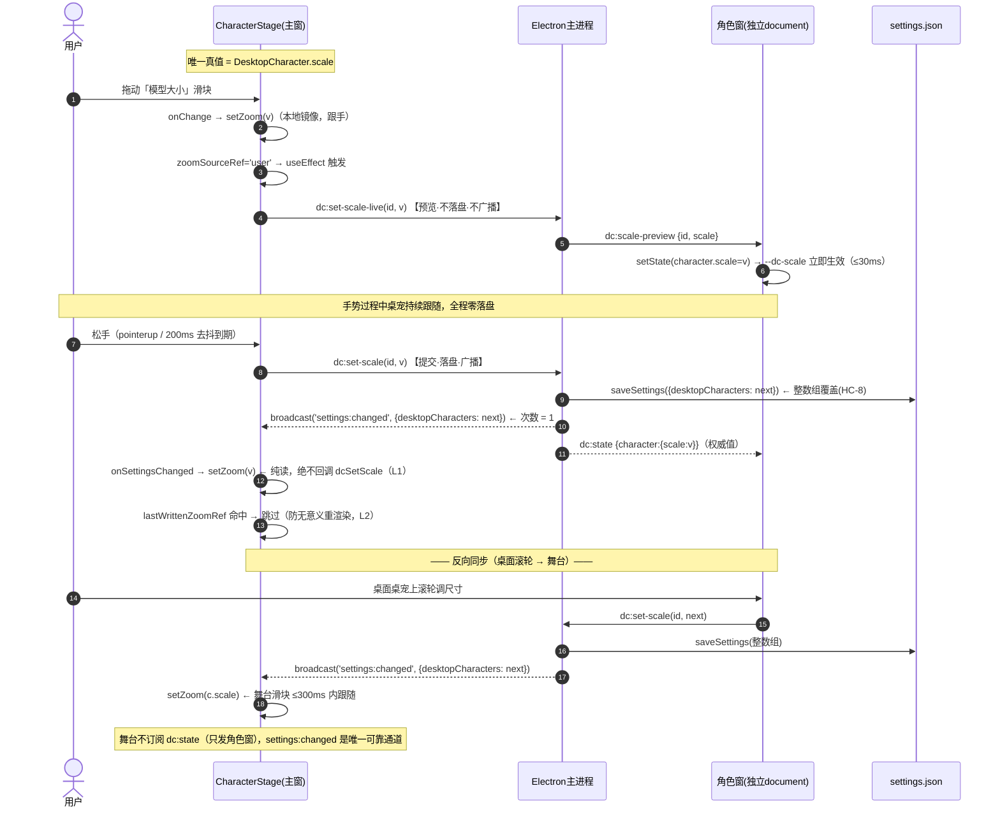
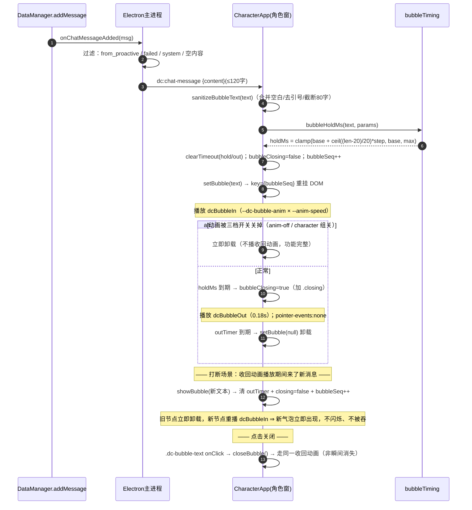
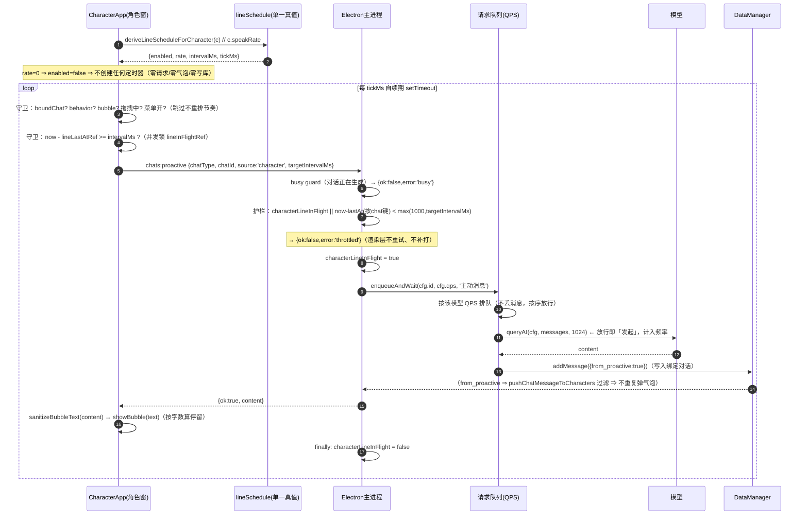
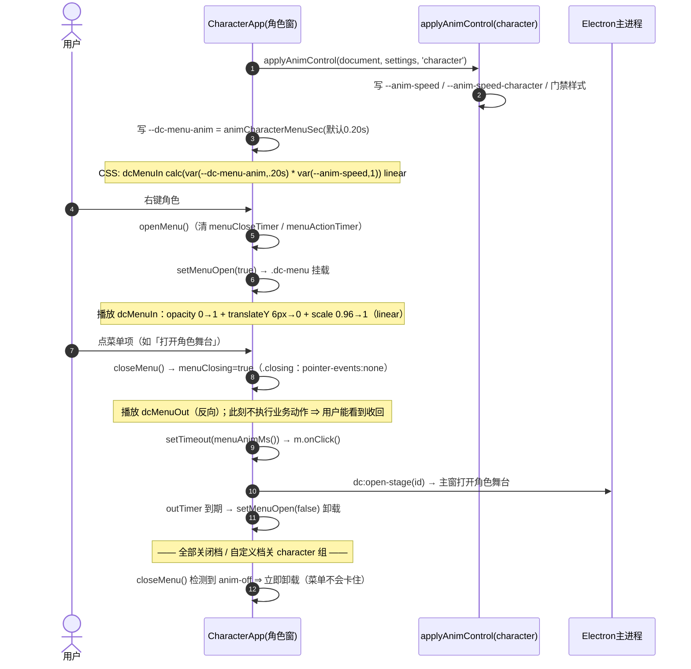
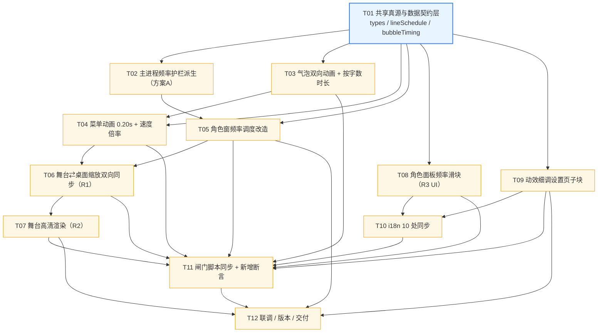

# 念语（Nianyu-Chat）桌宠体验增量 v3.0.3 —— 系统架构设计与任务分解

> 架构师：高见远 ｜ 基线：v3.0.2（已发布）→ 本轮：v3.0.3
> 唯一需求依据：`docs/pet-v3.0.3-prd.md`（以 **§12 用户拍板结论** 为最高口径）
> 技术栈：Electron 32 + React 18 + TypeScript 5.6 + Vite 5 · 目标平台：Windows 桌面
> 本文只做设计，**不含任何源码改动**。

---

## 0. 结论摘要（给工程师的 30 秒版）

| 需求 | 一句话方案 | 落点 |
|---|---|---|
| R1 舞台⇄桌面缩放同步 | **唯一真值 = `DesktopCharacter.scale`**；舞台滑块 = 真实尺寸（0.6~1.6/0.05）；舞台用「手势内 live 预览 + 手势末提交」把 `settings:changed` 广播压到 **1 次/手势** | `CharacterStage.tsx` / `desktopCharacter.ts` / `CharacterApp.tsx` |
| R2 舞台高清 | **去掉 `transform: scale()` 与 `will-change: transform`**，改「按 zoom 放大 `.stage-model` 布局盒子」→ 浏览器按最终尺寸重采样；3D/Live2D 靠画布变大 + 渲染分辨率随 zoom 提升 | `character-panel.css` / `CharacterStage.tsx` / `ThreeModelView.tsx` / `Live2DView.tsx` |
| R3 频率 0~60 | 单一真值函数 `deriveLineSchedule(n)`（渲染层 + 主进程**共用同一份**）；主进程护栏改为**按角色派生**（下限 1000ms）；`DesktopCharacter.speakRate` | `src/utils/lineSchedule.ts` / `main.ts` / `CharacterApp.tsx` / `CharacterCollection.tsx` |
| R4 菜单动画 | 时长 0.14s→**0.20s**、幅度加 `scale 0.96→1`、保持 linear；CSS 改用 `var(--dc-menu-anim)` + `var(--anim-speed)`；JS 侧 `DC_MENU_ANIM_MS` 常量删除，改 `menuAnimMs()` 派生；点菜单项**先播收回再执行业务动作** | `character.css` / `CharacterApp.tsx` |
| R5 气泡缩回 | 复用菜单的 `closing` 状态机范式：`显示 → 停留 → .closing 播 dcBubbleOut → 卸载`；`key={seq}` 保证新气泡打断旧气泡时动画重播不闪烁 | `CharacterApp.tsx` / `character.css` |
| R6 气泡按字数 | `bubbleHoldSeconds(len, params)`；参数 3/1/10 全开放；**公式用 `ceil`（与 PRD 分档表一致）**，PRD 正文里的 `floor` 与分档表冲突，按分档表执行并登记偏差 | `src/utils/bubbleTiming.ts` / `CharacterApp.tsx` / `Settings.tsx` |

**三个必须写进实现说明的实证结论**（PRD §7.1 交付物）：
1. **R3 主进程护栏选型**：采用**方案 A**（IPC 携带 `targetIntervalMs`），主进程只做「不得高于渲染层派生值」的兜底。
2. **R4 菜单动画"看不到"的四原因排查结论**：见 §1.4.4，**主因是③（0.14s linear + 4px 位移、无缩放 → 幅度太弱）**，**④（点菜单项时业务动作盖过收回）是"收回看不到"的次因**，①默认不成立（出厂 `animMode='all-on'`），②需按用户系统环境排查。
3. **R6 公式口径偏差**：PRD R6-AC3 / §12.5 的 `floor` 与 R6-AC2 分档表 + §7.2 F1 冲突，本轮以**分档表**为准（`ceil`）。

---

# 第一部分 · 系统设计

## 1. 实现方案（R1 ~ R6 逐条落地）

### 1.0 全局设计约束（先于各条需求）

**C-1 三层「同源」铁律（本轮所有时长的唯一正确做法）**

```
设置里的"基准秒数"（唯一真值）
        │
        ├─► 渲染层写 CSS 变量：--dc-menu-anim / --dc-bubble-anim （写在角色窗 documentElement）
        │        └─► CSS: animation: dcMenuIn calc(var(--dc-menu-anim, 0.20s) * var(--anim-speed, 1)) linear
        │
        └─► JS 侧算卸载等待：base * 1000 * getGroupAnimSpeed(settings, 'character')
                 └─► 与 CSS 用的是**同一个倍率**（见 C-2），绝不各算各的
```

**C-2 倍率必须用 `getGroupAnimSpeed(settings, 'character')`，不能用 `readAnimSpeed(document)`**

- `applyAnimControl` 会写 `--anim-speed`（全局）与 `--anim-speed-character`（分组）两个变量；
- `buildSpeedCss` 生成的规则 `html[data-anim-pergroup="1"] .dc-menu { --anim-speed: var(--anim-speed-character, var(--anim-speed,1)) }` **只在自定义档**生效；非自定义档 `.dc-menu` 直接继承 documentElement 上的全局 `--anim-speed`；
- `getGroupAnimSpeed()` 的规则与之一一对应（非自定义档返回全局、自定义档返回分组）→ **两侧天然一致**；
- 若用 `readAnimSpeed(document)`，自定义档下会读到**全局倍率**而 CSS 用的是**分组倍率** → 速度调快/调慢时必然出现「闪一下消失 / 卡住不消失」。**这是本轮最容易踩的坑。**

**C-3 门禁入口不变**
角色窗是独立 document，动画门控唯一入口仍是 `applyAnimControl(document, settings, 'character')`（现状已正确）。新增的 `.dc-bubble.closing` **不新增分组**，靠 `.dc-bubble` 已被 `docSelectors.character` 登记 + 显式补登 `.dc-bubble.closing` 双保险。

**C-4 新增动画一律可被三档开关杀掉**
`dcBubbleOut` 挂在 `.dc-bubble.closing` 上 → 命中 `html.anim-off .dc-bubble` 与 `html[data-anim-off~='character'] .dc-bubble` 两条兜底规则（`character.css` 自带，不依赖 `index.css`）。

---

### 1.1 R1 — 舞台 ⇄ 桌面 scale 双向同步

#### 1.1.1 真值与数据模型

**唯一真值：`settings.desktopCharacters[i].scale`**（float，钳制 0.6~1.6，步长 0.05）。

> **决策：舞台 zoom 与角色 scale 是「同一份数据」，不是两份。**
> 理由：① PRD R1-AC1 要求两者区间完全一致，两份数据必然漂移（这正是 v3.0.2 的 bug 根因）；② R1-AC7 要求舞台重开后显示保存值；③ 桌面滚轮已经会改 `scale`，若舞台另存一份就会出现「舞台 140% / 桌面 160%」的静默不一致（PRD 明确禁止）。
> 舞台只保留一份**本地镜像 state**（`zoom`，用于拖动跟手），任何外部变化都会把镜像重新对齐到真值。
> 旋转（`rotX/rotY`）**保持舞台本地态**，绝不写回（R1-AC8）。

#### 1.1.2 舞台 → 桌面（写路径）

```
用户拖动舞台滑块
  ├─ onChange → setZoom(v)                    // 组件本地镜像，立即跟手
  ├─ useEffect([zoom]) 判定「本次变化来自用户手势」→ 
  │    ├─ api.dcSetScaleLive(id, v)           // ① 预览：只改桌宠窗本地 --dc-scale，不落盘、不广播
  │    └─ scheduleCommit(v)                   // ② 提交：200ms trailing 去抖 + pointerup/keyup 立即提交
  └─ 提交到达 api.dcSetScale(id, v)
       → 主进程 dc:set-scale
         → 钳制 0.6~1.6
         → dm.saveSettings({ desktopCharacters: next })   // 整数组覆盖（HC-8）
         → settingsSink({ desktopCharacters: next })        // ⇒ broadcast('settings:changed') × 1
         → sendState()                                       // ⇒ dc:state 推给各角色窗（权威值）
```

**为什么要拆成「预览 + 提交」两条通道（关键取舍）**

| 方案 | `settings:changed` 广播次数 | 桌宠跟随延迟 | 评价 |
|---|---|---|---|
| 每次 change 都 `dc:set-scale` | 拖一次 = N 次（连续拖动） | ≤30ms | ❌ A5「同一轮操作内只 1 次」不成立 |
| 每次 change 都 `dc:set-scale` + 180ms 去抖提交 | 拖一次 = 1 次，但**桌宠在拖动过程中不跟随**（尾随去抖一直推迟） | 停手后 ~200ms | ❌ R1-AC2「实时跟随」不成立 |
| **预览通道 + 手势末提交（采用）** | **1 次/手势** | **≤30ms 全程跟随** | ✅ 同时满足 A2 与 A5 |

- **预览通道是纯视觉、纯内存**：`dc:set-scale-live`（渲染层→主进程，`send`）→ 主进程按 id 找到角色窗 → `dc:scale-preview`（主进程→角色窗）→ 角色窗只改本地 `state.character.scale`（不落盘、不广播）。
- **提交通道复用既有 `dc:set-scale`**：落盘 + 广播 + `dc:state` 全部沿用现状语义，**不新增落盘路径**（HC-8 天然满足）。
- 预览期间若用户滚轮操作桌宠：滚轮用的是角色窗**本地** `scale`（已被预览更新），以本地为准继续走滚轮自己的提交路径，最后提交值即最终真值 ✅。

#### 1.1.3 桌面 → 舞台（读路径，反向同步）

```
桌面滚轮调尺寸
  → api.dcSetScale(id, next) → 主进程落盘 + broadcast('settings:changed', { desktopCharacters: next })
  → 主窗（舞台所在窗口）收到 settings:changed
  → CharacterStage 的 onSettingsChanged 订阅：按 id 找到角色 → setZoom(c.scale)   // 纯读，绝不回调 dcSetScale
```

- 舞台**不订阅 `dc:state`**（`sendState()` 只发给 `dcWindows` 里的角色窗，主窗收不到），所以反向同步的**唯一可靠通道是 `settings:changed`**。
- 时延：主进程落盘 + 广播是同步的，`<300ms` 轻松满足（R1-AC4）。
- 舞台初次打开时用 `api.dcGetState(character.id)` 拉一次权威值（props 里的 `character` 可能是打开时的旧快照）。

#### 1.1.4 回环防护（三重保险）

| # | 规则 | 实现 |
|---|---|---|
| L1 | **写只发生在用户手势里** | `onSettingsChanged` / `dc:state` 的处理函数**只 `setZoom`，不调任何写接口**（代码评审红线） |
| L2 | **回声抑制** | `lastWrittenZoomRef` 记录最后一次提交值；收到广播值与它相等（±1e-6）时**跳过 `setZoom`**（避免无意义重渲染与二次写） |
| L3 | **一次手势一次广播** | 预览通道承载手势内的中间值；提交只在手势末发生一次 ⇒ 广播次数 = 1（A5） |

> **不使用 `useEffect([zoom])` 做「反向写回」**的常见陷阱：必须用 `zoomSourceRef`（`'user' | 'external'`）区分来源，否则收到广播 → `setZoom` → effect 又触发写 → 死循环。实现上：`onPointerDown` / `onKeyDown` 置 `'user'`，`useEffect` 读标记后立即复位为 `'external'`。

#### 1.1.5 范围与语义变更（Q1）

- `STAGE_ZOOM_MAX`：1.9 → **1.6**；`STAGE_ZOOM_MIN` 保持 0.6；步长保持 0.05。**1.9 档位彻底删除**（不保留、不钳制、不提示）。
- 舞台 zoom 语义从「视口内放大」改为「**角色真实大小**」→ 必须与 R2 联动（盒子真的变大），否则 160% 时舞台里角色只占原来那一小块，与桌面观感不符。

---

### 1.2 R2 — 舞台高清渲染（消除 CSS 插值模糊）

#### 1.2.1 模糊根因（代码级定位）

| # | 根因 | 证据 |
|---|---|---|
| B1 | `.stage-model` 固定 190×220，`` 以 `object-fit: contain` 铺满 → 素材先按 190×220 栅格化，再被 `transform: scale(zoom)` 放大 | `character-panel.css:240-252`、`CharacterStage.tsx:170` |
| B2 | `.stage-model` 有 `will-change: transform` → 浏览器把它提升为**独立合成层**，按 1× 栅格化成纹理后由合成器缩放 → **必然插值**（Chromium 对合成层的 raster scale 有上限，`scale(1.6)` 不会按 1.6× 重栅格） | `character-panel.css:245` |
| B3 | 桌面上桌宠清晰的原因：`.dc-character` **没有** `will-change`，其 `transform: translateX(-50%) scale(var(--dc-scale))` 是在**绘制期**施加的 → Chromium 按变换后的比例直接采样素材，等效于"按 1.6× 取样"，所以桌面上不糊 | `character.css:39-51` |
| B4 | 3D/Live2D 画布固定 190×220、`pixelRatio/resolution` 固定在 `min(2, dpr)` → 舞台放大时只是把一张 1× 截图放大 | `ThreeModelView.tsx:167,191`、`Live2DView.tsx:109,134` |

⇒ **用户的直觉「舞台应该跟桌面一样清晰」是正确的**：桌面走的是"绘制期按目标比例采样"，舞台走的是"合成层纹理放大"。

#### 1.2.2 三方案对比

| 方案 | 做法 | 清晰度 | 旋转/缩放组合 | 改动面 | 结论 |
|---|---|---|---|---|---|
| **A. 布局尺寸解耦** | `.stage-model` 的 `width/height = 190×zoom / 220×zoom`（CSS 变量驱动），`transform` 只保留 `perspective() rotateX() rotateY()`；去掉 `will-change: transform` | ✅ 浏览器按最终设备像素尺寸重新栅格化位图，**零 CSS 插值** | ✅ 旋转中心随盒子走，语义不变 | 中（CSS + TSX） | **推荐（基础方案）** |
| B. 保留 `transform: scale()` + 提 devicePixelRatio | Electron 无 per-element DPR 控制；合成层 raster scale 有上限 | ❌ 无法根治 B2 | ✅ | 小 | 否决（技术上行不通） |
| **C. 3D 改 camera / Live2D 改画布分辨率** | 3D：`group.scale.setScalar(base*zoom)`（包围盒归一化后放大物体）而非 CSS 缩放画布；Live2D：画布随 zoom 变大 → `fit()` 自动放大模型 | ✅ 渲染分辨率随 zoom 提升 | ✅ 姿态不变形 | 中（两个渲染器） | **推荐（与 A 组合）** |

> **推荐组合 = A（骨架）+ C（3D/Live2D 专项）**。
> A 解决"位图被插值"，C 解决"3D/Live2D 画布是 1× 截图"。二者叠加后舞台的渲染路径与桌面**同构**（都是"按目标尺寸采样/渲染"），满足 R2-AC2 的像素级对比要求。

#### 1.2.3 具体落地

**骨架（`character-panel.css` + `CharacterStage.tsx`）**

```css
.stage-viewport {
  perspective: 900px;          /* 透视移到父级：模型变大后透视畸变比例不变 */
  perspective-origin: 50% 50%;
  overflow: auto;              /* 放大后可滚动（R1 语义变更的必然结果） */
  min-height: 380px;           /* 容纳 190×228×1.6 = 304×365 */
}
.stage-inner {                /* 新增内层：让放大的模型能撑出滚动区 */
  min-width: 100%; min-height: 100%;
  display: flex; align-items: center; justify-content: center;
}
.stage-model {
  width: calc(190px * var(--stage-zoom, 1));
  height: calc(220px * var(--stage-zoom, 1));
  flex: 0 0 auto;
  transform: perspective(calc(900px * var(--stage-zoom, 1))) rotateX(..) rotateY(..);
  transform-style: preserve-3d;
  will-change: auto;           /* ← 关键：去掉合成层，避免纹理放大插值 */
}
.stage-model img { width:100%; height:100%; object-fit: contain; }
```

- `--stage-zoom` 由 TSX 以行内 style 写入（`style={{ '--stage-zoom': zoom }}`），与 R1 的 `zoom` state 同源。
- 旋转/缩放组合顺序：`perspective → rotateX → rotateY`，**不含 scale**；透视距离乘以 zoom 保持**相对畸变不变**（旋转手感与 v3.0.2 一致）。
- `.stage-model .dc-svg { animation: none }` **保持不变**（PRD 明确：不得把占位角色呼吸动画带回舞台）。

**三类素材分别怎么处理**

| 素材 | 处理 | 清晰度来源 |
|---|---|---|
| 位图（image / sprite） | 盒子按 `190×zoom × 220×zoom` 变大，`` 铺满 → 浏览器按最终尺寸重采样 | 高分辨率立绘（≥760×912）在 304×352 CSS px 下原生清晰；素材本身像素不足时**不可能凭空变清晰**（PRD R2-AC2 的前提是"≥190×228 原始像素"，实现上以"不再二次插值"为准） |
| 占位（placeholder / SVG） | 矢量，分辨率无关 → 只需盒子变大，自动矢量缩放 | 无限（但 `.dc-svg` 的 `animation:none` 保持） |
| 3D（vrm / glb） | 画布随盒子变大（`.dc-model3d{width:100%;height:100%}` 已有）→ `ThreeModelView` 接收 `zoom` prop，改 `group.scale.setScalar(baseScale * zoom)`（包围盒归一化后的基准），**不用 CSS 缩放**；`renderer.setPixelRatio(clamp(min(2,dpr)*(zoom>1?zoom:1),1,3))` + `setSize(w,h,false)` 由 `ResizeObserver` 自动跟随 | 渲染目标分辨率随 zoom 提升（R2-AC4） |
| Live2D | 画布随盒子变大 → `fit()` 里 `k = min(cw/mw, ch/mh)*0.98` 自动等比放大模型；`app.renderer.resize(cw, ch)` 令后备缓冲同步变大；`resolution` 上限由 `min(2,dpr)` 提到 `min(3, dpr*zoom)`（zoom>1 时） | 同上 |

- `ThreeModelView` / `Live2DView` 需要新增一个可选 prop `zoom?: number`（缺省 1 ⇒ **桌宠窗行为零变化**，R2-AC7）。

**性能**（R2-AC5）
- 拖动旋转时 `.stage-model` 不再有合成层 ⇒ 旋转靠绘制期变换，1080p/60Hz 下 304×352 的位图层开销可忽略；若实测掉帧，再评估是否加回 `will-change: transform`（**加了就会重新引入模糊**，故默认不加）。
- 3D/Live2D 在 `zoom>1` 时渲染分辨率提升 ⇒ GPU 像素量约 ×zoom²（1.6 → 2.56×）。缓解：只对舞台内的画布生效，桌宠窗保持 `min(2,dpr)` 不变。

---

### 1.3 R3 — 主动说话频率 0~60 条/分钟

#### 1.3.1 单一真值函数（新文件 `src/utils/lineSchedule.ts`，**纯函数、无 DOM 依赖**）

```ts
export const SPEAK_RATE_MIN = 0;
export const SPEAK_RATE_MAX = 60;
export const SPEAK_RATE_DEFAULT = 2;        // 存量用户升级默认 2 条/分
export const LINE_MIN_INTERVAL_MS = 1000;   // 硬下限（= 最多 60 条/分）

export interface LineSchedule {
  enabled: boolean;   // false ⇔ rate === 0（连调度器都不启动）
  rate: number;       // 归一化后的条/分钟（整数 0~60）
  intervalMs: number; // 最小请求间隔 = 探测判定的唯一依据（0 表示关闭）
  tickMs: number;     // 探测周期（0 表示关闭）
}

export function normalizeSpeakRate(n?: number | null): number;   // clamp(round(n ?? 2), 0, 60)
export function deriveLineSchedule(n?: number | null): LineSchedule;
export function deriveLineScheduleForCharacter(c?: { speakRate?: number } | null): LineSchedule;
```

`deriveLineSchedule` 实现口径（与 PRD §12.2 逐字一致）：

```
rate      = clamp(round(n ?? 2), 0, 60)
rate === 0 → { enabled:false, rate:0, intervalMs:0, tickMs:0 }
intervalMs = max(1000, round(60000 / rate))          // N=60→1000 / 30→2000 / 20→3000 / 10→6000 / 2→30000 / 1→60000
tickMs     = clamp(round(intervalMs / 4), 500, 15000) // N=60→500 / 30→500 / 20→750 / 10→1500 / 2→7500 / 1→15000
```

> **本文件必须被渲染层与主进程同时 import**（`electron/main.ts` 已有从 `../src/utils/*` 导入运行期代码的先例，见 `main.ts:63-69`）。**同一份代码 ⇒ 主进程护栏与渲染层节流不可能漂移**（R3-AC15 同源派生）。

#### 1.3.2 渲染层改造（`src/character/CharacterApp.tsx`）

| 现状 | 改造 |
|---|---|
| `const CHARACTER_LINE_TICK_MS = 15_000` | **删除** |
| `const CHARACTER_LINE_MIN_INTERVAL_MS = 45_000` | **删除** |
| `setInterval(tick, CHARACTER_LINE_TICK_MS)` | 改为**自续期 `setTimeout` 循环**：每次到期后按**当前** `speakRate` 重新算出 `tickMs` 再排下一次（频率改动即时生效，无需重启，R3-AC9） |
| `if (now - lineLastAtRef.current < CHARACTER_LINE_MIN_INTERVAL_MS) return;` | 改为 `if (now - lineLastAtRef.current < sch.intervalMs) return;`（**同一个 `sch`**） |
| `api.proactive({ chatType, chatId, source:'character' })` | 追加 `targetIntervalMs: sch.intervalMs` |

- **0 = 零定时器**（R3-AC16）：调度 effect 以 `state.character?.speakRate` 为依赖；`speakRate === 0` 时**不创建任何定时器**（`clearTimeout` 后直接 return）。⇒ N=0 时零请求、零气泡、零写库、零定时器空转。
- **并发锁保留**（R3-AC12）：`lineInFlightRef` 不动。
- **失败不补偿**（R3-AC7）：主进程返回 `{ ok:false, error:'throttled' | 'busy' }` 时，渲染层 `return`，**不重试、不补打**；下一次仍按 `intervalMs` 节奏。
- **拖拽/菜单打开时不生成，且不重排节奏**（R3-AC11）：tick 内直接 `return`（**不更新 `lineLastAtRef`**），下一次 tick 仍按原节奏判定 ⇒ 跳过不重排。

#### 1.3.3 主进程改造（`electron/main.ts`）—— **方案 A**

| 项 | 内容 |
|---|---|
| **选型** | **方案 A（IPC 携带 `targetIntervalMs`）** |
| 删除 | `const CHARACTER_LINE_MIN_GAP_MS = 30_000`（全局固定常量 = 60 条/分的隐形杀手） |
| 新增 | `dispatchProactive(p)` 的载荷扩展 `targetIntervalMs?: number`；`handleProactive` 载荷同步扩展（透传即可） |
| 护栏 | `const gap = Math.max(LINE_MIN_INTERVAL_MS, Number(p.targetIntervalMs) || 0)`；`if (characterLineInFlight \|\| now - lastAt < gap) return { ok:false, error:'throttled' }` |
| 兜底 | `targetIntervalMs` 缺失/非法时 → **方案 B 作为兜底**：按 `chatType:chatId` 在 `settings.desktopCharacters` 里找 `boundChat` 匹配的角色 → `deriveLineSchedule(c.speakRate).intervalMs`；仍解析不到 → 回落旧值 30_000（并 `console.warn` 一次） |
| 并发锁 | `characterLineInFlight` **保留**（HC-9） |
| **关键修补** | `characterLineLastAt` 由**全局 number** 改为 **`Map<string, number>`（key = `chatType:chatId`）**：否则角色 A（60 条/分）刚发完，会把角色 B（2 条/分）的下一次请求也压住；同键（两个角色绑同一对话）共享节流窗口 ⇒ 天然不会重复弹泡 |
| 不动 | `handleProactive` 内部仍是 `await enqueueAndWait(cfg.id, cfg.qps, '主动消息')` → `queryAI`（HC-9(c) / R3-AC14 **一字不改**） |

**为什么选 A 不选 B（必须写进实现说明）**

1. **派生点唯一**：A 把派生放在渲染层的单一真值函数里，主进程只做"不得高于前端派生值"的**上限兜底**；B 会让主进程再实现一遍派生逻辑（两处漂移 = 又一个隐性 bug 源）。
2. **主进程不需要认识"角色"这个概念**：`chats:proactive` 是通用主动消息通道，角色级语义通过一个可选数值字段传递，不污染通用签名。
3. **B 单独使用时的坑**：主进程必须反查"这个 chat 绑了哪个角色"——一个 chat 可能绑多个角色，取谁的值不确定；A 无此歧义。
4. **A 单独使用时的坑**：渲染层漏传字段 ⇒ 护栏回落 30_000 ⇒ 60 条/分被压成 2 条/分。**因此本设计强制"方案 B 作为兜底"**，两条路径任一生效都能得到正确护栏。

#### 1.3.4 角色级字段与 UI

- `DesktopCharacter.speakRate?: number`（0~60，缺省 2）→ 持久化于 `settings.desktopCharacters[]`。
- 写入：**整数组覆盖**（HC-8）——`CharacterCollection.persist()` 已经是 `api.saveSettings({ desktopCharacters: next })` 全量提交 ✅ 无需改造。
- 存量用户升级：`speakRate` 缺失 ⇒ `normalizeSpeakRate(undefined) = 2` ⇒ 派生 30_000ms（与主进程原 30s 护栏同值，行为不回退）。
- UI（`CharacterCollection.tsx` 角色卡片内，`dc-coll-toggles` 下方新增一行 `dc-coll-rate`）：
  - `<input type="range" min={0} max={60} step={1}>`；
  - 数值：`N 条/分钟`；N=0 显示 `已关闭`；
  - N ≥ 20 → 数值转警示色 + 追加成本提示（**只讲成本**）；
  - **禁止**：任何「实际约 N 条/分」「受请求耗时限制」字样与对应 i18n key（PRD §12.2）；
  - 滑块上 `onWheel` → `preventDefault()`（避免与页面滚动打架）。

---

### 1.4 R4 — 右键菜单弹入/弹出动画（0.20s + scale 0.96→1 + 可细调）

#### 1.4.1 CSS 改造（`src/styles/character.css`）

```css
.dc-menu {
  animation: dcMenuIn calc(var(--dc-menu-anim, 0.20s) * var(--anim-speed, 1)) linear;
}
.dc-menu.closing {
  animation: dcMenuOut calc(var(--dc-menu-anim, 0.20s) * var(--anim-speed, 1)) linear forwards;
  pointer-events: none;
}
@keyframes dcMenuIn {
  from { opacity: 0; transform: translateY(6px) scale(0.96); }
  to   { opacity: 1; transform: translateY(0)    scale(1);    }
}
@keyframes dcMenuOut {
  from { opacity: 1; transform: translateY(0)    scale(1);    }
  to   { opacity: 0; transform: translateY(6px) scale(0.96); }
}
```

- 幅度：`translateY 6px→0` + `scale 0.96→1`（Q4 拍板），缓动**保持 linear**。
- `--dc-menu-anim` 由渲染层写入角色窗 `documentElement`（值来自设置，默认 `0.20s`）→ **用户改设置后下一次开/关菜单立即生效**（R4-AC6）。
- `--anim-speed` 由 `applyAnimControl` 写入；自定义档下 `.dc-menu` 命中分组规则 → 吃 **character 组速度**（R4-AC8）。
- ⚠️ **闸门脚本里 `animation: dcMenuIn 0.14s linear` 这条字面量会失效** → 必须同步改（HC-5，见 §7）。

#### 1.4.2 JS 侧时长派生（`src/character/CharacterApp.tsx`）

```ts
// 删除：const DC_MENU_ANIM_MS = 140;
const menuAnimMs = useCallback(() => {
  const s = animSettingsRef.current;                       // 角色窗持有的最新 settings
  const base = readCharacterAnimParams(s).menuSec;          // 0.05~1.0，默认 0.20
  return Math.round(base * 1000 * getGroupAnimSpeed(s, 'character'));  // 与 CSS 同源（C-2）
}, []);
```

- `closeMenu()` 的 `setTimeout(..., DC_MENU_ANIM_MS)` → `setTimeout(..., menuAnimMs())`。
- `animSettingsRef` 在**既有**的动效 effect 里更新（`api.getSettings().then(s => { animSettingsRef.current = s; apply(s); })`），保证每次调用 `menuAnimMs()` 读到的是**当前**设置（函数在调用时现算，天然同步 —— 与 `animMs()` 的设计意图一致）。

#### 1.4.3 点菜单项时"先播收回再执行业务动作"（R4-AC10 ④ 的对策）

现状：`onClick={() => { closeMenu(); m.onClick(); }}` —— 业务动作与收回动画同时发生，用户看不到收回。

改造：

```ts
const menuActionTimer = useRef<ReturnType<typeof setTimeout> | null>(null);
// 菜单项 onClick：
closeMenu();
menuActionTimer.current = setTimeout(() => m.onClick(), menuAnimMs());
```

- `openMenu()` 与组件卸载时 `clearTimeout(menuActionTimer.current)`（防止"菜单重开后仍执行上一次的动作"）。
- 收回期间 `.dc-menu.closing { pointer-events: none }` ⇒ 不会重复触发 ✅。
- 6 个菜单项全部走同一路径（D5 验收）。

#### 1.4.4 四原因逐条排查的**实证结论**（架构侧已可判定，供实现说明引用）

| # | 可能原因 | 排查方式 | **本轮架构侧结论（基于代码事实）** |
|---|---|---|---|
| ① | 三档开关被关 | 读 `documentElement` 的 `anim-off` / `data-anim-off` | **默认不成立**：`DEFAULT_SETTINGS.animMode = 'all-on'` ⇒ `applyAnimControl` 不挂 `.anim-off`、不写 `data-anim-off`；`animGroups` 里**没有** `character` 键，但 `isGroupEnabled()` 对缺省键返回 `true` ⇒ 自定义档下 character 默认也是开的。**只有**用户主动切到「全部关闭」或自定义档手动取消 `character` 才会命中。 |
| ② | `prefers-reduced-motion: reduce` | DevTools 模拟 | **可能成立**：`character.css:287-293` 的 `@media (prefers-reduced-motion: reduce)` 强制 `.dc-menu { animation: none !important }`。Windows「显示效果 → 动画效果」关闭即命中。属**环境因素**，本轮不改（保留无障碍降级）。 |
| ③ | 时长与幅度太弱 | 对比 0.14s/4px 与 0.20s/6px+scale | **✅ 主因（成立）**：0.14s + 纯 `opacity/translateY(4px)`，在 340×420 的小窗里、菜单出现在角色右下角，视觉权重极低 ⇒ 用户感知为"没有动画"。本轮对策：0.20s + `scale 0.96→1` + `translateY 6px`（Q4 已拍板）。 |
| ④ | 收回动画被业务动作盖过 | 逐个菜单项点 | **✅ 次因（成立，仅影响"点菜单项"路径）**：`closeMenu()` 只挂 `closing` 类并排 140ms 定时器，但 `m.onClick()` 立即执行（开主窗 / 隐藏角色 / 跳对话）⇒ 业务动作把菜单"盖掉"，收回不可见。本轮对策：延迟 `menuAnimMs()` 后再执行业务动作。 |
| — | 四条全排除？ | — | **不成立**：③ 与 ④ 均已由代码事实确认，无需新根因分析。 |

> **实现说明必须原样引用上表结论**（PRD §7.1 / §12.4 要求"未给出实证结论不得视为交付完成"）。

#### 1.4.5 细调 UI（`src/components/Settings.tsx`）

- 位置：`sec-anim-control` 区块内、`character` 分组行**下方**的新增子块「桌宠动画细调」。
- **仅在「自定义」档渲染**（Q3 拍板，与分组区同规则：`{animCustom && (...)}`）。
- 子块内容：
  1. 菜单弹出/收回时长：`range 0.05~1.0 step 0.05`，默认 `0.20`；
  2. 气泡弹出/收回时长：`range 0.05~1.0 step 0.05`，默认 `0.18`；
  3. 气泡停留三参数：`基准 1~10 step 0.5`（默认 3）/ `每 20 字 + 0~3 step 0.5`（默认 1）/ `上限 3~30 step 1`（默认 10）；
  4. 换算示例行（`60 字 ≈ 5.0s`）+ 一行说明。
- `character` 组被关时：子块**置灰 + 说明**（HC-7 不静默失效），照抄既有 `fieldset disabled + opacity 0.45` 范式。

---

### 1.5 R5 — 气泡弹出 + 缩回动画

#### 1.5.1 状态机（与菜单 `closing` 范式同构，R5 冲突点 1）

```
        showBubble(text)
             │
             ├─ 清 holdTimer / outTimer
             ├─ bubbleClosing = false
             ├─ bubbleSeq++            ← React key 变化 ⇒ DOM 重挂 ⇒ 弹入动画必重播
             └─ setBubble(text)  ─────► 挂载，播放 dcBubbleIn（0.18s）
                    │
                    │ holdMs 到期（holdMs = 按字数计算，R6）
                    ▼
             bubbleClosing = true     ─► 加 .closing 类 ⇒ 播 dcBubbleOut（0.18s）
                    │                          pointer-events:none（收回期间不接点击）
                    │ outTimer（= bubbleAnimMs）到期
                    ▼
             setBubble(null)          ─► 卸载
```

#### 1.5.2 具体改造（`src/character/CharacterApp.tsx`）

| 现状 | 改造 |
|---|---|
| `const [bubble, setBubble] = useState<string \| null>(null)` | 增加 `const [bubbleClosing, setBubbleClosing] = useState(false)` 与 `const [bubbleSeq, setBubbleSeq] = useState(0)` |
| `bubbleTimer`（单个 ref） | 拆成 `bubbleHoldTimerRef`（停留）+ `bubbleOutTimerRef`（缩回后卸载），另有 `bubbleClosingRef` 做同步标记 |
| `showBubble(text, ms = 3800)` | 改为 `showBubble(text: string)`：**不再接受 ms**，时长由 R6 的公式按字数算（两条路径共用，R6-AC5） |
| `showBubble` 内部 `setTimeout(() => setBubble(null), ms)` | 换成上面的**四阶段**状态机 |
| `.dc-bubble-text` 的 `onClick={() => setBubble(null)}` | 改为 `closeBubble()` —— **走缩回动画**，不是瞬间消失（R5-AC6） |
| 新消息打断旧气泡（R5-AC5） | `showBubble` 先清两个定时器 + `bubbleClosing=false` + `bubbleSeq++` ⇒ 旧节点卸载、新节点以 `dcBubbleIn` 挂载 ⇒ **新气泡立即出现，不被旧气泡的收回动画吞掉，且不闪烁** |
| 收回期间不接点击（R5-AC4） | CSS `.dc-bubble.closing { pointer-events: none; }` |

#### 1.5.3 CSS 改造（`src/styles/character.css`）

```css
.dc-bubble {
  animation: dcBubbleIn calc(var(--dc-bubble-anim, 0.18s) * var(--anim-speed, 1)) linear;
}
.dc-bubble.closing {
  animation: dcBubbleOut calc(var(--dc-bubble-anim, 0.18s) * var(--anim-speed, 1)) linear forwards;
  pointer-events: none;
}
@keyframes dcBubbleIn {
  from { opacity: 0; transform: translateX(-50%) translateY(4px)  scale(0.96); }
  to   { opacity: 1; transform: translateX(-50%) translateY(0)    scale(1);    }
}
@keyframes dcBubbleOut {
  from { opacity: 1; transform: translateX(-50%) translateY(0)    scale(1);    }
  to   { opacity: 0; transform: translateX(-50%) translateY(-4px) scale(0.96); }
}
```

- 收回方向与弹入相反：弹入**从下 +4px 上移进入** ⇒ 收回**向上 -4px 淡出**（PRD 交互细节）。
- 收回期间**仍占位**（不加 `height:0` / `display:none`）⇒ 角色头顶位置不跳动。
- `--dc-bubble-anim` 同 `--dc-menu-anim` 的写入方式。
- 门禁兜底补登：`html.anim-off .dc-bubble.closing` / `html[data-anim-off~='character'] .dc-bubble.closing`（R5-AC9，虽 `.dc-bubble` 已能命中，但显式补登 + 闸门断言防后续改类名静默失效）。

---

### 1.6 R6 — 气泡停留时长按字数

#### 1.6.1 公式（**重要：与 PRD 正文的 `floor` 有出入，按分档表执行**）

PRD R6-AC2 的**分档表**与 §7.2 F1 的验收点（10/20/21/40/41/60/61/140/141/500 字）互相印证，但 R6-AC3 / §12.5 写的 `floor(max(0, len-20)/20)` 与分档表**冲突**：

| len | 分档表（R6-AC2） | PRD 公式（floor） | 本设计（ceil） |
|---|---|---|---|
| 20 | 3s | 3s ✅ | 3s ✅ |
| **21** | **4s** | 3s ❌ | **4s ✅** |
| 40 | 4s | 4s ✅ | 4s ✅ |
| **41** | **5s** | 4s ❌ | **5s ✅** |
| 140 | 9s | 9s ✅ | 9s ✅ |
| **141** | **10s** | 9s ❌ | **10s ✅** |

⇒ **本轮采用 `ceil`**，理由：① R6-AC2 分档表是用户口径的正面表述；② 用户原话「大于 20 字要弹 3 秒以上，每增加 20 字多弹一秒」在 21 字时应 >3s；③ F1 验收点列出的 21/41/61/141 全部指向 `ceil`。**该偏差必须写进实现说明并提请产品确认**（见 §8）。

**最终公式（`stepSec` 可配置，默认 1 时与 PRD 分档表逐格一致）**

```
steps     = ceil(max(0, len - 20) / 20)
holdSec   = clamp(baseSec + steps * stepSec, baseSec, maxSec)
```

#### 1.6.2 落地位置（新文件 `src/utils/bubbleTiming.ts`，**纯函数**，渲染层与设置页共用）

```ts
export const BUBBLE_STEP_CHARS = 20;         // 每 20 字一档
export const BUBBLE_HOLD_BASE_SEC = 3;
export const BUBBLE_HOLD_STEP_SEC = 1;
export const BUBBLE_HOLD_MAX_SEC = 10;

export function countBubbleChars(text: string): number;      // Unicode 码点计数：[...text].length
export function bubbleHoldSeconds(len: number, p: BubbleHoldParams): number;
export function bubbleHoldMs(text: string, p: BubbleHoldParams): number;
export function readCharacterAnimParams(settings: any): CharacterAnimParams;  // 钳制 + 缺省
```

- **计数口径**（R6-AC1）：对 `sanitizeBubbleText()` 处理后的**展示文本**按 **Unicode 码点**计数（`[...text].length`，非 `text.length`，避免 emoji/代理对被算 2 次）；标点计入；末尾截断的 `…` 计入 1 个码点（它就在展示文本里）。
- **上限真正生效**（R6-AC7）：500 字 → steps=24 → 3+24=27 → `clamp` 到 `maxSec`（默认 10）✅。
- **参数存放位置**：`AppSettings` **顶层扁平字段**（见 §3）。理由：① `db.ts` 的 `saveSettings` 是**顶层浅合并**、嵌套对象需要额外写合并分支（`characterRuntime` 就是先例），扁平字段零风险；② 与既有 `animSpeed*` 家族命名同构；③ 读取时统一走 `readCharacterAnimParams()` 做钳制与缺省，脏数据不怕。
- **实时生效 + 持久化**（R6-AC8）：设置页 `patch()` 即时落盘；角色窗在 `settings:changed` 时刷新 `animSettingsRef` ⇒ 下一次气泡即用新参数。

#### 1.6.3 计时起点与总时长

- 停留计时**从气泡挂载时刻起算**（= `showBubble` 内起算），不是模型返回时刻（R6 冲突点 2）✅。
- 总可见时长 = 停留 + 弹入 + 缩回（R6-AC4）✅（弹入与停留并行，缩回串在停留之后）。
- **可达档位说明**（R6-AC9）：两条路径最终都过渲染层 `sanitizeBubbleText`（上限 80 字）⇒ 实际可达的最长档位是 `ceil((80-20)/20)=3` 档 ⇒ 默认 `3+3=6s`；主进程侧 120 字上限不改变渲染层截断。本轮**不统一**这两个上限（P2，不在范围）。

---

## 2. 文件清单（相对路径，标注新增/修改）

### 2.1 新增

| 路径 | 作用 |
|---|---|
| `src/utils/lineSchedule.ts` | **频率派生的唯一真值**：`deriveLineSchedule(n)` / `normalizeSpeakRate` / 常量。渲染层 + 主进程共用（纯函数，无 DOM 依赖） |
| `src/utils/bubbleTiming.ts` | **气泡时长的唯一真值**：码点计数、分档公式、`readCharacterAnimParams()` 钳制读取器。渲染层 + 设置页共用 |

### 2.2 修改

| 路径 | 改动 | 对应需求 |
|---|---|---|
| `src/types.ts` | `DesktopCharacter.speakRate?: number`；`AppSettings.animCharacterMenuSec / animCharacterBubbleSec / animCharacterBubbleBaseSec / animCharacterBubbleStepSec / animCharacterBubbleMaxSec`；`DEFAULT_SETTINGS` 补默认值与 `desktopCharacters[0].speakRate` | R3 / R4 / R5 / R6 |
| `src/character/CharacterApp.tsx` | 频率调度改造（删两个常量、setTimeout 自续期循环、`speakRate=0` 零定时器、并发锁保留、`targetIntervalMs` 透传）；气泡四阶段状态机 + `bubbleSeq` key；菜单时长改 `menuAnimMs()`；菜单项先播收回再执行业务动作；写 `--dc-menu-anim` / `--dc-bubble-anim`；订阅 `dc:scale-preview` | R1 / R3 / R4 / R5 / R6 |
| `src/styles/character.css` | `--dc-menu-anim` / `--dc-bubble-anim` 接入 + `--anim-speed` 接入；`dcMenuIn/Out` 0.20s + `scale 0.96→1`；新增 `dcBubbleOut` + `.dc-bubble.closing`；兜底规则补 `.dc-bubble.closing` | R4 / R5 |
| `src/styles/character-panel.css` | `.stage-viewport`（perspective / overflow / min-height 380px）+ 新增 `.stage-inner`；`.stage-model` 按 `--stage-zoom` 放大盒子、去掉 `scale()`、去掉 `will-change: transform` | R2 |
| `src/components/CharacterStage.tsx` | zoom 语义改为「真实尺寸」；范围 0.6~1.6；`--stage-zoom` 变量；`zoomSourceRef` 区分用户/外部；手势内 live 预览 + 手势末提交；反向订阅 `settings:changed`；viewport 内层结构 | R1 / R2 |
| `src/components/CharacterCollection.tsx` | 角色卡片新增频率滑块行（`dc-coll-rate`）；`speakRate` 走既有 `patchCharacter`（整数组覆盖） | R3 |
| `src/components/Settings.tsx` | `sec-anim-control` 内新增「桌宠动画细调」子块（仅自定义档渲染）：菜单时长 / 气泡时长 / 气泡停留三参数 + 换算示例 + 说明 | R4 / R5 / R6 |
| `src/character/ThreeModelView.tsx` | 新增 `zoom?: number` prop；`group.scale.setScalar(base * zoom)`；`setPixelRatio` 随 zoom 提升（上限 3） | R2 |
| `src/character/Live2DView.tsx` | 新增 `zoom?: number` prop；`resolution` 随 zoom 提升（上限 3）；`resize(cw, ch)` 保持 | R2 |
| `src/character/ModelView.tsx` | 透传 `zoom` 给 3D / Live2D 渲染器 | R2 |
| `src/utils/animControl.ts` | `docSelectors.character` 补登 `.dc-bubble.closing`（显式，防改类名静默失效） | R5 |
| `electron/main.ts` | 删 `CHARACTER_LINE_MIN_GAP_MS`；`dispatchProactive` / `handleProactive` 载荷加 `targetIntervalMs`；护栏改派生 + 方案 B 兜底；`characterLineLastAt` 改 `Map` | R3 |
| `electron/desktopCharacter.ts` | 新增 `dc:set-scale-live`（预览，不落盘）与 `dc:scale-preview`（推给角色窗）；`dc:set-scale` 保持整数组覆盖语义不变 | R1 |
| `electron/preload.ts` | `proactive` 载荷类型扩展；新增 `dcSetScaleLive` / `onDcScalePreview` | R1 / R3 |
| `src/ipc.ts` | 同上（类型 + 透传） | R1 / R3 |
| `src/i18n/translations.ts` | zh + en 两块新增 14 个 key | 全部 |
| `src/i18n/locales/{de,es,fr,ja,ko,pt,ru,zh-Hant}.json` | 8 个 JSON 同步 14 个 key | 全部 |
| `scripts/verify-desktop-character.mjs` | 同步 4 处字面量 + 新增 8 组可证伪断言 | HC-5 |
| `package.json` | 版本 `3.0.2 → 3.0.3` | 交付 |
| `版本更新记录.md` / `硬编码清单.md` | 登记被改造/删除的硬编码（#234/#235/#237/#254/#256） | 交付 |

---

## 3. 数据结构与接口

### 3.1 类型变更（`src/types.ts`）

```ts
export interface DesktopCharacter {
  // …现有字段不变…
  /** 主动说话频率（条/分钟，0~60；缺省 2；0 = 完全不主动说话）。
   *  持久化于 settings.desktopCharacters[]，写入遵守「整数组覆盖」语义。 */
  speakRate?: number;
}

export interface AppSettings {
  // …现有字段不变…
  // ===== 桌宠动画细调（v3.0.3；仅「自定义」档可见，仍受 character 组开关与速度倍率约束）=====
  /** 菜单弹出/收回时长（秒，0.05~1.0，步长 0.05）。缺省 0.20 */
  animCharacterMenuSec?: number;
  /** 气泡弹出/收回时长（秒，0.05~1.0，步长 0.05）。缺省 0.18 */
  animCharacterBubbleSec?: number;
  /** 气泡停留基准（秒，1~10，步长 0.5）。缺省 3 */
  animCharacterBubbleBaseSec?: number;
  /** 气泡停留「每 20 字」递增（秒，0~3，步长 0.5）。缺省 1 */
  animCharacterBubbleStepSec?: number;
  /** 气泡停留上限（秒，3~30，步长 1）。缺省 10 */
  animCharacterBubbleMaxSec?: number;
}
```

### 3.2 新增/变更的纯函数签名

```ts
// src/utils/lineSchedule.ts
export const SPEAK_RATE_MIN = 0;
export const SPEAK_RATE_MAX = 60;
export const SPEAK_RATE_DEFAULT = 2;
export const LINE_MIN_INTERVAL_MS = 1000;

export interface LineSchedule {
  enabled: boolean;
  rate: number;
  intervalMs: number;   // 0 ⇔ 关闭
  tickMs: number;       // 0 ⇔ 关闭
}
export function normalizeSpeakRate(n?: number | null): number;
export function deriveLineSchedule(n?: number | null): LineSchedule;
export function deriveLineScheduleForCharacter(c?: { speakRate?: number } | null): LineSchedule;

// src/utils/bubbleTiming.ts
export interface CharacterAnimParams {
  menuSec: number;      // 0.20
  bubbleSec: number;    // 0.18
  holdBaseSec: number;  // 3
  holdStepSec: number;  // 1
  holdMaxSec: number;   // 10
}
export interface BubbleHoldParams { baseSec: number; stepSec: number; maxSec: number; }

export function countBubbleChars(text: string): number;                    // 码点
export function bubbleHoldSeconds(len: number, p: BubbleHoldParams): number;
export function bubbleHoldMs(text: string, p: BubbleHoldParams): number;
export function readCharacterAnimParams(s: unknown): CharacterAnimParams; // 钳制 + 缺省
```

### 3.3 IPC 通道签名

| 通道 | 方向 | 载荷 | 语义 |
|---|---|---|---|
| `chats:proactive` | 渲染 → 主 | `{ chatType, chatId, source?:'character', extraInstruction?, targetIntervalMs?: number }` | **变更**：`targetIntervalMs` 为渲染层派生的最小请求间隔（方案 A） |
| `dc:set-scale` | 渲染 → 主 | `(id: string, scale: number)` | **不变**：落盘 + 广播 + `dc:state`；钳制 0.6~1.6；整数组覆盖 |
| `dc:set-scale-live` | 渲染 → 主 | `(id: string, scale: number)` | **新增**：纯预览，**不落盘、不广播**；仅推给该角色窗刷新 `--dc-scale` |
| `dc:scale-preview` | 主 → 角色窗 | `{ id: string, scale: number }` | **新增**：预览值（0.6~1.6） |
| `dc:state` | 主 → 角色窗 | `{ runtime, character }` | **不变**：权威快照（含 `scale` / `speakRate`） |
| `settings:changed` | 主 → 全部 | `Partial<AppSettings>` | **不变**：舞台反向同步的唯一通道 |

### 3.4 preload / ipc.ts 新增方法

```ts
// electron/preload.ts & src/ipc.ts
dcSetScaleLive: (id: string, scale: number) => void;                  // send('dc:set-scale-live', id, scale)
onDcScalePreview: (cb: (d: { id: string; scale: number }) => void) => () => void;
```

---

## 4. 类图（Mermaid）

```mermaid
classDiagram
    direction LR

    class AppSettings {
        +string animMode
        +Record~string,boolean~ animGroups
        +number animSpeed
        +number animCharacterMenuSec
        +number animCharacterBubbleSec
        +number animCharacterBubbleBaseSec
        +number animCharacterBubbleStepSec
        +number animCharacterBubbleMaxSec
        +DesktopCharacter[] desktopCharacters
    }

    class DesktopCharacter {
        +string id
        +string name
        +DesktopCharacterKind kind
        +number scale
        +boolean behavior
        +boolean bubble
        +number speakRate
        +BoundChat boundChat
    }

    class LineSchedule {
        +boolean enabled
        +number rate
        +number intervalMs
        +number tickMs
    }

    class CharacterAnimParams {
        +number menuSec
        +number bubbleSec
        +number holdBaseSec
        +number holdStepSec
        +number holdMaxSec
    }

    class LineScheduleUtil {
        <<module src/utils/lineSchedule.ts>>
        +normalizeSpeakRate(n) number
        +deriveLineSchedule(n) LineSchedule
        +deriveLineScheduleForCharacter(c) LineSchedule
    }

    class BubbleTimingUtil {
        <<module src/utils/bubbleTiming.ts>>
        +countBubbleChars(text) number
        +bubbleHoldSeconds(len, p) number
        +bubbleHoldMs(text, p) number
        +readCharacterAnimParams(s) CharacterAnimParams
    }

    class AnimControl {
        <<module src/utils/animControl.ts>>
        +applyAnimControl(doc, settings, kind) void
        +getAnimMode(settings) AnimMode
        +isGroupEnabled(settings, groupId) boolean
        +getGroupAnimSpeed(settings, groupId) number
        +animMs(cssSeconds, doc) number
        +readAnimSpeed(doc) number
    }

    class CharacterStage {
        <<component src/components/CharacterStage.tsx>>
        -number zoom
        -number rotX
        -number rotY
        -ZoomSource zoomSource
        -number lastWrittenZoom
        +onSliderChange(v) void
        +onWheel(e) void
        +syncFromSettings(chars) void
    }

    class CharacterCollection {
        <<component src/components/CharacterCollection.tsx>>
        -Snapshot snap
        -DesktopCharacter stageChar
        +patchCharacter(id, patch) void
        +setSpeakRate(id, n) void
    }

    class CharacterApp {
        <<component src/character/CharacterApp.tsx>>
        -DcState state
        -string bubble
        -boolean bubbleClosing
        -number bubbleSeq
        -boolean menuClosing
        -boolean lineInFlightRef
        -number lineLastAtRef
        +showBubble(text) void
        +closeBubble() void
        +closeMenu() void
        +menuAnimMs() number
        +requestCharacterLine(bound, sch) void
        +tickLine() void
    }

    class DesktopCharacterBridge {
        <<module electron/desktopCharacter.ts>>
        +createDesktopCharacter(id) void
        +sendState(id) void
        +persistPos(id) void
        +registerDesktopCharacterIPC() void
    }

    class ProactiveDispatcher {
        <<module electron/main.ts>>
        -Map~string,number~ characterLineLastAt
        -boolean characterLineInFlight
        +dispatchProactive(p) Promise
        +handleProactive(p) Promise
    }

    AppSettings "1" o-- "0..*" DesktopCharacter : desktopCharacters[]
    DesktopCharacter --> LineSchedule : speakRate
    LineScheduleUtil ..> LineSchedule : 派生
    BubbleTimingUtil ..> CharacterAnimParams : 读取/钳制
    BubbleTimingUtil ..> LineSchedule : 互不相关
    AppSettings --> CharacterAnimParams : animCharacter* 字段
    AnimControl ..> AppSettings : 读取档位/倍率
    CharacterStage ..> DesktopCharacterBridge : dcSetScale / dcSetScaleLive
    CharacterStage ..> AnimControl : 主窗门控(character 组)
    CharacterCollection ..> DesktopCharacterBridge : dcGetState / saveSettings
    CharacterCollection --> CharacterStage : 打开舞台
    CharacterApp ..> AnimControl : applyAnimControl(document,s,'character')
    CharacterApp ..> BubbleTimingUtil : 气泡时长
    CharacterApp ..> LineScheduleUtil : 频率派生
    CharacterApp --> LineSchedule : 调度
    CharacterApp ..> DesktopCharacterBridge : dc:scale-preview 接收方
    ProactiveDispatcher ..> LineScheduleUtil : 主进程护栏派生
    ProactiveDispatcher ..> CharacterApp : 返回 throttled/busy
```

---

## 5. 时序图（Mermaid）

### 5.1 ① 舞台滑块 → 桌面同步（含手势预览 / 手势末提交 / 反向同步 / 无回环）



### 5.2 ② 新消息 → 气泡弹出 → 停留 → 缩回（含打断）



### 5.3 ③ 频率调度 → 请求 → QPS 排队 → 气泡



### 5.4 ④ 右键菜单开合（含细调时长与"先播收回再执行业务动作"）



---

# 第二部分 · 任务分解

## 6. 依赖包列表

**本轮无需新增任何第三方依赖。**

| 依赖 | 状态 | 说明 |
|---|---|---|
| `react` / `react-dom` / `typescript` / `vite` | 既有 | 无版本变更 |
| `three` / `@pixiv/three-vrm` | 既有 | R2 仅改 `setPixelRatio` / `group.scale`，不引入新 API |
| `pixi.js` / `pixi-live2d-display` | 既有 | R2 仅改 `resolution` / `resize` |
| **新增** | **无** | 纯 CSS + TS 实现，零新依赖 |

> 若后续需要为 R2 做「原图预解码 / 更高清源」，也**不需要**新包（`createImageBitmap` 是浏览器原生 API）。

---

## 7. 任务列表（按实现顺序，含依赖关系）

> 粒度：每项 3+ 文件，可直接派工。P0 = 本轮必须交付；P1 = 本轮内可延后但需在实现说明中交代。

### T01 · 共享真源与数据契约层（P0）
- **涉及文件**：`src/types.ts`、`src/utils/lineSchedule.ts`（新增）、`src/utils/bubbleTiming.ts`（新增）、`electron/db.ts`
- **依赖**：无（根任务）
- **内容**：
  1. `DesktopCharacter.speakRate?: number`；`AppSettings.animCharacter*` 五个字段 + `DEFAULT_SETTINGS` 默认值（0.20 / 0.18 / 3 / 1 / 10）与 `desktopCharacters[0].speakRate = 2`；
  2. `src/utils/lineSchedule.ts`：`deriveLineSchedule` / `normalizeSpeakRate` / 常量（**纯函数、零 DOM 依赖、可被 electron 导入**）；
  3. `src/utils/bubbleTiming.ts`：`countBubbleChars`（码点）/ `bubbleHoldSeconds`（**ceil**）/ `bubbleHoldMs` / `readCharacterAnimParams`（钳制 + 缺省）；
  4. `electron/db.ts`：**确认无需改动**（顶层浅合并 + `DEFAULT_SETTINGS` 展开已覆盖新扁平字段），若读档后出现 `undefined` 由 `readCharacterAnimParams` 兜底。
- **验收**：
  - `deriveLineSchedule(60) = {intervalMs:1000, tickMs:500}`、`(30)={2000,500}`、`(20)={3000,750}`、`(10)={6000,1500}`、`(2)={30000,7500}`、`(1)={60000,15000}`、`(0)={enabled:false,intervalMs:0,tickMs:0}`、`(undefined)={rate:2,intervalMs:30000,tickMs:7500}`；
  - `bubbleHoldSeconds(len)` 默认参数下：10/20→3、21/40→4、41/60→5、61/80→6、81/100→7、101/120→8、121/140→9、141/500→10；
  - `npm run typecheck` 通过；`node scripts/verify-i18n.mjs` 仍通过（未动 i18n）。

### T02 · 主进程频率护栏派生（方案 A）（P0）
- **涉及文件**：`electron/main.ts`、`electron/preload.ts`、`src/ipc.ts`
- **依赖**：T01（`deriveLineSchedule`）
- **内容**：
  1. 删 `CHARACTER_LINE_MIN_GAP_MS = 30_000`；
  2. `dispatchProactive` / `handleProactive` 载荷加 `targetIntervalMs?: number`；
  3. 护栏 = `max(1000, targetIntervalMs)`；缺省时走**方案 B 兜底**（按 `chatType:chatId` 反查绑定角色的 `speakRate` 派生），仍解析不到则回落 30_000 + `console.warn`；
  4. `characterLineLastAt` 由全局 number 改为 `Map<string, number>`（key = `chatType:chatId`）；`characterLineInFlight` 全局锁保留；
  5. `handleProactive` 内部的 `enqueueAndWait(cfg.id, cfg.qps, '主动消息')` **一字不改**；
  6. preload / ipc.ts 的 `proactive` 载荷类型同步扩展。
- **验收**：
  - 代码中**不再出现** `30_000` 这一固定护栏常量；
  - `targetIntervalMs = 1000` 时连续 1 分钟放行 60 次（±1，排队延后不算丢失）；
  - `throttled` 返回后渲染层不重试（由 T03 保证）；
  - 主进程侧 `enqueueAndWait` 调用点数量与改动前一致（`git diff` 自查）。

### T03 · 角色窗：气泡双向动画 + 按字数时长（R5 + R6 渲染侧）（P0）
- **涉及文件**：`src/character/CharacterApp.tsx`、`src/styles/character.css`、`src/utils/animControl.ts`
- **依赖**：T01（`bubbleTiming`）
- **内容**：
  1. `showBubble(text)` 四阶段状态机（`bubble` / `bubbleClosing` / `bubbleSeq` + 两个 timer ref）；`bubbleSeq` 作 React `key`；
  2. `closeBubble()`（点击关闭走收回动画）；
  3. CSS：`--dc-bubble-anim` + `--anim-speed` 接入、`dcBubbleOut`、`.dc-bubble.closing { pointer-events:none }`；
  4. `character.css` 兜底规则补 `.dc-bubble.closing`（`anim-off` 与 `data-anim-off~='character'` 两条）；
  5. `animControl.ts` 的 `docSelectors.character` 显式补登 `.dc-bubble.closing`；
  6. 动画被关档时：立即卸载（不播收回动画），气泡功能完整。
- **验收**：
  - 新消息 / 主动说话两条路径都出现"弹入 + 缩回"；
  - 收回期间点击气泡不误触；
  - 收回期间来新消息 → 新气泡立即出现、旧气泡不残留（DOM 只有一个 `.dc-bubble`）；
  - 全部关闭档 / 自定义档关 `character` 组 → 瞬间出现/消失，无残留节点；
  - `character.css` 里 `dcBubbleIn` 的字面量已改为变量形式（**闸门脚本同步在 T10**）。

### T04 · 角色窗：菜单动画 0.20s + 幅度 + 速度倍率接入（R4 渲染侧）（P0）
- **涉及文件**：`src/character/CharacterApp.tsx`、`src/styles/character.css`
- **依赖**：T01（`readCharacterAnimParams`）、T03（共用 `animSettingsRef` 与 `--dc-*-anim` 写入通道）
- **内容**：
  1. CSS：`dcMenuIn/Out` 改 0.20s + `scale 0.96→1` + `translateY 6px`；接 `var(--dc-menu-anim)` 与 `var(--anim-speed)`；
  2. 删除 `DC_MENU_ANIM_MS = 140`，新增 `menuAnimMs()` = `menuSec * 1000 * getGroupAnimSpeed(settings,'character')`；
  3. `closeMenu()` 用 `menuAnimMs()`；
  4. 菜单项 `onClick` 改为「先 `closeMenu()`，再 `setTimeout(menuAnimMs())` 后执行 `m.onClick()`」；新增 `menuActionTimer` 并在 `openMenu()` / 卸载时清理；
  5. 渲染层写 `--dc-menu-anim`（值来自 `animCharacterMenuSec`）。
- **验收**：
  - 默认档下菜单弹入/收回肉眼可辨（0.20s + scale）；
  - 自定义档把 character 组速度调到 2× → CSS 与 JS 卸载计时**同步变化**（菜单不会"卡住不消失"、不会"闪一下没了"）；
  - 全部关闭档 → 菜单立即出现/消失，6 个菜单项功能全正常；
  - 点菜单项时**先看到收回**再发生业务动作。

### T05 · 角色窗：频率调度改造（R3 渲染侧）（P0）
- **涉及文件**：`src/character/CharacterApp.tsx`
- **依赖**：T01（`deriveLineSchedule`）、T02（`targetIntervalMs`）
- **内容**：
  1. 删 `CHARACTER_LINE_TICK_MS` / `CHARACTER_LINE_MIN_INTERVAL_MS`；
  2. `setInterval` → **自续期 `setTimeout` 循环**，每轮按当前 `speakRate` 重算 `tickMs`；
  3. `speakRate === 0` → **不创建定时器**；
  4. 最小间隔判定与 tick 判定**共用同一个 `sch.intervalMs`**；
  5. `api.proactive({..., targetIntervalMs: sch.intervalMs})`；
  6. 拖拽/菜单打开时的跳过**不更新 `lineLastAtRef`**（不重排节奏）；
  7. `throttled` / `busy` → 静默 return，不重试不补打；
  8. `lineInFlightRef` 并发锁保留。
- **验收**：
  - `speakRate = 0` → 10 分钟内零请求、零气泡、零写库，且**没有运行中的定时器**（DevTools 定时器面板 / 日志断言）；
  - `speakRate = 60` → 渲染层不再有 45_000 之类的独立常量；
  - 改频率后下一次调度即按新频率（无需重启）。

### T06 · 舞台缩放双向同步（R1）（P0）
- **涉及文件**：`src/components/CharacterStage.tsx`、`electron/desktopCharacter.ts`、`electron/preload.ts`、`src/ipc.ts`、`src/character/CharacterApp.tsx`
- **依赖**：T04（角色窗已具备接收预览值的能力）、T05（无关但同文件，**合并提交以减少冲突**）
- **内容**：
  1. `STAGE_ZOOM_MAX` 1.9 → **1.6**（1.9 档位彻底删除）；
  2. `zoom` 语义改为「角色真实尺寸」；`--stage-zoom` 变量（供 T07 使用）；
  3. `zoomSourceRef`（`'user' | 'external'`）+ `lastWrittenZoomRef`（回声抑制）；
  4. 手势内 → `dcSetScaleLive` 预览；手势末（pointerup / keyup / 200ms 去抖）→ `dcSetScale` 提交（**1 次广播**）；
  5. 反向：订阅 `settings:changed` → 按 id 找角色 → `setZoom`（纯读）；初次打开用 `api.dcGetState(id)` 取权威值；
  6. 主进程新增 `dc:set-scale-live`（不落盘/不广播）与 `dc:scale-preview`；preload / ipc.ts 新增 `dcSetScaleLive` / `onDcScalePreview`；
  7. 角色窗订阅 `dc:scale-preview` → 只改本地 `state.character.scale`。
- **验收**：
  - A1~A9 全部通过（尤其 **A5：一次拖动 = 1 次 `settings:changed` 广播**）；
  - 舞台滑块与桌面滚轮双向同步，且**无回环**（代码走查：`onSettingsChanged` 内无任何写调用）；
  - 桌宠隐藏时舞台调滑块仍能持久化；
  - 关闭舞台重开滑块仍为保存值；
  - 滑块两端 0.6 / 1.6 不越界，全程不出现 170%~190%。

### T07 · 舞台高清渲染（R2）（P0）
- **涉及文件**：`src/styles/character-panel.css`、`src/components/CharacterStage.tsx`、`src/character/ModelView.tsx`、`src/character/ThreeModelView.tsx`、`src/character/Live2DView.tsx`
- **依赖**：T06（`--stage-zoom` 变量由 T06 引入）
- **内容**：
  1. `.stage-model` 改为按 `--stage-zoom` 放大盒子（`width/height: calc(190px|220px * var(--stage-zoom))`），`transform` 只保留 `perspective(calc(900px * var(--stage-zoom))) rotateX() rotateY()`；**去掉 `will-change: transform`**；
  2. `.stage-viewport` 加 `perspective: 900px; overflow: auto; min-height: 380px;`，新增内层 `.stage-inner`（`min-width/height:100%` + flex 居中）让放大的模型能撑出滚动区；
  3. `ModelView` / `ThreeModelView` / `Live2DView` 新增可选 `zoom?: number`（缺省 1 ⇒ 桌宠窗行为不变）；
  4. 3D：`group.scale.setScalar(baseScale * zoom)`；`setPixelRatio(clamp(min(2,dpr)*(zoom>1?zoom:1),1,3))`；
  5. Live2D：`resolution` 上限提到 3 且随 zoom 提升；`resize(cw,ch)` 保持；
  6. `.stage-model .dc-svg { animation: none }` **保持不变**。
- **验收**：
  - B1：舞台 160% 与桌面 `scale=1.6` 并排截图，舞台边缘不更糊；
  - B2：无空白边 / 无拉伸变形（aspect-ratio 保持）；
  - B3：3D / Live2D 放大时分辨率同步提升（不是放大一张 1× 截图）；
  - B4：连续滚轮缩放 10 次主窗不冻结；
  - B5：缩放后旋转正常、3D 姿态不变形；
  - B6：**桌宠窗清晰度与性能未受影响**（`zoom` 缺省 1 时渲染路径与改动前逐字等价）。

### T08 · 角色面板频率滑块（R3 UI）（P0）
- **涉及文件**：`src/components/CharacterCollection.tsx`、`src/styles/character-panel.css`
- **依赖**：T01（`speakRate` 字段）
- **内容**：
  1. 角色卡片 `dc-coll-toggles` 下方新增 `dc-coll-rate` 行：`range 0~60 step 1` + 数值文本（`N 条/分钟` / N=0 显示 `已关闭`）+ 灰色提示行；
  2. N ≥ 20 → 数值转警示色 + 成本提示（**只讲成本**）；
  3. 滑块 `onWheel` → `preventDefault()`；
  4. 写入走既有 `patchCharacter`（**整数组覆盖**，HC-8）；
  5. CSS：新增 `.dc-coll-rate` 样式（与全局 range 样式一致）。
- **验收**：
  - C1 / C2 / C3 / C10 / C11 / C12 通过；
  - **C5 口径检查**：全站（i18n 字典 + UI）**不出现**「实际约 N 条/分」「受请求耗时限制」类文案；
  - 两个角色可设不同频率且互不影响。

### T09 · 动效细调设置页子块（R4/R5/R6 设置侧）（P0）
- **涉及文件**：`src/components/Settings.tsx`、`src/styles/index.css`（仅在需要新增样式时）
- **依赖**：T01（`animCharacter*` 字段 + `readCharacterAnimParams`）
- **内容**：
  1. `sec-anim-control` 内、`character` 分组行下方新增「桌宠动画细调」子块（`{animCustom && ...}` ⇒ **仅自定义档渲染**）；
  2. 5 个滑块（菜单时长 / 气泡时长 / 基准 / 每 20 字 / 上限）+ 右侧等宽数字（`tabular-nums`）+ 换算示例行（`60 字 ≈ 5.0s`）+ 一行说明；
  3. `character` 组被关 → 子块 `fieldset disabled + opacity 0.45` + 说明（HC-7）；
  4. 换算示例复用 `bubbleHoldSeconds(60, params)` ⇒ 与实际渲染**同一函数**（F5：示例与实测一致）。
- **验收**：
  - F4 / F5 / F7 / F8 通过；
  - 切到「全部开启 / 全部关闭」档 ⇒ 子块**不渲染**；
  - 改参数后**立即**生效（角色窗下一次开合菜单 / 弹气泡即用新值），并持久化。

### T10 · i18n 10 处同步（P0）
- **涉及文件**：`src/i18n/translations.ts`、`src/i18n/locales/{de,es,fr,ja,ko,pt,ru,zh-Hant}.json`
- **依赖**：T08 / T09（键清单确定）
- **内容**：新增 14 个 key（PRD §4.4 清单，**一字不改地采用**）——`characters.speakRate / speakRateUnit / speakRateOff / speakRateHint / speakRateWarn / stageSyncHint` + `animCtl.groupCharacterDetail / menuAnimMs / bubbleAnimMs / bubbleHoldBase / bubbleHoldStep / bubbleHoldMax / bubbleHoldPreview / bubbleHoldDesc`；**不新增**任何"实际约 N 条/分"类 key。
- **验收**：`node scripts/verify-i18n.mjs` 通过（10 处键集一致 / 非空 / 占位符一致）；`node scripts/verify-i18n-coverage.mjs` 通过（无中文硬编码）。

### T11 · 闸门脚本更新与可证伪断言（P0）
- **涉及文件**：`scripts/verify-desktop-character.mjs`
- **依赖**：T03 / T04 / T05 / T06 / T07 / T08
- **内容**：见 §8「闸门字面量清单」的 4 处**同步修改** + 8 组**新增可证伪断言**。
- **验收**：`node scripts/verify-desktop-character.mjs` 通过（现有 214 条 + 新增断言全绿）；**至少 3 条新断言做过"变异→变红"自证**（脚本内按既有 `broken*` 范式实现）。

### T12 · 端到端联调、版本与交付（P0）
- **涉及文件**：`package.json`、`版本更新记录.md`、`硬编码清单.md`、`docs/pet-v3.0.3-design.md`（本文档，随实现更新）
- **依赖**：T01 ~ T11
- **内容**：
  1. `package.json` 版本 `3.0.2 → 3.0.3`；
  2. `版本更新记录.md` 增 v3.0.3 条目；
  3. `硬编码清单.md` 登记：#234（`CHARACTER_LINE_MIN_GAP_MS` **已删除**）、#235（两个 15s/45s 常量 **已删除**）、#237（`CHARACTER_BUBBLE_MS` **已删除**）、#254（`DC_MENU_ANIM_MS` **已删除**）、#256（CSS 时长 **已改为变量 + 默认值**），并新增 #257~#261（`deriveLineSchedule` / `speakRate` / 三个气泡参数 / `--dc-*-anim`）；
  4. **实现说明**（交付物）必须含：① R3 方案 A 选型说明；② R4 四原因排查实证结论（§1.4.4 原表）；③ R6 `ceil` 口径偏差说明；
  5. `npm run typecheck` / `npm run build` 通过；PRD §7.2 A~G 清单逐条走查；推送 GitHub（提交信息按 PRD §7.1）。
- **验收**：PRD §7.2 全清单通过；三条闸门脚本全绿；GitHub 推送完成。

---

## 8. 任务依赖图（Mermaid）



> **可并行提示**：T08 / T09（纯 UI）与 T02 / T03 / T04（角色窗与主进程）互不冲突，可并行；T06 与 T07 强耦合（`--stage-zoom`），**必须串行**；T11 / T12 收尾。

---

## 9. 共享知识（跨文件约定，工程师必须遵守）

### 9.1 新增 i18n key 清单（**10 处同步**，PRD §4.4 原样采用）

| key | zh | en | 占位符 |
|---|---|---|---|
| `characters.speakRate` | 主动说话频率 | Proactive speech rate | — |
| `characters.speakRateUnit` | {n} 条/分钟 | {n}/min | `{n}` |
| `characters.speakRateOff` | 已关闭 | Off | — |
| `characters.speakRateHint` | 每分钟最多主动说几句，0 = 不主动说话 | Max lines per minute; 0 = never | — |
| `characters.speakRateWarn` | 频率较高会产生较多模型调用与费用 | High rates increase model calls and cost | — |
| `characters.stageSyncHint` | 调整后同步到桌面桌宠 | Applies to the pet on your desktop | — |
| `animCtl.groupCharacterDetail` | 桌宠动画细调 | Pet animation details | — |
| `animCtl.menuAnimMs` | 菜单弹出/收回时长 | Menu open/close duration | — |
| `animCtl.bubbleAnimMs` | 气泡弹出/收回时长 | Bubble in/out duration | — |
| `animCtl.bubbleHoldBase` | 基准停留 | Base hold | — |
| `animCtl.bubbleHoldStep` | 每 {n} 字 + | +{n} chars | `{n}` |
| `animCtl.bubbleHoldMax` | 上限 | Max | — |
| `animCtl.bubbleHoldPreview` | {n} 字 ≈ {v} | {n} chars ≈ {v} | `{n},{v}` |
| `animCtl.bubbleHoldDesc` | 气泡停留时长按字数分档：基准 {base} 秒，每多 {n} 字 +{step} 秒，最多 {max} 秒 | Bubble hold scales with length: base {base}s, +{step}s per {n} chars, max {max}s | `{base},{n},{step},{max}` |

- `verify-i18n.mjs` 强制校验 10 处键集一致 / 非空 / **占位符集合一致** ⇒ 占位符名不可改。
- `bubbleHoldStep` 的 `{n}` 传 `"20"`；`bubbleHoldPreview` 传 `{ n:'60', v:'5.0s' }`；`bubbleHoldDesc` 传 `{ base:'3', n:'20', step:'1', max:'10' }`。

### 9.2 闸门脚本（`scripts/verify-desktop-character.mjs`）必须同步的**字面量**

| # | 现状断言 | 改为 |
|---|---|---|
| L1 | `/animation: dcMenuIn 0\.14s linear/` | `/animation:\s*dcMenuIn\s+calc\(var\(--dc-menu-anim,\s*0\.20s\)\s*\*\s*var\(--anim-speed,\s*1\)\)\s*linear/` |
| L2 | `/\.dc-menu\.closing \{[\s\S]{0,200}animation: dcMenuOut 0\.14s linear forwards/` | `/\.dc-menu\.closing \{[\s\S]{0,240}animation:\s*dcMenuOut\s+calc\(var\(--dc-menu-anim,\s*0\.20s\)[^}]*linear forwards/` |
| L3 | `/DC_MENU_ANIM_MS = 140/` | **反向断言**：`!/DC_MENU_ANIM_MS/` 且 `/function menuAnimMs/`、`/getGroupAnimSpeed\(s,\s*'character'\)/` |
| L4 | `/animation: dcBubbleIn 0\.18s linear/` | `/animation:\s*dcBubbleIn\s+calc\(var\(--dc-bubble-anim,\s*0\.18s\)\s*\*\s*var\(--anim-speed,\s*1\)\)\s*linear/` |
| L5 | `/showBubble\(text, CHARACTER_BUBBLE_MS\)/`（2 处：I4 与 J3） | `/showBubble\(text\)/` |
| L6 | （无）`STAGE_ZOOM_MAX = 1.9` | **新增反向断言**：`/STAGE_ZOOM_MAX\s*=\s*1\.6/` 且 `!/1\.9/`（1.9 档位已取消） |
| L7 | （无）`CHARACTER_LINE_MIN_GAP_MS = 30_000` | **新增反向断言**：`!/CHARACTER_LINE_MIN_GAP_MS/`（主进程护栏已派生） |
| L8 | （无）`CHARACTER_LINE_TICK_MS` / `CHARACTER_LINE_MIN_INTERVAL_MS` | **新增反向断言**：两者均不存在 |
| L9 | （无）`deriveLineSchedule` | **新增断言**：`src/utils/lineSchedule.ts` 存在且导出 `deriveLineSchedule`，且 `electron/main.ts` 与 `src/character/CharacterApp.tsx` **都 import 了它**（同源派生） |
| L10 | （无）`.dc-bubble.closing` | **新增断言**：`charCss` 含 `.dc-bubble.closing` 且含 `dcBubbleOut` keyframes；`animControl.ts` 的 `docSelectors.character` 含 `.dc-bubble.closing` |
| L11 | （无）`speakRate` | **新增断言**：`types.ts` 含 `speakRate?: number`；`CharacterCollection.tsx` 含 `min={0} max={60} step={1}` 的频率滑块 |
| L12 | （无）气泡时长分档 | **新增断言**：`src/utils/bubbleTiming.ts` 存在且含 `ceil` 分档与 `clamp`；`Settings.tsx` 含三个气泡参数滑块 |
| L13 | （无）`--anim-speed` 接入角色窗 CSS | **新增断言**：`charCss` 含 `var(--anim-speed` 且含 `var(--dc-menu-anim` / `var(--dc-bubble-anim` |

> **可证伪要求**：新增断言中至少 3 条按脚本既有 `broken*` 范式做"变异→变红"自证（例如把 `ceil` 改 `floor`、把 `--anim-speed` 从 CSS 里删掉、把 `dcMenuIn` 的 `scale(0.96)` 删掉）。

### 9.3 动画分组选择器补录清单（`src/utils/animControl.ts`）

| 分组 | 选择器 | 动作 |
|---|---|---|
| `character`（`docSelectors.character`） | `.dc-svg`, `.dc-modelimg`, `.dc-bubble`, `.dc-menu`, `.dc-err` | **补登** `.dc-bubble.closing`（R5-AC8：显式登记，防后续改类名静默失效；`.dc-bubble` 已能命中，但显式更稳） |
| `character`（主窗 `selectors`） | `.dc-svg`, `.dc-modelimg`, `.stage-bubble`, `.stage-model` | **不变**（`.stage-model` 已有；舞台本轮不新增动画） |
| —— | —— | **禁止**把 `.dc-bubble` 挪进 `bubble` 组（那是主窗消息气泡语义，会误伤主窗） |

### 9.4 跨文件约定速查

1. **门禁入口唯一**：角色窗动画门控只走 `applyAnimControl(document, settings, 'character')`；**禁止**手写 `data-anim-off`。
2. **倍率来源唯一**：JS 侧时长 = `base * 1000 * getGroupAnimSpeed(settings, 'character')`；**禁止**用 `readAnimSpeed(document)`（自定义档会读到全局倍率，与 CSS 的分组倍率不一致）。
3. **CSS 变量通道**：角色窗 `documentElement` 上写 `--dc-menu-anim` / `--dc-bubble-anim`；CSS 一律 `calc(var(--dc-X-anim, 默认) * var(--anim-speed, 1))`。
4. **`desktopCharacters` 写入一律整数组覆盖**（HC-8）：`dc:set-scale`、`dc:set-scale-live`（不落盘）、`CharacterCollection.persist`、`api.saveSettings({desktopCharacters: next})`。
5. **`from_proactive` 过滤必须保留**：主进程 `pushChatMessageToCharacters` 继续跳过 `from_proactive`，否则频率调高会双弹气泡。
6. **并发锁双层保留**（HC-9）：渲染层 `lineInFlightRef` + 主进程 `characterLineInFlight`。
7. **QPS 队列不得绕过**（HC-9）：`chats:proactive` → `dispatchProactive` → `handleProactive` → `enqueueAndWait(cfg.id, cfg.qps, '主动消息')` → `queryAI`。
8. **门禁脚本与 CSS 字面量必须同批改**（HC-5）：改 CSS 时长/类名 ⇒ 同批改 `scripts/verify-desktop-character.mjs`。
9. **i18n 10 处同批改**（HC-4）：`translations.ts`（zh/en）+ 8 个 locale JSON；占位符名不得改。
10. **闸门脚本的 `showBubble(text, CHARACTER_BUBBLE_MS)` 断言会因签名变更失效**（T03/T11 必须同批处理）。
11. **阶段提交纪律**：`src/types.ts` 与 `src/utils/lineSchedule.ts`、`src/utils/bubbleTiming.ts` 是**共享真源**，任何人需要新增字段/常量一律走 T01 的 owner 一次性追加，**禁止**在业务文件里就地写死时间常量。

---

## 10. 待明确事项（架构层面，**不含** PRD §5 已拍板的 5 项）

| # | 事项 | 影响 | 建议口径 |
|---|---|---|---|
| Q-1 | **R6 公式 `floor` 与分档表冲突**（21 字：表=4s，公式=3s） | 直接影响 F1 验收与用户"3 秒以上"口径 | 本轮按**分档表**（`ceil`）实现；**需产品书面确认**，并在实现说明登记偏差 |
| Q-2 | **舞台锚点措辞**："底部居中" vs 现状**垂直居中** | 舞台观感 | 本轮**保持现状垂直居中**（避免无谓视觉变更）；若产品要求底部对齐，改 `.stage-inner` 的 `align-items` 一行即可 |
| Q-3 | **新增 `dc:set-scale-live` 预览通道是否可接受** | 新增 2 个 IPC 通道（preload + ipc.ts + main） | 建议接受（唯一能同时满足 A2「实时跟随」与 A5「广播=1」的方案）；若不允许，退化为"节流提交"（桌宠在拖动中不跟随，违反 R1-AC2） |
| Q-4 | **主进程节流键从全局改为按 `chatType:chatId`** | 多角色场景下互不干扰 | 建议改（同绑一对话的两个角色天然共享节流窗口 ⇒ 不会重复弹泡）；不改则快角色会被慢角色压住 |
| Q-5 | **桌宠窗 CSS 接 `--anim-speed` 的范围** | 观感 | 本轮**只接菜单与气泡**（用户点名的两个）；`dcBreathe` 呼吸动画**不接**（无限循环动画被缩放会改变观感，且 R2-AC7 要求不影响桌宠窗） |
| Q-6 | **3D/Live2D 在舞台的渲染分辨率上限（3x）性能** | 高端机 GPU 占用 | 默认上限 3；若实测掉帧，降为 `min(2, dpr)` 并只依赖"画布变大"提升清晰度 |
| Q-7 | **`animCharacter*` 字段放在顶层还是 `animGroups` 邻接** | 数据结构 | 本轮选**顶层扁平**（`db.ts` 浅合并零风险 + 与 `animSpeed*` 同构）；若产品希望未来按组扩展，可后续迁到 `Record<groupId, params>`（需改 `db.ts` 合并分支） |
| Q-8 | **气泡两条路径的长度上限（80 / 120）不一致** | 可达档位 | PRD 明确 P2 不做；但需 QA 知晓**实际可达最长档位是 6s**（80 字 ⇒ 3 档），并在验收记录中写明 |
| Q-9 | **`.stage-model` 去掉 `will-change` 后的旋转性能** | 60fps 观感 | 已按"清晰度优先"取舍；若 B4 实测不达标，再评估加回（但会重新引入模糊）→ 需产品确认优先级 |
| Q-10 | **旧 `CHARACTER_BUBBLE_MS = 4200` / `showBubble(text, 3800)` 的历史观感** | 首次升级后的观感变化 | 新公式在 ≤20 字时是 3s（旧 4.2s/3.8s）⇒ 短句停留**略短**；这是用户拍板口径，升级说明里写一句即可 |

---

## 11. 交付自检清单（工程师提交前逐条打勾）

- [ ] `npm run typecheck` 通过
- [ ] `npm run build` 通过
- [ ] `node scripts/verify-i18n.mjs` 通过（10 处键集一致 / 非空 / 占位符一致）
- [ ] `node scripts/verify-i18n-coverage.mjs` 通过（无中文硬编码）
- [ ] `node scripts/verify-desktop-character.mjs` 通过（214 条 + 新增断言，且 ≥3 条做过变异自证）
- [ ] 实现说明含 **3 条实证结论**：R3 方案 A 选型 / R4 四原因排查表 / R6 `ceil` 口径偏差
- [ ] `硬编码清单.md` 已登记被删除/改造的 5 条旧常量并新增 5 条
- [ ] `版本更新记录.md` 已增 v3.0.3 条目；`package.json` 版本已改
- [ ] PRD §7.2 A~G 验收清单逐条走查并留存截图/录屏

---

*文档结束 · 架构：高见远 · v3.0.3 增量设计 · 依据 `docs/pet-v3.0.3-prd.md`（§12 拍板口径优先）*
