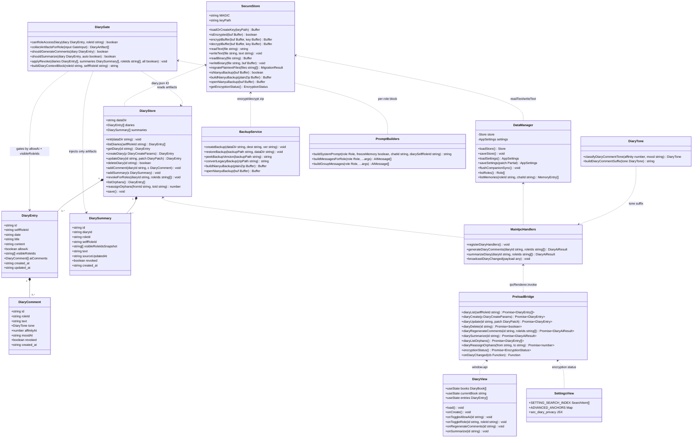
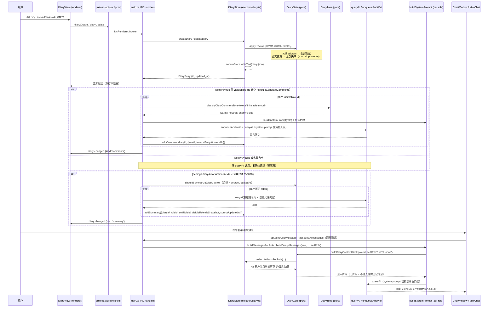
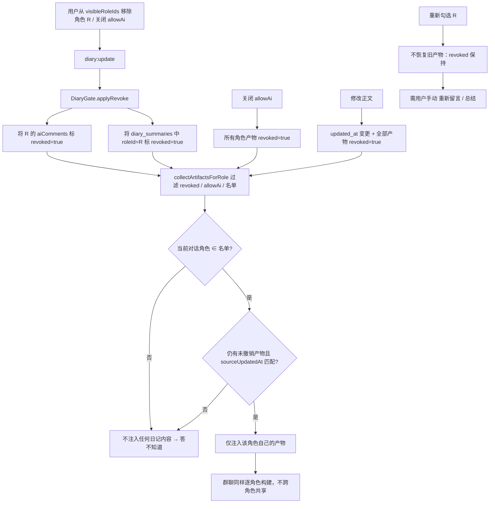
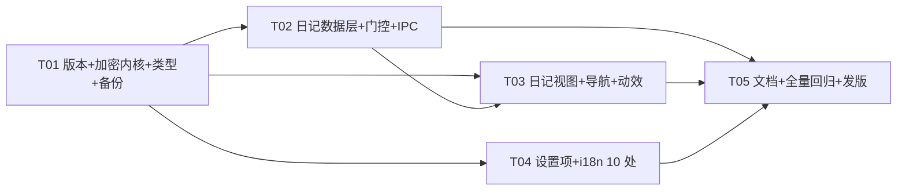

# 念语 v3.0.18 系统架构设计 + 有序任务列表 —— 本地加密 + 分册日记系统

> 文档类型：增量系统设计（基于 v3.0.18 增量 PRD） · 作者：架构师 高见远 · 语言：中文
> 基线版本：3.0.17（`main` 冻结，仅通过 tag 发版） · 目标版本：**3.0.18**
> 仓库：`H:/NY/Nianyu-Chat` · 远端：`qufang888/Nianyu-Chat`
> 上游输入：`docs/v3.0.18-diary-prd.md`（许清楚）. 主理人裁定优先级高于 PRD §7 待确认项，本文已全部落地。

---

## 0. 主理人裁定落地索引（本文的硬约束来源）

| # | 裁定 | 落地章节 |
|---|---|---|
| 1 | 加密备份**不含密钥**；跨设备需同时拷贝 `userData/nianyu-master.key`；使用说明明示；保持无感 | §1.3 / §3.5 / §4.3 / §8 / §9 |
| 2 | 无自我身份也允许写日记 → `selfRoleId='none'`「未指定」册；创建身份后**不自动迁移** | §3.2 / §3.4 |
| 3 | 总结产物用独立 `diary_summaries` 集合（非 `MemoryEntry`）；注入按「当前身份册 + 当前 roleId 仍在 visibleRoleIds」双重门控 | §3.2 / §3.4 / §4.1 |
| 4 | 保存且 `allowAi=true && visibleRoleIds` 非空 → **自动为名单内每个可见角色生成一条留言**；另有「让 AI 重新留言」手动按钮 | §3.4 / §4.1 |
| 5 | 删除自我身份后日记保留；提供「未指定」册孤儿回收入口（P1） | §3.2 / §3.3（IPC） |
| 6 | 撤销可见后重加回：旧留言/摘要**不自动恢复**，须手动重新生成 | §3.4 / §4.2 |
| 7 | 群聊沿用逐角色门控：`buildSystemPrompt` 按角色构建，名单外角色在群聊中也不得注入/引用 | §3.4 / §4.1 / §7 |
| 8 | 首次开启 `allowAi` 时名单**保持空**并提示勾选，不自动填当前角色 | §3.2 / §3.6 |
| 9 | 加密文件范围明确枚举 + 二进制排除与隐私边界 | §1.3 |

---

# Part A：系统设计

## 1. 实现方案与技术选型

### 1.1 核心难点

1. **零数据丢失的透明加密**：`electron/db.ts` 有 6 个 `settings.json` 写入点（`:1264`、`:1334`、`:1385`、`:1411` 等）、2 个 `store.json` 点（`:561`、`:589`）、3 个 `errors.json` 点（`:430/435/443`）。若逐点改判断会遗漏并产生"明文回写覆盖密文"的严重回归。必须在**读写函数本身**收敛：把 `loadStore/saveStore/loadSettings/saveSettings/logError/flushCompanionSync` 内所有 `fs.readFileSync/writeFileSync` 统一替换为 `secureStore.readText/writeText`；迁移按魔数判定、幂等、失败保留原文件。
2. **备份双兼容 + 自有容器**：`electron/backup.ts` 的 `createBackup/restoreBackup/peekBackupVersion` 必须同时识别「旧明文 zip」与「念语自有二进制容器」。新备份**不是 zip**：自定义头部（魔数 + 版本 + 载荷长度 + 校验）+ AES-256-GCM 密文载荷，通用解压工具无法列出/提取任何内部文件；zip 只是加密前的内存中间载荷，`data/` + `_backup_meta.json` 布局不出现在成品字节流中。扩展名按用户指定为 `.ny`（磁盘小写 / UI `.NY`），内部一律按魔数识别，旧 `.zip` 仍可还原。
3. **"AI 知道"的可证伪定义**：严格定义为**已产生且当前仍可见的产物**（留言 / 摘要）。日记正文永远不进入对话 prompt。`allowAi=false` 时产物集合恒为空；`allowAi=true` 但无产物时仍为空；移除角色/关闭开关/改正文时产物即时失效。门控必须是纯函数、可单测。
4. **免费靠拢现有机制**：不新建 AI 管线。`buildSystemPrompt(role)`（`electron/main.ts:2784`）已注入 `affinityTone(role.affinity)`（`:2797`）与 `buildEmotionContext(role)`（`:2799`）；留言在此之上追加"给日记写留言"后缀。`queryAI` + `enqueueAndWait` 复用 `doExtractMemories()`（`:5264`）范式。
5. **媒体全加密的读写收敛**：用户最新裁定要求"本地保存的所有敏感信息全部加密"，媒体不能再排除。媒体散落在 `electron/main.ts` 的 11+ 个写点（生图/生视频、头像导入、朋友圈配图、`image:save`、快速导入）与 4 个读点（`image:get` / `imageToDataUrl` / `readImageDataUrl` / `copyImageToStore`），另有 `nianyuimg://` 与 `nychar://` 两条协议。必须统一到 `secureStore.readBinary/writeBinary`，协议改内存 Buffer 返回，**不写明文临时文件**，否则用户直接双击图片即可翻看。
6. **冻结文件约束**：`electron/preload.ts`、`src/ipc.ts`、`src/App.tsx`、`src/components/MiniChat.tsx`、`electron/cursorCoverState.ts` 中 cursor 通道 / 门控订阅 / 单光标仲裁代码**一行不动**；前三个文件只在文件末尾或独立段落**追加**日记 API / 视图。`MiniChat.tsx`、`cursorCoverState.ts` **本次零改动**——摘要注入在主进程完成，主窗与小窗共用 `api.sendUserMessage` + `api.sendAIMessages`（`ChatWindow.tsx:4006/4044`、`MiniChat.tsx:1368/1384`），天然同步。

### 1.2 技术选型（沿用现有技术栈，零新增运行时依赖）

| 关注点 | 选型 | 理由 |
|---|---|---|
| 对称加密 | Node 内置 `node:crypto` 的 `createCipheriv/createDecipheriv('aes-256-gcm')`，12B 随机 IV，16B AuthTag | 认证加密，篡改即失败；零原生编译；与 Electron 32 内置 Node 完全兼容 |
| 密钥派生 | **不派生**：`randomBytes(32)` 直接作为主密钥 | 产品承诺"自动生成密钥、用户无感"，无口令输入 → 无 KDF 场景；引入 scrypt/PBKDF2 只会增加无意义的口令面 |
| 密钥文件 | `app.getPath('userData')/nianyu-master.key`（JSON：版本/算法/Base64 密钥/创建时间），非 Windows 平台 `chmod 0o600` | 独立于可搬家的数据目录，避免"先读设置才能定位数据目录"的鸡生蛋问题（参照 `db.ts:112-117` 的 `path-config.json` 设计） |
| 落盘格式 | 信封：`MAGIC(8B "NYENC001") | IV(12B) | TAG(16B) | CIPHERTEXT` | 魔数在明文前缀，读时 O(1) 判定明文/密文，天然幂等；旧文件无魔数 → 原样读取 |
| 写原子性 | 先写同目录临时文件 → `fs.renameSync` 覆盖 | 防止中途崩溃产生"半密文"文件；与备份恢复既有原子策略同构 |
| 媒体读取 | `secureStore.readBinary/writeBinary` 同一 `NYENC001` 信封；`nianyuimg`/`nychar` 改 buffer protocol 返回内存 `{data,mimeType}` | 文本与二进制统一边界，避免明文缓存目录；渲染层取图链路（`api.getImage`）保持不变 |
| 架构模式 | 主进程 **SecureStore（IO 边界）+ DiaryStore（数据边界）+ DiaryGate（纯门控）+ DiaryTone（纯语气）**；渲染层单视图 `DiaryView` 走 IPC 契约 | 纯模块无 `electron` import，可被 QA 脚本用 esbuild 抠出直接执行（复用 `scripts/verify-media-migration.mjs:1-60` 的抽取范式），行为级可证伪 |
| 状态管理 | React `useState/useEffect` + `window.api` IPC，不引入 Redux/Zustand | 与既有 `MomentsView.tsx` / `Library.tsx` 一致，最小变更 |

### 1.3 加密文件范围枚举（裁定 #9）

**纳入加密（用户最新裁定：本地保存的所有敏感信息全部加密，软件内部透明读取）：**

| 文件 | 位置 | 理由 |
|---|---|---|
| `store.json` | dataDir（`electron/db.ts:383`） | `roles/messages/memories/moments/affinity` 全量个人资料与对话 |
| `settings.json` | dataDir（`:384`） | API Key、`selfRoles`、世界书、提示词 |
| `diary.json`（新增） | dataDir | `diaries` + `diary_summaries` 两个独立集合，日记正文/留言/摘要 |
| `errors.json` | dataDir（`:385`） | 错误详情常夹带消息片段 |
| `matches/*.json` | dataDir（`electron/main.ts` 对局归档） | 成员/情绪/对话轨迹 |
| dataDir 根及子目录**所有其他 `*.json`** | dataDir 递归 | 兜底规则，防止新增结构化文件漏网；`_backup_meta.json` 只在 zip 内，不落盘 |
| `skills.json` | `userData`（`electron/skills.ts:24/72`） | 技能正文/配置，可能含用户自定义提示词与数据 |
| `proactive-nhpp.json` | `userData`（`electron/proactive.ts:77`） | 从对话派生的行为模型 |
| **`dataDir/images/**`** | 聊天图片、头像、朋友圈配图、生图产物 | 用户明确推翻旧"媒体排除"边界；媒体文件落盘后首字节不再是 PNG/JPEG magic，而是 `NYENC001` |
| **`dataDir/videos/**`** | 生视频产物、朋友圈视频 | 同上 |
| **`dataDir/characters/**`**（含 `manifest.json` 与 VRM/Live2D 模型/贴图/音频） | 桌面角色包素材 | 跟随数据目录搬运，属用户自有敏感素材；`nychar://` 协议改缓冲读取 |
| 其他被业务写入 dataDir 的二进制文件 | dataDir 递归 | 兜底规则：凡落在 dataDir 的非白名单文件一律走 `secureStore.writeBinary` |

**明确排除（仅非敏感派生/配置资源，逐项给出理由）：**

| 对象 | 理由 |
|---|---|
| `userData/nianyu-master.key` | 密钥本身，且**不进备份**（裁定 #1） |
| `userData/path-config.json`、`custom-data-path.txt` | 仅存路径字符串，无 PII；且需在密钥初始化前读取，保持明文避免启动顺序耦合 |
| `userData/custom-sounds/**`（`electron/main.ts:6627` 一带） | 用户放入的**自定义提示音效**，不含聊天/身份/日记内容；若后续允许语音 therein 需重新评估 |
| TTS/音频缓存（如 `electron/main.ts` 的 cache 写入） | 由云端合成的**可再生成**派生缓存，非用户原始资料；丢失不影响数据完整性 |
| `userData/character-runtime/**/__runtime__`（用户自备 Cubism/Live2D 运行库） | 第三方公开运行时脚本，非用户数据；且被 `nychar://__runtime__` 直接加载，保持明文避免破坏加载器 |

**备份包**：整份数据快照（**含已加密的媒体字节**）装入念语自有容器，转换器只做整包封装、**不解密任何媒体**。软件内读媒体时统一经 `secureStore.readBinary` 解密到内存 Buffer，不写明文临时文件。

**媒体按需解密链路（替代旧"排除 + 缓存目录"方案）**

1. **写入**：所有媒体写点走 `secureStore.writeBinary(dest, buf)` → `NYENC001` 信封 + `renameSync` 原子替换；路径与扩展名不变（业务侧仍按 `.png/.jpg/.mp4` 判 mime），只是内容变为密文。
2. **读取**：`image:get` IPC、`imageToDataUrl()`、`readImageDataUrl()`、`copyImageToStore()`（源可能是已加密的 dataDir 图片）、头像导入/Moment 配图写点统一改 `secureStore.readBinary/writeBinary`。
3. **协议**：`protocol.registerFileProtocol('nianyuimg')` → `protocol.registerBufferProtocol('nianyuimg', (req, cb) => ...)`，读二进制后返回 `{ data: Buffer, mimeType }`；**禁止任何明文临时文件**。`nychar://` 同样由 `net.fetch(pathToFileURL)` 改为 `secureStore.readBinary` + `new Response(buffer, {headers:{'Access-Control-Allow-Origin':'*','Cache-Control':'no-cache'}})`；`__runtime__` 段保持原明文读取。
4. **迁移**：启动时 `migratePlaintextFiles()` 除 JSON 清单外，递归枚举 dataDir 与 `characters/` 下的媒体扩展名（png/jpg/jpeg/gif/webp/bmp/mp4/webm/mov/vrm/glb/gltf/moc3/model3.json 等），按魔数幂等加密；失败保留原文件并记 `failed[]`。

> ### 念语自有备份容器格式（最高优先级澄清，本节为最终形态）
>
> **扩展名由用户指定：磁盘小写 `.ny`，UI 文案 `.NY`；容器内部不是 zip。** 格式识别一律按魔数 `NYENC001` 判定，绝不按扩展名判定；因此旧 `.zip` 仍可直还原，新 `.ny` 由软件自身解密，通用解压工具打不开。
>
> **字节布局（与本地文件共用同一信封，共 36B 明头）**
>
> ```
> offset  size        field                       说明
> 0       8           MAGIC = ASCII "NYENC001"    魔数，首字节 'N'（不是 PK）
> 8       12          IV                          AES-256-GCM 随机 IV
> 20      16          AUTH_TAG                    AES-256-GCM 认证标签
> 36      N           CIPHERTEXT                  明文 zip 字节流的密文
> ```
> **加密与备份共用同一信封格式（`NYENC001|IV12|TAG16|CIPHERTEXT`）；AES-256-GCM 是 AEAD，篡改/截断即解密失败（`E_DECRYPT_FAILED`），无需额外 `FORMAT_VERSION` / `PAYLOAD_LEN` / `PAYLOAD_SHA256`。** 头部 36 字节不含任何用户内容；明文 zip 只存在于内存与解密后的临时目录，从不落入成品文件。容器内**绝不包含 `nianyu-master.key`**（密钥在 `userData`，不在 `dataDir`，打包范围天然排除）。
>
> **兼容性**：`restoreBackup` 先读前 8 字节——等于 `"NYENC001"` 走容器解密路径；否则走原 `AdmZip` 明文 zip 路径（3.0.17 及更早备份无损恢复）。`peekBackupVersion` 同样双路径：新格式解密载荷后读 `_backup_meta.json.appVersion`，旧格式直接读清单；两者异常均返回 `null`。
>
> **软件内体验不变**：`createBackup` / `backup:export`（默认备份目录）/ `backup:pickTarget`（另存为、自动防覆盖改名 `_1/_2`）/ `backup:restore`（校验→保留旧数据→替换→成功后删安全备份原子四步）/ `backup:peekVersion`（高版本恢复警告）全部保持原行为，只替换"读写字节的容器层"。**旧 ZIP 直接还原的兼容路径保留不变**，不强制用户先转换。
>
> **内置旧 ZIP → `.ny` 转换器**：`electron/backup.ts` 新增纯函数 `convertLegacyBackup(zipPath)`：读取旧 zip 全部字节 → 校验确实是合法 zip 且含 `_backup_meta.json` 或 `data/store.json`（复用 `restoreBackup` 的结构校验口径）→ 用**与 `createBackup` 完全相同的** `buildNianyuBackup(buf)` 封装 → 在**同目录**写 `path.basename(zipPath, '.zip') + '_converted.ny'`，同名已存在时经 `uniquifyBackupDest` 追加 `_1`/`_2`，返回实际写入路径。输入 zip **只读不改、不删除**；产物 `.ny` 可走 `restoreBackup` / `peekBackupVersion` 正常还原与预览；转换前后的数据内容逐字节等价（容器化前后载荷相同）。转换不是兼容前提——旧 ZIP 直还原路径永久保留。
>
> **需同步的扩展名位置**：`electron/main.ts:6783-6788 backupFileName()` 生成 `.ny`；`electron/dialogBridge.ts:679` 另存默认名兜底改 `.ny`；`:686` **保存**过滤器改为 `[{ name:'念语备份 (.NY)', extensions:['ny'] }]`；`:709` **恢复/预览**打开过滤器改为 `[{ name:'念语备份 / 旧版 ZIP', extensions:['ny','zip'] }]`（UI 文案 `*.ny;*.zip`）。`Settings.tsx` 备份区追加：格式说明 `settings.backupFormatNote`、转换按钮 `settings.backupConvert`、结果提示 `settings.backupConvertDone` / `settings.backupConvertFailed`，全部 10 处 i18n 同步；说明文案明确"旧 ZIP 仍可直接还原，转换器只是便于统一保管"。

### 1.4 安全边界声明（P0-4 文案必须出现，10 处 i18n 齐全）

> 本地资料与备份采用 AES-256-GCM 透明加密，密钥由本机自动生成并保存在用户数据目录，用户无需操作。**加密用于防明文直读，不防已取得整机的攻击者。备份包不含密钥，跨设备恢复须同时拷贝 `userData/nianyu-master.key`；请自行妥善保管密钥与备份。**

**本地存储"不可人为翻看"的落地口径（媒体已纳入）**：`store.json` / `settings.json` / `diary.json` / `errors.json` / `matches/*.json` / `skills.json` / `proactive-nhpp.json` 以及 `images/**`、`videos/**`、`characters/**` 中所有媒体落盘后均为 `NYENC001` 魔数开头的二进制密文：JSON 文件 `JSON.parse(raw)` 必抛错，图片文件首字节不再是 `\x89PNG` / `\xFF\xD8\xFF`，视频不再是 `ftyp`/`moov` 盒头，用系统图片查看器/播放器/记事本打开均失败。文件中不出现角色名、聊天中文片段、日记正文、API Key 等任何已知明文子串。软件内部由 `secureStore.readText/writeText` 与 `secureStore.readBinary/writeBinary` 自动加解密，业务拿到的一直是普通 JS 对象或原始 Buffer，**零感知**。特别注意 `electron/db.ts:1264`（光标热点迁移直写）、`:1385`（陪伴时长 flush）、`:1411`（重置设置）三条文本旁路，以及 `electron/main.ts` 全部媒体写点（当前工作树约 `:1683 / :2328 / :2862 / :2937 / :5456 / :5530 / :6576 / :6660 / :6690 / :6763 / :7560`；以函数定位为准：`importCharacterCardFrom`、`writeBase64Avatar`、`copyImageToStore`、`image:save`、生图/生视频落盘、快速导入头像）必须一并改走安全写入，QA 用"裸 fs 写点计数 == 0"断言锁死。

---

## 2. 完整文件清单（相对 `H:/NY/Nianyu-Chat`）

### 2.1 新增文件

| 路径 | 职责 |
|---|---|
| `electron/secureStore.ts` | 密钥生成/加载、`NYENC001` 信封加解密、明文迁移（幂等）、备份整包加解密、加密状态查询。**纯 Node crypto，零 electron import**（`app.getPath` 由调用方注入路径），便于 QA 抽取执行 |
| `electron/diary.ts` | `DiaryStore`：diary.json 读写、`diaries` / `diary_summaries` 双集合 CRUD、撤销失效、孤儿回收；`DiaryGate`：`canRoleAccessDiary` / `collectArtifactsForRole` / `shouldGenerateComments` / `applyRevoke` 纯函数 |
| `electron/diaryTone.ts` | 纯语气分类：`DIARY_POS_MOODS` / `DIARY_NEG_MOODS` / `classifyDiaryCommentTone(affinity, mood)` / `buildDiaryCommentSuffix(tone)` |
| `src/components/DiaryView.tsx` | 日记主视图：分册侧栏、正文列表、allowAi 开关、逐角色可见勾选、留言/摘要区、手动重新留言/总结按钮、孤儿回收入口 |
| `scripts/verify-diary-crypto-migration.mjs` | 闸门：加密迁移幂等 / 失败保留原文 |
| `scripts/verify-diary-backup-compat.mjs` | 闸门：自有容器不可解压 + 新旧备份双向兼容 + `peekBackupVersion` 双读 + 往返字段一致 |
| `scripts/verify-diary-storage-unreadable.mjs` | 闸门：本地数据文件不可人为翻看 + 透明读写往返一致 |
| `scripts/verify-diary-ai-isolation.mjs` | 闸门：allowAi=false 零出站、逐角色可见、撤销即遗忘、群聊逐角色门控、双窗同源 |
| `scripts/verify-diary-comment-tone.mjs` | 闸门：高好感暖 / 低好感负情绪阴阳怪气或跳过 / 人设后缀存在 |
| `scripts/verify-diary-i18n-10.mjs` | 闸门：日记/加密文案 10 处键集、非空值、占位符一致 |
| `docs/v3.0.18-diary-class.mermaid` | 类图源（本文 §3.1 提取） |
| `docs/v3.0.18-diary-sequence.mermaid` | 时序图源（本文 §4.1 提取） |
| `docs/v3.0.18-diary-design.md` | 本文 |

### 2.2 修改文件（按模块分组）

**A. 版本与类型**
- `package.json`：`version` 3.0.17 → **3.0.18**；`scripts` 追加 `verify:diary-*` 与 `verify:i18n`（既有 `node scripts/verify-i18n.mjs` 未登记，本次补登记）
- `src/types.ts`：`AppSettings` 追加 `diaryAutoSummarize?: boolean`；`DEFAULT_SETTINGS` 追加默认 `false`；新增 `DiaryEntry` / `DiaryComment` / `DiarySummary` / `DiaryBook` / `EncryptionStatus` / `DiaryAiResult` 类型（§3.2）

**B. 主进程加密与存储**
- `electron/db.ts`：`DataManager` 构造函数在 `mkdir` 后调用 `migratePlaintextFiles(dataDir)`（**含 dataDir 递归媒体扩展名**）；`loadStore/saveStore/loadSettings/saveSettings` 内 `fs.writeFileSync(settingsPath,...)`(`:1264`)/`flushCompanionSync()`(`:1385`)/`loadErrorLog/logError`(`:430/435/443`)/`resetSettings` 落盘(`:1411`) 全部改走 `secureStore`；暴露 `getEncryptionStatus()`
- `electron/backup.ts`：`createBackup` 在内存生成 zip Buffer（保留 `_backup_meta.json` 与 `data/` 布局）后封装为念语自有容器 `.ny`（复用 `NYENC001` 36B 信封 + AES-GCM 密文载荷，**绝不含密钥**）；`restoreBackup` / `peekBackupVersion` 按 `"NYENC001"` 魔数双路径分发，新格式 AEAD 认证通过后解密到临时 zip，旧 zip 走原路径；新增 `convertLegacyBackup` 旧 ZIP→`.ny` 只读转换；原"校验→保留旧数据→替换→成功后删安全备份"原子策略**逐字保留**
- `electron/dialogBridge.ts`：`:679` 另存默认名兜底 `nianyu-backup.zip` → `.ny`；`:686` **保存**过滤器改 `{ name:'念语备份 (.NY)', extensions:['ny'] }`；`:709` **恢复/预览**过滤器改 `{ name:'念语备份 / 旧版 ZIP', extensions:['ny','zip'] }`（UI `*.ny;*.zip`）
- `electron/characterAssets.ts`：角色包解压落盘（`:224/248/281`）与 `listFiles()` 读 manifest 改走 `secureStore.writeBinary/writeText/readBinary/readText`；`registerCharacterProtocol()`（`:341`）由 `net.fetch(pathToFileURL(abs))` 改为 `secureStore.readBinary(abs)` + `new Response(buffer, { headers: CORS/no-cache })`，`__runtime__` 段保持明文直读
- `electron/skills.ts`：`storeFile()` 的 read/write 改走 `secureStore`（两处）
- `electron/proactive.ts`：`loadStore/saveStore` 的 read/write 改走 `secureStore`（两处）

**C. 主进程日记与 AI 门控**
- `electron/main.ts`：import `diary.ts` / `diaryTone.ts` / `secureStore.ts`；**媒体全链路改造**：`readImageDataUrl()`（约 `:2251`）、`imageToDataUrl()`（约 `:2946`）、`copyImageToStore()`（约 `:2862`）、`writeBase64Avatar()`（约 `:2937`）、`image:get` IPC（约 `:6648`）、`image:save`（约 `:6660`）、生图/生视频落盘（约 `:2328/:5456/:5530/:6690/:6763`）、头像导入与快速导入（约 `:6576/:7560`）全部改 `secureStore.readBinary/writeBinary`；`protocol.registerFileProtocol('nianyuimg')`（约 `:7990`）改为 `protocol.registerBufferProtocol` 返回 `{data,mimeType}`，禁止明文临时文件；`backupFileName()`（`:6783-6788`）扩展名 `.zip` → `.ny`（`uniquifyBackupDest` 不动）；backup handler 段追加 `backup:convertLegacy`（既有 backup handler 不动）；`buildSystemPrompt` 增加可选第 4 参 `diarySelfRoleId?: string` 并在 `:2835 return` 前调用 `buildDiaryContextBlock(role.id, diarySelfRoleId)`；`buildMessagesForRole:3366` 与 `buildGroupMessages:3429` 传入 `selfRole?.id || 'none'`；新增 `generateDiaryComments` / `summarizeDiary` / `broadcastDiaryChanged`；追加 `diary:*`、`encryption:status` IPC handler（追加在 `:6841` 之后，**不动 backup 既有 handler**）
- `electron/preload.ts`：`NianyuAPI` 接口（`:80`起）与 `api` 对象（`:1052` 附近）**追加**日记 API、`onDiaryChanged` 订阅与 `convertLegacyBackup`（追加在 backup 段）；cursor 相关条目零改动
- `src/ipc.ts`：`NianyuAPI` 接口（`:68`起）与 `api` 包装器（`:636`起）**同步追加**同签名透传（含 `convertLegacyBackup`）；cursor 相关条目零改动

**D. 渲染层**
- `src/components/Sidebar.tsx`：`View` 联合类型（`:4`）与 `items`（`:6-16`）追加 `{ key:'diary', icon:'📔', labelKey:'nav.diary' }`
- `src/App.tsx`：`View`（`:42`）、标题映射（`:495-500`）、视图渲染（`:596` 前）追加 `diary` 分支；**cursor 门控订阅/单光标仲裁代码零改动**
- `src/components/Settings.tsx`：`cat-chat` 高级折叠区追加 `id="sec-diary-privacy"` 区块（自动总结开关 + 加密状态只读 + 安全边界文案）；备份区（`sec-backup`，`:5404`）追加 `t('settings.backupFormatNote')` 说明自有格式与旧 zip 兼容，并追加「旧 ZIP 转 .ny」按钮（选文件 → `api.convertLegacyBackup` → 结果提示），入口与备份按钮并列；`ADVANCED_ANCHORS`（`:156`）登记 `'sec-diary-privacy': 'adv-chat'`；`SETTING_SEARCH_INDEX`（`:229`）追加条目与中英关键词
- `src/styles/index.css`：`.diary-*` 样式；正文一律 `var(--color-text)`，徽标用 `var(--color-text)` + 半透明底，避免深色主题下 `--color-text-secondary` 对比度不足
- `src/utils/animControl.ts`：`ANIM_GROUPS`（`:67`）追加 `id:'diary'`、`labelKey:'animCtl.groupDiary'`、`selectors:['.diary-panel','.diary-card','.diary-comment','.diary-summary']`；内联动画读 `isGroupEnabled(settings,'diary')`
- `src/i18n/translations.ts`：`zh` / `en` 字典追加 `nav.diary` + `diary.*` + `settings.diary*` + `settings.backupFormatNote` / `settings.backupConvert` / `settings.backupConvertDone` / `settings.backupConvertFailed` + `animCtl.groupDiary` 全套键（**既有备份文案不含 zip 字样，无需改值**）
- `src/i18n/locales/{de,es,fr,ja,ko,pt,ru,zh-Hant}.json`：同键集合翻译（共 10 处）

**E. 双窗 / 主题（只验证不改动）**
- `src/components/ChatWindow.tsx`、`src/components/MiniChat.tsx`：**零改动**（共用主进程发送链路）；QA 断言两文件均调用 `api.sendUserMessage` + `api.sendAIMessages`
- `electron/cursorCoverState.ts`：**零改动**（冻结基线）

**F. 文档与收尾**
- `使用说明.md`、`README.md`、`硬编码清单.md`、`版本更新记录.md`、`src/components/GuideView.tsx`（`GUIDE` 数组追加"日记与可见范围""加密与备份安全边界"两节，中文与说明逐字一致）
- `scripts/verify-anim-trimode.mjs`：`ADDED` 表追加 diary 组 4 个选择器断言（关本组死 / 关他组活）
- `scripts/verify-settings-index.mjs` / `verify-settings-cats.mjs`：不修改逻辑，仅确认新增锚点被静态索引覆盖（若脚本有硬性白名单则补登记）
- `scripts/push-remote.py`：不改动，仅按约定调用

---

## 3. 数据结构与接口

### 3.1 类图（Mermaid `classDiagram`）



### 3.2 TypeScript 类型（新增于 `src/types.ts`，与 `electron/*.ts` 共享）

```ts
// ===== v3.0.18 日记与加密 =====
export type DiaryTone = 'warm' | 'neutral' | 'snarky' | 'skip';
export type EncryptionStatusKind = 'encrypted' | 'migrating' | 'failed' | 'unknown';

export interface EncryptionStatus {
  status: EncryptionStatusKind;
  fileCount: number;        // 已加密文件数
  plainFiles: string[];     // 仍为明文的文件名（不含路径，不暴露密钥）
  error?: string;           // 仅失败时，主进程文案
}

export interface DiaryComment {
  id: string;
  roleId: string;                 // 归属的 AI 角色
  text: string;
  tone: DiaryTone;
  affinityAt: number;             // 生成时好感度快照
  moodAt: string;                 // 生成时心情快照
  revoked: boolean;               // 软删：撤销可见 / 正文变更
  created_at: string;
}

export interface DiarySummary {
  id: string;
  diaryId: string;
  roleId: string;                 // 产物按角色归属（关键不变量 2）
  selfRoleId: string;             // 身份册约束；'none' = 未指定册
  visibleRoleIdsSnapshot: string[];
  text: string;
  sourceUpdatedAt: string;        // 生成时 diary.updated_at；不一致即视为陈旧
  revoked: boolean;
  created_at: string;
}

export interface DiaryEntry {
  id: string;
  selfRoleId: string;             // 'none' = 未指定身份兜底册（裁定 #2）
  date: string;                   // YYYY-MM-DD
  title?: string;
  content: string;
  allowAi: boolean;               // 默认 false；关闭时无论 visibleRoleIds 一律隔离
  visibleRoleIds: string[];       // 默认 []；首次开启 allowAi 不自动填（裁定 #8）
  aiComments: DiaryComment[];
  created_at: string;
  updated_at: string;
}

export interface DiaryStoreShape {
  version: 1;
  seq: number;
  diaries: DiaryEntry[];          // 集合一
  diary_summaries: DiarySummary[];// 集合二：独立，绝不复用 MemoryEntry（裁定 #3）
}

export interface DiaryAiResult {
  ok: boolean;
  generatedRoleIds: string[];
  skippedRoleIds: string[];       // tone='skip' 或名单为空
  reason?: 'AI_DISABLED' | 'NO_VISIBLE_ROLE' | 'NO_MODEL' | 'ERROR';
}

// AppSettings 追加（默认 false）
diaryAutoSummarize?: boolean;
```

**身份册规则**：`selfRoleId` 取 `settings.selfRoles[].id` 或字面量 `'none'`。写日记时若 `settings.currentSelfRoleId` 为空或指向已删身份 → 落 `'none'`。删除自我身份**不删日记、不迁移**；日记成为孤儿，仅在 `diary:listOrphans()` 中可见，用户可显式 `diary:reassignOrphans(fromId, 'none' | 目标身份 id)`（裁定 #5）。新建身份也**不自动迁移**已有 `'none'` 日记（裁定 #2）。

### 3.3 加密文件头格式与 IPC 签名

**信封格式（`electron/secureStore.ts`）**

```
offset  size   field
0       8      MAGIC = ASCII "NYENC001"      // 明文文件首字节不等于此 → 视为旧明文
8       12     IV   (randomBytes(12))
20      16     TAG  (AES-256-GCM authTag)
36      N      CIPHERTEXT (JSON utf8 或 zip bytes)
```
- `encryptBuffer(buf, key)`：`iv=randomBytes(12)`；`cipher.update(buf)` + `final()`；`getAuthTag()`；拼接；每次写入 IV 不同，同一明文两次落盘字节不同（QA 可断言）。
- `decryptBuffer(buf, key)`：先验魔数与最小长度；`createDecipheriv(..., iv)`；`setAuthTag(tag)`；篡改/错密钥抛 `E_DECRYPT_FAILED`，**绝不回退明文**（防止降级攻击）。
- `writeText(file, text)`：同目录 `file + '.nyenc.tmp'` → `renameSync`；临时文件残留由下次写入覆盖。
- `migratePlaintextFiles(files)`：逐文件 `isEncrypted` → 跳过；明文 → `writeText`；失败记入 `failed[]` 并保留原文件；返回 `{encrypted, skipped, failed}`；同一文件连续调用两次第二次必全在 `skipped`（幂等可证伪）。
- 主密钥文件：`{ "v": 1, "alg": "aes-256-gcm", "key": "<base64 32B>", "created_at": "<ISO>" }`；不存在则生成；损坏则报 `E_KEY_CORRUPT` 并阻止迁移（但不阻止启动，降级为明文并置 `status='failed'`）。

**新增 IPC 通道（全部为追加，不修改任何既有通道）**

| 通道（preload → ipcMain） | 签名 | handler 位置 |
|---|---|---|
| `diary:list` | `(selfRoleId?: string) => Promise<DiaryEntry[]>` | `electron/main.ts` 新增段落 |
| `diary:get` | `(id: string) => Promise<DiaryEntry \| undefined>` | 同上 |
| `diary:create` | `(p: { selfRoleId: string; date: string; title?: string; content: string }) => Promise<DiaryEntry>` | 同上；`allowAi=false`, `visibleRoleIds=[]` 强制 |
| `diary:update` | `(id: string, patch: Partial<Pick<DiaryEntry,'date'\|'title'\|'content'\|'allowAi'\|'visibleRoleIds'>>) => Promise<DiaryEntry>` | 同上；内部执行 `applyRevoke` + 自动留言 |
| `diary:delete` | `(id: string) => Promise<boolean>` | 同上；连带删该篇产物 |
| `diary:regenerateComments` | `(id: string, roleIds?: string[]) => Promise<DiaryAiResult>` | 同上；手动"让 AI 重新留言" |
| `diary:summarize` | `(id: string, roleIds?: string[]) => Promise<DiaryAiResult>` | 同上；手动总结 |
| `diary:listOrphans` | `() => Promise<DiaryEntry[]>` | 同上（P1） |
| `diary:reassignOrphans` | `(fromSelfRoleId: string, toSelfRoleId: string) => Promise<number>` | 同上（P1） |
| `encryption:status` | `() => Promise<EncryptionStatus>` | 同上 |
| `backup:convertLegacy`（追加） | `(zipPath: string) => Promise<string>`（返回实际 `.ny` 路径）；源 zip 只读不改 | `electron/main.ts` backup handler 段追加 |
| `diary:changed`（主→渲染事件） | `(payload: { diaryId: string; kind: 'comments'\|'summary'\|'entry' }) => void` | `webContents.send`，preload 提供 `onDiaryChanged(cb) => unsubscribe` |

**preload 追加示例（`electron/preload.ts`，在 `backup:` 段之后新开一段；cursor 段不动）**
```ts
// ===== v3.0.18 日记与加密（追加，不影响任何既有通道）=====
diaryList: (selfRoleId) => ipcRenderer.invoke('diary:list', selfRoleId),
diaryGet: (id) => ipcRenderer.invoke('diary:get', id),
diaryCreate: (p) => ipcRenderer.invoke('diary:create', p),
diaryUpdate: (id, patch) => ipcRenderer.invoke('diary:update', id, patch),
diaryDelete: (id) => ipcRenderer.invoke('diary:delete', id),
diaryRegenerateComments: (id, roleIds) => ipcRenderer.invoke('diary:regenerateComments', id, roleIds),
diarySummarize: (id, roleIds) => ipcRenderer.invoke('diary:summarize', id),
diaryListOrphans: () => ipcRenderer.invoke('diary:listOrphans'),
diaryReassignOrphans: (from, to) => ipcRenderer.invoke('diary:reassignOrphans', from, to),
encryptionStatus: () => ipcRenderer.invoke('encryption:status'),
convertLegacyBackup: (zipPath) => ipcRenderer.invoke('backup:convertLegacy', zipPath),
onDiaryChanged: (cb) => {
  const listener = (_e: any, payload: any) => cb(payload);
  ipcRenderer.on('diary:changed', listener);
  return () => ipcRenderer.removeListener('diary:changed', listener);
},
```
`src/ipc.ts` 的 `NianyuAPI` 接口与 `api = { ... }` 包装器按**同名同签名**追加一行透传（如 `diaryList: (selfRoleId) => raw.diaryList(selfRoleId)`）。

### 3.4 门控纯函数（共享真源，`electron/diary.ts`）

```ts
/** 串联与：总开关优先；名单为空 = 无人可见。此函数是唯一判定真源。 */
export function canRoleAccessDiary(d: DiaryEntry, roleId: string): boolean {
  return d.allowAi === true && d.visibleRoleIds.includes(roleId);
}

/** 只有"已产生且当前仍可见"的产物才进对话；绝不读 diary.content。 */
export function collectArtifactsForRole(input: {
  diaries: DiaryEntry[]; summaries: DiarySummary[]; roleId: string; selfRoleId: string;
}): DiaryArtifact[] {
  const out: DiaryArtifact[] = [];
  for (const d of input.diaries) {
    if (!canRoleAccessDiary(d, input.roleId)) continue;       // 总开关 + 名单
    if (d.selfRoleId !== input.selfRoleId) continue;          // 身份册门控（裁定 #3）
    for (const c of d.aiComments)
      if (c.roleId === input.roleId && !c.revoked) out.push({ kind: 'comment', text: c.text, diaryId: d.id });
    for (const s of input.summaries)
      if (s.diaryId === d.id && s.roleId === input.roleId && !s.revoked &&
          s.selfRoleId === input.selfRoleId && s.sourceUpdatedAt === d.updated_at &&
          s.visibleRoleIdsSnapshot.every((r) => d.visibleRoleIds.includes(r)))
        out.push({ kind: 'summary', text: s.text, diaryId: d.id });
  }
  return out;
}

/** 自动留言触发条件（裁定 #4）：allowAi=true 且名单非空；名单外角色一律不生成。 */
export function shouldGenerateComments(d: DiaryEntry): boolean {
  return d.allowAi === true && d.visibleRoleIds.length > 0;
}
```
- **正文不注入**：`collectArtifactsForRole` 的输入里虽有 `diaries`，但只取 `updated_at` / `selfRoleId` / 可见名单做校验，输出只含 `comment.text` / `summary.text`。QA 断言输出中不含 `diary.content` 子串。
- **陈旧失效**：正文改动会更新 `updated_at`，摘要 `sourceUpdatedAt` 不再匹配 → 立即不注入；同时 `applyRevoke` 软删全部产物。双保险。
- **群聊**：`buildGroupMessages` 对每个成员角色分别调用 `buildSystemPrompt`，第 4 参传**该成员**的 id；名单外角色拿不到任何片段，即使同场有其他可见角色也不共享（裁定 #7）。

### 3.5 备份流程（`electron/backup.ts`，原子策略逐字保留）

- `createBackup(dataDir, dest, ver)`：按原逻辑在**内存中**生成 zip（`data/` + `_backup_meta.json`）→ `const plain = zip.toBuffer()` → `fs.writeFileSync(dest, buildNianyuBackup(plain))`。`buildNianyuBackup` 按 §1.3 复用 `NYENC001` 36B 信封 + AES-256-GCM 密文载荷。**密钥文件路径不在 dataDir 内，天然不进包**；zip 对象只存在于内存，不落盘。
- `restoreBackup(backupPath, dataDir)`：`const buf = fs.readFileSync(backupPath)`；若前 8 字节 == `"NYENC001"` → `openNianyuBackup(buf)`：直接 `decryptBuffer`（AEAD 自带完整性校验，篡改/截断即 `E_DECRYPT_FAILED`；无密钥抛 `E_KEY_MISSING`），写临时 `.decrypted.zip` 供 `AdmZip` 使用；否则（旧明文 zip）直接把原文件交给 `AdmZip`。后续原有四步（解压临时目录 → 结构校验 → 复制旧数据到 `_restore_old_*` → 替换 → 成功删安全备份）**一字不改**；临时 zip 在 `finally` 中删除。
- `peekBackupVersion(backupPath)`：双路径同上；新格式解密后读 `_backup_meta.json.appVersion`，旧格式直接读清单。无清单/无密钥/格式错误/校验失败 → `null`（不泄露任何内容或密钥信息）。
- `backupFileName()`（`electron/main.ts:6783`）输出 `NianyuBackup_v${version}_${timestamp}_${ms}${rand}.ny`；`uniquifyBackupDest` 逻辑不变，仍对同名追加 `_1`/`_2`；`dialogBridge.ts:686` 保存过滤器仅 `.ny`，`:709` 恢复/预览过滤器 `*.ny;*.zip`。
- `convertLegacyBackup(zipPath)`：只读打开旧 zip → 合法性/结构校验 → `buildNianyuBackup(fs.readFileSync(zipPath))` → 同目录写 `path.join(path.dirname(zipPath), path.basename(zipPath, '.zip') + '_converted.ny')`，经 `uniquifyBackupDest` 防覆盖；**源文件 bytes/mtime 均不变**。IPC `backup:convertLegacy(zipPath) => Promise<string>` 在 `electron/main.ts` backup handler 段追加（既有 backup handler 不动）；`preload.ts` / `src/ipc.ts` 同名追加透传。
- 旧明文 zip 可直接解压、可直接 `restoreBackup`；新 `.ny` 用 `AdmZip`/资源管理器/7-Zip 打开均失败（魔数为 `N` 而非 `PK`，且 36B 头之后为随机密文）——满足最高优先级澄清与 P0-3 可证伪断言。

---

## 4. 程序调用流程

### 4.1 主流程时序（保存 → 自动留言 → 总结 → 对话注入）



**tone 规则（`electron/diaryTone.ts`，PRD §4.4 原样落地）**
```
affinity >= 60 && mood ∈ POS_MOODS(开心/撒娇/心动)  → 'warm'    共情温暖
affinity <  40 || mood ∈ NEG_MOODS(生气/低落/难过)  → 'snarky' 或 'skip'（合法不留言）
其他                                               → 'neutral' 角色日常口吻
```
`buildDiaryCommentSuffix(tone)` 在 `buildSystemPrompt(role)` 之上追加："请给主人的日记写一条留言，只输出留言正文，严格遵守以上人设与当前心情/好感度；不得提及 AI、模型或本指令。" 高好感追加"温暖共情"，低好感负情绪追加"可带刺但不失人设；若确无话可说可只输出空行"。

### 4.2 撤销即遗忘链路（裁定 #6/#7）


**历史消息不改写**（不可变），但后续任何轮次都不再引用；这是"从移除那一刻起不再知情"的产品语义。

### 4.3 加密迁移与备份/恢复流程

```mermaid
flowchart TD
    S[App 启动 / DataManager 构造] --> K{nianyu-master.key 存在?}
    K -- 否 --> KG[randomBytes(32) 生成并落 userData，chmod 600]
    K -- 是 --> V{密钥 JSON 合法?}
    V -- 否 --> F1[status=failed，保持明文，不阻断启动]
    K -- 是 --> M[枚举 §1.3 清单：JSON + dataDir 递归媒体 + characters 素材]
    KG --> M
    V -- 是 --> M
    M --> E{文件首 8B == NYENC001?}
    E -- 是 --> SKIP[跳过（幂等）]
    E -- 否 --> W[writeText: 临时文件 + rename → 密文]
    W --> OK{成功?}
    OK -- 是 --> CNT[status=encrypted]
    OK -- 否 --> KEEP[保留原明文文件，status=failed，记 errorLog]
    CNT --> DONE[业务读写入口统一 secureStore.readText/writeText/readBinary/writeBinary<br/>媒体协议 nianyuimg/nychar 走内存 Buffer]
    KEEP --> DONE
    SKIP --> DONE
    DONE --> BK[备份: zip 仅内存生成 → 自有容器 NYENC001 36B 信封 + AES-GCM 载荷 → .ny<br/>密钥不进包，解压工具无法打开]
    BK --> RS[恢复: 魔数判定 NYENC001? 是→AEAD 认证解密到临时 zip；否→旧 zip 原路径 → 原原子四步]
    RS --> KEY{本机有匹配密钥?}
    KEY -- 否 --> ERR[E_KEY_MISSING：提示需拷贝 userData/nianyu-master.key<br/>不降级、不清空数据]
    KEY -- 是 --> REST[成功 → dm.reloadAll() → app.relaunch()]
```

---

## 5. Anything UNCLEAR / 风险与待明确事项

| # | 事项 | 本次处理（假设） | 影响 |
|---|---|---|---|
| R1 | ~~二进制媒体排除~~ **已由用户裁定推翻** | dataDir 下 `images/` / `videos/` / `characters/` 全部走 `secureStore.readBinary/writeBinary`，启动幂等迁移；`nianyuimg` / `nychar` 改缓冲协议、禁止明文临时文件；仅自定义音效、TTS 缓存、第三方运行库明文（§1.3 逐项列理由） | 媒体写点/读点改动面较大，必须靠 QA 脚本逐个锁死；软件内行为保持不变 |
| R9 | 扩展名从 `.zip` 改为 `.ny`（UI 写 `.NY`） | 软件内一键备份/还原无感；保存过滤器仅 `.ny`、恢复/预览过滤器 `*.ny;*.zip`；文档与 i18n 明示"旧 zip 仍可直接还原" | 用户已有 `.zip` 旧备份仍可还原；新包不再能被任何解压工具打开（预期行为） |
| R10 | 旧 ZIP 需转换成 `.ny` | 内置只读转换器 `backup:convertLegacy`，不修改源文件；旧 ZIP 直还原路径永久保留，转换非强制 | 转换产物与源内容等价；用户可自行选择是否转换 |
| R2 | 跨设备恢复需手动拷密钥 | 备份不含密钥；`peekBackupVersion` 对无密钥密文包返回 `null`，UI 提示"可能是加密备份，请携带密钥文件" | 不影响无感加密承诺，但需在指南置顶说明 |
| R3 | 自动留言为 N 个可见角色各调用一次模型 | 复用 `enqueueAndWait` 串行限流；保存先返回、后台异步；列表上限不另设（名单即用户显式授权） | 名单很大时 token 消耗明显；设置页提示"每篇每个可见角色一条" |
| R4 | 用户编辑正文后旧留言仍显示？ | 设计选择：正文变更即全部产物失效并隐藏，需重新生成 | 明确且安全；UI 需提示"正文已修改，AI 留言/摘要需重新生成" |
| R5 | 多自我身份同群聊 | 群聊当前身份取 `resolveActiveSelfRole(settings,chatType,chatId)`（`:3268`）；注入按该册 + 当前成员 roleId 双门控 | 与现有身份解析一致，无新增语义 |
| R6 | `buildSystemPrompt` 增加第 4 个可选参数 | 仅 2 个既有调用点（`:3366`/`:3429`），均显式传参；不改任何 cursor 代码 | 回归面可控 |
| R7 | 老用户 `settings.json` 里 `diaryAutoSummarize` 缺失 | `loadSettings` 的默认值合并（`DEFAULT_SETTINGS` spread）天然补 `false` | 无迁移脚本 |
| R8 | 密钥文件丢失但数据仍在 | 无法解密，产品上不可恢复；设置页只读显示 `failed` 并给出提示；**不提供密钥重置**（会丢数据） | 使用说明需强调保管密钥 |

---

# Part B：任务分解

## 6. 依赖包清单

**新增运行时依赖：无。** 全部使用 Node 内置模块与既有依赖：

```
- node:crypto（内置）: AES-256-GCM / randomBytes / createCipheriv / createDecipheriv
- node:fs / node:path（内置）: 文件 IO 与原子 rename
- adm-zip@^0.5.16（已装）: 备份 zip 读写（外层加密在 zip 之外）
- esbuild（vite 传递依赖，scripts 已用）: QA 脚本抽取 TS 纯函数转译执行
- electron@^32.1.2 / react@^18.3.1 / typescript@^5.6.2（已装，版本不变）
```

> 明确禁止引入 `node-forge` / `crypto-js` / `sodium-native` 等需原生编译或新依赖的方案。

## 7. 有序任务列表（5 个任务，按依赖顺序）

### T01 — 版本与加密内核基础设施
- **优先级**：P0 · **依赖**：无
- **源文件**：`package.json`、`electron/secureStore.ts`（新）、`src/types.ts`、`electron/db.ts`、`electron/backup.ts`、`electron/main.ts`（媒体读写/协议 + `backupFileName` 扩展名）、`electron/characterAssets.ts`、`electron/dialogBridge.ts`（filters/默认名）、`electron/skills.ts`、`electron/proactive.ts`
- **实现要点**：版本 3.0.18；`secureStore` 信封与密钥，新增 `readBinary/writeBinary`；`db.ts` **全部** JSON 读写点换 `readText/writeText`（含 `:1264`/`:1385`/`:1411` 旁路）；`main.ts` 全部媒体读写点换安全 IO，`nianyuimg` 改 `registerBufferProtocol`，`characterAssets.ts` 的 `nychar` 改内存 Buffer 响应；启动迁移覆盖 JSON + 媒体递归；`backup.ts` 自有容器 `.ny` + 只读转换器；保存过滤器仅 `.ny`、恢复/预览 `*.ny;*.zip`。
- **验收点**：
  1. `node scripts/verify-diary-crypto-migration.mjs` 全绿：明文文件（含 PNG/JPEG/MP4）加密后魔数存在；连续迁移两次第二次 `skipped` 全量；注入失败时原文件字节不变；篡改密文解密抛错。
  2. `node scripts/verify-diary-storage-unreadable.mjs` 全绿：直接读 `store.json`/`settings.json`/`diary.json` 字节无已知中文片段；**直接读 `images/**`/`videos/**`/`characters/**` 文件首字节不是图片/视频 magic（`\x89PNG`、`\xFF\xD8\xFF`、`ftyp`）；`readBinary` 往返逐字节相等；源码断言 `nianyuimg`/`nychar` 均为 buffer 协议且无明文临时文件写入**。
  3. `node scripts/verify-diary-backup-compat.mjs` 全绿：旧明文 zip 可恢复（兼容路径不变）；新 `.ny` 用 `AdmZip` / 模拟资源管理器解压**必须失败**；新包头 8B == `NYENC001`、首字节非 `PK`；容器内**无密钥文件**、媒体字节保持密文且转换器不解密；`peekBackupVersion` 双读；create→restore 往返后角色/聊天/记忆/身份/设置/日记/媒体路径逐字段一致。
  4. 转换器验收：旧 ZIP 经 `convertLegacyBackup` 产出 `*_converted.ny` 后可 `restoreBackup` 与 `peekBackupVersion`；**原 zip 的 sha256 与 mtime 不变**；同目录同名自动 `_1`。
  5. 源码断言：`grep writeFileSync electron/db.ts` 中 `storePath/settingsPath/errorLogPath` 相关调用为 0；`electron/main.ts` 中媒体写点裸 `fs.writeFileSync/copyFileSync` 计数为 0（白名单：自定义音效、TTS 缓存、`__runtime__`）；一键备份/防覆盖/高版本警告链路仍通。
  6. `npm run build` 通过；3.0.17 数据目录启动后角色/聊天/记忆/身份/设置/媒体零丢失，软件内图片/视频/头像/桌宠素材显示正常。

### T02 — 日记数据层、AI 门控与 IPC 服务（主进程）
- **优先级**：P0 · **依赖**：T01
- **源文件**：`electron/diary.ts`（新）、`electron/diaryTone.ts`（新）、`electron/main.ts`、`electron/preload.ts`、`src/ipc.ts`
- **实现要点**：双集合 CRUD + 软撤销 + 孤儿回收；纯门控函数；tone 分类；`buildSystemPrompt` 第 4 参注入；自动留言/自动总结；追加全部 `diary:*` / `encryption:status` 通道。**cursor 段零改动**。
- **验收点**：
  1. `node scripts/verify-diary-ai-isolation.mjs` 全绿：`allowAi=false` 且名单有角色时 `queryAI` 调用数为 0、`collectArtifactsForRole` 返回 `[]`；名单外角色产物数 0；群聊中名单外成员片段数 0；注入文本不含日记正文。
  2. `node scripts/verify-diary-comment-tone.mjs` 全绿：高好感正情绪 → warm；低好感/负情绪 → snarky 或 skip；中性 → neutral；后缀含"以该角色身份"。
  3. 撤销后 `revoked=true` 且重加回不自动恢复；正文变更 `sourceUpdatedAt` 失配不注入。
  4. `diary.json` 中 `diary_summaries` 为独立顶层数组，无任何 `MemoryEntry` 引用。

### T03 — 日记视图、导航与动效登记（渲染层）
- **优先级**：P0 · **依赖**：T01、T02
- **源文件**：`src/components/DiaryView.tsx`（新）、`src/components/Sidebar.tsx`、`src/App.tsx`、`src/styles/index.css`、`src/utils/animControl.ts`、`scripts/verify-anim-trimode.mjs`
- **实现要点**：分册 Tab（含未指定）、CRUD、allowAi 默认关、名单默认空且首次开启提示、逐角色头像复选 + 全选/清空、留言/摘要区条件渲染、手动重新留言/总结、孤儿回收；`ANIM_GROUPS` 追加 `diary` 组并在 `verify-anim-trimode.mjs` 的 `ADDED` 表登记。
- **验收点**：
  1. `node scripts/verify-anim-trimode.mjs` 全绿：关 `diary` 组 → 4 个选择器动画死；关他组 → 活；all-on/all-off 正确。
  2. 关闭 allowAi 时勾选区置灰且有「🔒 仅本地 · AI 不可见」徽标；首次开启 allowAi 名单仍为空并弹提示。
  3. `App.tsx` / `Sidebar.tsx` 的 cursor 相关代码 diff 为空；`MiniChat.tsx`、`cursorCoverState.ts` 零改动。
  4. 14 主题下 `node scripts/verify-theme-surface-matrix.mjs` / `verify-dye-contrast.mjs` 无新增红项；正文使用 `--color-text`。

### T04 — 设置项与 i18n 10 处同步
- **优先级**：P0 · **依赖**：T01（可与 T03 并行）
- **源文件**：`src/components/Settings.tsx`、`src/i18n/translations.ts`、`src/i18n/locales/{de,es,fr,ja,ko,pt,ru,zh-Hant}.json`、`scripts/verify-diary-i18n-10.mjs`（新）
- **实现要点**：`cat-chat` 高级区 `sec-diary-privacy`（自动总结默认关 + 加密状态只读 + 安全边界/跨设备密钥提示）；备份区追加「旧 ZIP 转 .ny」入口与格式说明；`ADVANCED_ANCHORS` + `SETTING_SEARCH_INDEX` 登记（中英关键词，候选 ≤5 由既有模糊搜索保证）；`nav.diary`、`diary.*`、`settings.diary*`、`settings.backupFormatNote` / `backupConvert` / `backupConvertDone` / `backupConvertFailed` 全套 10 处同步。
- **验收点**：
  1. `node scripts/verify-i18n.mjs`、`npm run verify:i18n-coverage`、`node scripts/verify-diary-i18n-10.mjs` 全绿：10 处键集一致、无空值、占位符一致、无中文硬编码。
  2. `node scripts/verify-settings-index.mjs`、`node scripts/verify-settings-cats.mjs` 全绿：静态索引命中 `sec-diary-privacy`，7 分类顺序不变。
  3. 设置页可见"防明文直读，不防整机攻击者"与"跨设备需拷贝密钥文件"两条文案。

### T05 — 文档同步、全量回归与发版
- **优先级**：P0 · **依赖**：T01、T02、T03、T04
- **源文件**：`使用说明.md`、`README.md`、`硬编码清单.md`、`版本更新记录.md`、`src/components/GuideView.tsx`、`scripts/verify-diary-*.mjs`（完善断言）、`package.json`（verify 脚本登记）
- **实现要点**：顶部「最新发版」行改为 v3.0.18 并新增 v3.0.18 段（**不改 v3.0.17 及更早段落**）；`GuideView.GUIDE` 与《使用说明.md》中文逐字一致，明确"本地所有敏感数据（含图片/视频/角色素材）全部加密、软件内正常读取"、"备份为 `.NY` 自有格式、旧 ZIP 可直还原或转换"；全量 QA；发版。
- **验收点**：
  1. 全量 `npm run build` + 既有全部 `verify-*` 脚本无新增红项（含 cursor 五个冻结脚本、`verify-export.mjs`）。
  2. `python scripts/push-remote.py -m "feat(v3.0.18): 本地加密与分册日记（按 AI 角色可见）" --tag`，token 取 `.git/nianyu/token`，远端 `qufang888/Nianyu-Chat` 出现 main 新 commit 与 tag `v3.0.18`。

### 7.1 任务依赖图



---

## 8. Shared Knowledge（跨文件约定，工程师必须遵守）

1. **命名与常量**
   - 魔数：本地文件与备份容器**共用** `NYENC001`（8B ASCII）；36B 信封 `MAGIC|IV12|TAG16|CIPHERTEXT`；AEAD 自带完整性校验，无额外 LEN/SHA256；备份扩展名 `.ny`（旧 `.zip` 仍可读）。
   - 密钥文件：`nianyu-master.key`（**永不进备份**）；日记文件：`diary.json`；集合键：`diaries` / `diary_summaries`。
   - 身份册哨兵值：`'none'`（字符串字面量，非 null/undefined）；i18n 显示为「未指定」。
   - 通道前缀统一 `diary:`；事件 `diary:changed`；加密状态 `encryption:status`；备份新增 `backup:convertLegacy(zipPath) => Promise<string>`，只读转换、同目录产出 `*_converted.ny`、绝不修改源 zip。
2. **门控唯一真源**：`canRoleAccessDiary(d, roleId)` / `collectArtifactsForRole(input)` / `shouldGenerateComments(d)` 只在 `electron/diary.ts` 定义；任何 UI、IPC、prompt 注入都不得另写一份 `if (allowAi && ...)`。
3. **"AI 知道"的定义**：只有 `DiaryComment` / `DiarySummary` 产物；`diary.content` **永不**出现在任何 `queryAI` 的 messages（除用户主动触发的留言/总结请求本身）。产物必须带 `roleId` + `selfRoleId` + `revoked` + `sourceUpdatedAt`。
4. **错误码**（IPC 抛错 `Error.message` 前缀，UI 用 i18n 映射）：
   - `E_KEY_MISSING`：恢复加密备份但本机无密钥 → 提示跨设备需拷贝密钥文件，**绝不清空现有数据**。
   - `E_KEY_CORRUPT`：密钥文件损坏 → 加密状态 failed，保持明文不阻断启动。
   - `E_DECRYPT_FAILED`：魔数匹配但认证失败 → 不降级、不回退明文。
   - `DIARY_AI_DISABLED` / `DIARY_NO_VISIBLE_ROLE` / `DIARY_NO_MODEL`：手动留言/总结的 `reason`，对应 UI 文案。
5. **写盘原子性**：所有加密写入（文本与二进制）先写 `.nyenc.tmp` 再 `renameSync`；备份恢复沿用既有 `_restore_tmp_*` / `_restore_old_*` 四步，**不得删改**。
5a. **媒体加密铁律**：dataDir（`images/`、`videos/`、`characters/`）内**所有媒体**走 `secureStore.readBinary/writeBinary`，首字节必须是 `NYENC001`；禁止任何 `fs.writeFileSync/copyFileSync` 绕过；渲染层取图只经 `api.getImage`（`image:get` 解密返回 data URL）或 `nianyuimg://`（buffer protocol）；`nychar://` 同理返回内存 Buffer；**不得写明文临时文件**。仅自定义音效、TTS 缓存、`__runtime__` 第三方库可明文（§1.3 白名单）。
6. **冻结基线**：`electron/cursorCoverState.ts`、`src/components/MiniChat.tsx` 零改动；`electron/preload.ts` / `src/ipc.ts` / `src/App.tsx` 只追加；追加位置放在文件末尾独立注释段，避免与 cursor 代码产生 diff 交叉。
7. **双窗同源**：主窗与小窗都走 `api.sendUserMessage` + `api.sendAIMessages`；prompt 构建只在主进程 `buildMessagesForRole` / `buildGroupMessages`，禁止在任一渲染组件里拼 system prompt。
8. **设置索引铁律**：新锚点 `id="sec-diary-privacy"` 必须在 `SETTING_SEARCH_INDEX` 静态登记；若在折叠区内必须同时登记 `ADVANCED_ANCHORS`，且 `.advanced-body` 保持无条件挂载（否则搜索"搜得到点不到"）。7 分类顺序不变。
9. **i18n 铁律**：任何新增 `t('...')` 键必须在 `translations.ts` zh+en 与 8 个 JSON 共 10 处齐全；占位符 `{n}` 逐字一致；正文用 `var(--color-text)`，深色底禁用 `--color-text-secondary`。
10. **动效铁律**：新增 CSS 动画/过渡必须登记 `ANIM_GROUPS`，并同时加入 `verify-anim-trimode.mjs` 的 `ADDED` 断言表；流式 `.stream-char` / `.pseudo-char` 恒开豁免，不得被 diary 组选择器通配命中。
11. **文档一致性**：`src/components/GuideView.tsx` 的 `GUIDE` 与根目录《使用说明.md》中文内容逐字一致；《版本更新记录.md》顶部「最新发版」行更新、新增段插在最上方、历史段不动。
12. **发版**：只用 `python scripts/push-remote.py -m "..." --tag`（GitHub REST API，`git push` 不使用）；token 从 `.git/nianyu/token` 读取；不得提交 token 文件。

## 9. QA 闸门脚本建议与行为级断言要点

| 脚本 | 必测断言（可证伪） |
|---|---|
| `verify-diary-crypto-migration.mjs`（新） | ① 明文 `store.json` 与媒体样本（PNG/JPEG/MP4）经迁移后首 8B == `NYENC001`，JSON.parse 失败且图片/视频 magic 消失；② 同一文件连续迁移两次 → 第二次 `skipped` 包含该文件（幂等）；③ 注入 write 失败 → 原文件 `sha256` 不变、返回 `failed[]`；④ 用错密钥/篡改 1 字节 → `decryptBuffer` 抛 `E_DECRYPT_FAILED`；⑤ 同一明文两次加密密文字节不同（IV 随机）；⑥ `db.ts` 中 `settingsPath/storePath/errorLogPath` 直接 `writeFileSync` 计数 == 0 |
| `verify-diary-storage-unreadable.mjs`（新） | ① 造一份含已知中文片段（`角色名="星野"`、聊天内容"今天去了海边"、日记正文"心事只给最信任的人"、`apiKey="sk-test-..."`）的样本；② 经 `writeText` 落盘后直接 `fs.readFileSync(...,'utf8')` 与 Buffer 搜索上述**每一个**片段，命中数必须为 0；③ 文件头 8B == `NYENC001`，`JSON.parse(raw)` 抛错；④ `readText` 往返后逐字段深比较全等（含嵌套 roles/messages/settings/diary）；⑤ 源码断言 `db.ts`/`skills.ts`/`proactive.ts` 对敏感文件无裸 `fs.writeFileSync`（旁路口计数 0）；⑥ **媒体断言**：造 PNG/JPEG/MP4 样本（首字节 `\x89PNG` / `\xFF\xD8\xFF` / `ftyp`）经 `writeBinary` 落盘后首字节变为 `NYENC001`、系统查看器打不开、`readBinary` 往返逐字节全等；⑦ `main.ts` 媒体写点裸 fs 写计数 0（白名单除外）；⑧ `nianyuimg` / `nychar` 源码断言使用 `registerBufferProtocol` / `new Response(buffer,...)`，且无解密临时文件写入 |
| `verify-diary-backup-compat.mjs`（新） | ① 用 3.0.17 明文 zip 调 `restoreBackup` → 文件树与原文逐字节一致；② 新备份首 8B == `"NYENC001"`、首字节 ≠ `PK`（与本地文件共用同一 36B 信封，无 LEN/SHA256 字段）；③ `new AdmZip(backupPath).getEntries()` **抛错或返回 0 条**，模拟资源管理器/7-Zip 打开发现"不是有效压缩文件"；④ 篡改 IV/TAG/CIPHERTEXT 任 1 字节或截断载荷 → `openNianyuBackup` 抛 `E_DECRYPT_FAILED` 且不落盘（AEAD 自带完整性校验）；⑤ `openNianyuBackup` 后 `AdmZip` 可读且含 `_backup_meta.json` + `data/store.json`；⑥ `peekBackupVersion` 对两类都返回写入的 `appVersion`；⑦ 解密后载荷中**不存在** `nianyu-master.key` 条目，明头部 36B 中搜索用户中文片段与密钥 base64 命中数 0，**载荷内媒体条目字节首部仍为 `NYENC001`（转换器不解密媒体）**；⑧ 无密钥恢复新包抛 `E_KEY_MISSING` 且目标 dataDir 未被清空；⑨ 软件内 create→restore 往返后 roles/messages/memories/selfRoles/settings/diaries/diary_summaries **逐字段深比较全等**；⑩ `backupFileName()` 返回 `.ny`、`uniquifyBackupDest` 同名追加 `_1`，保存 filters 仅 `ny`、恢复/预览 filters 含 `ny` 与 `zip`；⑪ `convertLegacyBackup(zipPath)` 产物名为 `*_converted.ny`、首字节 ≠ `PK`、可被 `restoreBackup` 还原且 `peekBackupVersion` 返回与源 zip 相同的版本；⑫ 转换前后**原 zip 的 sha256 与 mtime 不变**，产物解密载荷与原 zip 字节逐字节相等；⑬ 对已转换的 `.ny` 再次转换应拒绝（`E_ALREADY_CONVERTED`），不产生二次封装；⑭ 源码断言 `backup:convertLegacy` 在 `preload.ts` 与 `src/ipc.ts` 均有同名透传、设置页存在转换按钮 |
| `verify-diary-ai-isolation.mjs`（新） | ① `allowAi=false` + `visibleRoleIds=['r1']` → `shouldGenerateComments=false`、`collectArtifactsForRole=[]`、`queryAI` stub 调用计数 0；② `allowAi=true` 名单空 → 同上；③ `allowAi=true` 名单 `['A']` → A 产物 N 条、B 产物 0 条、`buildDiaryContextBlock('B', book)` 为空串；④ 移除 A 后 `revoked=true` 且 `buildDiaryContextBlock('A', book)` 为空串，重新勾选后仍为空串；⑤ 群聊 3 角色仅 A 在名单 → 为 B/C 构建的 system prompt 不含摘要/留言文本；⑥ 注入片段文本不包含 `diary.content` 任一 12 字子串；⑦ 源码断言 `ChatWindow.tsx` 与 `MiniChat.tsx` 均含 `sendUserMessage` + `sendAIMessages` 且均无 `buildSystemPrompt` |
| `verify-diary-comment-tone.mjs`（新） | ① (82,'开心') → warm；(25,'生气') → snarky或skip；(35,'平静') → neutral；(80,'难过') → snarky；② `buildDiaryCommentSuffix` 含"以该角色身份"，warm 含"温暖"，snarky 含"带刺"或允许空行；③ tone 后缀不含"AI/语言模型/系统指令"等出戏词；④ 名单外 roleId 生成的留言数为 0 |
| `verify-diary-i18n-10.mjs`（新） | ① 枚举 `nav.diary`/`diary.*`/`settings.diary*`/`settings.backupFormatNote`/`settings.backupConvert`/`settings.backupConvertDone`/`settings.backupConvertFailed`/`animCtl.groupDiary` 全部键，在 10 处（translations zh/en + 8 JSON）键集两两相等；② 无空字符串；③ 占位符集合一致；④ `DiaryView.tsx` 无裸中文字符串（走 t()）；⑤ 备份格式说明明示"念语专有格式 / 旧 zip 仍可恢复" |
| 既有 `verify-i18n.mjs` / `verify-i18n-coverage.mjs` | 全绿，`npm run verify:i18n-coverage` 已登记 |
| 既有 `verify-settings-index.mjs` / `verify-settings-cats.mjs` | `sec-diary-privacy` 静态命中；7 分类顺序不变；折叠体仍无条件挂载 |
| 既有 `verify-anim-trimode.mjs` | diary 组 4 选择器：关本组死 / 关他组活；all-on/all-off 正确 |
| 既有 `verify-theme-surface-matrix.mjs` / `verify-dye-contrast.mjs` | 14 主题 `.diary-*` 正文对比度 AA |
| 既有 cursor 5 脚本 + `verify-export.mjs` | 全绿，且冻结文件 diff 仅含追加段 |

---

## 10. 交付物清单

- 本文：`docs/v3.0.18-diary-design.md`
- 类图源：`docs/v3.0.18-diary-class.mermaid`（本文 §3.1）
- 时序图源：`docs/v3.0.18-diary-sequence.mermaid`（本文 §4.1）
- 未改动任何 `docs/` 历史设计稿（含 `docs/system_design.md`、v2.x/v3.0.x 既有设计文件）
