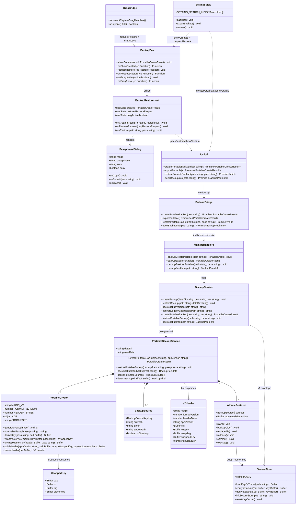
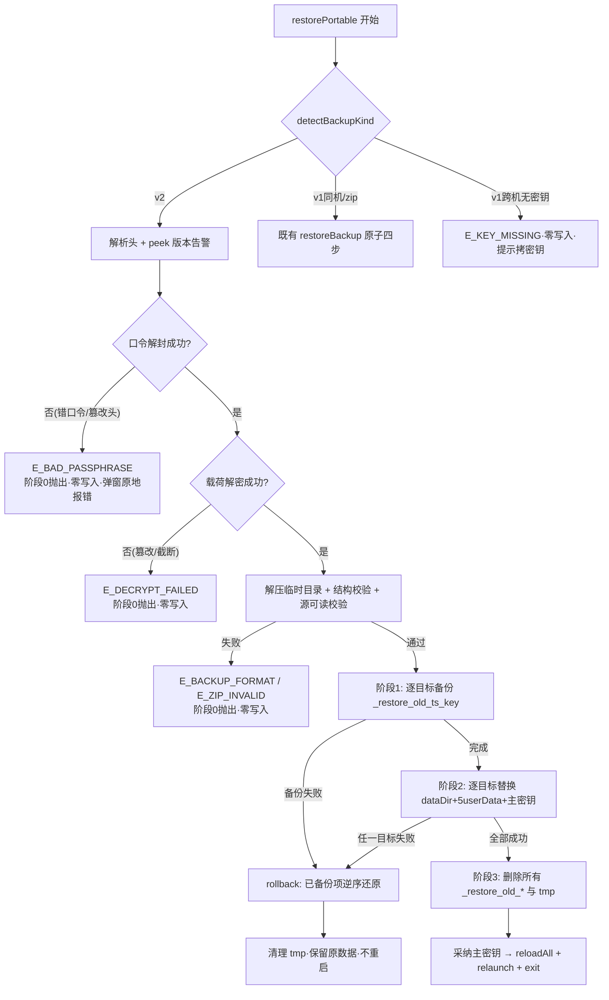
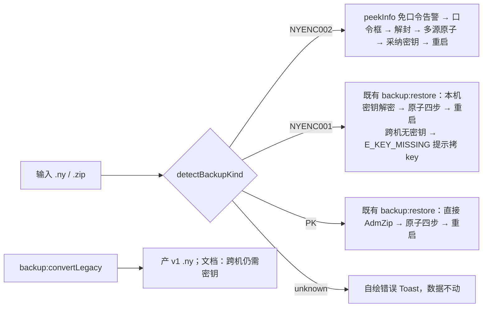
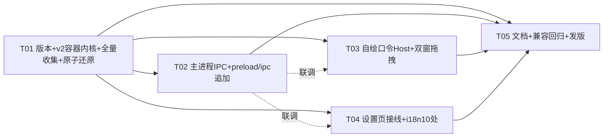

# 念语 v3.0.19 系统架构设计 + 有序任务列表 —— 可携带备份（口令短语 · 换机一键全量还原）

> 文档类型：增量系统设计（基于 v3.0.19 增量 PRD） · 作者：架构师 高见远 · 语言：中文
> 基线版本：3.0.18（HEAD `e6c5609`，工作区仅新增 PRD 文档） · 目标版本：**3.0.19**
> 仓库：`H:/NY/Nianyu-Chat` · 上游输入：`docs/v3.0.19-portable-backup-prd.md`（许清楚，218 行）
> 主理人裁定优先级高于 PRD §6 待确认项，本文已全部落地；所有符号名 / 行号均经真实代码核对，实现以符号名为准。

---

## 0. 主理人裁定落地索引（本文硬约束来源）

| # | 裁定 | 落地章节 |
|---|---|---|
| 1 | 口令 24 位 Crockford base32（去 I/L/O/U），`randomBytes(15)`；scrypt `N=2^15,r=8,p=1,keylen=32` + 16B salt；AES-256-GCM 封装 32B 主密钥（12B IV + 16B TAG）；**绝不裸放主密钥** | §1.4 / §1.7 / §3.3 / §8 |
| 2 | v2 魔数 `NYENC002`，头部含 formatVersion / appVersion 明文 / salt / IV / TAG / 封装主密钥 / 载荷长度；载荷整包加密 zip，内部 `data/` + `userdata/` 分区；v1 `NYENC001` 与旧 zip 三态识别互不破坏 | §1.3 / §1.5 / §3.3 / §4 |
| 3 | 全量状态清单：`dataDir` 全部 + skills.json + proactive-nhpp.json + custom-sounds + character-runtime；排除 path-config / custom-data-path / nianyu-master.key / tts-cache / `.nyenc.tmp` | §1.5 / §2 / §8 |
| 4 | 小窗拖拽冲突已解决：`src/main.tsx` 为主窗与 `#mini` **共用渲染入口**，`ConfirmHost`/`FilePickerHost` 已并列挂载。新增 `BackupRestoreHost.tsx` + document 级拖放监听；**严禁改** `MiniChat.tsx`/`ChatWindow.tsx`/`cursorCoverState.ts`；`preload.ts`/`src/ipc.ts`/`App.tsx` 只追加 | §1.8 / §2 / §3.5 / §7 T03 |
| 5 | 多源原子还原：先暂存校验 → 每目标 `_restore_old_*` → 任一失败全回滚 → 全成功才删各自安全备份；解封/篡改/版本失败在替换前抛出 | §1.6 / §4.2 / §8 |
| 6 | 兼容：v1 同机旧路径、跨机仍需密钥文件；旧明文 zip 直还原；`backup:convertLegacy` 仍产 v1（文档说明跨机仍需密钥）；v2 才承诺全量一致 | §1.9 / §4.3 / §5 |
| 7 | 版本 3.0.19 + 记录 + tag；i18n 10 处、设置索引、动画三档、14 主题对比度、Guide/使用说明/README/硬编码清单同步；原生弹窗为 0 | §2 / §7 T04/T05 / §9 |

---

# Part A：系统设计

## 1. 实现方案与技术选型

### 1.1 核心难点与对策

1. **主密钥必须随包旅行，但绝不能裸放。** v3.0.18 的所有敏感文件（`store.json`/`settings.json`/媒体）在落盘时已用 `nianyu-master.key` 中的主密钥加密（`electron/secureStore.ts`）。跨机还原时，新机若不持有**同一把**主密钥，即使解开外层容器也读不了里面的 JSON/媒体。这正是 v1 跨机必须手拷密钥文件的根因。
   **对策**：v2 用「口令派生 key → AES-256-GCM 封装主密钥」把主密钥**密文**放进头部；还原时先用口令解封出主密钥，再用它解密载荷，并在原子替换阶段把该主密钥**采纳为新机的 `nianyu-master.key`**（同样纳入备份/回滚）。这样 v2 真正做到「只记口令、不拷密钥」。（§1.7）
2. **口令语义与三态识别。** 容器识别一律按魔数，绝不按扩展名：`NYENC002` → v2；`NYENC001` → v1；无魔数且首字节 `PK` → 旧明文 zip；其余 → unknown。新增纯函数 `detectBackupKind(buf)` 作为唯一判据，`peekBackupVersion` / `peekBackupInfo` / `restore*` 共用，避免三处各写一份 if。
3. **口令只显示一次且零留存。** 口令由渲染层在收到 create 返回值后经渲染层事件总线推给 Host 自绘展示；主进程不写日志、不落盘、不进设置、`peek*` 永不输出任何密钥材料。关闭对话框即丢弃内存态。
4. **多源原子还原的一致性。** 目标是 6 类源（dataDir + 5 类 userData）+ 1 个特殊目标（主密钥文件）。采用「预检全通过 → 逐个备份旧目标 → 逐个替换 → 全成功才删所有安全备份；任一步失败逆序回滚已动目标」的两阶段提交式流程，所有失败点都在**替换前或回滚保护下**。（§1.6）
5. **冻结区 vs 小窗拖拽。** 已核对：`src/main.tsx:47-65` 是主窗 `<App/>` 与小窗 `<MiniChat/>` 的**共用渲染入口**，Host 以并列方式挂载且两窗共享。因此在 `main.tsx` 追加 **document 捕获阶段**全局拖放监听 + 挂载 `BackupRestoreHost` 即可同时覆盖两窗，**零改动** `MiniChat.tsx` / `ChatWindow.tsx` / `cursorCoverState.ts`；`preload.ts` / `src/ipc.ts` / `App.tsx` 只在文件末尾追加。（§1.8）
6. **自绘弹窗铁律。** 复用 `ConfirmDialog` 范式：`createPortal(..., document.body)` + `.modal-mask/.modal` 三件套 + `useRetract(...,'theme')`（该组已登记 `.modal-*` 与 `.quick-import-overlay`，见 `src/utils/animControl.ts:228`），焦点锁 / Esc / Enter / 遮罩关闭。`scripts/verify-no-native-dialog.mjs` 断言 `window.alert/confirm/prompt` 为 0、`dialog.showMessageBox/showOpenDialog/showSaveDialog` 为 0。

### 1.2 技术选型（沿用现有技术栈，零新增运行时依赖）

| 关注点 | 选型 | 理由 |
|---|---|---|
| 对称加密 | Node 内置 `node:crypto` `createCipheriv/createDecipheriv('aes-256-gcm')` | 与 v3.0.18 `secureStore` 同一原语；AEAD 篡改即失败；零原生编译 |
| 口令派生 | `scrypt(passphrase, salt, {N:2^15, r:8, p:1, keylen:32})` | 内存硬（约 32MB/次），抗暴力；Node 内置；参数固化可复现（§1.4） |
| 口令格式 | 24 字符 Crockford base32（15B 熵=120bit），6 组 ×4 字符，组间 `-` | 去掉 I/L/O/U 易混字符，人类可读可抄；输入容错 I/L→1、O→0 |
| 主密钥封装 | AES-256-GCM（12B IV + 16B TAG + 32B 密文），AAD = v2 头前 44B | 既保密又认证；AAD 把 salt/版本/明文 appVersion 绑定进标签，篡改即失败 |
| 载荷加密 | 直接复用 `encryptBackup(zipBuf, masterKey)` = `NYENC001|IV12|TAG16|CIPHERTEXT` 信封 | 新机用解封出的主密钥调 `decryptBackup(payload, masterKey)` 即可；**不改 secureStore 加密原语** |
| zip 读写 | 既有 `adm-zip@^0.5.16` | 内存生成/读取，明文 zip 只在内存与临时目录出现 |
| 架构模式 | 主进程 `PortableCrypto`（纯函数）+ `PortableBackupService`（IO/编排）+ `AtomicRestorer`（事务）;渲染层 `backupBus`（进程内事件总线）+ `BackupRestoreHost`（唯一宿主）+ `PassphraseDialog`（纯 UI） | 纯模块可被 QA 用 esbuild 抠出直接执行（复用 `scripts/verify-*` 抽取范式），行为级可证伪 |
| 状态管理 | React `useState/useEffect` + `window.api`，不引入 Redux/Zustand | 与既有 `ConfirmHost` / `FilePickerHost` 一致，最小变更 |

### 1.3 v2 容器字节布局（最终形态，最高优先级）

**扩展名仍为 `.ny`（磁盘小写 / UI `.NY`）；识别一律按魔数。** v2 容器 = **112B 明文头 + v1 信封载荷**。明文头不含任何用户内容，只含版本元信息与被封装的主密钥密文；appVersion 为明文但无隐私（仅版本号），供 `peekBackupInfo` 在高版本告警时使用，读取时**不需要口令、不触碰密钥**。

```
offset  size   field                     说明
0       8      MAGIC = ASCII "NYENC002"  魔数，首字节 'N'（≠ 'P'，通用解压工具打不开）
8       2      FORMAT_VERSION  u16 BE    固定 = 2；将来格式升级据此分流，避免魔数 proliferation
10      2      HEADER_BYTES    u16 BE    固定 = 112（自描述，peek 可先校验长度）
12      16     APP_VERSION     ASCII     明文版本号，右侧 \0 补齐（如 "3.0.19"+10×0x00）；无隐私
28      16     KDF_SALT        bytes     randomBytes(16)，scrypt 盐
44      12     WRAP_IV         bytes     randomBytes(12)，封装主密钥的 AES-GCM IV
56      16     WRAP_TAG        bytes     封装主密钥的 AES-GCM AuthTag
72      32     WRAPPED_KEY     bytes     AES-256-GCM(derivedKey, WRAP_IV, masterKey32) 的**密文**
104     8      PAYLOAD_LEN     u64 BE    紧跟其后的载荷信封总字节数（含其 36B 头）
112     N      PAYLOAD         bytes     = encryptBackup(zipBuffer, masterKey)
                                         即 NYENC001(8) | IV(12) | TAG(16) | CIPHERTEXT(N-36)
```

- **封装 AAD** = `container.subarray(0, 44)`（MAGIC + FORMAT_VERSION + HEADER_BYTES + APP_VERSION + KDF_SALT）。解封时必须用同一区间重建 AAD；篡改 appVersion/salt/版本 → 封装 TAG 校验失败 → `E_BAD_PASSPHRASE`。
- **载荷不再另存 IV/TAG**：直接是标准 v1 信封，`decryptBackup(payload, recoveredMasterKey)` 一步还原 zip（AEAD 自带完整性，篡改/截断 → `E_DECRYPT_FAILED`）。
- **无密钥材料的明文出现**：头部 112B 中搜索 32B 主密钥 base64 / JSON `key` 字段命中数必须为 0（QA 断言）；`WRAPPED_KEY` 是口令相关的认证密文。
- **总长度约束**：`file.length === HEADER_BYTES + PAYLOAD_LEN`，不符 → `E_BACKUP_FORMAT`（防止尾部追加/截断）。

```
┌────────── NYENC002 容器 ──────────┐
│ 明文头 112B（无用户内容）          │
│  MAGIC│VER│HDR_LEN│appVersion(16) │
│  salt(16)│wrapIV(12)│wrapTAG(16)   │
│  wrapped_key(32)│payloadLen(8)    │
├────────────────────────────────────┤
│ 载荷 = NYENC001 信封               │
│  MAGIC│IV(12)│TAG(16)│密文 zip     │  ← 内层 zip 仅在此处与临时目录存在
│  ├ _backup_meta.json (appVersion/createdAt/format/sources 清单)
│  ├ data/            ← dataDir 全部（排除 tts-cache 与 .nyenc.tmp）
│  └ userdata/
│      ├ skills.json (+ skills/ 若存在)
│      ├ proactive-nhpp.json
│      ├ custom-sounds/
│      └ character-runtime/
└────────────────────────────────────┘
```

### 1.4 口令 KDF 可复现配方（固化参数，写死在 `electron/portableBackup.ts`）

```
【生成】
raw          = crypto.randomBytes(15)                       // 120 bit
ALPHABET     = '0123456789ABCDEFGHJKMNPQRSTVWXYZ'           // Crockford，32 字符，无 I/L/O/U
chars24      = base32Encode(raw, ALPHABET)                  // 15B → 恰好 24 字符（5bit/字符）
display      = [0..5].map(g => chars24.slice(g*4, g*4+4)).join('-')   // 形如 X7KQ-9M2P-3VZT-8WHR-6NJL-4YDC

【归一化（输入侧，容错）】
normalize(p) = p.trim().toUpperCase().replace(/[-_\s]/g,'').replace(/[IL]/g,'1').replace(/O/g,'0')
校验：长度 === 24 且 chars24 每字符 ∈ ALPHABET，否则 E_BAD_PASSPHRASE

【派生 + 封装】
salt         = crypto.randomBytes(16)
derivedKey   = crypto.scryptSync(normalize(display) /*UTF-8*/, salt, 32,
                                 { N: 1 << 15, r: 8, p: 1, maxmem: 64 * 1024 * 1024 })
wrapIV       = crypto.randomBytes(12)
cipher       = createCipheriv('aes-256-gcm', derivedKey, wrapIV)
cipher.setAAD(header.subarray(0, 44))
wrappedKey   = Buffer.concat([cipher.update(masterKey32), cipher.final()])  // 32B
wrapTag      = cipher.getAuthTag()                                          // 16B

【解封】
derivedKey'  = scryptSync(normalize(input), saltFromHeader, 32, sameParams)
decipher     = createDecipheriv('aes-256-gcm', derivedKey', wrapIVFromHeader)
decipher.setAAD(header.subarray(0, 44)); decipher.setAuthTag(wrapTagFromHeader)
masterKey32  = Buffer.concat([decipher.update(wrappedKey), decipher.final()]) // 错口令 → E_BAD_PASSPHRASE
```
> `maxmem` 必须显式给到 64MB（Node scrypt 默认 32MB 对 `N=2^15,r=8` 恰好边界，留余量防 `ERR_CRYPTO_INVALID_SCRYPT_PARAMS`）。参数集中为导出常量 `KDF = { N: 1<<15, r: 8, p: 1, keylen: 32, maxmem: 64*1024*1024, saltBytes: 16 }`，QA 直接读取断言，避免实现漂移。

### 1.5 全量状态清单与容器内分区（不得缩水）

经代码核对：`skills.json` 是技能唯一持久化文件（`electron/skills.ts:26/73-74`，内置技能由 `builtinSkills.ts` 代码种子写入、无独立文件）；`proactive-nhpp.json`（`electron/db.ts:403`）；`custom-sounds/`（`electron/main.ts:6549/6774/8233`）；`character-runtime/`（`electron/characterAssets.ts:54`）。

| # | 源（绝对路径由主进程解析） | 容器前缀 | 还原目标 | 关键性 |
|---|---|---|---|---|
| S1 | `dm.dataDirectory`（`resolveDataDir()`，`electron/db.ts:148/569`）**全部**，含 store.json / settings.json(含模型 Key) / errors.json / images / videos / characters / 日记 / 记忆 / 朋友圈 / 剧情 / 会话聊天记录等 | `data/` | 同一 `dm.dataDirectory` | 用户点名：聊天记录、所有设置 |
| S2 | `userData/skills.json`；若 `userData/skills/` 目录存在则一并纳入（防御性动态枚举） | `userdata/skills.json`、`userdata/skills/` | `userData/` 同名 | 用户点名：安装的 Skill |
| S3 | `userData/proactive-nhpp.json` | `userdata/proactive-nhpp.json` | 同名 | v3.0.18 已加密 |
| S4 | `userData/custom-sounds/`（整目录） | `userdata/custom-sounds/` | 同名 | 用户点名「所有设置/状态一致」 |
| S5 | `userData/character-runtime/`（整目录） | `userdata/character-runtime/` | 同名 | 同上 |
| S6 | 解封出的主密钥（不在 zip 内） | —（仅在 v2 头 `WRAPPED_KEY`） | `userData/nianyu-master.key` | **v2 全量一致的前提**（§1.7） |

**排除（收集时按相对路径过滤，QA 断言包内 0 命中）**：`path-config.json`、`custom-data-path.txt`、`nianyu-master.key`、`tts-cache/**`、任意 `*.nyenc.tmp`、`_backup_meta.json` 在还原时剔除。S2–S5 采用**显式白名单收集**（不整拷 userData），故 path-config / custom-data-path / 密钥天然不进包；S1 的 `data/` 递归收集需跳过名为 `tts-cache` 的目录与 `.nyenc.tmp` 文件。

`_backup_meta.json`（zip 根）结构：
```ts
{ appVersion: string; createdAt: string; format: 2;
  sources: Array<{ key: 'data'|'skills'|'proactive'|'sounds'|'runtime';
                   prefix: string; target: 'dataDir'|'userData'; rel: string }> }
```
`restorePortable` 读取 `sources` 驱动多源还原并校验期望 key 齐全；缺 `sources` 时回退到上表硬编码默认值（防御老脚本）。

### 1.6 多源原子还原（两阶段提交 + 逆序回滚）

```
阶段 0 预检（零写入）：
  detectBackupKind → v2：解析头（长度/版本/PAYLOAD_LEN）→ 高版本告警（peek，无口令）
  → 输入口令 → 解封主密钥（失败 E_BAD_PASSPHRASE，此时零写入）
  → decryptBackup(payload, masterKey) → zip（失败 E_DECRYPT_FAILED，零写入）
  → 解压到 _restore_tmp_<ts> → 校验 data/store.json|settings.json 存在 + meta 合法 + sources 齐全
  → 计算全部目标路径与源路径，逐项确认源可读（任一不满足 → 抛 E_BACKUP_FORMAT，零写入）
阶段 1 备份旧目标：对每个目标（含 S6 主密钥文件）——
  若目标存在 → fs.cpSync 到 `_restore_old_<ts>_<key>`，记录 {key, hadOld:true, backupPath}
  若不存在 → 记录 {key, hadOld:false}，无需备份
  任一步失败 → 对已备份项逆序 fs.rmSync(新)/cpSync(旧) 回滚，清理 tmp，抛 E_RESTORE_FAILED
阶段 2 替换：对每个目标逆/正序 fs.rmSync(目标) → fs.cpSync(源→目标)；S6 用 writeAtomic 写解封密钥
  任一步失败 → 逆序回滚所有已替换目标（有备份则还原，无备份则删除新建），
               并把 S6 主密钥一并回滚；清理 tmp；抛 E_RESTORE_FAILED
阶段 3 提交：全部成功 → 删除所有 `_restore_old_<ts>_<key>` 安全备份及 tmp
成功后（仅此时）：dm.reloadAll(); app.relaunch(); app.exit(0)   // 沿用既有 7005-7010 范式
```
- **关键不变量**：任何 `E_BAD_PASSPHRASE` / `E_DECRYPT_FAILED` / `E_BACKUP_FORMAT` / 结构校验失败都发生在阶段 0，**数据目录与 userData 一字节未动、不重启**。
- 回滚函数是纯 IO 编排、独立可测：QA 注入「第 k 个目标替换时抛错」→ 断言所有 6+1 目标与备份前逐字节一致、无 `_restore_old_*` 残留、无重启调用。

### 1.7 关键决策：采纳备份机主密钥（为什么 v2 能「不拷密钥」）

v3.0.18 起，dataDir 内 JSON 与媒体在落盘时已用 `nianyu-master.key` 的主密钥加密（`secureStore.writeText/writeBinary`）。因此跨机「全量状态一致」的充要条件是：**新机最终持有与备份机相同的主密钥**。

- v1：容器只整包加密、不携带主密钥 → 新机无从获得 → 必须手拷 `nianyu-master.key`（PRD §4.3 的兼容口径）。
- v2：头部用口令派生 key 封装了主密钥 → 解封后得到 `masterKey32` → 既能解开载荷，又在阶段 2 将其写入 `userData/nianyu-master.key`（纳入 §1.6 原子备份/回滚，不裸放进 zip）。采纳后，还原过来的加密 JSON/媒体在新机全部可读，实现「只记口令、不拷密钥、全量一致」。
- 安全边界不变：`nianyu-master.key` 仍**不在备份包内**（只有其 GCM 封装密文）；包内无裸密钥满足 P0-1 可证伪断言。
- 设计取舍：不采用「解密后按新机密钥重加密全部文件」——那需要逐文件判定明文/密文与媒体白名单，改动面大且易漏；采纳主密钥是最小且完备的方案（失败可整体回滚）。

### 1.8 冻结区与非冻结入口（小窗拖拽的具体落地）

已核对真实代码：
- `src/main.tsx:47-65`：主窗 `<App/>` / 小窗 `<MiniChat/>` **同一入口**，`<ConfirmHost/>` / `<FilePickerHost/>` 已并列挂在 `ErrorBoundary` 内、两窗共享。这是本次唯一需要新增全局监听与 Host 挂载的位置。
- `src/App.tsx:93/125/507-537`：主窗根 `onDrag*` + `handleQuickImport`（`api.getPathForFile`）是**既有快速导入**链路，保持不变。
- 方案：在 `src/main.tsx` 追加 **document 捕获阶段**（`addEventListener(type, handler, true)`）的 `dragenter/dragover/dragleave/drop` 监听：
  - 仅当 `dataTransfer.items/files` 中存在 **`.ny`（大小写不敏感）** 文件时接管：`preventDefault()` + `stopPropagation()`（`drop` 再加 `stopImmediatePropagation()`），阻止事件到达 React root，因而**不会**触发 App.tsx 快速导入或 ChatWindow 输入区下落逻辑；其他文件（含角色卡 `.zip`/`.vrm`）**完全不拦截**，既有行为零回归。
  - `getPathForFile` 取真实路径 → `backupBus.requestRestore({ path, source:'drag' })`。
  - overlay 由 Host 渲染，复用 `.quick-import-overlay/.quick-import-card`（已在 `theme` 动画组登记），文案走 `settings.restoreDropHint`。
- **零改动**：`MiniChat.tsx` / `ChatWindow.tsx` / `cursorCoverState.ts`（QA 用 diff 断言）。
- **只追加**：`preload.ts`（`NianyuAPI` 接口 + `api` 对象末尾）、`src/ipc.ts`（同签名透传）、`App.tsx`（本方案无需改 App.tsx；若需在备份区补提示，仅追加）。

### 1.9 兼容矩阵（v2 才承诺全量一致）

| 输入 | 判据（魔数） | 口令 | 密钥来源 | 状态范围 | 结果 |
|---|---|---|---|---|---|
| v2 `.ny` | `NYENC002` | 必须（自绘） | 口令派生 key 解封头内封装密钥，并采纳为主机密钥 | **全量**（§1.5） | 跨机一键、与备份机一致 |
| v1 `.ny` | `NYENC001` | 否 | 同机 `nianyu-master.key`；跨机需手拷 | 仅 dataDir | 旧路径不变（docs 明示跨机需密钥） |
| 旧明文 ZIP | 首字节 `PK` | 否 | 无 | 仅 dataDir | 直还原（旧确认沿用） |
| 转换器产物 | v1 `.ny` | 否 | 同 v1 | 仅 dataDir | `convertLegacy` 仍产 v1；跨机仍需密钥（文档写明） |

---

## 2. 完整文件清单（相对 `H:/NY/Nianyu-Chat`）

### 2.1 新增文件

| 路径 | 职责 |
|---|---|
| `electron/portableBackup.ts` | **纯 Node 模块**（零 electron import，路径由调用方注入）：口令生成/归一化、`scrypt` 封装/解封、v2 头 build/parse、`detectBackupKind`、`collectFullStateSources`、`createPortableBackup`、`restorePortableBackup`（含 `AtomicRestorer`）、`peekBackupInfo`。所有 KDF/布局常量集中于此 |
| `src/utils/backupBus.ts` | 渲染层进程内事件总线：`showCreated` / `requestRestore` / `dragActive` 三事件 + `on*` 订阅（返回 unsubscribe）。仅模块级 `Set<cb>`，无第三方依赖 |
| `src/components/PassphraseDialog.tsx` | 自绘口令对话框（两种模式）：`display`（只读口令 + 复制 + 一次性警示）/ `input`（掩码输入 + 明文切换 + 错误行 + busy）；仿 `ConfirmDialog` 的 portal/焦点锁/Esc/`.modal-*` |
| `src/components/BackupRestoreHost.tsx` | 挂在 `src/main.tsx` 顶层的唯一宿主（与 ConfirmHost 并列，两窗共享）：订阅 bus → 驱动拖入 overlay、创建展示弹窗、还原输入弹窗；调用 `peekInfo` / `showConfirm` / `restorePortable` |
| `scripts/verify-portable-container.mjs` | 闸门：v2 布局字节、口令可复现、封装密文无裸密钥、三态识别、peek 免口令 |
| `scripts/verify-portable-restore-atomic.mjs` | 闸门：全量清单齐备/排除项 0 命中、主密钥采纳、错口令/篡改零写入、注入失败逆序回滚、成功清理安全备份 |
| `scripts/verify-portable-compat.mjs` | 闸门：v1 同机 / v1 跨机无密钥报错 / 旧 zip / 转换器产 v1 四态矩阵 |
| `scripts/verify-portable-i18n-10.mjs` | 闸门：新文案 10 处键集/非空/占位符一致、无中文硬编码 |
| `docs/v3.0.19-portable-backup-design.md` | 本文 |
| `docs/v3.0.19-portable-backup-class.mermaid` | 类图源（本文 §3.1 提取） |
| `docs/v3.0.19-portable-backup-sequence.mermaid` | 时序图源（本文 §4.1 提取） |

### 2.2 修改文件（按模块分组，**追加为主**）

**A. 版本 / 类型 / 主进程内核**
- `package.json`：`version` 3.0.18 → **3.0.19**；`scripts` 追加 `verify:portable-*`（4 条）。
- `src/types.ts`：追加 `BackupKind` / `BackupPeekInfo` / `PortableCreateResult` / `RestoreRequest` / `BackupSourceKey` 类型（§3.2）。
- `electron/secureStore.ts`：仅**追加** `resetKeyCache()`（采纳新主密钥后清 `cachedKey`，供同进程内 reload 兜底；重启本就清）与导出 `KEY_BYTES`；**既有信封/加解密/migrate 一行不动**。
- `electron/backup.ts`：追加 `createPortableBackup` / `restorePortableBackup` / `peekBackupInfo` / `detectBackupKind` 的转发封装（委托 `portableBackup.ts`），保留 `createBackup` / `restoreBackup` / `peekBackupVersion` / `convertLegacyBackup` **逐字不动**（v1 与转换器路径零回归）。
- `electron/main.ts`：在 `backup:convertLegacy`（`:7021`）之后**追加** 4 个 handler：`backup:createPortable` / `backup:exportPortable` / `backup:restorePortable` / `backup:peekInfo`；`backup:restore`(`:7005`) 等既有 handler 一行不动。复用既有 `uniquifyBackupDest` / `backupFileName` / `dm.reloadAll()+relaunch+exit` 范式。

**B. IPC 桥（只追加）**
- `electron/preload.ts`：`NianyuAPI` 接口（backup 段 `:384-390` 之后）追加 4 签名；`api` 对象（`:1075` 之后）追加 4 行 `ipcRenderer.invoke`；`convertLegacyBackup`(`:683/1421`) 与 cursor 段零改动。
- `src/ipc.ts`：`NianyuAPI` 接口（`:376-382` 之后）与 `api` 包装器（`:803` 附近）同名同签名追加 4 行；既有透传与 cursor 段零改动。

**C. 渲染层**
- `src/main.tsx`：import `BackupRestoreHost`；追加 document 捕获阶段拖放监听（§1.8）；在 `<FilePickerHost/>` 之后并列挂载 `<BackupRestoreHost/>`。**既有 12-60 行（含 ConfirmHost/FilePickerHost/autoContrast）零改动**。
- `src/components/Settings.tsx`：`backup()`(`:1566`) 改调 `api.createPortableBackup(dest)` 并在成功后 `backupBus.showCreated(result)`；`exportBackup()`(`:1666`) 改调 `api.exportPortable()` 同样弹口令；`restore()`(`:1603`) 选文件后改 `backupBus.requestRestore({path, source:'settings'})`（高版本告警/二次确认逻辑下沉 Host，复用 `settings.backupVersionWarn` 与 `settings.confirmRestore`）；备份区描述补 `settings.backupPortableDesc`（v2 口令跨机 / v1 跨机仍需密钥 / 排除本地路径配置）；`SETTING_SEARCH_INDEX`(`:309`) 的 `sec-backup` 关键词补「口令/passphrase/换机/portable」。按钮数量不变。
- `src/styles/index.css`：追加 `.backup-drop-*` 与口令弹窗内 `.pass-*` 少量样式（正文 `var(--color-text)`，复制反馈 `var(--color-text)`+半透明底），overlay 复用既有 `.quick-import-overlay` 不新增关键帧。
- `src/utils/animControl.ts`：**优先复用 `theme` 组**（`.modal-*`、`.quick-import-overlay` 已登记，Host 与 Dialog 均传 `'theme'`）；若新增专属 `.pass-*` 过渡，则新增 `id:'backup'` 组并在 `verify-anim-trimode.mjs` 的 `ADDED` 表登记 4 个选择器（关本组死 / 关他组活）。
- `src/i18n/translations.ts`：zh + en 追加 `settings.backupPass*` / `settings.restorePass*` / `settings.restoreDropHint` / `settings.backupPortableDesc` / `settings.restorePassWrong` / `animCtl.groupBackup`（若建 backup 组）。
- `src/i18n/locales/{de,es,fr,ja,ko,pt,ru,zh-Hant}.json`：同键集合翻译（共 **10 处**：translations zh/en + 8 JSON），占位符 `{path}` `{pass}` 逐字一致。

**D. 文档与收尾**
- `使用说明.md §21`（`:1383-1417` 一带，含旧「跨设备须拷密钥」表述）：改为「v2 用一次性口令跨机还原；v1 / 转换器产物跨机仍需 `nianyu-master.key`；path-config 等机器本地配置不进包也不覆盖」；`README.md`、`GuideView.tsx`（`GUIDE` 备份节 `:603-612` 同步）、`硬编码清单.md`（登记 `NYENC002` / KDF 常量 / 新 IPC 名 / 新文件）、`版本更新记录.md`（顶部「最新发版」改 v3.0.19，最上方新增段，历史段不动）。

**E. 冻结文件（零改动，QA diff 断言）**
- `src/components/MiniChat.tsx`、`src/components/ChatWindow.tsx`、`electron/cursorCoverState.ts`、`electron/cursorHotspotMigration.ts`、`electron/cursorCoverState.ts` 及 preload/ipc.ts 中 cursor 相关条目。

---

## 3. 数据结构与接口

### 3.1 类图（Mermaid `classDiagram`）



### 3.2 TypeScript 类型（追加于 `src/types.ts`）

```ts
// ===== v3.0.19 可携带备份 =====
export type BackupKind = 'v2' | 'v1' | 'zip' | 'unknown';
export type BackupSourceKey = 'data' | 'skills' | 'proactive' | 'sounds' | 'runtime' | 'master-key';

export interface BackupPeekInfo {
  kind: BackupKind;
  appVersion: string | null;   // v2 直接读明文头；v1/zip 读 _backup_meta.json；失败 null
  format: number | null;       // v2 = 2；其余 null
  size: number;                // 文件字节数
}

export interface PortableCreateResult {
  path: string;                // 实际写入路径（已过 uniquifyBackupDest）
  passphrase: string;          // 24 位 Crockford base32，6 组 ×4，带 '-'；仅此一次返回
}

export interface RestoreRequest {
  path: string;
  source: 'drag' | 'settings';
}

export interface BackupSource {
  key: BackupSourceKey;
  srcPath: string;             // 解包临时目录中的源 或（master-key）解封出的 key Buffer
  prefix: string;              // 容器内前缀
  targetPath: string;          // 还原目标绝对路径
  isDirectory: boolean;
}
```

### 3.3 v2 头字段与 IPC 签名

**v2 头字段**（详见 §1.3 字节布局表）：`MAGIC(8)` / `FORMAT_VERSION(u16)` / `HEADER_BYTES(u16=112)` / `APP_VERSION(16B ASCII)` / `KDF_SALT(16B)` / `WRAP_IV(12B)` / `WRAP_TAG(16B)` / `WRAPPED_KEY(32B)` / `PAYLOAD_LEN(u64)`；载荷为 `NYENC001` 信封。

**新增 IPC 通道（全部追加，既有通道零改动）**

| 通道 | 签名 | handler 位置 |
|---|---|---|
| `backup:createPortable` | `(destPath: string) => Promise<PortableCreateResult>` | `electron/main.ts` backup 段追加（`:7023` 后）；内部 `uniquifyBackupDest` → `createPortableBackup` → 返回 `{path, passphrase}` |
| `backup:exportPortable` | `() => Promise<PortableCreateResult>` | 同上；复用 `s.backupDir` + `backupFileName()`，无对话框 |
| `backup:restorePortable` | `(path: string, passphrase: string) => Promise<void>` | 同上；成功才 `dm.reloadAll(); app.relaunch(); app.exit(0)`；失败仅抛错不重启 |
| `backup:peekInfo` | `(path: string) => Promise<BackupPeekInfo>` | 同上；**不需要口令**；v2 只读明文头，v1/zip 读清单；任何异常返回 `{kind:'unknown', appVersion:null, format:null, size}` |

`preload.ts` 接口追加（backup 段之后，cursor 段不动）：
```ts
createPortableBackup: (destPath: string) => Promise<PortableCreateResult>;
exportPortable: () => Promise<PortableCreateResult>;
restorePortableBackup: (path: string, passphrase: string) => Promise<void>;
peekBackupInfo: (path: string) => Promise<BackupPeekInfo>;
// api 对象末尾追加（与既有 convertLegacyBackup 相邻）
createPortableBackup: (destPath) => ipcRenderer.invoke('backup:createPortable', destPath),
exportPortable: () => ipcRenderer.invoke('backup:exportPortable'),
restorePortableBackup: (path, passphrase) => ipcRenderer.invoke('backup:restorePortable', path, passphrase),
peekBackupInfo: (path) => ipcRenderer.invoke('backup:peekInfo', path),
```
`src/ipc.ts` 的 `NianyuAPI` 与 `api` 包装器按同名同签名追加 4 行透传（如 `peekBackupInfo: (path) => raw.peekBackupInfo(path)`）。

### 3.4 门控纯函数（唯一真源，供 UI / IPC / QA 共用）

```ts
/** 三态识别真源：只按魔数/首字节判定，绝不看扩展名。 */
export function detectBackupKind(buf: Buffer): BackupKind {
  if (buf.subarray(0, 8).toString('ascii') === MAGIC_V2) return 'v2';
  if (buf.subarray(0, 8).toString('ascii') === 'NYENC001') return 'v1';
  if (buf.length >= 2 && buf[0] === 0x50 && buf[1] === 0x4b) return 'zip'; // 'PK'
  return 'unknown';
}
/** 高版本告警：复用 Settings 的 compareVersions，peek 阶段无口令即可判断。 */
export function isBackupNewer(backupVer: string|null, currentVer: string): boolean { /* compareVersions */ }
/** 拖放入口门控：仅 .ny（大小写不敏感）由新流程接管；.zip 等不拦截。 */
export function isPortableBackupFile(name: string): boolean { return /\.ny$/i.test(name); }
/** 备份排除门控：S1 递归收集时命中即跳过。 */
export function isExcludedFromBackup(relPath: string): boolean {
  const n = relPath.toLowerCase();
  return n === 'path-config.json' || n === 'custom-data-path.txt' ||
         n === 'nianyu-master.key' || n.endsWith('.nyenc.tmp') ||
         n.split(/[\\/]/).includes('tts-cache');
}
export function needsPassphrase(kind: BackupKind): boolean { return kind === 'v2'; }
```

### 3.5 `backupBus` 事件契约与 Host 组件接口

```ts
// src/utils/backupBus.ts（渲染层进程内，非 IPC；两窗各自一份，天然只影响本窗）
export interface CreatedEvent  { result: PortableCreateResult }
export interface RestoreEvent  { path: string; source: 'drag' | 'settings' }
export type Unsub = () => void;
export const backupBus = {
  showCreated(result: PortableCreateResult): void,          // Settings 创建成功后调用
  onShowCreated(cb: (e: CreatedEvent) => void): Unsub,
  requestRestore(req: RestoreEvent): void,                  // main.tsx 拖放 / Settings 还原调用
  onRequestRestore(cb: (e: RestoreEvent) => void): Unsub,
  setDragActive(active: boolean): void,                     // main.tsx 拖入/离开调用
  onDragActive(cb: (active: boolean) => void): Unsub,
};
```

**`BackupRestoreHost`（无 props）**：与 `ConfirmHost` 完全同构（队列语义，避免连点丢请求）。内部三块 state：`created`（展示态，关闭即置 null **且不写任何持久层**）、`restore`（当前还原请求）、`dragActive`（overlay）。事件处理：
1. `onShowCreated` → 渲染 `PassphraseDialog mode='display'`，明文口令来自 `result.passphrase`，「复制」走 `navigator.clipboard.writeText`（失败回退隐藏 textarea + `execCommand('copy')`），点击后显示「已复制」；关闭 → `setCreated(null)`，**口令不进 state 之外的任何地方**。
2. `onRestoreRequest` → `api.peekBackupInfo(path)`：
   - `kind==='v2'`：若 `appVersion` 高于当前（复用 `api.updateStatus().currentVersion` + `compareVersions`）先 `api.showConfirm(backupVersionWarn)`；再渲染 `PassphraseDialog mode='input'`。
   - `kind==='v1'|'zip'|'unknown'`：不弹口令，沿用既有 `api.showConfirm(settings.confirmRestore)` + `api.restoreBackup(path)`（v1 跨机无密钥时主进程抛 `E_KEY_MISSING`，Settings 显示可读错误）。
3. `onSubmit(pass)` → `setBusy(true)` → `api.restorePortableBackup(path, pass)`；失败按错误码在对话框内显示 `settings.restorePassWrong`（`E_BAD_PASSPHRASE`）/ `settings.restoreFailed`（其他），**保持对话框打开、不动数据、不重启**；成功则主进程已 relaunch，无需关闭。

**`PassphraseDialog` props**（仿 `ConfirmDialog`）：
```ts
interface PassphraseDialogProps {
  mode: 'display' | 'input';
  open: boolean;
  passphrase?: string;        // display 模式：待展示的一次性口令
  error?: string;             // input 模式：错误行
  busy?: boolean;             // input 模式：验证中禁用按钮/转圈
  onCopy?: () => void;
  onClose: () => void;        // display: 我已保存关闭；input: 取消
  onSubmit?: (pass: string) => void;
}
```
复用 `useRetract(open ? true : null, RETRACT_MS, 'theme')`、`createPortal(...,document.body)`、`.modal-mask/.modal`、焦点锁（input 模式焦点在口令输入框，Tab 环覆盖输入框 + 取消 + 开始还原）、Esc = 取消、Enter = 提交（input）/ 关闭（display）。

---

## 4. 程序调用流程

### 4.1 综合时序（创建→展示口令→封装；拖拽→三态→解封→原子→重启；失败回滚）

```mermaid
sequenceDiagram
    autonumber
    participant U as 用户
    participant S as Settings / main.tsx 拖放
    participant Bus as backupBus (渲染层)
    participant Host as BackupRestoreHost
    participant Dlg as PassphraseDialog
    participant Api as src/ipc.ts → preload
    participant M as main.ts IPC handlers
    participant PB as PortableBackupService
    participant PC as PortableCrypto (pure)
    participant SS as secureStore
    participant FS as 文件系统 (dataDir + userData)

    %% ===== 创建：生成口令 → 封装主密钥 → 一次性展示 =====
    U->>S: 点「创建备份」/「一键导出」
    S->>Api: createPortableBackup(dest) / exportPortable()
    Api->>M: ipcRenderer.invoke('backup:createPortable')
    M->>PB: createPortableBackup(dest, appVersion)
    PB->>PC: generatePassphrase() → 24 位 Crockford (randomBytes 15)
    PB->>PC: deriveKey(pass, salt=randomBytes16) scrypt N=2^15,r=8,p=1
    PB->>SS: loadKeyOrThrow(userData/nianyu-master.key) → masterKey32
    PB->>PC: wrapMasterKey(masterKey32, derivedKey, AAD=head[0:44]) → ct/tag
    PB->>FS: collectFullStateSources() → data/+userdata/ 分区（排除项过滤）
    PB->>PB: AdmZip 内存生成 zip → encryptBackup(zip, masterKey32) 得 v1 信封载荷
    PB->>PC: buildHeader(appVersion,salt,wrap,payloadLen) → 112B
    PB->>FS: writeAtomic(dest, header‖payload) (.ny, 经 uniquify)
    PB-->>M: { path, passphrase }  (口令仅此一次回传；不落盘/不写日志)
    M-->>S: PortableCreateResult
    S->>Bus: showCreated(result)
    Bus->>Host: onShowCreated
    Host->>Dlg: mode='display' 展示明文口令 + 复制按钮 + 「仅显示一次」
    U->>Dlg: 点「复制」→「已复制」→「我已保存，关闭」
    Dlg-->>Host: onClose → setCreated(null)（口令不再留存）

    %% ===== 还原：拖入 → 三态识别 → 口令 → 解封 → 原子替换 → 重启 =====
    U->>S: 把 .ny 拖入主窗或小窗
    S->>Bus: setDragActive(true)（document 捕获，仅 .ny 接管，其他文件放行）
    Bus->>Host: overlay「松开以还原」（复用 .quick-import-overlay）
    U->>S: 松开 → getPathForFile → requestRestore({path, source:'drag'})
    S->>Bus: requestRestore
    Bus->>Host: onRequestRestore(req)
    Host->>Api: peekBackupInfo(path)  (无需口令)
    Api->>M: backup:peekInfo
    M->>PB: peekBackupInfo → detectBackupKind
    alt kind = v2
        PB-->>M: {kind:'v2', appVersion, format:2, size}
        opt appVersion 高于当前版本
            Host->>Api: showConfirm(backupVersionWarn)
            Api-->>Host: 用户确认继续
        end
        Host->>Dlg: mode='input' 输入还原口令
        U->>Dlg: 输入口令 →「开始还原」
        Dlg->>Host: onSubmit(pass)
        Host->>Api: restorePortableBackup(path, pass)
        Api->>M: backup:restorePortable
        M->>PB: restorePortableBackup(path, pass)
        PB->>PC: parseHeader → deriveKey(pass,salt) → unwrapMasterKey (AAD=head[0:44])
        Note over PB,PC: 解封失败 → E_BAD_PASSPHRASE，阶段 0 抛出，零写入
        PB->>SS: decryptBackup(payload, masterKey32) → zip  (AEAD 校验)
        Note over PB,SS: 篡改/截断 → E_DECRYPT_FAILED，零写入
        PB->>FS: 解压到 _restore_tmp_<ts> → 校验 meta + data/store|settings.json + sources
        PB->>PB: AtomicRestorer.execute(): 逐目标 _restore_old_* → 替换(6+1 目标) → 全成功删安全备份
        Note over PB,FS: 任一目标失败 → rollback() 逆序还原已替换目标；无空目录、无重启
        PB->>SS: resetKeyCache()（采纳主机主密钥）
        PB-->>M: ok
        M->>M: dm.reloadAll(); app.relaunch(); app.exit(0)
    else kind = v1 / zip / unknown
        PB-->>M: {kind, appVersion|null,...}
        Host->>Api: showConfirm(settings.confirmRestore)
        Api->>M: (既有 app:confirm → ConfirmHost 自绘)
        Host->>Api: restoreBackup(path)（既有 v1/zip 原子四步；跨机无密钥 → E_KEY_MISSING）
        Api->>M: backup:restore → 成功则 relaunch
    end
```

### 4.2 失败回滚（可证伪分支）



### 4.3 兼容路径（逐字复用既有实现）



---

## 5. Anything UNCLEAR / 风险与待定项

| # | 事项 | 本次决策（已定，不再阻塞） | 残留风险 / 备注 |
|---|---|---|---|
| R1 | 采纳备份机主密钥会不会让新机原有数据不可读？ | 还原是全量替换（dataDir + 5 类 userData + 密钥一起换），旧密钥与其数据同批纳入 `_restore_old_*` 回滚；采纳后与新数据一致 | 若用户只想要「合并」而非「覆盖」，本版不支持（产品口径=全局一致）；文档明示「还原将覆盖当前全部数据」 |
| R2 | 口令遗忘 | 设计上不可恢复（无后门、无日志留存），UI 明确「遗忘将无法还原」 | 需在 Guide/使用说明置顶；P1 可考虑让用户额外导出口令到密码管理器（本次不做） |
| R3 | scrypt 内存/耗时 | `N=2^15,r=8` ≈ 32MB、桌面百毫秒级；`maxmem=64MB`；解封在渲染层触发的主进程执行，按钮 busy 禁用 | 低配小窗设备可能有卡顿，QA 计时 <2s；如超标仅调 `p`，**不改 N/r/keylen**（可复现性铁律） |
| R4 | 大写 `.NY` / `.zip` 拖拽 | 全局监听按 `/\.ny$/i` 识别（含大写）；**`.zip` 不拦截**，仍走既有快速导入/转换器路径 | 用户拖旧 zip 期望直还原时需在设置页选文件即可；文档写清 |
| R5 | 口令输入归一化 | I/L→1、O→0、去 `-`/空格/下划线、转大写；24 字符校验 | Crockford 无障碍细节，QA 断言三种输入等价解封 |
| R6 | `userData/skills/` 目录 | 当前代码只有 `skills.json`（已核对），动态枚举仅为防御；无则跳过 | 不缩水用户点名项；若将来新增技能文件目录自动纳入 |
| R7 | `appVersion` 明文是否泄露隐私 | 只有版本号字符串，无路径/用户名/内容；高版本告警必需 | 作为 v2 头 AAD 一部分，篡改会导致解封失败（防伪造版本） |
| R8 | `peekInfo` 对 v1 密文包 | v1 需本机密钥读清单；无密钥时 `appVersion=null` 但 `kind='v1'` 仍返回，UI 不误报旧 zip | 与 v3.0.18 `peekBackupVersion` 返回 null 语义兼容 |
| R9 | 高版本告警 + 二次确认顺序 | 均在**输入口令前**完成（peek 免口令），确认后才弹口令框；v1/zip 沿用既有确认 | 与 PRD P1-3/P1-4 一致 |
| R10 | 动画分组 | 优先复用 `theme` 组（零新增组）；仅当新增 `.pass-*` 专属过渡才建 `backup` 组并登记 `verify-anim-trimode.mjs` | 建组则 14 主题对比度需复测 |

---

# Part B：任务分解

## 6. 依赖包清单

**新增运行时依赖：无。** 全部使用 Node 内置模块与既有依赖：
```
- node:crypto（内置）: scryptSync / randomBytes / createCipheriv / createDecipheriv('aes-256-gcm')
- node:fs / node:path（内置）: 收集、原子写（.nyenc.tmp + renameSync）、多源替换与回滚
- adm-zip@^0.5.16（已装）: v2 载荷 zip 内存读写（加密在 zip 之外）
- esbuild（vite 传递依赖，scripts 已用）: QA 脚本抽取 portableBackup.ts 纯函数转译执行
- electron@^32.1.2 / react@^18.3.1 / typescript@^5.6.2（已装，版本不变）
```
> 明确禁止引入 `node-forge` / `crypto-js` / `sodium-native` 等新依赖或原生编译方案。剪贴板用 web API `navigator.clipboard` + `execCommand` 回退，零新增依赖。

## 7. 有序任务列表（5 个任务，按依赖顺序）

### T01 — 版本 / v2 容器内核 / 全量收集 / 原子还原（主进程纯逻辑）
- **优先级**：P0 · **依赖**：无
- **源文件**：`package.json`、`src/types.ts`、`electron/portableBackup.ts`（新）、`electron/secureStore.ts`（追加 resetKeyCache/导出 KEY_BYTES）、`electron/backup.ts`（追加 4 个转发，既有路径不动）
- **实现要点**：版本 3.0.19；§1.3 字节布局 + §1.4 KDF 常量；口令生成/归一化；v2 头 build/parse（含 AAD=head[0:44]、长度自校验）；`collectFullStateSources`（§1.5 白名单 + 排除门控）；`createPortableBackup`（封装主密钥、整包加密、一次性返回口令）；`AtomicRestorer`（§1.6 两阶段 + 逆序回滚）；`peekBackupInfo`（免口令三态）；`detectBackupKind` 等门控纯函数。**secureStore 既有信封一行不改**。
- **验收点**：
  1. `node scripts/verify-portable-container.mjs` 全绿：头 112B、魔数 `NYENC002`、`PAYLOAD_LEN` 与文件长度相符；同一口令派生 key 固定、错误口令 unwrap 抛 `E_BAD_PASSPHRASE`；头/载荷搜索 32B 主密钥 base64 与 JSON `key` 字段命中 0；`detectBackupKind` 对 v2/v1/PK/乱码四态正确；`peekBackupInfo` 不需口令且返回写入的 appVersion。
  2. `node scripts/verify-portable-restore-atomic.mjs` 全绿：包内 `data/` + `userdata/{skills.json,proactive-nhpp.json,custom-sounds/,character-runtime/}` 齐备，排除项（path-config/custom-data-path/nianyu-master.key/tts-cache/.nyenc.tmp）命中 0；还原后 6+1 目标逐字节一致且主密钥被采纳；错口令/篡改头/篡改载荷/结构缺失四类均在替换前抛出且目标目录字节不变、无 `_restore_old_*` 残留；注入第 k 步失败 → 全部目标回滚到前态、无空目录、无 relaunch 调用；成功路径安全备份被清空。
  3. v1/转换器既有函数源码与行为 diff 为空；`npm run build` 通过。

### T02 — 主进程 IPC + preload/ipc.ts 追加（只追加，旧通道零改动）
- **优先级**：P0 · **依赖**：T01
- **源文件**：`electron/main.ts`、`electron/preload.ts`、`src/ipc.ts`
- **实现要点**：main.ts 在 `backup:convertLegacy` 之后追加 `backup:createPortable` / `backup:exportPortable` / `backup:restorePortable` / `backup:peekInfo`，复用 `uniquifyBackupDest` / `backupFileName` / `dm.reloadAll()+relaunch+exit`；preload 接口与 api 对象、src/ipc.ts 接口与包装器同名同签名追加 4 行；既有 backup/cursor 通道与 `convertLegacyBackup` 零改动。
- **验收点**：
  1. 源码断言：`backup:restore`(`:7005`)/`backup:create`(`:6996`)/`backup:export`(`:6987`)/`backup:peekVersion` handler 文本 diff 为空；preload/ipc.ts 中 cursor 相关条目 diff 为空。
  2. 四通道 invoke 往返测试：create 返回 `{path,passphrase}` 且口令非空；peek 对 v2 免口令；restore 错口令不触发 relaunch；成功路径触发 reload+relaunch+exit（stub 计数）。
  3. `npm run build` 通过，`tsc` 无类型错误。

### T03 — 自绘口令 Host + 双窗拖拽（冻结区零改动）
- **优先级**：P0 · **依赖**：T01（编码按 §3.3/§3.5 冻结契约；T02 落地后联调）
- **源文件**：`src/utils/backupBus.ts`（新）、`src/components/PassphraseDialog.tsx`（新）、`src/components/BackupRestoreHost.tsx`（新）、`src/main.tsx`、`src/styles/index.css`、`src/utils/animControl.ts`
- **实现要点**：bus 三事件；Dialog 两模式（display 复制反馈 / input 掩码+明文切换+错误行+busy），portal + `.modal-*` + `useRetract(...,'theme')` + 焦点锁 + Esc/Enter；Host 队列语义，订阅 bus、调 peekInfo/showConfirm/restorePortable；main.tsx 追加 document **捕获阶段**拖放监听（仅 `.ny/i` 接管，成功后才 `stopPropagation`，其他文件放行）+ 并列挂载 Host；样式正文 `var(--color-text)`；动画复用 `theme` 组（如需新组则登记 ADDED 表）。
- **验收点**：
  1. 主窗与小窗（`#mini`）各拖入 v2 包 → 均出现 overlay 与口令框；拖入角色卡 `.zip/.vrm` → 新监听不拦截，既有快速导入正常（QA 断言 `isPortableBackupFile` 门控 + 事件冒泡未被 stop）。
  2. 复制按钮有「已复制」反馈；口令关闭后全仓 UI/日志/设置无再次查看入口；错口令原地报错、数据不动、不重启。
  3. 代码扫描 `window.prompt/confirm/alert` = 0、`dialog.showMessageBox/showOpenDialog/showSaveDialog` = 0（`node scripts/verify-no-native-dialog.mjs` 全绿）。
  4. `git diff -- src/components/MiniChat.tsx src/components/ChatWindow.tsx electron/cursorCoverState.ts electron/cursorHotspotMigration.ts` 为空；`main.tsx` 既有行 diff 为空（仅 import + 监听 + 挂载）；14 主题下新弹窗正文对比度 AA。

### T04 — 设置页接线 + i18n 10 处 + 设置索引
- **优先级**：P0 · **依赖**：T01（编码按 §3.3/§3.5 冻结契约；T02 落地后联调，可与 T03 并行）
- **源文件**：`src/components/Settings.tsx`、`src/i18n/translations.ts`、`src/i18n/locales/{de,es,fr,ja,ko,pt,ru,zh-Hant}.json`、`scripts/verify-portable-i18n-10.mjs`（新）
- **实现要点**：`backup()`/`exportBackup()` 改调 portable 通道并 `backupBus.showCreated`；`restore()` 改 `backupBus.requestRestore`（高版本告警/二次确认下沉 Host，复用既有 i18n 键）；备份区描述补 `settings.backupPortableDesc`；`sec-backup` 索引关键词补「口令/passphrase/换机/portable」；新增 `settings.backupPass*`/`settings.restorePass*`/`settings.restoreDropHint`/`settings.backupPortableDesc`/`settings.restorePassWrong` 及可选 `animCtl.groupBackup` 共 10 处同步、占位符逐字一致。
- **验收点**：
  1. `node scripts/verify-portable-i18n-10.mjs`、`node scripts/verify-i18n.mjs`、`npm run verify:i18n-coverage` 全绿：10 处键集相等、无空值、占位符一致、无中文硬编码。
  2. `node scripts/verify-settings-index.mjs` / `verify-settings-cats.mjs` 全绿：`sec-backup` 命中新关键词、7 分类顺序不变、按钮数量不变。
  3. 设置页创建/导出 v2 包后弹一次性口令框；还原 v2 包体验与拖拽一致；高版本告警 + 二次确认仍生效；v1/zip 走旧路径不变。

### T05 — 文档同步 / 全量回归 / 版本记录与发版
- **优先级**：P0 · **依赖**：T01、T02、T03、T04
- **源文件**：`使用说明.md`（§21）、`README.md`、`src/components/GuideView.tsx`、`硬编码清单.md`、`版本更新记录.md`、`scripts/verify-portable-compat.mjs`（新）、`package.json`（verify 脚本登记）
- **实现要点**：文档把「所有跨机都要拷密钥」改为「v2 用一次性口令；v1/转换器产物跨机仍需密钥；本地路径配置不进包/不覆盖」；`GuideView.GUIDE` 与《使用说明.md》中文逐字一致；`硬编码清单.md` 登记 `NYENC002` / KDF 常量 / 4 个新通道 / 新文件；版本记录顶部改 v3.0.19 并新增段（历史段不动）；补全 `verify-portable-compat.mjs`（v2 / v1 同机 / v1 跨机无密钥 / 旧 zip / 转换器四态矩阵）；全量 QA。
- **验收点**：
  1. `node scripts/verify-portable-compat.mjs` 全绿：v1 同机还原成功；v1 跨机无密钥抛 `E_KEY_MISSING` 且零写入；旧 zip 直还原；`convertLegacyBackup` 产物首字节 `N`、可被还原、`peekBackupVersion` 返回源版本、原 zip sha256/mtime 不变。
  2. 全量 `npm run build` + 既有全部 `verify-*`（含 cursor 5 脚本、`verify-export.mjs`、`verify-no-native-dialog.mjs`、`verify-anim-trimode.mjs`、14 主题对比度）无新增红项；`git status` 无冻结文件改动。
  3. `python scripts/push-remote.py -m "feat(v3.0.19): 可携带备份（口令短语 · 换机一键全量还原）" --tag`，token 取 `.git/nianyu/token`，远端出现 main 新 commit 与 tag `v3.0.19`。

### 7.1 任务依赖图



---

## 8. Shared Knowledge（跨文件约定，工程师必须遵守）

1. **命名与常量（集中在 `electron/portableBackup.ts`，QA 直接读断言）**
   - `MAGIC_V2='NYENC002'`、`MAGIC_V1='NYENC001'`、`FORMAT_VERSION=2`、`HEADER_BYTES=112`；v2 载荷 = v1 信封（`NYENC001|IV12|TAG16|CIPHERTEXT`）。
   - 口令：`CROCKFORD='0123456789ABCDEFGHJKMNPQRSTVWXYZ'`（无 I/L/O/U）、`RAW_KEY_BYTES=15`、`PASS_CHARS=24`、`PASS_GROUPS=6`、`PASS_GROUP_SIZE=4`、显示用 `-` 分组。
   - KDF：`KDF={N:1<<15, r:8, p:1, keylen:32, maxmem:64*1024*1024, saltBytes:16}`；封装 AAD = `header.subarray(0,44)`；`WRAP_IV_BYTES=12`、`WRAP_TAG_BYTES=16`、`PAYLOAD_LEN_BYTES=8`。
   - 容器分区：`data/`、`userdata/`（`skills.json`/`skills/`/`proactive-nhpp.json`/`custom-sounds/`/`character-runtime/`）；清单 `_backup_meta.json` 置根，还原时剔除。
   - 目标 key：`data`/`skills`/`proactive`/`sounds`/`runtime`/`master-key`；临时目录 `_restore_tmp_<ts>`，安全备份 `_restore_old_<ts>_<key>`。
   - IPC 新增：`backup:createPortable` / `backup:exportPortable` / `backup:restorePortable` / `backup:peekInfo`（既有 `backup:create/export/restore/peekVersion/convertLegacy` 全部不动）；渲染层 bus 事件 `showCreated`/`requestRestore`/`dragActive`。
2. **门控唯一真源**：`detectBackupKind` / `needsPassphrase` / `isPortableBackupFile` / `isExcludedFromBackup` / `isBackupNewer` 只在 `electron/portableBackup.ts` 定义；UI/IPC/QA 不得另写一份魔数或扩展名判断。
3. **错误码（IPC `Error.message` 前缀 / `error.code`，UI 用 i18n 映射）**：`E_BAD_PASSPHRASE`（错口令或 v2 头封装校验失败，零写入）、`E_BACKUP_FORMAT`（v2 头/长度/版本/结构非法）、`E_DECRYPT_FAILED`（载荷 AEAD 失败，既有语义）、`E_KEY_MISSING` / `E_KEY_CORRUPT`（v1 缺/坏密钥，既有）、`E_RESTORE_FAILED`（多源替换/回滚失败，含失败 key 于 message，不放堆栈）、`E_ZIP_INVALID`（zip 结构校验失败）、`E_ALREADY_CONVERTED`（既有）。**任何错误路径都不得 relaunch、不得清空目标**。
4. **原子与写盘**：所有新文件写入走 `writeAtomic`（`.nyenc.tmp` + `renameSync`）；v2 还原严格按 §1.6 阶段 0/1/2/3；回滚函数对「原本不存在」的目标执行删除而非还原。成功才删所有 `_restore_old_*`。
5. **口令零留存**：口令只在 `PortableCreateResult` 返回值与 `PassphraseDialog display` 内存态存在；不写日志、不写 `settings.json`、不进 `_backup_meta.json`、不进 `peekInfo`；关闭对话框 `setCreated(null)`。复制反馈不把口令写入 DOM 持久属性。
6. **主密钥边界**：`nianyu-master.key` 永不进 zip；v2 只在头部放其 GCM 封装密文；采纳时经 `resetKeyCache()` 清内存缓存；`peekInfo` 永不输出任何密钥材料。
7. **冻结基线**：`MiniChat.tsx` / `ChatWindow.tsx` / `cursorCoverState.ts` / `cursorHotspotMigration.ts` 零改动；`preload.ts` / `src/ipc.ts` 只在末尾追加；`main.tsx` 既有行零改动；新 Host 与 ConfirmHost/FilePickerHost 并列挂载，两窗共享。
8. **拖放门控**：全局监听只在 document **捕获阶段**接管 `.ny`（大小写不敏感）；命中才 `preventDefault`+`stopPropagation`（drop 加 `stopImmediatePropagation`）；其他文件（尤其角色卡 `.zip/.vrm/.glb`）**必须放行**，保证既有快速导入零回归。
9. **i18n 铁律**：新增 `t('...')` 键在 `translations.ts` zh+en 与 8 JSON 共 10 处齐全；占位符逐字一致；正文 `var(--color-text)`，深色底禁用 `--color-text-secondary`。
10. **动效铁律**：Dialog/overlay 复用 `theme` 组（`.modal-*`、`.quick-import-overlay` 已登记）；若新增 `.pass-*` 关键帧须建 `backup` 组并加入 `verify-anim-trimode.mjs` 的 ADDED 断言；流式 `.stream-char`/`.pseudo-char` 恒开豁免不得被命中。
11. **文档一致性**：`GuideView.GUIDE` 与《使用说明.md》中文逐字一致；《版本更新记录.md》顶部「最新发版」改 v3.0.19、新段置顶、历史段不动；`硬编码清单.md` 同步常量与通道名。
12. **发版**：只用 `python scripts/push-remote.py -m "..." --tag`；token 从 `.git/nianyu/token` 读取，不得提交。

## 9. QA 闸门建议（行为级可证伪）

| 脚本 | 必测断言（可证伪） |
|---|---|
| `verify-portable-container.mjs` | ① v2 头前 8B == `NYENC002`、偏移 10 的 u16 == 112、`FORMAT_VERSION`==2、`file.length === 112+PAYLOAD_LEN`；② 同口令+salt 派生 key 两次相等、换 salt 不等；③ 正确口令 unwrap 得 32B 主密钥，错误口令/篡改 WRAP_TAG/篡改 APP_VERSION/篡改 SALT 均抛 `E_BAD_PASSPHRASE`；④ 头 112B 与载荷搜索主密钥 base64、JSON `"key"` 字段、已知中文片段命中数 **0**；⑤ 载荷首 8B == `NYENC001`，`AdmZip(container)` 打开失败（首字节非 PK）；⑥ `detectBackupKind` v2/v1/PK/乱码四态；⑦ `peekBackupInfo` 无口令返回 `{kind:'v2',appVersion:'3.0.19',format:2}`，篡改载荷不影响 peek（只读头）；⑧ 口令格式：`randomBytes(15)`→24 字符、无 I/L/O/U、6 组 ×4、I/L→1 与 O→0 归一化后等价解封 |
| `verify-portable-restore-atomic.mjs` | ① 造 A 机样本（dataDir 含 store/settings/媒体 + userData 五项），create v2 → 解包断言 `data/`+`userdata/` 分区齐备；② path-config.json / custom-data-path.txt / nianyu-master.key / tts-cache / `.nyenc.tmp` 在包内命中 0；③ 还原到清空样本机后 6+1 目标逐字节一致，`nianyu-master.key` == A 机主密钥（采纳），加密 JSON 可被 `secureStore.readText` 读出；④ 错口令 / 篡改头 / 篡改载荷 / 删 `data/store.json` 四类：目标目录 sha256 前后相等、`_restore_old_*` 数 0、relaunch stub 调用 0；⑤ 注入第 1/3/5 个目标替换时抛错 → 所有目标回滚到前态、无空目录、无安全备份残留、relaunch 0；⑥ 成功路径 `_restore_old_*` 全清、tmp 全清、relaunch 恰好 1 次；⑦ 源码断言 `MiniChat.tsx`/`ChatWindow.tsx`/`cursorCoverState.ts` diff 0、document 监听用捕获阶段且 `isPortableBackupFile` 门控存在 |
| `verify-portable-compat.mjs` | ① v1 `.ny`（3.0.18 格式）同机 `backup:restore` 成功且仅 dataDir 还原；② v1 跨机删密钥 → `E_KEY_MISSING` 且数据零写入；③ 旧明文 zip 直还原成功；④ `convertLegacyBackup(zip)` 产物 v1（魔数 `NYENC001`、非 v2）、可被还原、`peekBackupVersion` 返回源版本、源 zip sha256/mtime 不变；⑤ 四态矩阵下 UI 分流文案键正确（v2 弹口令、其余不弹）；⑥ 文档断言 `使用说明.md §21` 与 `GuideView` 不再写「所有跨机都要拷密钥」，且写明 v1/转换器跨机仍需密钥 |
| `verify-portable-i18n-10.mjs` | ① 枚举 `settings.backupPass*` / `settings.restorePass*` / `settings.restoreDropHint` / `settings.backupPortableDesc` / `settings.restorePassWrong` / `animCtl.groupBackup`（若建组）在 10 处键集两两相等；② 无空值、占位符 `{path}`/`{pass}` 一致；③ `PassphraseDialog.tsx`/`BackupRestoreHost.tsx` 无裸中文（走 `t()`）；④ 描述文案含「v2 口令 / v1 仍需密钥 / 排除本地路径配置」 |
| 既有 `verify-no-native-dialog.mjs` | `src/` 下 `window.alert/confirm/prompt` = 0；`electron/` 下 `showMessageBox/showOpenDialog/showSaveDialog` = 0（注释剥离后计数） |
| 既有 `verify-anim-trimode.mjs` / `verify-theme-surface-matrix.mjs` / `verify-dye-contrast.mjs` | 复用 theme 组则无新增失败；建 backup 组则 4 选择器「关本组死/关他组活」；14 主题新弹窗正文对比度 AA |
| 既有 cursor 5 脚本 / `verify-export.mjs` / `verify-i18n.mjs` / `verify-settings-*` | 全绿；冻结文件 diff 0；`sec-backup` 索引命中、7 分类顺序不变 |

---

## 10. 交付物清单

- 本文：`docs/v3.0.19-portable-backup-design.md`
- 类图源：`docs/v3.0.19-portable-backup-class.mermaid`（本文 §3.1）
- 时序图源：`docs/v3.0.19-portable-backup-sequence.mermaid`（本文 §4.1）
- 未改动任何 `docs/` 历史设计稿（含 `docs/system_design.md`、`docs/v3.0.18-diary-design.md` 等）。
