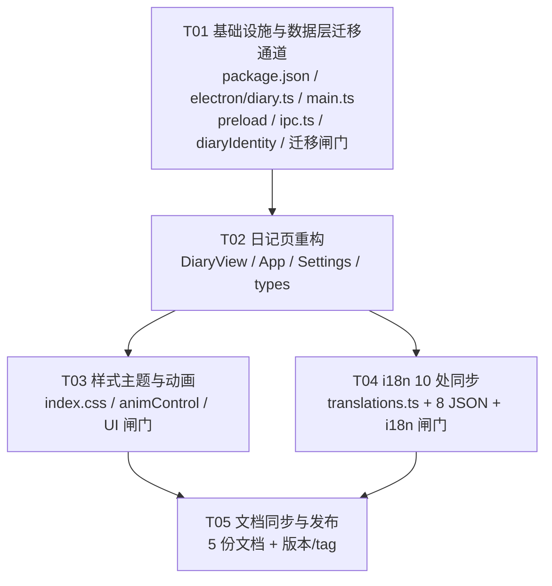

# 念语 v3.0.22 系统架构设计 —— 日记界面重做（单一当前身份 · 自动迁移 · 大输入框与全主题适配）

> 文档类型：增量系统设计 + 有序任务列表 · 架构师：高见远 · 语言：中文
> 基线：v3.0.21（已发布） · 目标版本：**3.0.22** · 上游：`docs/v3.0.22-diary-ui-prd.md`
> 仓库：`H:/NY/Nianyu-Chat` · 冻结区（真实路径已校正）：`src/components/MiniChat.tsx` / `src/components/ChatWindow.tsx` / `electron/cursorCoverState.ts`（相对基线 `3229083` 零增量改动）
> 配套图：`docs/v3.0.22-diary-ui-class.mermaid`、`docs/v3.0.22-diary-ui-sequence.mermaid`

## 0. 基线核对与主理人裁定（最高优先级）

### 0.1 代码基线核对结果（与任务书的一处偏差）

| 项 | 任务书/PRD 口径 | 本机实测 | 处理 |
|---|---|---|---|
| HEAD | `bd8b3723077ab8c72764f4f7f1a51f7541bb1e59`（任务书口径） | **主理人已定**：`bd8b3723…` 是远端 REST 重建 commit；远端 main / tag v3.0.21 为其对应树；本地 HEAD 现为 `322908361a47f106f20bdd383bf663d9993e6261`（拖球双光标闪烁修复，任务 #5），二者 tree 一致 | **基线以本地 `3229083` 的工作树为准**（R0 已裁定）。设计基于真实代码符号名给出，无需再核对远端 SHA。 |
| 工作区 | 干净 | 主理人已裁定：写作期间观察到的并行改动即任务 #5 拖球双光标闪烁 BugFix，已提交为 `3229083`，**属于 v3.0.22 正式范围** | 该批改动是基线的一部分，日记实现必须保留；日记任务不得再改这些文件里的 cursor 门控代码（R8 已裁定）。 |
| `package.json` | 3.0.21 | 3.0.21 | 一致，bump 到 3.0.22。 |

### 0.2 主理人已定（覆盖 PRD 中任何旧表述，逐条落实）

| 编号 | 裁定 | 在本设计中的落点 |
|---|---|---|
| **Q1 迁移** | **写专用不 revoke 的迁移函数**；只改日记与摘要的 `selfRoleId`，**不改 `updated_at`、不 revoke 任何留言/摘要**，并同步改写摘要 `selfRoleId` 使 `collectArtifactsForRole` 继续命中；正文、留言、摘要全保留。`electron/diary.ts:331` 的 `reassignOrphans` 含 `applyRevoke(all=true)`，**不得复用**。 | §1.2、`migrateLegacyDiaries()` / `DiaryStore.migrateLegacySelfRoles()`；门控函数 `canRoleAccessDiary` / `collectArtifactsForRole` 一行不改。 |
| **Q2 真孤儿** | 移除日记页手动孤儿回收入口；迁移范围扩大到「`selfRoleId` 不在当前 selfRoles 列表里的所有日记」（含历史哨兵值与身份已删除的孤儿），自动归到当前默认身份。数据层能力保留，UI 不暴露。 | §1.2 迁移谓词 `!validIds.includes(d.selfRoleId)`；DiaryView 删除 `:376-392` 孤儿 UI；IPC/数据层 `listOrphans`/`reassignOrphans` 原样保留。 |
| **Q3 跳转** | 空状态「去设置创建身份」跳到设置页身份管理分区并高亮，复用现有设置导航/锚点，**严禁原生弹窗**。 | §1.5 `settingsFocusTick` + `focusSelfRoleTick` + `#self-role-manage` + 既有 `flashElement`；`App.tsx` / `Settings.tsx` 仅此一处导航改动。 |
| **Q4 布局** | 正文 textarea 用 `flex:1` + `min-height:320px`，编辑态**内联展开在主区域**，不做覆盖抽屉；结合 `.diary-main{overflow-y:auto}` 保证大/小屏都合理。 | §1.4 CSS 方案；编辑态隐藏列表避免双滚动竞争；`.diary-editor` 无 `position:fixed`。 |
| **Q5 边界** | `currentSelfRoleId` 无效时只在内存回落第一个 selfRole 用于顶部展示与迁移目标，**不回写设置**，不得影响 `chatSelfRoles` 按会话覆盖。 | `resolveDiaryIdentity()` / `resolveDiaryTargetSelfRole()` 纯函数；`resolveActiveSelfRole`（`main.ts:3304`）与 `chatSelfRoles` 零改动；无 `api.saveSettings` 调用。 |
| **Q6 i18n** | `diary.bookNone` / `diary.books` / `diary.orphanHint` / `diary.reassignOrphans` 不再使用时**从 10 处真删**，不留空字符串；新增 `diary.currentIdentity` 在 10 处逐字为 `当前身份（{name}）` / `Current Identity ({name})`（中文全角括号 + `{name}` 占位符）。 | §3.5 键表；§10 G10 静态闸门。 |

### 0.3 最高优先级用户口径（覆盖 PRD 旧文案）

1. 日记页**没有分册列表、没有身份切换器**，只读显示 `当前身份（{name}）`（中文全角括号，`name` = `settings.currentSelfRoleId` 对应自我身份名；无效时内存回落第一个身份）。换身份去设置里切，回日记页跟随变化。
2. UI 与用户文档**彻底不出现旧占位词**。该词仅作为内部迁移实现细节存在；对用户只说「旧日记已归入当前身份」。
3. 必须至少有一个自我身份才能写日记；无身份时显示「请先创建一个身份，再写日记」+ 跳转设置入口。
4. 写日记正文输入框大幅放大，背景/文字色与聊天输入框完全一致（`--input-bg` / `--input-fg`），14 主题 WCAG AA，整体美化。

---

## Part A：系统设计

## 1. Implementation Approach

### 1.1 技术难点与总体取向

| 难点 | 方案 | 为什么不用别的做法 |
|---|---|---|
| 历史日记归属迁移且要保留 AI 产物 | 新增**专用纯迁移函数** `migrateLegacyDiaries()`，只改两个 `selfRoleId` 字段；摘要 `sourceUpdatedAt` 与日记 `updated_at` 因为都没动而天然继续匹配 | 复用 `reassignOrphans()`（`electron/diary.ts:331-345`）会 `applyRevoke(all=true)` + `nextTimestamp()`，直接让留言/摘要失效并打断摘要游标，违反“不丢留言/摘要”。 |
| 日记归属必须可信 | **主进程二次门控**：`diary:create` 严格校验传入 `selfRoleId`，去掉 `p.selfRoleId \|\| current?.id \|\| 'none'` 回退（`main.ts:7074-7085`） | 只靠渲染层门控可被任意 IPC 调用绕过；双层门控是既有 v3.0.18 隔离不变量的延伸。 |
| 当前身份跟随设置但不得污染其它机制 | 纯函数 `resolveDiaryIdentity(settings)` 只读 `settings.selfRoles` / `settings.currentSelfRoleId`，内存回落第一个身份，**绝不回写设置** | 回写无效 id 会破坏 `resolveActiveSelfRole`（`main.ts:3304-3320`）里 `chatSelfRoles[<chatType>:<chatId>]` 的按会话覆盖优先级。 |
| 输入框与聊天框“同一套外观” | **扩展现有 `.chat-input` 声明块**，把 `.diary-input` 并入同一选择器组，而不是复制 `background`/`color` 声明 | `ThemeContext.tsx:89-92` 只在用户设置时才设置 `--input-bg`/`--input-fg`，否则移除并走 fallback。复制 fallback 字面量等于新增硬编码色值；共用声明块则零新增色值且天然同步。 |
| 大输入框 + 小窗/小屏 | `.diary-main` 改为 flex column 且保留 `overflow-y:auto`；编辑态内联并暂时隐藏列表，正文 `flex:1` + `min-height:320px` | 覆盖抽屉与冻结区交互冲突；在滚动容器里给列表和编辑器同时 `flex:1` 会互相压缩，编辑态单主轴最稳。 |
| i18n 10 处不漂移 | 沿用 `scripts/verify-diary-i18n-10.mjs`（已存在，检查 10 处键集/空值/占位符 + DiaryView 无裸中文 + 锚点登记），扩展两条精确断言 | 手工同步 10 个字典必然漂移；脚本是现有闸门，扩展成本最低。 |

**技术栈**：不引入任何新框架或运行时依赖。沿用 Electron 32 `ipcMain.handle` / `contextBridge`、React 18 hooks + TypeScript、Vite；验证脚本沿用 `esbuild` 转译真实 `electron/diary.ts` 的做法（`scripts/verify-diary-ai-isolation.mjs` 已有范式）。

**架构模式**：主进程「纯数据层 + IPC 门控」/ 渲染层「纯选择器 + 单向数据流」。设置是身份的唯一真源；日记页是只读消费者；迁移是主进程对数据的内部修正，不进入 UI 状态机。

### 1.2 数据层迁移（Q1 / Q2 核心）

新增到 `electron/diary.ts`（紧邻 `reassignOrphans` 之后，**不修改它**）：

```ts
export interface DiaryMigrationResult {
  migratedDiaries: number;
  migratedSummaries: number;
  targetSelfRoleId: string | null;
}

/**
 * 内部兼容迁移：把 selfRoleId 不在有效身份列表里的日记（含历史哨兵值与身份已删除的孤儿）
 * 归到 target。只改 selfRoleId 两个字段：不改 updated_at / created_at / 正文 /
 * allowAi / visibleRoleIds / aiComments，不调用 applyRevoke。
 * 摘要同步改 selfRoleId，sourceUpdatedAt 因日记时间戳未动而继续匹配，
 * 因此 collectArtifactsForRole 的门控结果保持原样。
 */
export function migrateLegacyDiaries(
  diaries: DiaryEntry[],
  summaries: DiarySummary[],
  validSelfRoleIds: string[],
  preferredSelfRoleId?: string | null
): DiaryMigrationResult {
  const valid = (Array.isArray(validSelfRoleIds) ? validSelfRoleIds : [])
    .filter((x): x is string => typeof x === 'string' && x.length > 0 && x !== NO_SELF_ROLE);
  const target = valid.includes(String(preferredSelfRoleId || ''))
    ? String(preferredSelfRoleId)
    : (valid[0] || null);
  const result: DiaryMigrationResult = {
    migratedDiaries: 0, migratedSummaries: 0, targetSelfRoleId: target,
  };
  if (!target) return result;                       // 没有任何身份：数据保留但隐藏，不迁移

  const moved = new Set<string>();
  for (const d of diaries || []) {
    if (!d || valid.includes(d.selfRoleId)) continue; // 幂等：迁移后不再命中
    d.selfRoleId = target;                            // 唯一写入点
    moved.add(d.id);
    result.migratedDiaries += 1;
  }
  if (moved.size === 0) return result;

  for (const s of summaries || []) {
    if (!s || !moved.has(s.diaryId) || s.selfRoleId === target) continue;
    s.selfRoleId = target;                            // 唯一写入点；text/revoked/游标/快照原样
    result.migratedSummaries += 1;
  }
  return result;
}
```

`DiaryStore` 新增薄封装（照既有 `save()` 原子写口径）：

```ts
migrateLegacySelfRoles(validSelfRoleIds: string[], preferredSelfRoleId?: string | null): DiaryMigrationResult {
  const r = migrateLegacyDiaries(this.diaries, this.summaries, validSelfRoleIds, preferredSelfRoleId);
  if (r.migratedDiaries > 0 || r.migratedSummaries > 0) this.save();
  return r;
}
```

**四条硬保证如何成立**

1. **幂等**：条件为 `!validIds.includes(d.selfRoleId)`，迁移后 `selfRoleId === target ∈ validIds`，二次执行返回两个 0，`save()` 不触发、文件字节不变。
2. **不丢正文**：只写 `selfRoleId`；`content` / `date` / `title` / `allowAi` / `visibleRoleIds` / `aiComments` / `created_at` 均未触碰。
3. **不丢留言/摘要**：`aiComments` 没有 `selfRoleId` 字段，其可见性经所属日记的 `selfRoleId` 判定，自动随迁；摘要仅改自身 `selfRoleId`，`revoked` / `text` / `visibleRoleIdsSnapshot` / `sourceUpdatedAt` 原样。全程无 `applyRevoke`、无 `nextTimestamp`。
4. **门控自洽**：`collectArtifactsForRole`（`electron/diary.ts:72-102`）要求 `d.selfRoleId === input.selfRoleId && s.selfRoleId === input.selfRoleId && s.sourceUpdatedAt === d.updated_at`；迁移后前两者同时变为 `target`，第三者因双方时间戳都没改而保持相等 —— 产物集合与迁移前逐字一致（仅查询身份从旧值变为 `target`）。`canRoleAccessDiary` / `shouldGenerateComments` / `buildDiaryContextBlock` 一行不改。

> 摘要若历史上本就存在 `sourceUpdatedAt !== diary.updated_at` 的陈旧游标，本次**刻意不修复**（不属于本需求，且重算会凭空让旧产物重新注入）；QA 用例须用游标匹配的正向夹具验证“迁移前后产物一致”。

### 1.3 主进程 IPC：门控与三个触发时机

**IPC 新增通道** `diary:ensureMigrated`，三端同步：`electron/preload.ts`（约 `:686` / `:1425`）、`src/ipc.ts`（`:639` / `:806`）、`electron/main.ts`（日记 IPC 段 `:7107` 附近）。

**主进程 helper**（放在 `electron/main.ts` 日记 IPC 段之前）：

```ts
function diaryValidIds(): string[] {
  return (dm.getSettings().selfRoles || []).map((r) => r.id).filter(Boolean);
}

function migrateDiarySelfRoles(broadcast: boolean): DiaryMigrationResult {
  const settings = dm.getSettings();
  const result = diaryStore.migrateLegacySelfRoles(
    diaryValidIds(),
    String(settings.currentSelfRoleId || '')
  );
  if (broadcast && (result.migratedDiaries > 0 || result.migratedSummaries > 0)) {
    broadcastDiaryChanged({ diaryId: '', kind: 'entry' });
  }
  return result;
}

function assertDiaryCreateSelfRole(requested: string | undefined): string {
  const id = String(requested || '');
  if (!id || id === NO_SELF_ROLE || !diaryValidIds().includes(id)) {
    const e = new Error(`${DIARY_ERROR_NO_SELF_ROLE}: 请先创建一个身份，再写日记`);
    (e as Error & { code?: string }).code = DIARY_ERROR_NO_SELF_ROLE;
    throw e;                                   // 不回退 current，也不回退哨兵
  }
  return id;
}
```

`diary:create` 改写（原 `main.ts:7074-7085`）——删掉 `settings` / `current` 两行与 `|| current?.id || 'none'`：

```ts
ipcMain.handle('diary:create', (_e, p: DiaryCreateParams) => {
  const selfRoleId = assertDiaryCreateSelfRole(p?.selfRoleId);
  const entry = diaryStore.createDiary({
    selfRoleId,
    date: p.date || new Date().toISOString().slice(0, 10),
    title: p.title || '',
    content: p.content || '',
  });
  broadcastDiaryChanged({ diaryId: entry.id, kind: 'entry' });
  return entry;
});
```

**三个触发时机**

| 时机 | 调用 | 广播 | 失败策略 |
|---|---|---|---|
| ① 启动 | `diaryStore.init(dm.dataDirectory)` 之后（`main.ts:275` 紧后），`try/catch` 包裹 `migrateDiarySelfRoles(false)` | 否（窗口可能尚未就绪） | 记录日志，**绝不阻塞启动**，磁盘保留原样 |
| ② 设置变更 | `settings:save` handler（`main.ts:6430`）在 `dm.saveSettings(patch)` 之后、广播之前；仅当 `patch` 含 `selfRoles` 或 `currentSelfRoleId` 时调用 `migrateDiarySelfRoles(true)` | 是（复用既有 `settings:changed` + 迁移广播） | 迁移异常不得吞掉设置保存结果，记日志 |
| ③ 首次进日记页 | `DiaryView` mount 先 `await api.diaryEnsureMigrated()`，再 `getSettings()` / `getRoles()` / `diaryList(identity.id)`；IPC handler 调 `migrateDiarySelfRoles(true)` | 有变更才广播 | 迁移失败时仍继续加载（渲染层显示 notice），不白屏 |

> 场景 B（0 身份但有历史日记）：①②③ 均返回 `targetSelfRoleId: null`，数据原样保留；创建首个身份经 ② 自动归入该身份。

### 1.4 渲染层：当前身份解析、UI 结构与大输入框

**纯函数模块 `src/utils/diaryIdentity.ts`（新增、可单测、零浏览器 API）**

```ts
import type { AppSettings } from '../types';

export const DIARY_ERROR_NO_SELF_ROLE = 'E_DIARY_NO_SELF_ROLE';
/** 内部兼容哨兵，仅用于迁移/门控，不是任何 UI 文案。 */
export const DIARY_LEGACY_SENTINEL = 'none';

export interface DiaryIdentity { id: string; name: string; }

export function isValidDiarySelfRole(validIds: string[], id: string | null | undefined): boolean {
  return typeof id === 'string' && id.length > 0 &&
    validIds.includes(id) && id !== DIARY_LEGACY_SENTINEL;
}

/** 迁移目标：优先当前身份，无效则内存回落第一个身份；无身份返回 null，不写设置。 */
export function resolveDiaryTargetSelfRole(validIds: string[], preferred?: string | null): string | null {
  const valid = (Array.isArray(validIds) ? validIds : [])
    .filter((x): x is string => typeof x === 'string' && x.length > 0 && x !== DIARY_LEGACY_SENTINEL);
  return isValidDiarySelfRole(valid, preferred) ? String(preferred) : (valid[0] || null);
}

/** 日记页顶部展示身份：只读 settings，无身份返回 null，不写 settings，不碰 chatSelfRoles。 */
export function resolveDiaryIdentity(
  settings: Pick<AppSettings, 'selfRoles' | 'currentSelfRoleId'>
): DiaryIdentity | null {
  const roles = Array.isArray(settings?.selfRoles) ? settings.selfRoles : [];
  if (roles.length === 0) return null;
  const id = resolveDiaryTargetSelfRole(roles.map((r) => r.id), settings?.currentSelfRoleId);
  const role = roles.find((r) => r.id === id);
  return role ? { id: role.id, name: role.name } : null;
}
```

**`src/components/DiaryView.tsx` 结构改造**（相对现状 `:35-397`）

- 删除 `books` / `currentBook` / `reassignTarget` / `orphans` 状态，`DiaryBook` import 与 `DiaryBook` 类型（`src/types.ts:763`）一并删除；`emptyEditor(bookId)` 改 `emptyEditor(selfRoleId)`，新建时固定 `identity.id`。
- `loadEntries(selfRoleId)` 只调 `api.diaryList(selfRoleId)`，不再并发 `diaryListOrphans()`；编辑、删除、重新留言、总结、删留言后的刷新统一传 `identity.id`。
- mount 流程：`await api.diaryEnsureMigrated()` → `Promise.all([api.getSettings(), api.getRoles()])` → `resolveDiaryIdentity(settings)` → `setIdentity()` → `loadEntries(identity.id)`；`migratedDiaries > 0` 时用 `t('diary.migratedHint')` 展示一次轻提示。
- 顶部 toolbar：`我的日记` + 只读 `t('diary.currentIdentity', { name: identity.name })`（中文全角括号由 i18n 字面量保证）+ `[＋ 写日记]`；身份为 `null` 时不渲染写日记按钮。
- 删除 `<aside className="diary-books">` 整块（现 `:218-231`）和孤儿回收块（现 `:376-392`）；删除 `switchBook()`。
- 无身份分支：主区域渲染空状态（图标 + `diary.noIdentity` + `diary.noIdentityHint` + `diary.goCreateIdentity`），搜索框与编辑器不渲染；按钮调用 props `onGoToIdentitySettings`。
- 有身份分支：搜索框（placeholder 改 `diary.searchPlaceholderCurrent`）+ 列表；可选提示 `diary.identityHint` 指引去设置换身份。
- 编辑器内联渲染于 `.diary-main` 内、列表之上；编辑态 `entries` 列表条件隐藏（保留数据，不卸载 store），避免两个滚动主轴互相挤压。
- 编辑态标题栏复用 `t('diary.currentIdentity', { name: identity.name })`，不新增身份选择控件。
- 错误提示：捕获 `err.code === DIARY_ERROR_NO_SELF_ROLE` 时显示 `t('diary.errInvalidIdentity')`，其它错误沿用 `String(e)`。

**CSS（`src/styles/index.css`）**

1. 扩展既有输入框规则（现 `:75-78`）为共享组，**不新增任何色值字面量**：

```css
.chat-input,
.diary-input {
  background: var(--input-bg, #f2f3f5) !important;
  color: var(--input-fg, #1f2329) !important;
  caret-color: var(--input-fg, #1f2329);
}
.chat-input::placeholder,
.diary-input::placeholder {
  color: var(--color-text-secondary);
  opacity: 0.7;
}
```

2. 日记控件加 `.diary-input` class：搜索框、日期输入、标题输入、正文 textarea。原 `:7524` 的 `.diary-search input, .diary-field input, .diary-field textarea, .diary-orphan-row select { background: var(--color-input-bg); ... }` 收窄为只保留布局属性（`box-sizing/width/border/radius/padding/font`），**删除其中的 `color` / `background`**，避免两套口径打架；`!important` 的共享组最终生效。
3. 布局与放大：

```css
.diary-layout { display: flex; flex-direction: column; gap: 12px; flex: 1; min-height: 0; margin-top: 14px; }
.diary-main { flex: 1; min-width: 0; min-height: 0; overflow-y: auto; padding-right: 4px;
              display: flex; flex-direction: column; gap: 10px; }
.diary-editor { flex: 1 1 auto; min-height: 460px; display: flex; flex-direction: column;
                gap: 10px; padding: 14px; margin: 0; border: 1px solid var(--color-border);
                border-radius: 10px; color: var(--color-text); background: var(--color-panel); }
.diary-field--content { flex: 1 1 auto; min-height: 320px; display: flex; flex-direction: column; }
.diary-content-input { flex: 1 1 auto; min-height: 320px; resize: vertical;
                       line-height: 1.7; border-radius: 8px; }
.diary-identity { font-size: 13px; color: var(--color-text-secondary); ... }
.diary-empty-state { flex: 1; display: flex; flex-direction: column; align-items: center;
                     justify-content: center; gap: 12px; text-align: center; }
```

大屏：`.diary-panel` 有确定高度 → `.diary-layout` flex:1 → `.diary-main` flex:1 → `.diary-editor` flex:1 → textarea flex:1 填满主区域。小屏：`.diary-main` 的 `overflow-y:auto` 接管滚动，`min-height:320px` 保证 body 输入区不被压扁。编辑态**无** `position:fixed/absolute`（QA 可静态断言）。

4. 美化只使用既有主题变量：`--color-text` / `--color-text-secondary` / `--color-border` / `--color-panel` / `--color-panel-alt` / `--color-primary` / `--color-primary-ink` / `--input-bg` / `--input-fg`；圆角、间距、hover/active 统一。删除 `.diary-books` / `.diary-book.active` / `.diary-orphans` / `.diary-orphan-row` 规则（无引用）。

5. 动画：既有 `ANIM_GROUPS` 已有 `diary` 组（`src/utils/animControl.ts:462-465`，选择器 `.diary-panel` / `.diary-card` / `.diary-comment` / `.diary-summary`）。新增 `.diary-editor` / `.diary-empty-state` 若带动画，**追加进同一 `diary` 组 selectors**，不新建分组、不用通配、不触碰流式豁免；跳转高亮继续用 `flashElement`（`theme` 组既有 `.setting-flash`）。

### 1.5 空状态跳转设置（Q3，无原生弹窗）

现状：`App.tsx:45` 有 `View` 类型，`:561` 侧栏点设置时 `setSettingsNavTick`；`Settings.tsx:337-351` 只接收 `navResetTick` 并在变化时 `setSub('main')`；身份管理实际是二级页 `sub==='self'`（`Settings.tsx:1829-1834` 渲染 `<SelfRoleSettings>`），锚点 `sec-self`（`:1859`）只在 `sub==='main'` 时存在。

改动（最小闭环）：

- `src/App.tsx`：新增 `settingsFocusTick` state；`DiaryView` 增加可选 prop `onGoToIdentitySettings`，回调 `setView('settings'); setSettingsFocusTick(n => n + 1)`；`<Settings focusSelfRoleTick={settingsFocusTick} />`；侧栏 `onChange` 进入 settings 时 `setSettingsFocusTick(0)` 后再 `setSettingsNavTick(t => t + 1)`（避免旧 tick 误跳）。
- `src/components/Settings.tsx`：新增 prop `focusSelfRoleTick?: number`；在 `goToSetting` 定义之后加 effect：tick > 0 时 `setSub('self')`，`setTimeout(..., 0)` 等二级页挂载后取 `document.getElementById('self-role-manage')`，`scrollIntoView({behavior:'smooth', block:'start'})` + `flashElement(el)`；把 `<SelfRoleSettings>` 包一层 `<div id="self-role-manage">`。
- 不调用 `window.alert/confirm`；删除日记页固有 `api.showConfirm!(t('diary.confirmDelete'))` **保留**（它是既有自绘确认框，不是原生弹窗，本次不动）。

### 1.6 数据契约与既有不变量

- 主进程 IPC 沿用仓库现状：成功直接返回业务对象，失败 `throw Error`（带 `code` 属性），**不套 `{code,data,message}`**；渲染层 `src/ipc.ts` 是最薄包装。
- 日期仍 `YYYY-MM-DD`（`Date.toISOString().slice(0,10)`）；时间戳仍 ISO 8601 UTC，且**迁移不产生新时间戳**。
- `collectArtifactsForRole` 的“正文永不注入 prompt”不变量不变；`aiComments` 无 `selfRoleId` 字段，无需改写。
- `listOrphans` / `reassignOrphans` 的 IPC 与数据层能力保留（向后兼容与数据修复），只是 DiaryView 不再调用；`main.ts:7111` 的 `String(to || 'none')` 属内部能力，不在 UI 暴露。

---

## 2. 完整新增/修改文件清单

| # | 路径（相对仓库根） | 动作 | 说明 |
|---|---|---|---|
| 1 | `package.json` | 修改 | `version` 3.0.21 → 3.0.22；**只追加** `verify:diary-migrate-3022`、`verify:diary-ui-3022` 两个 npm script。基线 `3229083` 已含拖球修复的 `verify:drag-cursor-gate`，必须保留，禁止覆盖 scripts 段 |
| 2 | `electron/diary.ts` | 修改 | 新增 `DiaryMigrationResult`、`migrateLegacyDiaries()`、`DiaryStore.migrateLegacySelfRoles()`；**不改** `reassignOrphans` / 门控函数 |
| 3 | `electron/main.ts` | 修改 | 新增 `diaryValidIds` / `migrateDiarySelfRoles` / `assertDiaryCreateSelfRole`；三个迁移触发点；`diary:create` 去回退；新增 `diary:ensureMigrated` handler |
| 4 | `electron/preload.ts` | 修改 | 暴露 `diaryEnsureMigrated`（类型 + `ipcRenderer.invoke`） |
| 5 | `src/ipc.ts` | 修改 | `DiaryApi` 接口 + `api` 包装新增 `diaryEnsureMigrated` |
| 6 | `src/utils/diaryIdentity.ts` | **新增** | 身份解析纯函数、错误码与内部哨兵常量 |
| 7 | `src/components/DiaryView.tsx` | 修改（重写主体） | 去分册/去切换器/去孤儿 UI、当前身份只读展示、无身份空状态、编辑态内联大输入框、`.diary-input` class |
| 8 | `src/App.tsx` | 修改 | `settingsFocusTick` + `onGoToIdentitySettings` 回调 + 透传 `focusSelfRoleTick` |
| 9 | `src/components/Settings.tsx` | 修改 | `focusSelfRoleTick` prop、跳转 effect、`<div id="self-role-manage">` 包裹 |
| 10 | `src/types.ts` | 修改 | 删除失效的 `DiaryBook`；把 `DiaryEntry.selfRoleId` / `DiarySummary.selfRoleId` 注释改为内部兼容口径（不出现旧占位词） |
| 11 | `src/styles/index.css` | 修改 | 共享 `.chat-input, .diary-input`；日记布局/大输入框/美化；删无引用规则 |
| 12 | `src/utils/animControl.ts` | 修改 | `diary` 组 selectors 追加新增动效类名（若无新增动画则仅确认，不改） |
| 13 | `src/i18n/translations.ts` | 修改 | zh/en 字典：删 5 个旧键、新增 7 个键、更新占位符文案 |
| 14 | `src/i18n/locales/de.json` | 修改 | 同上（10 处之一） |
| 15 | `src/i18n/locales/es.json` | 修改 | 同上 |
| 16 | `src/i18n/locales/fr.json` | 修改 | 同上 |
| 17 | `src/i18n/locales/ja.json` | 修改 | 同上 |
| 18 | `src/i18n/locales/ko.json` | 修改 | 同上 |
| 19 | `src/i18n/locales/pt.json` | 修改 | 同上 |
| 20 | `src/i18n/locales/ru.json` | 修改 | 同上 |
| 21 | `src/i18n/locales/zh-Hant.json` | 修改 | 同上 |
| 22 | `scripts/verify-diary-migration-v3022.mjs` | **新增** | esbuild 加载真实 `electron/diary.ts`，行为级验证迁移幂等/不 revoke/游标自洽/主进程源码门控 |
| 23 | `scripts/verify-diary-ui-v3022.mjs` | **新增** | 源码级闸门：无旧占位词、无分册/切换器、`diary:create` 无回退、CSS 变量与 textarea 尺寸、冻结区零 diff |
| 24 | `scripts/verify-diary-i18n-10.mjs` | 修改 | 追加 `diary.currentIdentity` 逐字断言与 4(+1) 个旧键零残留断言 |
| 25 | `使用说明.md` | 修改 | §44 日记章节重写为「当前身份与 AI 可见范围」；旧占位词清零 |
| 26 | `src/components/GuideView.tsx` | 修改 | 日记 FAQ 同步；顺带把非日记语境的「未指定识图模型」改为「没有配置识图模型」消除全文扫描歧义 |
| 27 | `README.md` | 修改 | 特性与目录说明中的日记表述改为当前身份口径 |
| 28 | `硬编码清单.md` | 修改 | v3.0.22 段登记新增常量；历史段技术哨兵描述去除旧占位词 |
| 29 | `版本更新记录.md` | 修改 | 新增 3.0.22 正式段；历史段技术描述去除旧占位词 |
| 30 | `docs/v3.0.22-diary-ui-design.md` | **新增** | 本文档 |
| 31 | `docs/v3.0.22-diary-ui-class.mermaid` | **新增** | 类图 |
| 32 | `docs/v3.0.22-diary-ui-sequence.mermaid` | **新增** | 时序图 |

**零改动（相对基线 `3229083`，主理人已定）**：日记任务对 `src/components/MiniChat.tsx`、`src/components/ChatWindow.tsx`、`electron/cursorCoverState.ts` 零增量改动；`MiniChat.tsx` / `App.tsx` / `src/ipc.ts` / `package.json` 中任务 #5 已提交的 cursor 门控代码是基线的一部分，必须保留，不得覆盖。

---

## 3. Data Structures and Interfaces

### 3.1 类图

```mermaid
classDiagram
    direction LR

    class DiaryIdentity {
        +string id
        +string name
    }

    class DiaryIdentityUtil {
        <<module src/utils/diaryIdentity.ts>>
        +resolveDiaryIdentity(settings) DiaryIdentity
        +resolveDiaryTargetSelfRole(validIds, preferred) string
        +isValidDiarySelfRole(validIds, id) boolean
        +DIARY_ERROR_NO_SELF_ROLE string
        +DIARY_LEGACY_SENTINEL string
    }

    class DiaryMigrationResult {
        +number migratedDiaries
        +number migratedSummaries
        +string targetSelfRoleId
    }

    class DiaryMigration {
        <<module electron/diary.ts>>
        +migrateLegacyDiaries(diaries, summaries, validIds, preferred) DiaryMigrationResult
        +NO_SELF_ROLE string
        +canRoleAccessDiary(entry, roleId) boolean
        +collectArtifactsForRole(input) DiaryArtifact
        +applyRevoke(diaries, summaries, roleIds, all) void
    }

    class DiaryStore {
        +string dataDir
        +DiaryEntry[] diaries
        +DiarySummary[] summaries
        +init(dataDir) void
        +save() void
        +listDiaries(selfRoleId) DiaryEntry
        +createDiary(params) DiaryEntry
        +updateDiary(id, patch) DiaryEntry
        +migrateLegacySelfRoles(validIds, preferred) DiaryMigrationResult
        +listOrphans(validIds) DiaryEntry
        +reassignOrphans(from, to) number
    }

    class DiaryEntry {
        +string id
        +string selfRoleId
        +string date
        +string title
        +string content
        +boolean allowAi
        +string[] visibleRoleIds
        +DiaryComment[] aiComments
        +string created_at
        +string updated_at
    }

    class DiarySummary {
        +string id
        +string diaryId
        +string roleId
        +string selfRoleId
        +string sourceUpdatedAt
        +string[] visibleRoleIdsSnapshot
        +string text
        +boolean revoked
    }

    class SelfRole {
        +string id
        +string name
    }

    class AppSettings {
        +SelfRole[] selfRoles
        +string currentSelfRoleId
        +Record chatSelfRoles
        +string lang
    }

    class DiaryIpcBridge {
        <<preload.ts + src/ipc.ts>>
        +diaryEnsureMigrated() DiaryMigrationResult
        +diaryList(selfRoleId) DiaryEntry
        +diaryCreate(params) DiaryEntry
        +diaryReassignOrphans(from, to) number
    }

    class MainDiaryIpc {
        <<electron/main.ts>>
        +migrateOnStartup() void
        +migrateOnSettingsChange(patch) void
        +handleEnsureMigrated() DiaryMigrationResult
        +handleDiaryCreate(params) DiaryEntry
        +assertDiaryCreateSelfRole(requested) string
    }

    class App {
        <<React src/App.tsx>>
        +View view
        +number settingsFocusTick
        +onGoToIdentitySettings() void
    }

    class DiaryView {
        <<React src/components/DiaryView.tsx>>
        -DiaryIdentity identity
        -DiaryEntry[] entries
        -EditorState editor
        +loadEntries(id) void
        +save() void
        +goToIdentitySettings() void
    }

    class Settings {
        <<React src/components/Settings.tsx>>
        -string sub
        +number focusSelfRoleTick
        +goToSetting(id, sub) void
    }

    class SelfRoleSettings {
        <<React src/components/SelfRoleSettings.tsx>>
        +onPersist(patch) void
    }

    DiaryIdentityUtil ..> DiaryIdentity : creates
    DiaryIdentityUtil ..> AppSettings : reads only
    DiaryIdentityUtil ..> SelfRole : reads id and name
    DiaryMigration ..> DiaryMigrationResult : returns
    DiaryMigration ..> DiaryEntry : rewrites selfRoleId only
    DiaryMigration ..> DiarySummary : rewrites selfRoleId only
    DiaryStore *-- DiaryEntry : owns
    DiaryStore *-- DiarySummary : owns
    DiaryStore ..> DiaryMigration : delegates migration
    MainDiaryIpc --> DiaryStore : uses
    MainDiaryIpc --> DiaryIdentityUtil : validates and resolves target
    DiaryIpcBridge ..> MainDiaryIpc : IPC invoke
    DiaryView --> DiaryIpcBridge : calls
    DiaryView --> DiaryIdentityUtil : resolveDiaryIdentity
    DiaryView --> App : onGoToIdentitySettings
    App --> Settings : focusSelfRoleTick
    App --> DiaryView : renders
    Settings *-- SelfRoleSettings : sub equals self
    Settings --> DiaryIpcBridge : saveSettings
    AppSettings o-- SelfRole : selfRoles
    DiaryEntry o-- DiarySummary : diaryId and sourceUpdatedAt gate
```



### 3.2 接口变更汇总

| 层 | 符号 | 变更 |
|---|---|---|
| 数据层 | `migrateLegacyDiaries(diaries, summaries, validSelfRoleIds, preferredSelfRoleId?): DiaryMigrationResult` | 新增，纯函数（入参数组被就地改写，无外部 IO） |
| 数据层 | `DiaryStore.migrateLegacySelfRoles(validSelfRoleIds, preferredSelfRoleId?): DiaryMigrationResult` | 新增，仅在有变更时 `save()` |
| 工具层 | `resolveDiaryIdentity(settings): DiaryIdentity \| null` | 新增，只读 |
| 工具层 | `resolveDiaryTargetSelfRole(validIds, preferred?): string \| null`、`isValidDiarySelfRole(validIds, id): boolean` | 新增，只读 |
| IPC | `diary:ensureMigrated` → `DiaryMigrationResult` | 新增（preload / ipc.ts / main.ts 三端） |
| IPC | `diary:create(p)` | 行为变更：无效/缺失 `selfRoleId` 抛 `code=E_DIARY_NO_SELF_ROLE`，不再回退 |
| IPC | `diary:listOrphans` / `diary:reassignOrphans` | 保留，UI 不再调用 |
| UI | `DiaryView` props | 新增 `onGoToIdentitySettings?: () => void` |
| UI | `Settings` props | 新增 `focusSelfRoleTick?: number` |
| UI | `#self-role-manage` | 新增 DOM 锚点（仅用于跳转高亮） |

### 3.3 i18n 键表（10 处：zh/en + 8 locale JSON）

**删除（10 处真删，不留空字符串）**：`diary.bookNone`、`diary.books`、`diary.orphanHint`、`diary.reassignOrphans`（主理人指定），外加 `diary.orphans`（孤儿 UI 已移除，避免死键）。当前日记相关键 53 个 → 48 个。

**新增 8 键**：

| key | zh | en（其余 9 处同） | 占位符 |
|---|---|---|---|
| `diary.currentIdentity` | `当前身份（{name}）` | `Current Identity ({name})` | `{name}` |
| `diary.noIdentity` | `请先创建一个身份，再写日记` | `Please create an identity before writing a diary` | 无 |
| `diary.noIdentityHint` | `日记会按你当前使用的身份保存，不同身份的日记互不相通。` | `Diaries are saved under your current identity; different identities never share entries.` | 无 |
| `diary.goCreateIdentity` | `去设置创建身份` | `Create identity in Settings` | 无 |
| `diary.identityHint` | `如需更换身份，请到「设置」中切换当前自我身份` | `To change identity, switch the current self-role in Settings` | 无 |
| `diary.migratedHint` | `旧日记已归入当前身份` | `Earlier diary entries have been moved to the current identity` | 无 |
| `diary.errInvalidIdentity` | `当前身份已失效，请到设置中重新选择` | `The current identity is no longer valid. Please choose one in Settings.` | 无 |
| `diary.searchPlaceholderCurrent` | `搜索当前身份的日记…` | `Search this identity's diaries…` | 无 |

> 实现落地后 `verify:diary-i18n-10` 实测日记键 **55** 个 ≥ 闸门要求的 45（设计估算 56，实际删除项略多，以闸门实测为准）。
> `diary.currentIdentity` 逐字口径：**zh 一处为 `当前身份（{name}）`，其余 9 处（en + de/es/fr/ja/ko/pt/ru/zh-Hant）为 `Current Identity ({name})`**。中文全角括号只出现在 zh 字面量中；`{name}` 占位符 10 处逐字一致。其它新增键同样采用「zh 中文 / 其余 9 处英文」以控制增量 diff，后续本地化可另行补齐（列入 §11 待定项）。
> `diary.searchPlaceholder` 与 `diary.noEntries` 原值含“本册/这一册”口径，本次**保留键名与键数**，但 10 处值改为中性文案（`搜索当前身份的日记…` / `No entries yet`）或直接改用新键 `searchPlaceholderCurrent` 并删除旧键——工程师二选一，但必须 10 处一致且 `verify-diary-i18n-10` 全绿。**推荐**：删除 `diary.searchPlaceholder`，统一用 `diary.searchPlaceholderCurrent`；`diary.noEntries` 改值不改键。

---

## 4. Program Call Flow

```mermaid
sequenceDiagram
    autonumber
    participant M as 主进程 electron/main.ts
    participant S as DiaryStore electron/diary.ts
    participant U as diaryIdentity 纯函数
    participant A as App.tsx
    participant V as DiaryView.tsx
    participant P as preload / src/ipc.ts
    participant G as Settings.tsx
    participant F as SelfRoleSettings.tsx

    Note over M,S: ① 启动迁移：无广播、失败不阻塞启动
    M->>S: init(dm.dataDirectory)
    M->>U: resolveDiaryTargetSelfRole(validIds, currentSelfRoleId)
    U-->>M: targetSelfRoleId 或 null
    alt 有有效身份且存在 selfRoleId 不在 validIds 的日记
        M->>S: migrateLegacySelfRoles(validIds, currentSelfRoleId)
        S->>S: 仅改写 diary.selfRoleId 与对应 summary.selfRoleId
        Note right of S: 不改 updated_at / created_at / 正文<br/>不调用 applyRevoke / nextTimestamp
        S->>S: save() 写回 diary.json
    else 无身份或无命中数据
        M->>S: 空操作（无身份时数据保留但隐藏）
    end

    Note over A,V,P: ② 首次进入日记页
    A->>V: view === diary 挂载
    V->>P: diaryEnsureMigrated()
    P->>M: invoke diary:ensureMigrated
    M->>S: migrateLegacySelfRoles(...)（幂等第二次为 0）
    M-->>V: DiaryMigrationResult
    V->>P: getSettings() + getRoles()
    P-->>V: settings + roles
    V->>U: resolveDiaryIdentity(settings)
    alt identity === null（没有任何自我身份）
        U-->>V: null
        V->>V: 空状态「请先创建一个身份，再写日记」+「去设置创建身份」
        Note right of V: 隐藏写日记按钮与搜索框<br/>无分册列表 / 无身份切换器
        V->>A: onGoToIdentitySettings()
        A->>A: setView(settings) + settingsFocusTick+1
        A->>G: focusSelfRoleTick = n+1
        G->>G: setSub(self)
        G->>G: #self-role-manage scrollIntoView + flashElement
        Note right of G: 复用既有设置导航与闪动高亮，禁用原生弹窗
        F->>G: onPersist(首个身份 + currentSelfRoleId)
        G->>P: api.saveSettings(selfRoles patch)
        P->>M: settings:save
        M->>S: migrateOnSettingsChange(patch) 自动归入首个身份
        M-->>A: broadcast settings:changed / diary:changed
        A->>V: 返回日记页，重新解析身份与列表
    else identity !== null
        U-->>V: {id, name}
        V->>V: 顶部只读渲染 t(diary.currentIdentity, {name})
        V->>P: diaryList(identity.id)
        P->>M: invoke diary:list
        M-->>V: entries（含 diary_summaries）
        V->>V: 列表 + 内联大编辑器（flex:1 / min-height:320px / --input-bg / --input-fg）
    end

    Note over V,P,M: ③ 写日记：渲染层与主线程双门
    V->>P: diaryCreate({selfRoleId: identity.id, date, title, content})
    P->>M: invoke diary:create
    M->>U: isValidDiarySelfRole(validIds, requested)
    alt 缺失 / 哨兵值 / 无效 id
        U-->>M: false
        M-->>V: throw E_DIARY_NO_SELF_ROLE（不回退任何身份）
        V->>V: 显示 i18n 错误提示
    else 有效
        U-->>M: true
        M->>S: createDiary({selfRoleId: requested, ...})
        S-->>M: entry
        M-->>V: broadcastDiaryChanged + return entry
        V->>P: diaryList(identity.id) 刷新
    end

    Note over G,M,V: ④ 设置里切换身份后回日记页跟随
    F->>G: onPersist({currentSelfRoleId: B})
    G->>P: api.saveSettings(patch)
    P->>M: settings:save
    M-->>A: broadcast settings:changed
    A->>V: 重新 resolveDiaryIdentity → {id: B}
    V->>P: diaryList(B)
    P-->>V: 仅 B 的日记；A 的日记不可见
    Note right of M: 不回写 currentSelfRoleId 的无效值<br/>不触碰 chatSelfRoles 按会话覆盖<br/>resolveActiveSelfRole 保持原样
```

---

## 5. Anything UNCLEAR（假设与待确认）

| # | 事项 | 本设计采用的假设 |
|---|---|---|
| U1 | 基线 SHA 曾与任务书不一致 | **主理人已裁定**：以本地 `3229083` 工作树为基线（远端 `bd8b3723…` 为 REST 重建 commit，两者 tree 一致）；R0 关闭 |
| U2 | 14 套主题的精确名称/变量清单在 `src/styles/index.css` 的主题段内（PRD 称 `variables.css`，本地无此文件） | 以实际 CSS 变量为准；QA 按应用内主题切换器枚举 14 套，而非按文件名 |
| U3 | `diary.currentIdentity` 的“10 处逐字”对非中文语言如何解释 | zh 用中文全角括号字面量，其余 9 处用 `Current Identity ({name})`；QA 按此断言（若主理人要求其它 8 语种本地化，仅改字典值，占位符不变） |
| U4 | 旧键 `diary.orphans` 是否也算“不再使用时真删” | 一并真删（UI 已无孤儿区），理由：避免死键与空值；若主理人要求保留，改回即可，不影响功能 |
| U5 | 迁移提示 `diary.migratedHint` 的展示时长 | 仅当本次 `migratedDiaries > 0` 时展示一次，沿用现有 `.diary-hint`，不额外计时；刷新页面不重复提示（迁移已幂等返回 0） |
| U6 | 编辑态隐藏列表是否影响搜索结果跳转 | 编辑态本就不显示搜索；取消编辑后列表恢复，行为与旧版一致 |
| U7 | `SelfRoleSettings` 内部无 id 锚点 | 在 Settings.tsx 外包一层 `<div id="self-role-manage">`，不改 `SelfRoleSettings.tsx` 本身（冻结区外最小改动） |

---

## Part B：任务分解

## 6. Required Packages

**无新增运行时依赖**。以下为已存在于 `package.json`、本次会用到的能力：

```
- electron@^32.0.0（ipcMain.handle / contextBridge / secureStore 透明加密）— 已安装
- react@^18.2.0 + react-dom@^18.2.0 — 已安装
- typescript@^5.x（typecheck / build:main）— 已安装
- vite@^5.x（build:renderer）— 已安装
- esbuild（scripts/verify-diary-ai-isolation.mjs 已用于在 Node 中转译 electron/diary.ts）— 已作为间接依赖存在；若解析失败则显式加入 devDependencies 并锁版本
```

新增 npm scripts（T01 写入 `package.json`）：

```
- verify:diary-migrate-3022: node scripts/verify-diary-migration-v3022.mjs
- verify:diary-ui-3022: node scripts/verify-diary-ui-v3022.mjs
```

既有闸门继续复用：`verify:i18n`、`verify:diary-i18n-10`、`verify:anim-trimode`、`verify:diary-ai-isolation`、`verify:diary-crypto-migration`、`typecheck` / `build`。

---

## 7. 有序任务列表（≤5，按依赖排序）

### T01 · 基础设施与数据层迁移通道（P0，无依赖）

**源文件**：`package.json`、`electron/diary.ts`、`electron/main.ts`、`electron/preload.ts`、`src/ipc.ts`、`src/utils/diaryIdentity.ts`（新增）、`scripts/verify-diary-migration-v3022.mjs`（新增）

**内容**
1. `package.json` bump 3.0.22 + 注册两个 verify script。
2. `electron/diary.ts` 实现 `DiaryMigrationResult` / `migrateLegacyDiaries` / `DiaryStore.migrateLegacySelfRoles`；门控与 `reassignOrphans` 零改动。
3. `src/utils/diaryIdentity.ts` 实现三个纯函数与两个常量。
4. `electron/main.ts` 加三个 helper、三处迁移触发、`diary:create` 严格门控、新增 `diary:ensureMigrated` handler。
5. `preload.ts` / `src/ipc.ts` 三端打通新通道。
6. `scripts/verify-diary-migration-v3022.mjs`：esbuild 加载真实 `electron/diary.ts`，构造 `'none'` + 已删身份 + 有效身份三类日记与带留言/摘要夹具，断言迁移结果、幂等、字节不变、`collectArtifactsForRole` 产物一致；并对 `main.ts` 的 `diary:create` 做源码断言（无 `|| 'none'`）。

**验收点**：`npm run typecheck` + `verify:diary-migrate-3022` + `verify:diary-ai-isolation` 全绿；`diary:create` 传 `'none'` / 空 / 无效 id 均抛 `E_DIARY_NO_SELF_ROLE`；`package.json` 为 3.0.22。

---

### T02 · 日记页重构：单身份、空状态、设置跳转（P0，依赖 T01）

**源文件**：`src/components/DiaryView.tsx`、`src/App.tsx`、`src/components/Settings.tsx`、`src/types.ts`

**内容**
1. 删除 `books`/`currentBook`/`reassignTarget`/`orphans` 状态、`switchBook`、分册侧栏、孤儿回收 UI；删除 `DiaryBook` 类型与 import。
2. mount 先 `diaryEnsureMigrated()`，再 `resolveDiaryIdentity` 与 `diaryList(identity.id)`；所有刷新固定当前身份。
3. 顶部只读当前身份；无身份空状态 + 跳转按钮（经 App 的 `settingsFocusTick` → Settings 的 `focusSelfRoleTick` → `sub='self'` + `#self-role-manage` 高亮）。
4. 编辑态内联、正文 textarea 加 `.diary-input` / `.diary-content-input` / `.diary-field--content` class；保存走严格身份。
5. 错误码映射与 `diary.migratedHint` 提示位。

**验收点**：DiaryView 无 `<aside className="diary-books">`、无 `diaryReassignOrphans` 调用、无身份 `<select>`；顶部文案格式精确；无身份时按钮/搜索隐藏且跳转高亮生效；设置切换身份后回页列表与标题同步；冻结区零 diff。

---

### T03 · 样式、主题与动画合规（P0/P1，依赖 T02）

**源文件**：`src/styles/index.css`、`src/utils/animControl.ts`、`scripts/verify-diary-ui-v3022.mjs`（新增）

**内容**
1. 共享 `.chat-input, .diary-input` 声明块；日记输入控件去除 `--color-input-bg` 口径。
2. `.diary-layout` / `.diary-main` / `.diary-editor` flex 主轴，`min-height:320px`，编辑态隐藏列表；卡片、徽标、留言摘要区美化，全部主题变量。
3. 删除 `.diary-books` / `.diary-book.active` / `.diary-orphans` / `.diary-orphan-row` CSS。
4. 新增动效类名登记进既有 `diary` 组（无新增动画则仅核对）。
5. `verify-diary-ui-v3022.mjs` 静态闸门。

**验收点**：`verify:diary-ui-3022` + `verify:anim-trimode` 全绿；textarea 计算高度 ≥320px 且无 `position:fixed`；日记输入与聊天输入 `background/color` 计算值相同；14 主题对比度 QA 走查通过；CSS diff 无新增硬编码色值。

---

### T04 · i18n 10 处同步（P0，依赖 T02，可与 T03 并行）

**源文件**：`src/i18n/translations.ts`、`src/i18n/locales/{de,es,fr,ja,ko,pt,ru,zh-Hant}.json`、`scripts/verify-diary-i18n-10.mjs`

**内容**
1. 10 处真删 5 个旧键；新增 8 个键；更新 `diary.noEntries` 等含旧口径的值。
2. `diary.currentIdentity` 严格按 §3.3 字面量写入。
3. 扩展 `verify-diary-i18n-10.mjs`：精确字面量断言 + 旧键零残留 + `{name}` 占位符逐字一致。

**验收点**：`verify:i18n` + `verify:i18n-coverage` + `verify:diary-i18n-10` 全绿；10 处键集一致、无空值、无旧键残留。

---

### T05 · 文档同步与版本发布（P1，依赖 T03、T04）

**源文件**：`使用说明.md`、`src/components/GuideView.tsx`、`README.md`、`硬编码清单.md`、`版本更新记录.md`

**内容**
1. 5 份文档改为「单一当前身份 / 跟随设置 / 旧日记已归入当前身份 / 大输入框与输入框外观同步」口径；用户文档旧占位词零出现（含 GuideView/README 中非日记语境的近义表述一并改写）。
2. `硬编码清单.md` 登记 new constants（错误码、内部哨兵、`#self-role-manage`、CSS 变量口径）；`版本更新记录.md` 新增 3.0.22 段。
3. 版本 bump 已在 T01 完成；本任务复核 `package.json` 3.0.22，提交并打 `v3.0.22` tag（由主理人执行上传）。

**验收点**：5 份文档 + DiaryView 全文检索旧占位词为 0；版本号与 tag 一致；设置索引/搜索候选未超过 5；冻结区 `git diff` 为空。

---

### 7.1 任务依赖图



---

## 8. Shared Knowledge（工程师必读）

1. **内部哨兵与错误码**
   - `NO_SELF_ROLE='none'`（`electron/diary.ts:23`）与 `DIARY_LEGACY_SENTINEL='none'` 只是**内部兼容字面量**；禁止进入任何 UI 文案或用户文档，禁止作为新建日记的回退目标。
   - `DIARY_ERROR_NO_SELF_ROLE='E_DIARY_NO_SELF_ROLE'`；主进程 `throw Error` 带 `code`，渲染层按 code 映射 i18n，不直接展示英文错误。
2. **“主理人已定”红线**：不复用 `reassignOrphans`；迁移只写两个 `selfRoleId`；`updated_at` 与 `revoked` 在迁移中恒定；`currentSelfRoleId` 无效**只在内存回落**、**不回写设置**；`chatSelfRoles` / `resolveActiveSelfRole` 零改动。
3. **身份解析口径**：当前身份 = `settings.currentSelfRoleId` 对应自我身份；无效/空取 `selfRoles[0]`；无身份返回 `null`。日记列表、新建、编辑器绑定一律使用该 id；日记页不做切换器。
4. **门控函数签名**：`canRoleAccessDiary(d: DiaryEntry, roleId: string): boolean`；`collectArtifactsForRole(input: GateInput): DiaryArtifact[]`；`migrateLegacyDiaries(diaries, summaries, validSelfRoleIds, preferredSelfRoleId?): DiaryMigrationResult`；`resolveDiaryIdentity(settings): DiaryIdentity | null`。
5. **IPC 约定**：仓库现状为「直接返回业务对象 / 失败抛带 code 的 Error」，**不是** `{code,data,message}`；新增 `diary:ensureMigrated` 遵循同口径。
6. **CSS 变量口径**：输入框一律 `var(--input-bg, #f2f3f5)` / `var(--input-fg, #1f2329)`（与 `.chat-input` 共用声明块）；其余颜色只用 `--color-*` 主题变量；**禁止新增硬编码色值**。日期 ISO `YYYY-MM-DD`、时间戳 ISO 8601 UTC。
7. **动画**：三档开关唯一真源 `src/utils/animControl.ts`；复用 `diary` 组（不新建组，不用通配，不误伤 `.stream-char`/`.pseudo-char`）；跳转高亮用 `flashElement`（`.setting-flash`，5s，theme 组）。
8. **设置跳转**：`#self-role-manage` 是新锚点；`sub='self'` 才是身份管理页；`settingsFocusTick`/`focusSelfRoleTick` 用自增数触发，避免重复点击被 React 去重；禁用 `window.alert/confirm/prompt`。
9. **冻结区（主理人已定，R8 关闭）**：以本地 HEAD `3229083` 为基线；日记任务对 `MiniChat.tsx` / `ChatWindow.tsx` / `cursorCoverState.ts` 零增量改动；`MiniChat.tsx` / `App.tsx` / `src/ipc.ts` / `package.json` 中任务 #5 的 cursor 门控代码必须原样保留，`package.json` 的 `verify:drag-cursor-gate` 不得覆盖。
10. **文案**：用户可见字符串一律 `t(key)` / `t(key,{name})`；DiaryView 无裸中文（`verify-diary-i18n-10` 会扫）；「旧日记已归入当前身份」是唯一对外迁移说明。

---

## 9. QA 闸门建议（行为级、可证伪）

| # | 闸门 | 可证伪断言 | 载体 |
|---|---|---|---|
| G1 | 迁移正确性与幂等 | 夹具含 `selfRoleId='none'`、已删身份 id、有效 id 三类日记 + 各自留言/摘要；迁移后全部 = target；`updated_at`/`content`/`aiComments`/摘要 `text`/`revoked`/`sourceUpdatedAt` 与迁移前逐字相等；`collectArtifactsForRole` 文本集合一致；第二次调用两个计数为 0 且 `diary.json` 字节不变；全文无 `applyRevoke` 调用 | `verify:diary-migrate-3022`（esbuild 真实模块） |
| G2 | 主进程拒绝无效身份 | `diary:create` 传 `none` / `''` / 不存在 id → 全部抛 `E_DIARY_NO_SELF_ROLE`；传有效 id → 创建成功且 `entry.selfRoleId` 等于传入值；源码断言 `diary:create` 块内无 `\|\| 'none'` 与 `current?.id` 回退 | `verify:diary-migrate-3022` + 源码扫描 |
| G3 | UI 无分册/切换器、文案精确 | 顶部文本 === `当前身份（小雨）`（中文全角括号）；DiaryView 源码无 `diary-books` / `reassignOrphans` / 身份 `<select>`；用户文档与 DiaryView 旧占位词命中数 0 | `verify:diary-ui-3022` |
| G4 | 无身份空状态与跳转 | `selfRoles=[]` 时显示「请先创建一个身份，再写日记」，写日记按钮与搜索框不渲染；点击后 `view==='settings'`、`sub==='self'`、`#self-role-manage` 带 `setting-flash`；新增身份后回日记页出现日记 | 手工 + 脚本源码断言 |
| G5 | 跟随设置与严格隔离 | A→B 切换后标题与列表同步为 B，A 的日记不可见；`settings.chatSelfRoles` 与 `resolveActiveSelfRole` 源码/数据零 diff；无效 `currentSelfRoleId` 时标题为第一个身份且设置文件字节不变 | 手工 + `git diff` |
| G6 | 大输入框 | textarea `getBoundingClientRect().height >= 320`；CSS 含 `flex:1` + `min-height:320px`；`.diary-editor` 无 `position:fixed/absolute`；编辑态列表不渲染 | `verify:diary-ui-3022` + 手工 |
| G7 | 输入框变量一致 | `.chat-input` 与 `.diary-input` 位于同一规则组；日记输入控件源码无 `--color-input-bg`；设置里改 `inputBgColor`/`inputTextColor` 后两处 `getComputedStyle` 仍相等 | `verify:diary-ui-3022` + 手工 |
| G8 | 14 主题对比度 | 逐套切换 14 主题，标题/正文/次级文字/按钮/输入框对比度 ≥4.5:1（大字/图形 ≥3:1）；CSS diff 中日记段新增 hex/rgb 字面量数为 0；`硬编码清单.md` 无新增违规 | 手工 + `verify:dye-contrast` 辅助 |
| G9 | i18n 10 处 | `verify:diary-i18n-10` 全绿；`diary.currentIdentity` 10 处字面量严格匹配 zh/en 两值；5 个旧键 10 处命中数 0；`{name}` 占位符一致 | `verify:i18n` + `verify:i18n-coverage` + `verify:diary-i18n-10` |
| G10 | 动画三档 | `verify:anim-trimode` 全绿；`all-off` 时 `.diary-editor` 计算 `animation-name` 为 `none`；新增选择器已登记 `diary` 组 | `verify:anim-trimode` |
| G11 | 冻结区零 diff | **相对基线 `3229083`（任务 #5 完成后）**，`MiniChat.tsx` / `App.tsx` / `src/ipc.ts` / `package.json` 中拖球 cursor 门控相关代码零 diff（必须保留）；`src/components/MiniChat.tsx` / `src/components/ChatWindow.tsx` / `electron/cursorCoverState.ts` 对日记任务零增量改动；`git diff 3229083 -- <cursor 门控符号/行>` 输出为空 | CI/发布前（主理人已确认口径） |
| G12 | 文档与版本 | 5 份文档 + GuideView 旧占位词 0；`package.json` 3.0.22；tag `v3.0.22` 与远端一致；设置索引/搜索候选 ≤5 | 发布检查 |

**回归必跑清单**：`npm run typecheck && npm run build && npm run verify:i18n && npm run verify:i18n-coverage && npm run verify:diary-i18n-10 && npm run verify:diary-ai-isolation && npm run verify:diary-crypto-migration && npm run verify:anim-trimode && npm run verify:diary-migrate-3022 && npm run verify:diary-ui-3022`。

---

## 10. 风险与待定项

| ID | 风险/待定 | 影响 | 缓解 |
|---|---|---|---|
| R0 | ~~基线 SHA 不一致~~ **已关闭（主理人已定）** | 无残余影响 | `bd8b3723…` 为远端 REST 重建 commit；本地 HEAD `322908361a47f106f20bdd383bf663d9993e6261`（任务 #5 拖球修复）与远端 v3.0.21 tree 一致。**基线以本地 `3229083` 工作树为准**，设计已基于真实代码符号名 |
| R1 | 迁移改写摘要 `selfRoleId` 时，若历史摘要的 `sourceUpdatedAt` 早已与日记不匹配，产物仍不注入 | 老数据“看似丢失摘要” | 不属本次范围；QA 用游标匹配夹具验证；在 `版本更新记录.md` 注明“陈旧游标保持原有语义” |
| R2 | 编辑态隐藏列表可能被误认为数据丢失 | 体验疑虑 | 取消编辑即恢复；搜索框在编辑态一并隐藏，行为自洽；如主理人要求常显，改为列表 `max-height` 折叠而非 `flex:1` |
| R3 | `diary.currentIdentity` 非中文 9 处使用英文文案 | 8 语种本地化不完整 | 符合主理人“逐字”口径；后续本地化仅改值，占位符不变 |
| R4 | 新增 `#self-role-manage` 锚点与将来设置页重构冲突 | 跳转失效 | 锚点集中在 Settings.tsx 一处；`verify:diary-ui-3022` 断言其存在 |
| R5 | 启动迁移在 `dm.getSettings()` 尚未就绪时抛错 | 迁移延后 | `try/catch` + ②③ 兜底；进日记页必定再跑一次幂等迁移 |
| R6 | 冻结区外的 `Settings.tsx` / `App.tsx` 改动引入导航回归 | 设置页二级页返回/高亮异常 | 复用既有 `navResetTick` 与 `flashElement`；跳转 effect 仅在 tick>0 触发；QA G4/G5 覆盖 |
| R7 | `verify-diary-i18n-10.mjs` 当前有“日记键数量 ≥45”断言 | 删键过多导致闸门失败 | 本次 48→56，仍满足；若后续再删键需同步调整阈值 |
| R8 | ~~并行改动与冻结区冲突~~ **已关闭（主理人已定）**：写作期间观察到的改动即任务 #5 拖球双光标闪烁 BugFix，已提交为 `3229083`，**属于 v3.0.22 正式范围**，是基线的一部分 | 无残余阻塞；仅剩工程合并纪律要求 | **冻结区新口径**：`MiniChat.tsx` / `App.tsx` / `src/ipc.ts` / `package.json` 中拖球修复引入的改动必须保留，日记任务不得再改这些文件里的 cursor 门控代码；日记任务对 `MiniChat.tsx` / `ChatWindow.tsx` / `cursorCoverState.ts` 零增量改动。G11 已改为「相对 `3229083`，cursor 门控相关代码零 diff」。`package.json` 中既有的 `verify:drag-cursor-gate` 必须保留，T01 只追加两个 verify script 并 bump 版本，禁止覆盖 scripts 段 |

---

> 交付物：`docs/v3.0.22-diary-ui-design.md`、`docs/v3.0.22-diary-ui-class.mermaid`、`docs/v3.0.22-diary-ui-sequence.mermaid`。下一步由工程师按 T01→T05 执行，QA 按 §9 闸门回归。
