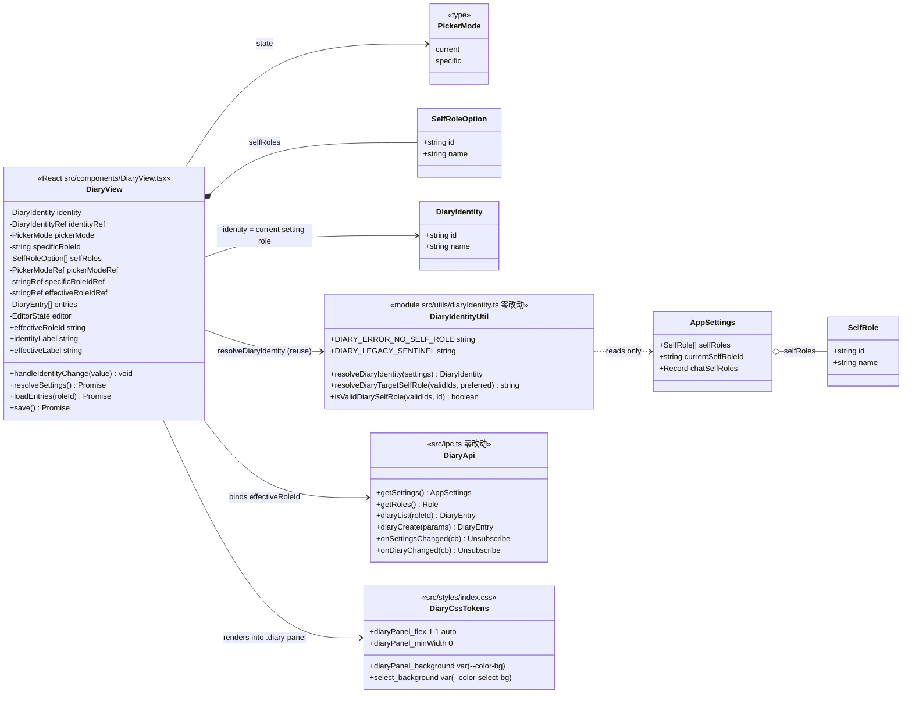
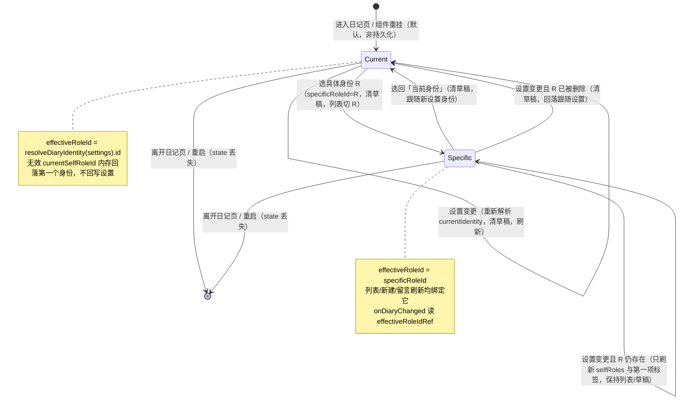
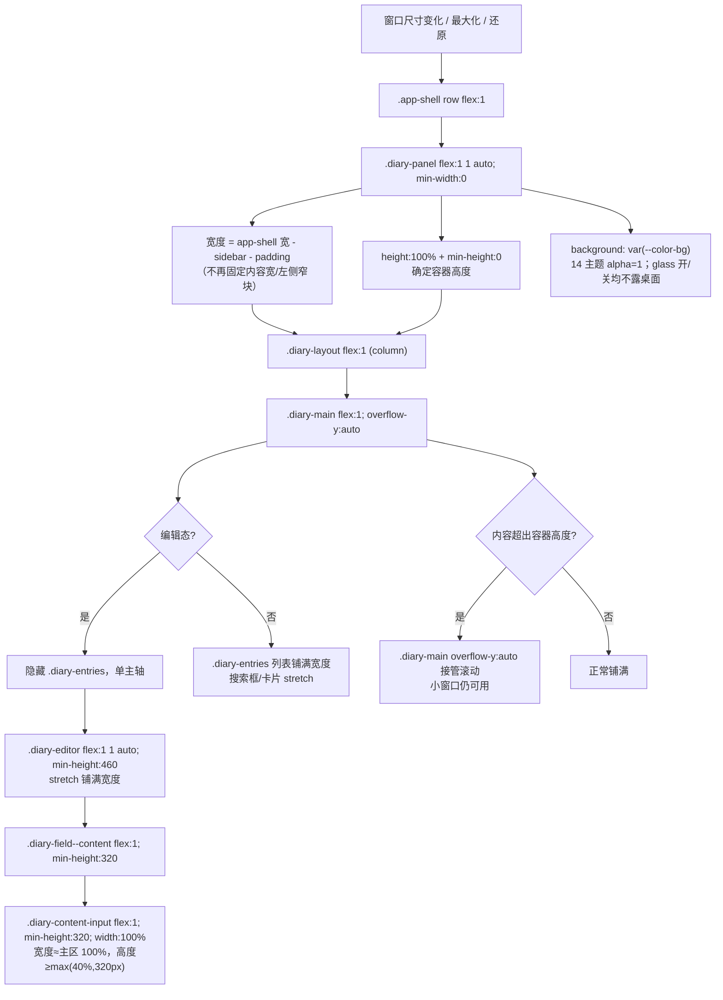
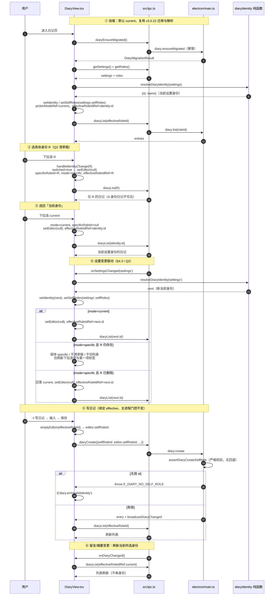
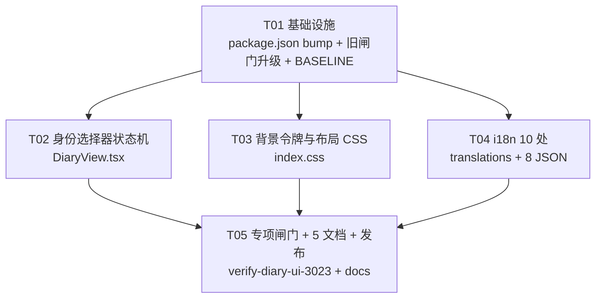

# 念语 v3.0.23 增量系统设计 —— 日记页背景不透明 · 编辑器自适应 · 页内身份切换

> 文档类型：增量系统设计 + 有序任务列表 · 架构师：高见远 · 语言：中文
> 基线版本：3.0.22（HEAD `bc946d44c11faca8afd3a5096897207d4e48dc97`，已发布） · 目标版本：**3.0.23**
> 上游：`docs/v3.0.23-diary-layout-identity-prd.md` · 基线设计（不重做）：`docs/v3.0.22-diary-ui-design.md`
> 仓库：`H:/NY/Nianyu-Chat`
> 配套图：`docs/v3.0.23-diary-layout-identity-class.mermaid`、`docs/v3.0.23-diary-layout-identity-sequence.mermaid`、`docs/v3.0.23-diary-layout-identity-state.mermaid`、`docs/v3.0.23-diary-layout-identity-layout.mermaid`
> **冻结区**：`electron/cursorCoverState.ts` / `src/components/ChatWindow.tsx` / `src/components/MiniChat.tsx` —— 本次日记实现对其**零增量改动**；并行光标 BugFix（任务 #1）对冻结区的改动「另算」。

---

## 0. 基线核对与主理人五项裁定落点（最高优先级）

### 0.1 代码现状复核（本机实测，符号名为准）

| 项 | PRD/任务书口径 | 本机实测 | 结论 |
|---|---|---|---|
| HEAD | `bc946d4` | `bc946d44c11faca8afd3a5096897207d4e48dc97` | 一致 |
| 版本 | 3.0.22 | `package.json` = 3.0.22 | 一致，bump 3.0.23 |
| 背景根因 1 | `.diary-panel` 无 background | `index.css:7485-7493` 仅有 `display:flex/flex-direction/height/padding/color/animation`，**无 `background`** | 确认 |
| 背景根因 2 | DiaryView 未包 `.main-pane` | `App.tsx:657-664` 直接 `<DiaryView>`，渲染在 `.app-shell`（`index.css:191` `display:flex`）下，与聊天页 `main-pane`（`index.css:557` `flex:1;background:var(--color-chat-bg)`）不平级同权 | 确认 |
| 布局根因 | 编辑器缩左侧窄块 | `.diary-panel` **无 `flex`、无 `min-width:0`**，作为 `.app-shell` 的 flex item 默认 `flex:0 1 auto`，宽度=内容宽 → 窄块。内部 `.diary-layout/.diary-main/.diary-editor/.diary-content-input` 的 `flex:1`/`min-height:320px` 链条已在 v3.0.22 建好 | 确认：缺的是**主 item 的 flex 伸展** |
| 身份现状 | 只读展示 | `DiaryView.tsx:230` `identityLabel = t('diary.currentIdentity',{name:identity.name})`，`:237` `<span className="diary-identity">` | 确认 |
| 身份数据源 | 所有自我身份 | 自我身份 = `settings.selfRoles`（`SelfRole{id,name,...}`，`types.ts:264`）；`api.getRoles()` = `dm.listRoles()` = **所有角色卡**（`db.ts:622`），二者**不是一回事** | 下拉选项必须用 `settings.selfRoles`，不可用 `roles` |
| 工作区 | 干净 | 存在并行光标 BugFix 未提交改动：`src/App.tsx`、`src/components/MiniChat.tsx`、`src/cursor/*`、`src/floating-ball.ts`，新增 `src/cursor/nativeCursorGuard.ts` | 属任务 #1，另算；日记实现避开 |

### 0.2 主理人五项裁定（覆盖 PRD §7 与任何旧表述，逐条落点）

| 编号 | 裁定 | 本设计落点 |
|---|---|---|
| **Q1 非持久化** | 选择只在本组件生命周期内有效，重启回「当前身份」，不写 settings | §1.3：`pickerMode`/`specificRoleId` 为组件 `useState`，无任何 `api.saveSettings` 调用；切到其他 view 再回来组件重挂即回 current（会话内合理语义，§6 R5） |
| **Q2 切身份清草稿** | 具体→具体、具体→当前、设置变更导致具体身份被删除，都清空 editor state，防串册 | §1.3 `handleIdentityChange` 与 `resolveSettings` 回落分支均 `setEditor(null)`；QA G4 |
| **Q3 背景令牌 `var(--color-bg)`** | 已核对 `variables.css`：aura 的 `--color-chat-bg:rgba(255,255,255,0.07)`、`--color-panel:rgba(255,255,255,0.14)` 半透明，用了继续露桌面；`--color-bg` 13 套实色、aura/vibrant 为**不透明渐变**（色标无 transparent） | §1.1：`.diary-panel{background:var(--color-bg)}`；QA G1 要求 14 主题计算后 alpha=1 |
| **Q4 复用第一项标签** | 复用 `diary.currentIdentity` 作下拉第一项标签 | §1.3、§3.3：`t('diary.currentIdentity',{name:identity.name})` 字面不变，闸门已断言该调用 |
| **Q5 复用设置页 select 令牌** | 不新增硬编码色值 | §1.4：`<select>` 直接使用全局 `select` 规则（`index.css:88-102`，令牌 `--color-select-bg/--color-select-text/--color-primary`），仅加类名做尺寸/间距，不含色值 |

### 0.3 用户三问 → 变更点映射

| 用户问题 | 变更点 | 设计节 |
|---|---|---|
| ① 背景半透明露桌面 | C1 背景不透明 | §1.1 |
| ② 输入框不自适应、最大化仍左侧窄块 | C2 宽度自适应 + C3 正文高度不退化 | §1.2 |
| ③ 日记页内换身份、当前身份跟随设置、唯一身份时两项 | C4/C5/C6 身份选择器状态机 | §1.3 |

---

# Part A：系统设计

## 1. Implementation Approach（三部分精确方案）

### 1.1 背景层：不透明承载面（C1）

**根因**：`.diary-panel` 没有 `background`，其父 `.app-shell` 也无背景，日记页区域最终透到 `.app-root`。而 `.app-root` 在 `[data-glass='on']` 下是 `color-mix(var(--app-bg) 86%, transparent)`（`index.css:184`），aura 主题 `--app-bg` 本身 alpha 0.96（`variables.css:736`）——所以在玻璃态/aura 下能看见桌面壁纸与桌宠。

**方案**（`src/styles/index.css`，仅改 `.diary-panel` 规则块，追加两条声明）：

```css
.diary-panel {
  display: flex;
  flex-direction: column;
  height: 100%;
  box-sizing: border-box;
  padding: 18px 22px;
  color: var(--color-text);
  animation: diaryPanelIn calc(0.28s * var(--anim-speed, 1)) ease-out;
  /* ===== v3.0.23 C1 新增：不透明承载面 ===== */
  flex: 1 1 auto;                 /* C2：占满 .app-shell 主轴剩余空间 */
  min-width: 0;                   /* C2：允许收缩，防止窄窗口溢出 */
  min-height: 0;                  /* 与 flex 主轴配套，防内容撑破 */
  background: var(--color-bg);    /* C1：实色主题=实色；aura/vibrant=不透明渐变，alpha 恒为 1 */
}
```

**为什么是 `--color-bg` 而不是 `--color-chat-bg` / `--color-panel`**：

| 令牌 | 普通主题 | aura 主题 | 是否露桌面 |
|---|---|---|---|
| `--color-chat-bg` | `#f5f5f5` 等实色 | `rgba(255,255,255,0.07)`（`variables.css:705`） | ❌ 玻璃下露 |
| `--color-panel` | `#ffffff` 等实色 | `rgba(255,255,255,0.14)`（`variables.css:703`） | ❌ 玻璃下露 |
| **`--color-bg`** | `#ededed`/`#0d0d0d`/… 13 套实色 | `linear-gradient(...color-mix(不透明色,不透明色)...)`（`:696-702`），vibrant 同为不透明渐变（`:248`） | ✅ alpha=1 |

- `--color-bg` 正是普通主题 `.app-root` 的底色来源（`--app-bg: var(--color-bg)`，`variables.css:100`），用它即「与主界面同色系且不透明」，符合用户「跟主界面一样」的诉求。
- `[data-glass='on']` 的半透明规则只覆写 `.app-root`/`.main-pane`/`.composer` 的 `background`，**不覆写变量本身、也不命中 `.diary-panel`** → 日记页在玻璃开/关两态下都不透明。
- **禁止**：给 `.diary-panel` 用 `color-mix(..., transparent)`、`rgba(...,<1)`、`opacity<1`、`backdrop-filter`：任何一项都会重新引入露桌面风险。
- **零新增色值**：只用变量，不写 hex/rgb 字面量；v3.0.22 UI 闸门「日记样式段零新增硬编码色值」继续满足。

### 1.2 布局自适应：编辑器随窗口伸缩（C2 / C3）

**根因**：v3.0.22 已把内部链条修好（`.diary-layout` flex:1 → `.diary-main` flex:1 + `overflow-y:auto` → `.diary-editor` flex:1 + min-height:460 → `.diary-content-input` flex:1 + min-height:320，`index.css:7498-7502/7556-7568/7573-7577`），但**最外层 `.diary-panel` 没有 `flex:1`**。作为 `.app-shell`（row 主轴）的 flex item，它默认 `flex:0 1 auto`，宽度收缩到内容宽 → 整体编辑器被挤在左侧窄块。

**方案**：§1.1 的 `.diary-panel{flex:1 1 auto;min-width:0;min-height:0}` 一行即打通主轴：

```
.app-shell (row, flex:1)
  └─ .diary-panel  flex:1 1 auto; min-width:0   ← 关键新增：占满 sidebar 之外全部宽度
       └─ .diary-layout  flex:1; min-height:0 (column)
            └─ .diary-main  flex:1; min-width:0; overflow-y:auto (column)
                 ├─ .diary-editor  flex:1 1 auto; min-height:460 (column)  ← 宽度=父 100%（stretch）
                 │    └─ .diary-field--content  flex:1 1 auto; min-height:320
                 │         └─ .diary-content-input  flex:1 1 auto; min-height:320; width:100%
                 └─ .diary-entries（编辑态隐藏）
```

- **宽度**：`.diary-main` 是 column flex，子元素默认 `align-items:stretch`，`.diary-editor`/搜索框/列表自动铺满 `.diary-panel` 内容区。textarea 的 `width:100%` 来自既有 `.diary-field textarea` 规则（`index.css:7530`）。**无需新增宽度规则**。
- **高度**：`.diary-panel` 的 `height:100%` 已有确定值 → 链条向下传递，`flex:1` 的 textarea 填满剩余高度；`min-height:320px` 保证小窗可用，`.diary-main` 的 `overflow-y:auto` 接管溢出滚动（v3.0.22 成果不退化）。
- **不新增**：`position:fixed/absolute`、固定 `width:px`、固定 `rows` —— QA 静态断言保持 through。
- **定量口径**：最大化时 `editor.width / diary-panel 内容区宽度 ≥ 0.8`；`textarea.height ≥ max(主区高度×0.4, 320px)`。因 `flex:1` + stretch，实测接近 1.0，稳过。

### 1.3 身份选择器：状态机与数据绑定（C4 / C5 / C6）

**新增会话内 state/ref**（`src/components/DiaryView.tsx`，均不写 settings）：

```ts
type PickerMode = 'current' | 'specific';
const [pickerMode, setPickerMode] = useState<PickerMode>('current');   // 默认跟随设置
const [specificRoleId, setSpecificRoleId] = useState<string | null>(null);
const [selfRoles, setSelfRoles] = useState<Array<{ id: string; name: string }>>([]); // settings.selfRoles 快照（下拉数据源）
const pickerModeRef = useRef<PickerMode>('current');
const specificRoleIdRef = useRef<string | null>(null);
const effectiveRoleIdRef = useRef<string>('');
// 既有的 identity（DiaryIdentity）= resolveDiaryIdentity(settings) = 「当前设置身份」，保留不动
```

**派生有效身份**（替换现有 `const currentId = identity?.id || ''`，`:111`）：

```ts
const effectiveRoleId = pickerMode === 'current'
  ? (identity?.id ?? '')
  : (specificRoleId ?? identity?.id ?? '');
```

**下拉选项构造**（顺序固定，第一项复用 `diary.currentIdentity`）：

```ts
const identityLabel = identity ? t('diary.currentIdentity', { name: identity.name }) : ''; // 变量名保留，闸门兼容
// options：第一项「当前身份（name）」跟随设置；其后所有自我身份（含当前那个，重复为预期）
const pickerValue = pickerMode === 'current' ? 'current' : (specificRoleId ?? 'current');
// JSX：
{identity && (
  <label className="diary-identity-picker">
    <span className="diary-identity-label">{t('diary.identityPickerLabel')}</span>
    <select
      className="diary-identity-select"
      aria-label={t('diary.identityPickerLabel')}
      value={pickerValue}
      onChange={(e) => handleIdentityChange(e.target.value)}
    >
      <option value="current">{identityLabel}</option>
      {selfRoles.map((r) => <option key={r.id} value={r.id}>{r.name}</option>)}
    </select>
  </label>
)}
```

- 1 个自我身份 → 2 项（current + 该身份）；0 个 → 不渲染下拉，走 v3.0.22 无身份空状态（背景同样不透明）。
- 当前身份出现两次（第一项 + 其具体项）为**预期**，不是 bug。
- `value='current'` 是与真实 role id 不冲突的保留值（自我身份 id 为 UUID，不会等于字面量 `current`）。

**切换处理**（Q2 清草稿）：

```ts
const handleIdentityChange = (value: string): void => {
  const nextMode: PickerMode = value === 'current' ? 'current' : 'specific';
  const nextSpecificId = value === 'current' ? null : value;
  const nextEffective = value === 'current' ? (identity?.id ?? '') : value;
  const switched = (effectiveRoleIdRef.current || '') !== nextEffective;
  pickerModeRef.current = nextMode;
  specificRoleIdRef.current = nextSpecificId;
  setPickerMode(nextMode);
  setSpecificRoleId(nextSpecificId);
  if (switched) { setEditor(null); setQuery(''); }        // Q2：真正切换才清草稿
  if (nextEffective) { effectiveRoleIdRef.current = nextEffective; void loadEntries(nextEffective); }
};
```

**设置变更联动 `resolveSettings()`**（改造现有 `:72-82`，按 mode 分派）：

```ts
const resolveSettings = async (): Promise<void> => {
  const settings = await api.getSettings();
  if (!alive) return;
  const next = resolveDiaryIdentity(settings);                 // 复用 v3.0.22 纯函数，只读、不回写
  const nextSelfRoles = (settings.selfRoles || []).map((r) => ({ id: r.id, name: r.name }));
  identityRef.current = next;
  setIdentity(next);
  setSelfRoles(nextSelfRoles);                                 // 刷新下拉选项（含第一项 name）
  if (pickerModeRef.current === 'specific') {
    const sid = specificRoleIdRef.current;
    if (sid && nextSelfRoles.some((r) => r.id === sid)) {
      return;                                                  // 具体身份仍在：保持 specific，不清草稿、不切列表
    }
    // 具体身份被删 → 回落 current（Q2 清草稿）
    pickerModeRef.current = 'current';
    specificRoleIdRef.current = null;
    setPickerMode('current');
    setSpecificRoleId(null);
  }
  setEditor(null); setQuery('');                               // current 跟随新设置身份 / 回落：清草稿
  const eid = next?.id ?? '';
  effectiveRoleIdRef.current = eid;
  if (eid) void loadEntries(eid); else setEntries([]);
};
```

`onDiaryChanged` 回调（现有 `:99-102`）改为用 `effectiveRoleIdRef.current` 而非 `identityRef.current?.id`，保证 specific 模式下留言/摘要变更刷新的是当前所选身份的列表。

**新建/保存/编辑器标题绑定**：

| 位置 | 现状 | 改为 | 理由 |
|---|---|---|---|
| 新建按钮 `:242` | `emptyEditor(identity.id)` | `emptyEditor(effectiveRoleId)` | 新建归入所选身份 |
| `save()` `:126` | `api.diaryCreate({selfRoleId: editor.selfRoleId, ...})` | **不变** | `editor.selfRoleId` 已由 `emptyEditor(effectiveRoleId)` 设定；编辑旧日记保持原归属 |
| `save()` 后刷新 `:141` | `loadEntries(entry.selfRoleId)` | **不变** | 通常等于 effective；编辑态归属不变 |
| `remove/regenerate/summarize/deleteComment` `:155/180/194/205` | `loadEntries(currentId)` | `loadEntries(effectiveRoleId)` | 跟随所选身份 |
| 编辑器标题 `:288` | `t('diary.currentIdentity',{name:identity.name})` | `effectiveLabel`（current→`identityLabel`；specific→`selfRoles.find(id)?.name`） | specific 模式显示真实身份名 |

**与 `resolveDiaryIdentity` 的复用关系**：不修改 `src/utils/diaryIdentity.ts` 一个字符。`resolveDiaryIdentity(settings)` 继续作为「第一项标签 + current 模式 effective」的唯一解析入口（只读、无效时内存回落第一个身份、不回写设置）；specific 模式仅在会话内覆盖 effective，数据层门控（`assertDiaryCreateSelfRole`）不动——所选 id 必来自 `selfRoles`，天然通过 v3.0.22 严格门控。

### 1.4 下拉控件样式（Q5，零硬编码色值）

只加类名，颜色全部继承全局 `select` 规则（`index.css:88-102`：`--color-select-bg` / `--color-select-text` / `--color-primary` / `--color-primary-text`），14 主题已为其它设置页下拉校验过 AA：

```css
.diary-identity-picker { display: inline-flex; align-items: center; gap: 6px; }
.diary-identity-label { font-size: 12.5px; color: var(--color-text-secondary); }
.diary-identity-select { font-size: 13px; max-width: 220px; }  /* 仅尺寸/间距，无色值 */
```

- **不新增** `:root` 变量、不写 hex/rgb、不覆写 `select option` 配色。
- 动画：`diary.identity-picker` 无新增动画类，`animControl.ts` 的 `diary` 组 selectors 原样保留（闸门 `verify-diary-ui-v3022.mjs` line 97-99 继续满足）。

---

## 2. 完整新增/修改文件清单

| # | 路径（相对仓库根） | 动作 | 说明 |
|---|---|---|---|
| 1 | `package.json` | 修改 | `version` 3.0.22 → **3.0.23**；**追加** `verify:diary-ui-3023`；**保留**所有既有 scripts（含 `verify:drag-cursor-gate`、`verify:diary-migrate-3022`、`verify:diary-ui-3022`），禁止覆盖 scripts 段 |
| 2 | `src/styles/index.css` | 修改 | `.diary-panel` 加 `flex/min-width/min-height/background:var(--color-bg)`；加 `.diary-identity-picker/-label/-select` 三条尺寸规则；**不改**任何既有令牌/主题段/`.main-pane`/`.chat-input` |
| 3 | `src/components/DiaryView.tsx` | 修改（主体增量） | 新增 pickerMode/specificRoleId/selfRoles state + 三个 ref；下拉 JSX；`handleIdentityChange`；`resolveSettings` 按 mode 分派；`onDiaryChanged` 用 effectiveRoleIdRef；`currentId`→`effectiveRoleId` 绑定；编辑器标题 effectiveLabel；保留 `identityLabel` 变量名 |
| 4 | `src/i18n/translations.ts` | 修改 | zh/en：改写 `diary.identityHint` 值（键保留、非空）；新增 `diary.identityPickerLabel`；`diary.currentIdentity` **逐字不变** |
| 5 | `src/i18n/locales/de.json` | 修改 | 同上（10 处之一） |
| 6 | `src/i18n/locales/es.json` | 修改 | 同上 |
| 7 | `src/i18n/locales/fr.json` | 修改 | 同上 |
| 8 | `src/i18n/locales/ja.json` | 修改 | 同上 |
| 9 | `src/i18n/locales/ko.json` | 修改 | 同上 |
| 10 | `src/i18n/locales/pt.json` | 修改 | 同上 |
| 11 | `src/i18n/locales/ru.json` | 修改 | 同上 |
| 12 | `src/i18n/locales/zh-Hant.json` | 修改 | 同上 |
| 13 | `scripts/verify-diary-ui-v3022.mjs` | 修改（**必须升级**） | 版本断言 3.0.22→3.0.23；dead list 移除 `'<select'` 并加「有 select + 第一项 current」新断言；`emptyEditor(identity.id)`→`emptyEditor(effectiveRoleId)`；冻结区 BASELINE 改为含光标修复的新 SHA。强度只增不减 |
| 14 | `scripts/verify-diary-migration-v3022.mjs` | 修改（**必须升级**） | line 187-190 版本断言 3.0.22→3.0.23；其余迁移行为断言不动 |
| 15 | `scripts/verify-diary-ui-v3023.mjs` | **新增** | 本次专项闸门：背景令牌/flex、下拉状态机/数据源/清草稿、i18n 键、冻结区相对新 BASELINE 零 diff（详见 §11） |
| 16 | `使用说明.md` | 修改 | 日记章节补：背景不透明、编辑器自适应、页内切身份与「当前身份跟随设置/重启复位」 |
| 17 | `src/components/GuideView.tsx` | 修改 | 日记 FAQ 同步新行为 |
| 18 | `README.md` | 修改 | 特性表述同步 |
| 19 | `硬编码清单.md` | 修改 | 新增 3.0.23 段：`--color-bg` 口径、下拉令牌复用、零新增硬编码色值说明 |
| 20 | `版本更新记录.md` | 修改 | 新增 `## v3.0.23 (` 段（保留 3.0.22 段，闸门 line 117 依赖） |
| 21 | `docs/v3.0.23-diary-layout-identity-design.md` | **新增** | 本文档 |
| 22 | `docs/v3.0.23-diary-layout-identity-class.mermaid` | **新增** | 类图 |
| 23 | `docs/v3.0.23-diary-layout-identity-sequence.mermaid` | **新增** | 时序图 |
| 24 | `docs/v3.0.23-diary-layout-identity-state.mermaid` | **新增** | 身份状态机图 |
| 25 | `docs/v3.0.23-diary-layout-identity-layout.mermaid` | **新增** | 窗口尺寸变化布局流图 |

**零改动（相对光标修复 commit）**：`electron/cursorCoverState.ts`、`src/components/ChatWindow.tsx`、`src/components/MiniChat.tsx`；`src/App.tsx` 本次**也不需要改**（DiaryView 已挂载、跳转回调已存在，背景/布局/身份全在 DiaryView + CSS 内完成）→ 天然避开任务 #1 对 `App.tsx`/`MiniChat.tsx` 的光标改动，合并冲突风险最低。`src/utils/diaryIdentity.ts`、`electron/*`、`src/ipc.ts` 零改动。

---

## 3. Data Structures and Interfaces

### 3.1 类图（Mermaid classDiagram）



### 3.2 接口变更汇总

| 层 | 符号 | 变更 |
|---|---|---|
| UI state | `pickerMode` / `specificRoleId` / `selfRoles` + 3 个 ref | 新增，会话内，不写 settings |
| UI 派生 | `effectiveRoleId` | 新增，替换原 `currentId`（`:111`） |
| UI 方法 | `handleIdentityChange(value)` | 新增，切换 + Q2 清草稿 |
| UI 方法 | `resolveSettings()` | 改造：按 mode 分派设置变更（§1.3） |
| UI 回调 | `onDiaryChanged` | 改读 `effectiveRoleIdRef.current` |
| 工具层 | `resolveDiaryIdentity` 等三个纯函数 | **零改动，直接复用** |
| IPC / 数据层 | 全部 | **零改动**（无新通道、无新门控） |
| i18n | `diary.currentIdentity` | 值不变，复用为第一项 |
| i18n | `diary.identityHint` | 值改写，键保留 |
| i18n | `diary.identityPickerLabel` | 新增 |

### 3.3 i18n 键变更表（10 处：zh/en + 8 locale JSON）

| key | 动作 | zh 值 | en 值（其余 8 locale 同 en） | 占位符 |
|---|---|---|---|---|
| `diary.currentIdentity` | **复用，值不变** | `当前身份（{name}）` | `Current Identity ({name})` | `{name}`（10 处逐字一致，闸门 line 105-112 依赖） |
| `diary.identityHint` | **改值，键保留** | `在上方下拉切换日记身份；「当前身份」跟随设置变化，切换仅在本次会话有效。` | `Use the dropdown above to switch diary identity; "Current Identity" follows Settings and the choice resets on restart.` | 无 |
| `diary.identityPickerLabel` | **新增** | `日记身份` | `Diary identity` | 无 |

- 沿用 v3.0.22 口径：zh 中文，其余 9 处英文，控制增量 diff；后续本地化另议（§6 U3）。
- **不复活** v3.0.22 已删的 `diary.bookNone`/`diary.books`/`diary.orphanHint`/`diary.reassignOrphans`/`diary.orphans`/`diary.searchPlaceholder`（闸门 line 96-103 依赖零残留）。
- `verify-diary-i18n-10.mjs` **无需修改**：它只断言键集一致、无空值、占位符一致、`diary.currentIdentity` 逐字、旧键零残留、指定新增键非空——本表全部满足；日记键数 55→56 ≥45。

### 3.4 身份状态机图（Mermaid stateDiagram-v2）

> 同步落盘 `docs/v3.0.23-diary-layout-identity-state.mermaid`



### 3.5 窗口尺寸变化下的布局流（Mermaid flowchart）

> 同步落盘 `docs/v3.0.23-diary-layout-identity-layout.mermaid`



---

## 4. Program Call Flow（Mermaid sequenceDiagram）

> 同步落盘 `docs/v3.0.23-diary-layout-identity-sequence.mermaid`



---

## 5. Anything UNCLEAR（假设与待确认）

| # | 事项 | 本设计采用的假设 |
|---|---|---|
| U1 | 快照行号会随并行光标 commit 漂移 | 全部以符号名/类名/文案为准，不硬依赖行号；`identityLabel`、`currentId` 等保留原名降低闸门扰动 |
| U2 | 「1 个身份时下拉 2 项」的重复项 | 当前身份在「第一项」与「其具体项」出现两次为**预期**（PRD §4.2），QA 断言项数=selfRoles.length+1，不去重 |
| U3 | 非 zh/en 的 8 语种文案 | 沿用 v3.0.22「zh 中文 / 其余 9 处英文」，占位符一致；如需完整本地化仅改字典值，不涉代码 |
| U4 | 「会话内有效」边界 | 组件 `useState`；切到其他 view 导致 DiaryView 卸载重挂会回 current。若要求"切 view 也保留"，需提升到 App 层 state（本次不做，非持久化裁定下可接受） |
| U5 | `--color-bg` 在 aura/vibrant 是渐变 | `background: var(--color-bg)` 对渐变合法；QA alpha 量化须逐色标检查（§11 G1），不能只读 `backgroundColor` |
| U6 | 冻结区基线随并行 commit 变化 | 日记实现开工时记录含光标修复的 HEAD 为新 BASELINE，写入两个闸门脚本；日记任务对冻结区零 diff（§6 R4） |
| U7 | 并行光标 BugFix 是否触及 v3022 闸门断言的符号 | `verify-diary-ui-v3022.mjs` line 127-131 断言 `syncNativeCursorHidden`/`ballDraggingRef` 等 v3.0.22 旧拖球符号仍存在；若任务 #1 删除需 QA 复核（非日记责任，§12 R6） |

---

# Part B：任务分解

## 6. Required Packages

**无新增运行时依赖**。沿用：

```
- electron@^32 / react@^18.2 / react-dom@^18.2 / typescript@^5 / vite@^5 —— 已安装
- esbuild（verify 脚本转译用，已为间接依赖）—— 已存在
```

新增 npm script（T01 写入 `package.json`，**追加不覆盖**）：

```
- verify:diary-ui-3023: node scripts/verify-diary-ui-v3023.mjs
```

既有闸门继续全量复用：`verify:i18n`、`verify:i18n-coverage`、`verify:diary-i18n-10`、`verify:diary-migrate-3022`、`verify:diary-ui-3022`、`verify:diary-ai-isolation`、`verify:diary-crypto-migration`、`verify:anim-trimode`、`verify:drag-cursor-gate`、`typecheck` / `build`。

---

## 7. 有序任务列表（≤5，按依赖排序）

### T01 · 基础设施：版本 bump 与闸门基线升级（P0，无依赖）

**源文件**：`package.json`、`scripts/verify-diary-ui-v3022.mjs`、`scripts/verify-diary-migration-v3022.mjs`

**内容**
1. `package.json` version → 3.0.23；**追加** `verify:diary-ui-3023`，完整保留 scripts 段（尤其 `verify:drag-cursor-gate`）。
2. 记录含光标修复的 HEAD SHA 为新冻结区 BASELINE。
3. `verify-diary-ui-v3022.mjs` 升级（强度只增不减）：版本断言 → 3.0.23；dead list 移除 `'<select'`，改为「DiaryView 含 `<select>` + `option value="current"` + `selfRoles.map`」断言；`emptyEditor(identity.id)` → `emptyEditor(effectiveRoleId)`；冻结区 BASELINE → 新 SHA；line 127-131 旧拖球符号断言保留。
4. `verify-diary-migration-v3022.mjs` line 187-190 版本断言 → 3.0.23，其余不动。

**验收点**：`npm run typecheck` 绿；`node scripts/verify-diary-ui-v3022.mjs` 与 `node scripts/verify-diary-migration-v3022.mjs` 在版本 bump 后不因版本号失败；`package.json`=3.0.23 且既有 script 一个不少；**必须在任务 #1 光标 commit 合并之后开工**。

---

### T02 · 身份选择器状态机与数据绑定（P0，依赖 T01）

**源文件**：`src/components/DiaryView.tsx`（唯一）

**内容**（严格按 §1.3）
1. 新增 `pickerMode`/`specificRoleId`/`selfRoles` state 与三个 ref；保留 `identity`/`identityLabel` 原名。
2. `currentId` → `effectiveRoleId` 派生；下拉 JSX（第一项 `identityLabel` + `selfRoles.map`）。
3. `handleIdentityChange`（Q2 清草稿）；`resolveSettings` 按 mode 分派（§4.3）；`onDiaryChanged` 改读 `effectiveRoleIdRef`。
4. 新建按钮/各刷新点/编辑器标题绑定 effective；`save()` 与 `resolveDiaryIdentity` 复用不变。
5. 无裸中文；DiaryView 不碰 `window.alert/confirm/prompt`；自绘确认框保留。

**验收点**：`typecheck` 绿；1 身份=2 项、0 身份无下拉；选 R 后列表仅 R；选回 current 跟随设置；设置变更三分支正确；切身份草稿清空；冻结区与 `App.tsx` 零 diff。

---

### T03 · 背景令牌与布局自适应 CSS（P0，依赖 T01；可与 T02 并行）

**源文件**：`src/styles/index.css`

**内容**（严格按 §1.1/§1.2/§1.4）
1. `.diary-panel` 追加 `flex:1 1 auto; min-width:0; min-height:0; background:var(--color-bg)`。
2. 新增 `.diary-identity-picker/-label/-select` 三条仅尺寸/间距规则。
3. **不改** `.main-pane`/`.chat-input`/主题段/既有令牌；不新增 hex/rgb、不新增 `color-mix(...,transparent)`。

**验收点**：日记样式段新增硬编码色值数=0；`.diary-editor` 无 `position:fixed`；textarea 仍 `flex:1`+`min-height:320px`；14 主题 + glass 开/关下 `.diary-panel` 计算后 alpha=1（§11 G1）；最大化编辑器宽度 ≥ 主区 80%。

---

### T04 · i18n 10 处同步（P0，依赖 T01；可与 T02/T03 并行）

**源文件**：`src/i18n/translations.ts`、`src/i18n/locales/{de,es,fr,ja,ko,pt,ru,zh-Hant}.json`

**内容**（严格按 §3.3）
1. 10 处改写 `diary.identityHint` 值（键保留、非空、无占位符）；新增 `diary.identityPickerLabel`。
2. `diary.currentIdentity` 10 处逐字不动；不复活任何 v3.0.22 已删键。

**验收点**：`verify:i18n` + `verify:i18n-coverage` + `verify:diary-i18n-10` 全绿；键集一致、无空值、占位符一致、旧键零残留。

---

### T05 · 专项闸门 + 5 文档同步 + 发布准备（P1，依赖 T02、T03、T04）

**源文件**：`scripts/verify-diary-ui-v3023.mjs`（新增）、`使用说明.md`、`src/components/GuideView.tsx`、`README.md`、`硬编码清单.md`、`版本更新记录.md`

**内容**
1. `verify-diary-ui-v3023.mjs`：背景令牌/flex、下拉状态机/数据源/清草稿、i18n 键、冻结区相对新 BASELINE 零 diff 的源码级断言（§11）。
2. 5 文档同步新行为；`版本更新记录.md` 新增 `## v3.0.23 (` 段（保留 3.0.22 段）；`硬编码清单.md` 登记零新增色值。
3. 复核 `package.json`=3.0.23；全量回归（§11 清单）；提交并打 `v3.0.23` tag（上传由主理人执行）。

**验收点**：`verify:diary-ui-3023` 绿；5 文档反映新行为且无旧占位词；冻结区 `git diff <新BASELINE> -- <三文件>` 为空；版本与 tag 一致；QA 按 §11 通过。

---

### 7.1 任务依赖图



---

## 8. Shared Knowledge（工程师必读）

1. **身份解析唯一入口**：`resolveDiaryIdentity(settings)`（`src/utils/diaryIdentity.ts`）只读 `settings.selfRoles`/`currentSelfRoleId`，无效时在内存回落第一个身份，**绝不回写设置**，不碰 `chatSelfRoles`。current 模式与下拉第一项一律用它。
2. **下拉数据源是 `settings.selfRoles`，不是 `api.getRoles()`**：后者是 `dm.listRoles()`（所有角色卡，用于 AI 留言可见范围），拿它做身份下拉会列出非自我身份 → 违反 C4，且 selected id 可能过不了主进程门控。`resolveSettings` 里 `setSelfRoles(settings.selfRoles.map(...))`。
3. **`current` 是保留 value**：自我身份 id 为 UUID，不会等于字面量 `current`；`value='current'` 代表「跟随设置」，选项数 = `selfRoles.length + 1`。
4. **有效身份绑定**：所有列表/新建/留言刷新用 `effectiveRoleId`（derived）或 `effectiveRoleIdRef.current`（回调内）；`save()` 用 `editor.selfRoleId`（已由 `emptyEditor(effectiveRoleId)` 设定），两处不能混。
5. **清草稿触发点**：`handleIdentityChange` 中 `switched=true` 时；`resolveSettings` 的 current 分支与 specific→current 回落分支。specific 且 R 仍存在**不清**。
6. **背景令牌红线**：`background: var(--color-bg)`；禁止 `--color-chat-bg`/`--color-panel` 作日记主背景（aura 半透明）；禁止 `color-mix(...,transparent)`/`opacity`/`rgba(<1)`/`backdrop-filter` 作用于 `.diary-panel`。
7. **CSS 变量口径**：下拉继承全局 `select`（`--color-select-bg`/`--color-select-text`/`--color-primary`）；输入框仍 `var(--input-bg,#f2f3f5)`/`var(--input-fg,#1f2329)`（v3.0.22 共享块不动）；**零新增硬编码色值**。
8. **IPC 约定**：仓库现状为「直接返回业务对象 / 失败抛带 `code` 的 Error」，**不是** `{code,data,message}`；本次无新通道。日期 `YYYY-MM-DD`，时间戳 ISO 8601 UTC。
9. **动画**：三档唯一真源 `src/utils/animControl.ts`；`diary` 组 selectors 原样保留，新控件无独立动画，不得新建分组/用通配。
10. **冻结区与合并纪律**：以**含光标修复的新 BASELINE** 为准，`electron/cursorCoverState.ts`/`ChatWindow.tsx`/`MiniChat.tsx` 零增量；`App.tsx`/`src/ipc.ts`/`package.json` 中任务 #1 的光标代码必须原样保留；**日记实现不改 `App.tsx`**；`package.json` 只追加 `verify:diary-ui-3023`，禁止覆盖 `verify:drag-cursor-gate` 等既有 script。
11. **文案**：用户可见字符串一律 `t(key)`/`t(key,{name})`；DiaryView 无裸中文（`verify-diary-i18n-10` 会扫）。
12. **闸门升级原则**：旧闸门因版本 bump / 新 `<select>` 必须升级，但**强度只增不减**——把「无 select」换成「有 select 且结构正确」，把版本号同步到 3.0.23，绝不删断言来"凑绿"。

---

## 9. QA 闸门建议（行为级、可证伪）

| # | 闸门 | 可证伪断言 | 载体 |
|---|---|---|---|
| G1 | **14 主题背景 alpha=1** | 逐套 `data-theme`（14 套）× glass on/off：实色主题 `.diary-panel` 的 computed `backgroundColor` alpha=1；aura/vibrant 渐变主题 `backgroundImage` 含 `linear-gradient` 且每个色标无 `transparent`/`rgba(...,<1)`；截图确认看不到桌面壁纸/桌宠；CSS diff 中日记段新增 hex/rgb/透明色值数=0 | 手工 + `getComputedStyle` 脚本 + `verify:diary-ui-3023` |
| G2 | **编辑器宽度定量** | 窗口最大化：`editor.width / (diary-panel.width - padding) ≥ 0.8`；`.diary-panel` computed `flex-grow ≥ 1` 且 `min-width=0`；还原/缩小后仍 ≥0.8 且无横向溢出 | 手工 + 脚本断言 CSS |
| G3 | **正文高度定量（不退化）** | `textarea.getBoundingClientRect().height ≥ max(mainArea.height×0.4, 320)`；CSS 含 `flex:1`+`min-height:320px`；`.diary-editor`/`.diary-content-input` 无 `position:fixed/absolute`；小窗溢出时 `.diary-main` 出现滚动条 | `verify:diary-ui-3022` + 手工 |
| G4 | **下拉选项数量与状态转移** | 1 身份 → `options.length===2` 且第一项 label=`当前身份（X）`、第二项=X；2 身份 → 3 项（当前身份出现两次为预期）；0 身份 → 无 `<select>`、走空状态。切换 R：列表仅 R、`editor===null`；选回 current：跟随设置、`editor===null`；R→S：`editor===null`；设置变更 R 仍在：mode/列表/草稿不变、第一项标签更新；R 被删：回落 current、`editor===null` | `verify:diary-ui-3023`（源码级）+ 手工行为 |
| G5 | **非持久化与隔离** | 选 R 后重启/切 view 重挂 → 回 current；全程 settings 文件字节不变（无 `saveSettings`）；`chatSelfRoles`/`resolveActiveSelfRole` 零 diff；R 的日记在 current 模式不可见 | 手工 + `git diff` |
| G6 | **v3.0.22 全量不回退** | `verify:diary-migrate-3022`、`verify:diary-ai-isolation`、`verify:diary-crypto-migration`、`verify:diary-ui-3022`（升级版）、`verify:anim-trimode`、`verify:diary-i18n-10` 全绿；旧日记迁移不 revoke、门控严格拒绝无效 id、14 主题 AA、输入框 `--input-bg/--input-fg` 同口径 | 脚本全套 |
| G7 | **冻结区零增量** | 相对**新 BASELINE（含光标修复）**，三冻结文件 `git diff` 为空；`App.tsx` 中日记任务零 diff（光标代码原样）；`verify:drag-cursor-gate` 绿；并行光标 BugFix 功能不受影响 | CI/发布前 |
| G8 | **i18n 与文档** | `verify:i18n`/`verify:i18n-coverage`/`verify:diary-i18n-10` 全绿；新键 10 处一致；5 文档反映新行为、无旧占位词；`版本更新记录.md` 含 `## v3.0.23 (` 且保留 3.0.22 段 | 脚本 + 文本检索 |
| G9 | **版本与发布** | `package.json`=3.0.23；所有既有 script 保留；tag `v3.0.23` 与远端一致 | 发布检查 |

**回归必跑清单**：

```
npm run typecheck && npm run build &&
npm run verify:i18n && npm run verify:i18n-coverage && npm run verify:diary-i18n-10 &&
npm run verify:diary-migrate-3022 && npm run verify:diary-ui-3022 && npm run verify:diary-ui-3023 &&
npm run verify:diary-ai-isolation && npm run verify:diary-crypto-migration &&
npm run verify:anim-trimode && npm run verify:drag-cursor-gate
```

---

## 10. 风险与待定项

| ID | 风险/待定 | 影响 | 缓解 |
|---|---|---|---|
| R1 | **旧闸门硬编码 3.0.22 与「无 `<select>`」**：bump 版本及引入下拉会触发 `verify-diary-ui-v3022.mjs`/`verify-diary-migration-v3022.mjs` 失败 | QA 全量回归红 | T01 升级断言（版本→3.0.23、select dead→结构断言、emptyEditor→effectiveRoleId），强度只增不减；禁止删断言凑绿 |
| R2 | **`--color-bg` 在 aura/vibrant 是渐变**，只查 `backgroundColor` 会误判 a=0 | G1 误报 | 逐色标检查 `backgroundImage`，确认无 transparent/rgba(<1)；截图兜底 |
| R3 | **身份数据源误用 `api.getRoles()`**（含非自我身份） | 下拉多出无关身份 / selected id 过不了门控 / 违反 C4 | 明确用 `settings.selfRoles`；`verify-diary-ui-3023` 断言 `selfRoles.map` 且 `onSettingsChanged` 内刷新 |
| R4 | **冻结区基线随并行光标 commit 变化**；日记任务相对 `bc946d4` 会因光标改动出现 diff | G7 误报 / 合并冲突 | 新 BASELINE 取含光标修复的 HEAD；日记任务**不改 App.tsx**；先合并光标 commit 再实现；两闸门 BASELINE 同步更新 |
| R5 | 非持久化下切 view 重挂回 current | 用户可能期望跨 view 保留 | 按 Q1「组件生命周期内有效」解释为预期；若改需提升 state 到 App（与光标改动冲突，本次不做） |
| R6 | 并行光标 BugFix 可能改动 `verify-diary-ui-v3022.mjs` line 127-131 断言的旧拖球符号 | v3022 闸门失败（非日记责任） | QA 复核该断言；若任务 #1 删除了 `syncNativeCursorHidden` 等符号，由光标任务负责同步更新该断言，日记实现不触碰 |
| R7 | `diary.identityHint` 由「去设置切换」改为「页内切换」文案 | 8 语种仍英文 | 符合 v3.0.22 惯例；仅字典值变更，占位符无，闸门只验非空 |
| R8 | `.diary-panel` 加 `flex:1` 是否影响其它 view | 理论上仅日记页 | 选择器严格限定 `.diary-panel`；其它 view 用 `.main-pane`/自身布局，不受影响；QA 回归聊天/settings 布局 |

---

> 交付物：`docs/v3.0.23-diary-layout-identity-design.md`、`docs/v3.0.23-diary-layout-identity-class.mermaid`、`docs/v3.0.23-diary-layout-identity-sequence.mermaid`、`docs/v3.0.23-diary-layout-identity-state.mermaid`、`docs/v3.0.23-diary-layout-identity-layout.mermaid`。
> 下一步：工程师按 T01→T05 执行（**须在任务 #1 光标 commit 合并之后开工**），QA 按 §9 闸门回归。
