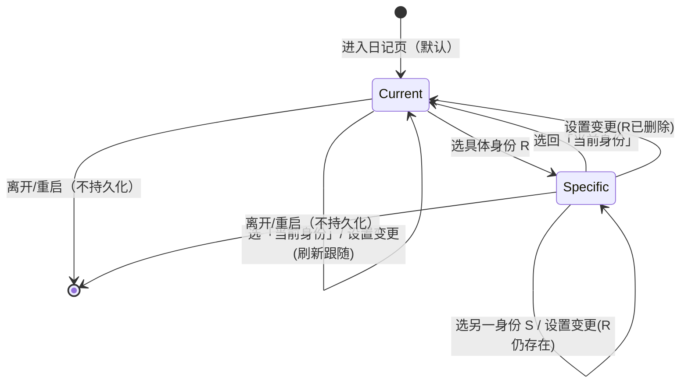

# 念语 v3.0.23 增量 PRD —— 日记页背景不透明 · 编辑器自适应 · 页内身份切换

> 文档类型：增量 PRD（简单档） · 作者：产品经理 许清楚 · 语言：中文
> 基线版本：3.0.22（HEAD `bc946d44c11faca8afd3a5096897207d4e48dc97`，已发布） · 目标版本：**3.0.23**
> 仓库：`H:/NY/Nianyu-Chat` · 冻结区：`electron/cursorCoverState.ts` / `ChatWindow.tsx` / `MiniChat.tsx`（零增量改动）
> **重要：本次口径覆盖 v3.0.22 PRD §8「日记页只读展示当前身份、不可切换」的决定，以本文档为准。**

---

## 0. 原始需求复述（逐字保留语义）

> 1.「这个日记界面怎么还是背景是半透明的呀，正常来说应该跟聊天界面和主界面一样全都是不透明的呀。」
> 2.「还有这个日记界面输入框的这个比例应该根据这个软件界面的比例会动态调节的吧？不会你放到最大还是在最左边那一小块。」
> 3.「还有在日记界面能自己更换身份，'当前身份'只是默认的，会随着设置里的身份动态调节，然后你也可以选择自己的其他身份，如果没有其他身份，那就只有'当前身份'选项和自己唯一的那个身份选项。」
> 4.「修复上述所有问题并上传 github。」

### 主理人裁定口径（已定，不再讨论）

1. **身份切换器语义**：日记页顶部放**下拉选择器**。选项第一项固定为「当前身份」（跟随 `settings.currentSelfRoleId` 动态变化），其后列出**所有**自我身份（含当前那个；允许同一身份出现两项——一项「当前身份」、一项具体身份名）。仅 1 个身份时下拉共 2 项：「当前身份」+ 该身份名。选某个具体身份后，日记列表/新建日记临时切到该身份；选回「当前身份」则重新跟随设置。
2. **选择不持久化（主理人已定）**：选择只在本组件生命周期内有效（组件 state），**不写入 settings**；重启后默认回到「当前身份」（详见 §7 Q1）。
3. **背景不透明（主理人已定）**：日记页主背景**与软件主背景同源、且计算后 alpha=1，不露桌面壁纸/桌宠**；令牌用 `var(--color-bg)`（不用 `--color-chat-bg` / `--color-panel`，二者在 aura 主题下本身半透明）。`.diary-panel`（`src/styles/index.css:7485`）当前无 `background` 声明为根因之一（详见 §7 Q3）。
4. **输入区自适应**：编辑器宽高随窗口动态伸缩：最大化时占满主区域合理宽度（非左侧固定小块），缩小时仍可用；正文 textarea 保持 `flex:1` + `min-height:320px`（v3.0.22 成果不退化）。定量口径见 §6 A2。
5. **不回退 v3.0.22**：旧日记自动迁移、不 revoke 留言/摘要、主进程 `diary:create` 严格门控、14 主题文字与按钮 AA、输入框 `--input-bg/--input-fg` 同口径、i18n 10 处一致、拖球双光标修复均保留。
6. **收尾**：版本 bump 3.0.23；5 份文档同步；GitHub 上传打 tag；冻结区基线 `bc946d4`，三文件零增量改动。

---

## 1. 项目信息

| 项 | 值 |
|---|---|
| Language | 中文（与用户一致） |
| Programming Language | 沿用现有技术栈：Electron 32 + React 18 + TypeScript + Vite（不引入新框架） |
| Project Name | `nianyu_diary_layout_identity_v3023` |
| 交付形态 | 增量修复，落地于现有 `Nianyu-Chat` 仓库；`package.json` 版本 3.0.22 → **3.0.23** |

---

## 2. 产品定义

### 2.1 Product Goals（3 个正交目标）

1. **视觉与主界面一致**：日记页背景改为不透明、与聊天/主界面同令牌，任何窗口尺寸与主题下都不露出桌面壁纸与桌宠。
2. **写作区随窗口自适应**：编辑器宽度与正文高度随窗口伸缩，最大化时充分利用主区域，缩小时仍可用，v3.0.22 的大输入框成果不退化。
3. **日记页内可切身份**：顶部下拉在「跟随设置」与「指定具体身份」间自由切换，列表与新建绑定当前选择，且不破坏身份隔离与设置联动。

### 2.2 User Stories（5 个场景）

1. 作为**打开日记页的用户**，我希望背景是实色、和聊天界面一样，不要透出桌面壁纸和桌宠，这样我专注于写日记。
2. 作为**把窗口最大化的用户**，我希望编辑器和正文输入框跟着窗口变大、占满主区域，而不是缩在左边一小块，这样我有足够空间写作。
3. 作为**想临时用另一个身份写日记的用户**，我希望在日记页顶部下拉直接选身份，不用跑到设置里来回切。
4. 作为**设置了当前身份的用户**，我希望下拉第一项「当前身份」始终显示设置里正在用的身份，切回它就能恢复跟随，这样默认行为符合预期。
5. 作为**只有一个身份的用户**，我希望下拉里只有「当前身份」和那一个具体身份两项，不要出现多余的空选项。

---

## 3. 变更点清单（增量，逐条）

> 措辞：**必须** = P0，**应该** = P1。每条尽量可度量；未列项沿用 v3.0.22 不改动。

| # | 变更点 | 级别 | 说明 / 代码现状（行号为调研快照，实现以符号名为准） |
|---|---|---|---|
| C1 | **背景不透明** | P0 | `.diary-panel`（`src/styles/index.css:7485`）当前无 `background`，`DiaryView` 在 `App.tsx:658` 直接渲染、**未包在 `.main-pane`**。修复用 `var(--color-bg)`（主理人已定，Q3）：与软件主背景同源、计算后 **alpha=1**；**不得**用 `--color-chat-bg`/`--color-panel`——aura 主题下二者分别是 `rgba(255,255,255,0.07)` / `rgba(255,255,255,0.14)`，会继续露桌面。`--color-bg` 在 13 套为实色 hex、aura 为不透明渐变。须覆盖 `[data-glass='on']` 与关闭两态、并在 aura 最大化下核验实际渲染 alpha。 |
| C2 | **编辑器宽度自适应** | P0 | 现状编辑器被挤在左侧窄块（见截图）：`DiaryView` 未继承主区 `flex:1` 伸展。必须让 `.diary-panel` 及其编辑容器在 App 布局中占满主区域宽度；最大化时编辑器宽度 ≥ 主区可用宽度 **80%**，不再是固定左侧小块。 |
| C3 | **正文高度自适应（不退化）** | P0 | 正文 textarea 保持 `flex:1` + `min-height:320px`；正文可视高度 ≥ 主区高度 **40% 或 ≥320px**（取较大者），窗口缩小时可滚动、仍可用。 |
| C4 | **身份切换器（页内）** | P0 | `DiaryView.tsx:230` 顶部 `identityLabel`（`<span className="diary-identity">`）改为**下拉选择器**；替换 v3.0.22「只读展示、不可切换」语义。选项规则与状态机见 §4。移除/改写“如需更换身份请到设置”的 `diary.identityHint` 提示语（已不适用）。 |
| C5 | **列表/新建绑定选择身份** | P0 | `loadEntries(selfRoleId)` 与 `emptyEditor(identity.id)` / `api.diaryCreate({selfRoleId})` 由固定「当前身份」改为绑定 §4 的 `effectiveRoleId`。选中具体身份后列表/新建切到该身份；选回「当前身份」重新跟随设置。 |
| C6 | **设置变更联动** | P0 | `api.onSettingsChanged` 回调（`DiaryView.tsx:97-105` 附近）按 §4 状态机处理：mode=current 时重新解析并刷新；mode=specific 时校验具体身份是否仍存在。 |
| C7 | **i18n 10 处同步** | P0 | 复用 `diary.currentIdentity`（`当前身份（{name}）`）作为下拉第一项标签；新增/调整下拉相关键（如 `diary.identityPickerLabel` 等，架构师定名）。`translations.ts` zh/en + 8 locale JSON 共 10 处键集合一致、无空值、占位符一致，`verify-i18n*.mjs` 全绿；**不复活** v3.0.22 已删的 `diary.bookNone`/`diary.orphanHint`/`diary.reassignOrphans`。 |
| C8 | **背景/令牌合规** | P0 | 背景改动不得引入硬编码色值，走主题变量；14 主题下日记页文字/按钮仍达 WCAG AA，`硬编码清单.md` 无新增违规项。 |
| C9 | **收尾同步** | P1 | 版本 bump 3.0.23；`使用说明.md`/`GuideView.tsx`/`README.md`/`硬编码清单.md`/`版本更新记录.md` 同步（新增页内切身份、背景不透明、自适应说明）；GitHub 上传并打 `v3.0.23` tag；冻结区三文件相对 `bc946d4` 零增量改动。 |

---

## 4. 身份选择器状态机（核心）

### 4.1 状态定义

| 状态 | 含义 |
|---|---|
| `mode = 'current'` | 跟随设置：`effectiveRoleId = resolveDiaryIdentity(settings).id`（当前 `settings.currentSelfRoleId`，无效则内存回落第一个 selfRole，不回写设置） |
| `mode = 'specific'` | 指定身份：`effectiveRoleId = specificRoleId`（来自所有自我身份之一） |

会话内 state：`mode`、`specificRoleId`。均**不写入 settings**；重启默认 `mode='current'`。

### 4.2 下拉选项构造（顺序固定）

```
options = [
  { value: 'current', label: t('diary.currentIdentity', { name: 当前设置身份名 }) },  // 第一项固定
  ...selfRoles.map(r => ({ value: r.id, label: r.name }))                              // 所有身份，含当前那个
]
```

- 当前那个身份会**出现两次**：一项「当前身份（名字）」+ 一项具体身份名——**这是预期，不视为重复 bug**。
- 仅 1 个身份：options 恰好 2 项（「当前身份」+ 该身份名）。
- 0 个身份：不渲染下拉，走 v3.0.22 无身份引导空状态（C1 空状态背景同样不透明）。

### 4.3 状态转移表

| 当前状态 | 事件 | 处理 | 结果状态 |
|---|---|---|---|
| 任意 | 进入日记页 | 初始 `mode='current'`，解析设置身份 | current，列表/新建绑定设置身份 |
| current | 用户选「当前身份」 | 保持跟随（可显式刷新一次列表） | current |
| current | 用户选具体身份 R | 设 `specificRoleId=R`，`mode='specific'`；**清空正在编辑的草稿**（见 §7 Q2），列表/新建切到 R | specific(R) |
| specific(R) | 用户选回「当前身份」 | `mode='current'`，清空草稿，重新解析设置身份并刷新列表 | current |
| specific(R) | 用户选另一具体身份 S | `specificRoleId=S`，清空草稿，列表/新建切到 S | specific(S) |
| current | 设置变更 `onSettingsChanged` | 重新解析 `settings.currentSelfRoleId`，刷新 identity 与列表（沿用现有监听） | current（新身份） |
| specific(R) | 设置变更且 R 仍存在 | 保持指定 R，不随设置跳变；仅刷新 roles 列表 | specific(R) |
| specific(R) | 设置变更且 R 已被删除 | 回落 `mode='current'`，跟随新设置身份，**清空 editor 草稿**，刷新列表 | current |
| 任意 | 应用重启 | state 丢失，默认 | current |

### 4.4 状态机图



---

## 5. UI 线框

### 5.1 顶部工具栏 + 身份下拉（C4 / C5）

```
┌──────────────────────────────────────────────────────────────────┐
│  我的日记     [ 当前身份（小雨）  ▾ ]        [＋ 写日记]            │
│               ↑ 下拉：第一项固定「当前身份」(跟随设置)            │
│                 展开后：当前身份（小雨）/ 小雨 / 阿星 / …          │
├──────────────────────────────────────────────────────────────────┤
│  [ 搜索日记…                                              ]       │
│  （原“请到设置切换身份”提示语移除/改写）                          │
│  ┌────────────────────────────────────────────────────────────┐  │
│  │ 2026-11-26   今天的心情         （列表绑定 effectiveRoleId）│  │
│  └────────────────────────────────────────────────────────────┘  │
```

> 下拉展开示意（1 个身份时恰好 2 项；当前身份出现两次为预期）：
> ```
> ┌────────────────────────┐
> │ 当前身份（小雨）   ✓   │  ← 跟随设置
> │ 小雨                   │  ← 具体身份（当前那个，允许重复）
> │ 阿星                   │  ← 其它身份
> └────────────────────────┘
> ```

### 5.2 编辑器自适应（C1 / C2 / C3）

```
┌──────────────────────────────────────────────────────────────────┐  ← 窗口最大化
│  写日记 · 当前身份（小雨）                                        │
│ ┌──────────────────────────────────────────────────────────────┐ │
│ │ 日期 [ 2026-11-26 ]   标题 [                            ]    │ │
│ │ 正文 textarea：flex:1 + min-height:320px                     │ │
│ │ ┌──────────────────────────────────────────────────────────┐ │ │
│ │ │  宽度 ≥ 主区可用宽度 80%，高度 ≥ 主区 40% 或 ≥320px      │ │ │
│ │ │  背景/文字色 = --input-bg / --input-fg（同聊天框）       │ │ │
│ │ │  整页主背景实色（与主界面/聊天页同令牌），不露桌面        │ │ │
│ │ └──────────────────────────────────────────────────────────┘ │ │
│ │ [ ] 允许 AI 留言                                             │ │
│ │                              [ 保存 ]   [ 取消 ]              │ │
│ └──────────────────────────────────────────────────────────────┘ │
└──────────────────────────────────────────────────────────────────┘
```

---

## 6. 验收标准

### 6.1 截图问题逐条对照（用户三大问题）

| # | 对应用户问题 | 验收项 | 通过条件 |
|---|---|---|---|
| A1 | ①「背景半透明，应跟聊天/主界面一样不透明」 | 背景不透明 | 日记页主区域背景用 `var(--color-bg)`，**与软件主背景同源、且计算后 alpha=1（不透明）**；`[data-glass='on']` 与关闭两态、最大化/还原、14 套主题（**重点：aura 主题最大化下核验实际渲染 alpha=1**）均**看不到桌面壁纸与桌宠**；`.diary-panel` 有明确 `background`（不以 `--color-chat-bg`/`--color-panel` 兜底）；无硬编码色值。 |
| A2 | ②「输入框比例应随窗口动态调节，最大化别在左边小块」 | 编辑器宽高自适应 | 窗口最大化时编辑器宽度 **≥ 主区域可用宽度 80%**、不再固定左侧小块；正文可视高度 **≥ 主区域 40% 或 ≥320px**（取较大）；缩小窗口后编辑器仍可用、正文可滚动；正文 textarea 样式保持 `flex:1` + `min-height:320px`（v3.0.22 不退化）。 |
| A3 | ③「日记页能换身份，当前身份只是默认的，随设置动态调节；只有 1 个身份时只有两项」 | 身份下拉 + 联动 | 下拉第一项固定「当前身份（{name}）」且随 `settings.currentSelfRoleId` 动态变化；其后列出**所有** selfRoles（含当前那个，重复出现为预期）；仅 1 身份时恰好 2 项；选具体身份后列表/新建切到该身份、选回「当前身份」恢复跟随；设置变更按 §4.3 联动；选择不写 settings、重启回「当前身份」。 |

### 6.2 不回退 v3.0.22（回归项）

| # | 验收项 | 通过条件 |
|---|---|---|
| A4 | 旧日记迁移 | 不 revoke 留言/摘要、不改 `updated_at`、摘要仍可见可引用；`selfRoleId` 门控自洽；重启不重复迁移；界面不暴露旧占位词。 |
| A5 | 主进程门控 | `diary:create` 对占位值/无效 `selfRoleId` 仍严格拒绝；不同身份日记严格不互通，AI 留言/摘要不跨身份串。 |
| A6 | 主题与输入框 | 14 主题下日记页文字/按钮达 WCAG AA；输入控件仍用 `var(--input-bg, #f2f3f5)` / `var(--input-fg, #1f2329)`，改「输入框外观」两处同步；`硬编码清单.md` 无新增违规。 |
| A7 | i18n | `verify-i18n*.mjs` 全绿：10 处键集合一致、无空值、占位符一致；新增/调整下拉键 10 处逐字一致；3 个旧键无残留。 |
| A8 | 冻结区与光标修复 | 相对基线 `bc946d4`，`electron/cursorCoverState.ts` / `ChatWindow.tsx` / `MiniChat.tsx` **零增量改动**；拖球双光标修复不受影响。 |

### 6.3 收尾

| # | 验收项 | 通过条件 |
|---|---|---|
| A9 | 文档 | `使用说明.md`、`GuideView.tsx`、`README.md`、`硬编码清单.md`、`版本更新记录.md` 反映新行为（页内切身份、背景不透明、自适应），无旧占位词。 |
| A10 | 版本与发布 | `package.json` 版本 3.0.23；变更提交并上传 GitHub，打 `v3.0.23` tag。 |

---

## 7. 原待确认问题 —— 主理人已全部裁定（不再讨论，交架构师直接执行）

1. **Q1 选择持久化（主理人已定：非持久化）**：选择只在**本组件生命周期内有效**（组件 state），**不写入 settings**；重启回「当前身份」。
2. **Q2 切身份时草稿处理（主理人已定：清空草稿）**：从具体身份切到另一具体身份、切回「当前身份」、以及**设置变更导致具体身份被删除**三种情况，**都清空 editor state**，防止串册。已回灌 §4.3 状态转移表。
3. **Q3 背景令牌（主理人已定：`var(--color-bg)`）**：核对 `src/theme/variables.css` 后确认 aura 主题下 `--color-chat-bg: rgba(255,255,255,0.07)`、`--color-panel: rgba(255,255,255,0.14)` 本身半透明，直接用会继续露桌面；`--color-bg` 在 13 套是实色 hex、aura 是不透明渐变，满足 A1 硬指标。A1 口径改为「**与软件主背景同源、且计算后 alpha=1，不露桌面**」，不写「必须与 `--color-chat-bg` 同口径」。背景验证须覆盖 **aura 主题在最大化下的实际渲染 alpha**。已回灌 §0-3 / §3 C1 / §6 A1。
4. **Q4 第一项标签（主理人已定：复用）**：复用 `diary.currentIdentity`（当前身份（{name}））作为下拉第一项标签，不新增措辞。
5. **Q5 下拉样式（主理人已定：复用）**：复用现有设置页 `<select>` 的令牌与样式，**不新增硬编码色值**。

---

> 交付：本 PRD 落盘 `docs/v3.0.23-diary-layout-identity-prd.md`。下一步由架构师基于 §3 变更点、§4 状态机、§6 验收标准产出设计文档；实现须守住 §6.2 不回退项与冻结区。
