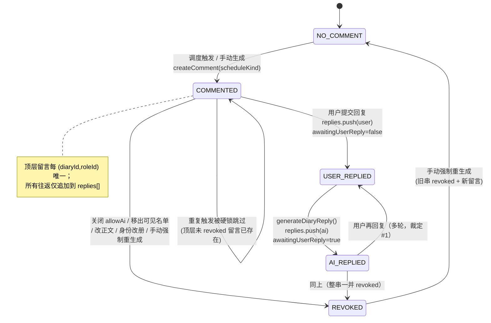
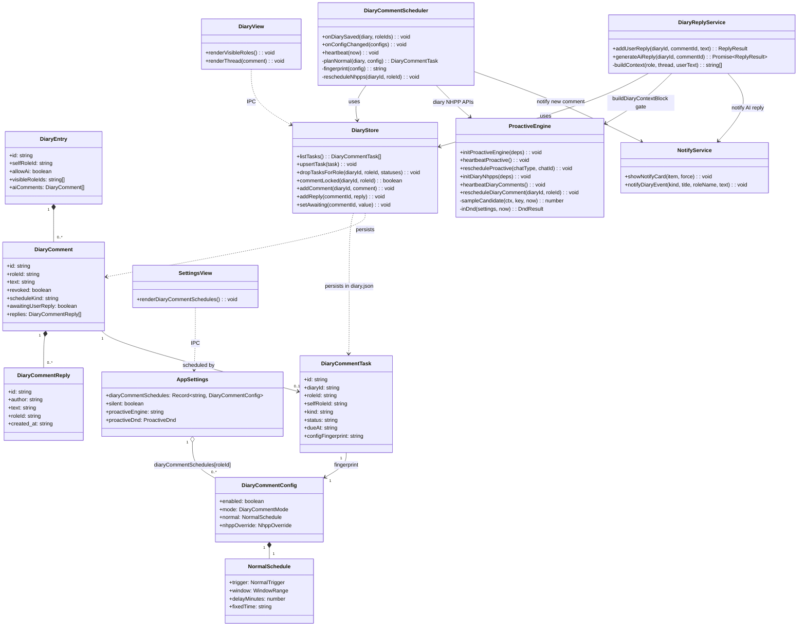
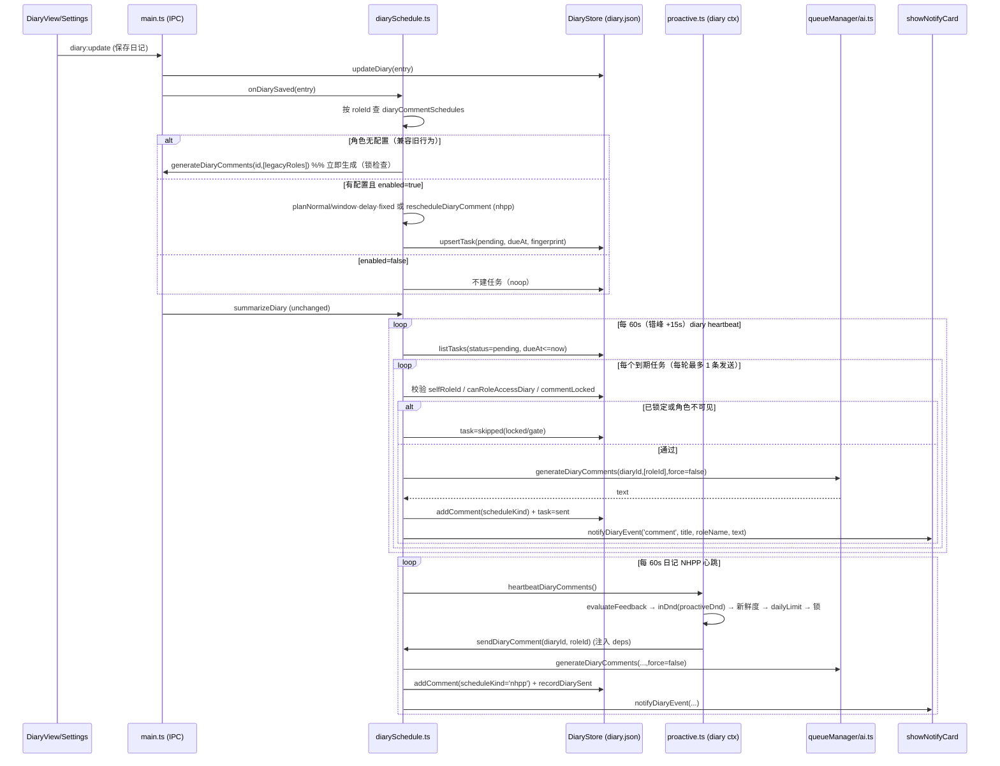
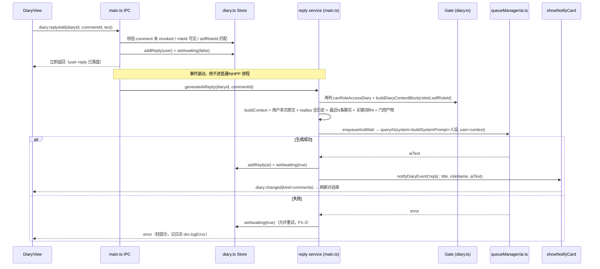
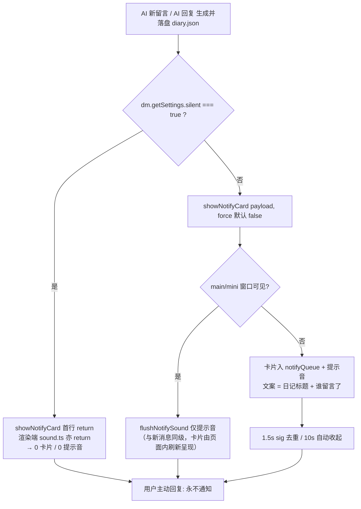
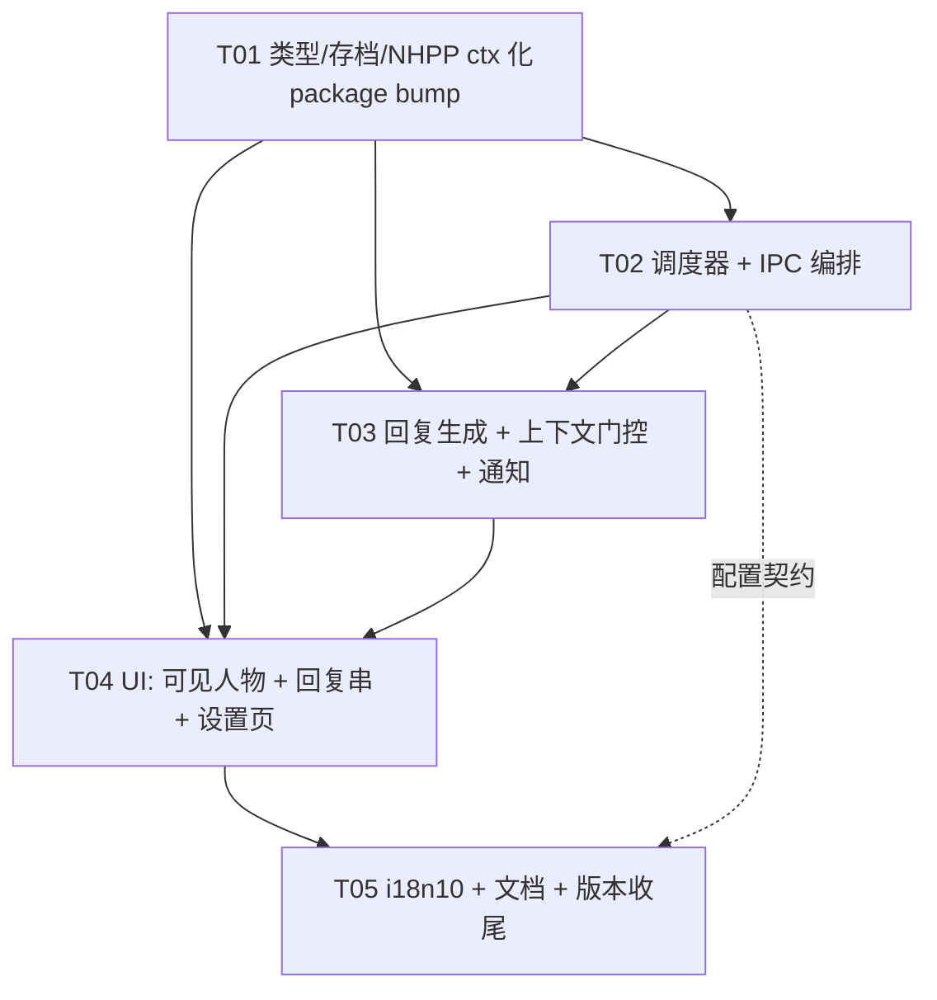

# 念语 v3.0.24 增量系统设计 —— 日记 AI 留言（可见人物 UI · 三子模式/NHPP 排程 · 可回复对话串 · 通知静默矩阵）

> 文档类型：增量系统设计 + 有序任务列表 · 架构师：高见远（software-architect） · 语言：中文
> 基线版本：3.0.23（HEAD `52e934ea0d151e2a2c9130628917877bdb3cfd05`，已发布） · 目标版本：**3.0.24**
> 上游：`docs/v3.0.24-diary-ai-comments-prd.md` · 基线设计（不重做）：`docs/v3.0.23-diary-layout-identity-design.md`、`docs/v3.0.22-diary-ui-design.md`
> 仓库：`H:/NY/Nianyu-Chat`
> 配套图：`docs/v3.0.24-diary-ai-comments-class.mermaid`、`docs/v3.0.24-diary-ai-comments-sequence.mermaid`、`docs/v3.0.24-diary-ai-comments-state.mermaid`、`docs/v3.0.24-diary-ai-comments-schedule.mermaid`、`docs/v3.0.24-diary-ai-comments-notify.mermaid`
> 约束：最小变更 · 新字段一律可选（旧存档零迁移） · 不引入新依赖 · 版本 bump 3.0.24 · 5 份文档同步 · 全部用户可见文案走 i18n 10 语言。

---

## 0. 基线代码复核与主理人七项裁定落点（最高优先级）

### 0.1 本机实测（符号名/行号以本机为准，工程师按符号搜索而非按行号硬套）

| 项 | PRD/任务书口径 | 本机实测结论 |
|---|---|---|
| HEAD / 版本 | `52e934e` / 3.0.23 | 一致（`git rev-parse HEAD` = `52e934e…`；`package.json:3` = `3.0.23`）→ bump 3.0.24 |
| 工作区 | — | 干净，仅新增未跟踪的 PRD 文档；本设计不触碰任何既有未提交改动 |
| 可见人物 UI 根因 | 容器无 `max-height`/`overflow` | `.diary-role-pick`（`index.css:7588`）仅 `display:flex;flex-direction:column;gap:5px;border…`；`.diary-check`（`:7587`）`inline-flex` 与长名混排 → 确认 |
| NHPP 引擎 | 复用注入，不改聊天行为 | `electron/proactive.ts`：模块级单例 `store`（`proactive-nhpp.json`）、`initProactiveEngine(deps)`（main.ts:8354 注入）、`heartbeatProactive()`（main.ts:8377 每 60s，**每轮最多发送一条**）、`rescheduleProactive`、`inDnd`（读 `settings.proactiveDnd`，支持跨午夜）、`dailyCount`/`feedback`/`replyGapEma`。**候选 key 形如 `chatType:chatId`，心跳按首个 `:` 切分后调用 `sendProactive`** → 日记 key 不能直接塞进聊天 store，否则 `handleProactive(chatType='diary',…)` 崩溃 |
| 留言数据层 | 扩展对话串 | `electron/diary.ts` 纯模块：`canRoleAccessDiary`（:71）、`collectArtifactsForRole`（:79，只读未 revoked 产物，**永不读 diary.content**）、`planDiaryAiWork`（:146，tone='skip' 过滤）、`DiaryStore.addComment`（:354）、`applyRevoke`（:128）、`buildDiaryContextBlock`（:427）。存档 `diary.json` 走 `secureStore.readText/writeText` 统一加密 |
| 留言生成/调度 | 接管排程，总结不变 | `generateDiaryComments`（main.ts:5730）、`summarizeDiary`（:5785）、`scheduleDiaryAi`（:5834，保存后 fire-and-forget）；IPC `diary:regenerateComments`（:7155）、`diary:update`（:7140，`aiComments-only` patch 不重复触发） |
| 通知 | 复用 `showNotifyCard` 首行静默总闸 | `showNotifyCard(item, force)`（main.ts:1022）首行 `if (dm.getSettings().silent === true) return`; 去重 sig=`chatType:chatId:content[:40]`；`label`/`roleName`/`content`/`chat` 透传给 `notify:data`；渲染端 `src/notify.ts:212` `playSoundSync('notification')` → `src/utils/sound.ts:191` `if (type==='notification' && s.silent && !force) return`。两端同口径 |
| 静默开关 | 复用 `settings.silent`，不新增 DND 设置 | 托盘 `toggleSilentMode`（main.ts:1414）持久化 + 重建托盘 + `settings:changed` 广播；`silent` 定义 `types.ts:965`，默认 `false`（:1469） |
| IPC 三层 | 需新增通道 | `electron/main.ts`（ipcMain.handle）→ `electron/preload.ts`（invoke）→ `src/ipc.ts`（api 封装）→ 组件。日记通道现状：preload:1424-1438 / ipc.ts:636-651 |
| i18n | 10 语言 | `src/i18n/translations.ts`（zh 块 :2046-2100，en 块 :4125+）+ `src/i18n/locales/{de,es,fr,ja,ko,pt,ru,zh-Hant}.json` 共 9 个 JSON → zh + 9 = 10 |
| Token 预算 | 复用既有上限 | `effectiveHistoryCap(cfg, isGroup)`（main.ts:3084）= `cfg.memReadLimit>0 ? memReadLimit : (isGroup?24:16)`；`buildSystemPrompt(role, …, diarySelfRoleId)`（:2817）第 4 参注入 `buildDiaryContextBlock` |

### 0.2 主理人七项裁定 → 本设计落点（覆盖 PRD §10 的任何旧表述）

| # | 裁定 | 落点 |
|---|---|---|
| 1 | 多轮回复；每轮 AI 回复必须由用户新回复触发，绝不自动连发；`awaitingUserReply` 控制 | §3.2 锁状态机；§4.3 回复服务只在 `diary:replyAdd` 用户事件里生成 AI 回复；UI 生成中禁用输入框 |
| 2 | NHPP 日记留言沿用 `proactiveDnd` 顺延；与 `settings.silent` 分离（静默只静音不停生成） | §4.4 日记 NHPP 心跳调用同一 `inDnd()`；§5 静默矩阵只拦通知/提示音，生成与落盘在前置完成 |
| 3 | 时段留言：时段内均匀随机、每篇每角色每日最多 1 次，与一人物一留言锁一致 | §4.2 `window` 排程 + §3.2 顶层留言唯一锁（回复走嵌套 `replies`，不新增顶层留言） |
| 4 | 配置变更：作废旧 pending 并按新配置重排；关闭 `enabled` 直接作废 | §4.5 `onConfigChanged` 指纹比对 + `superseded`/`cancelled` |
| 5 | 手动重新留言：显式意图，强制重生成（旧留言软撤 revoked），UI 二次确认 | §4.6 `diary:commentRegenerateOne` + `force` 标志；§6.2 二次确认文案 |
| 6 | 按人物配置全局按 `roleId`，不按身份分 | §3.1 `AppSettings.diaryCommentSchedules: Record<roleId, Config>`，落在 `settings`，跨身份共享 |
| 7 | 回复上下文 = 用户本次回复原文 + 该留言串全部历史；其余取该角色最近 N 条聊天，守 token 预算与 `collectArtifactsForRole` 门控 | §4.3.2 定量裁剪策略：N=16（受 `memReadLimit` 下调）、关键词补 4 条、6000 字符硬预算、优先级裁剪 |

---

## Part A · 系统设计

## 1. 实现方案

### 1.1 核心难点

| 难点 | 方案 |
|---|---|
| **复用 NHPP 但不污染聊天心跳** | `proactive.ts` 内部 `store` 是模块单例、心跳按 `chatKey.split(':')` 解析。日记 key `diary:{diaryId}:{roleId}` 若混入会导致 `handleProactive('diary', …)` 崩溃。方案：把引擎内部辅助函数（`intensity`/`sampleCandidate`/`poissonSample`/`priorScale`/`recentProactiveCount`/`replyGapScale`/`inDnd`/`evaluateFeedback`/`recordSent`）**增加可选 `ctx` 参数（默认聊天 ctx）**，新增第二个 `ProactiveEngineCtx` 实例（独立 `diary-nhpp.json`）。所有既有导出函数（`initProactiveEngine`/`heartbeatProactive`/`rescheduleProactive`/`markQuickReply`/`deriveAwaitingReplyKeys`）**保持签名与行为不变**（内部形如 `run(chatCtx, …)`），聊天 store/文件/心跳循环一行不改。日记侧新增 `initDiaryNhpps(deps)` / `rescheduleDiaryComment(diaryId, roleId)` / `heartbeatDiaryComments()`，由新模块 `diarySchedule.ts` 驱动 |
| **两套时钟互不阻塞** | 聊天心跳仍是 main.ts:8377 的 60s `setInterval(heartbeatProactive)`；日记留言心跳**独立定时器、错峰 15s**（`setTimeout(() => setInterval(heartbeatDiaryComments, 60_000), 15_000)`）。两者各自「每轮最多一条」预算独立，不共享节流标志；共享 `enqueueAndWait` QPS 队列仅做串行排队（既有机制），不构成互相阻塞 |
| **一人物一留言 + 多轮回复兼容** | 顶层 `aiComments` 每 (diaryId,roleId) 最多 1 条未撤销留言（硬锁）；所有往返塞进该留言的 `replies[]` 嵌套数组。锁判断只看顶层，回复永不新增顶层留言 → 默认 1 条与多轮对话同时成立 |
| **门控不回退** | 所有生成/回复路径统一经 `canRoleAccessDiary` + `selfRoleId` 比对；注入对话只经 `buildDiaryContextBlock`（内部 `collectArtifactsForRole`），日记正文 `content` **只在生成该篇留言/摘要的那一次 prompt 中出现**，任何回复/聊天上下文不得携带 |
| **静默口径不漂移** | 不写新的 silent 判断：生成/落盘在通知之前完成；通知一律走 `showNotifyCard`（主进程首行 silent return）与 `playSoundSync('notification')`（渲染端 sound.ts silent return），两端既有机制天然同口径 |
| **40 人物 UI 溢出** | 滚动容器 `.diary-role-list`（`max-height:240px; overflow-y:auto; overflow-x:hidden`）独立于 `.diary-bulk`（置于容器外，顶部固定）；行容器 flex + `align-items:center` + `min-height:22px`，checkbox `flex:0 0 auto`，文字 `text-overflow:ellipsis` + `title` |

### 1.2 模块划分与边界（复用 vs 新增）

| 模块 | 归属 | 职责 | 边界（明确「改什么、不改什么」） |
|---|---|---|---|
| `electron/diarySchedule.ts` | **新增**（核心） | 普通三子模式排程、任务 CRUD/持久化、配置指纹比对与重排、日记 NHPP 心跳编排、`rescheduleDiaryComment` 调用、通知载荷组装 | 只调用 `proactive.ts` 的日记导出函数与 `diary.ts` 的 Store；不 import `main.ts`（依赖注入） |
| `electron/proactive.ts` | **增量改造（加法）** | 增加 `DiaryEngineCtx` + 日记导出函数；既有聊天辅助函数改为「接收可选 ctx，默认 chatCtx」 | **聊天行为零变化**：`initProactiveEngine`/`heartbeatProactive`/`rescheduleProactive`/`markQuickReply`/`deriveAwaitingReplyKeys` 对外签名与内部逻辑等价；`proactive-nhpp.json` 结构不变；日记状态落新文件 `diary-nhpp.json` |
| `electron/diary.ts` | **增量改造** | `DiaryStoreShape.commentTasks?`；`DiaryStore` 增加 `listTasks/upsertTask/dropTasksForRole/addReply/setAwaiting`；`applyRevoke` 扩展为整串撤销（含 `replies`） | 既有 `collectArtifactsForRole`/`planDiaryAiWork`/`canRoleAccessDiary`/迁移函数**不改判定语义**；只把「输出未 revoked 留言文本」扩展为可选包含 replies（默认关，回复服务显式开启） |
| `electron/main.ts` | **增量改造（编排层）** | 新 IPC 注册、`scheduleDiaryAi` 分流（legacy 直 generation / 有配置走 scheduler）、`generateDiaryComments` 增加 `force` 与锁检查、新增 `generateDiaryReply`、`settings:save` 配置变更钩子、独立日记心跳定时器、通知调用 | `showNotifyCard` 首行 silent return、`toggleSilentMode`、`summarizeDiary`、聊天 NHPP 心跳与注入块**逐字不动** |
| `electron/preload.ts` / `src/ipc.ts` | 增量 | 3 条新 IPC 通道 + 1 个 `diary:changed` 事件扩展 | 既有通道不改 |
| `src/components/DiaryView.tsx` / `src/styles/index.css` | 增量 | 可见人物列表修复、留言串/回复输入框、徽标、二次确认 | 身份切换/清草稿/背景/自适应逻辑不改 |
| `src/components/Settings.tsx` | 增量 | 「按人物留言配置」分区，复用同一滚动列表样式 | 既有 NHPP/DND/静默设置项不改 |
| `src/i18n/*` / 5 份文档 / `package.json` | 增量 | 新增键 ×10 语言、版本 3.0.24 | 既有键文案不动 |

### 1.3 架构模式

沿用现有 **Electron 主进程数据/调度真源 + 渲染层纯展示 + preload IPC 桥** 的分层，不引入 MVC/MVVM 重构；调度器采用 **纯函数排程（可单测）+ 单例编排器（持有 Store 引用）** 的组合，与 `diary.ts` 的纯函数门禁风格一致。

---

## 2. 文件清单（完整新增/修改路径）

### 2.1 新增文件

| 路径 | 说明 |
|---|---|
| `electron/diarySchedule.ts` | 日记留言调度器（普通三子模式 + NHPP 编排 + 任务持久化 + 通知载荷） |
| `docs/v3.0.24-diary-ai-comments-design.md` | 本设计文档 |
| `docs/v3.0.24-diary-ai-comments-class.mermaid` | 类图 |
| `docs/v3.0.24-diary-ai-comments-sequence.mermaid` | 时序图（调度 + 回复 + 通知） |
| `docs/v3.0.24-diary-ai-comments-state.mermaid` | 留言锁状态机 |
| `docs/v3.0.24-diary-ai-comments-schedule.mermaid` | 调度时序 |
| `docs/v3.0.24-diary-ai-comments-notify.mermaid` | 通知/静默矩阵 |
| `scripts/verify-diary-comments-3024.mjs` | QA 行为级自检脚本（§9 断言） |
| `userData/diary-nhpp.json`（运行时生成，不入库） | 日记 NHPP 独立状态文件（priors/candidates/feedback/dailyCount） |

### 2.2 修改文件

| 路径 | 变更摘要 |
|---|---|
| `src/types.ts` | `DiaryCommentMode`/`NormalTrigger`/`DiaryCommentConfig`/`DiaryCommentReply`/`DiaryCommentTask` 新类型；`AppSettings.diaryCommentSchedules?`；`DiaryComment` 三个可选字段；`DiaryStoreShape.commentTasks?`；`DEFAULT_SETTINGS` 增加 `diaryCommentSchedules: {}` |
| `electron/diary.ts` | Store 任务表读写；`addReply`/`setAwaiting`/`commentLocked`；`applyRevoke` 整串撤销；`collectArtifactsForRole` 可选 `includeReplies`（默认 false） |
| `electron/proactive.ts` | 引擎 ctx 参数化（加法）；新增日记 NHPP 导出函数与新 store 文件常量 |
| `electron/main.ts` | 新 IPC、生成锁与 force、回复生成、`settings:save` 钩子、独立心跳定时器、通知调用、`openNotifyChat` 支持 `chatType='diary'` |
| `electron/preload.ts` | `diaryReplyAdd`/`diaryCommentRegenerateOne` 两个 invoke + 类型声明 |
| `src/ipc.ts` | 同上两个 api 封装 |
| `src/components/DiaryView.tsx` | 可见人物列表结构、回复串渲染、回复输入、批量重新留言确认 |
| `src/components/Settings.tsx` | 按人物留言配置分区 |
| `src/styles/index.css` | `.diary-role-list`/`.diary-check`/`.diary-comment-thread`/`.diary-reply-*` 等类；14 主题令牌兼容（只用 `var(--color-*)`，无裸色值） |
| `src/i18n/translations.ts` | zh/en 新增键 |
| `src/i18n/locales/{de,es,fr,ja,ko,pt,ru,zh-Hant}.json` | 各新增键译文 |
| `package.json` | version `3.0.23` → `3.0.24`；新增 `verify:diary-comments-3024` 脚本 |
| `使用说明.md`、`README.md`、`硬编码清单.md`、`版本更新记录.md`、`src/components/GuideView.tsx` | 5 份文档/文案同步（新增常量登记见 §8.4） |

---

## 3. 数据结构与接口

### 3.1 类型定义（`src/types.ts`，全部可选字段兼容旧存档）

```ts
// ===== v3.0.24 日记留言排程 =====
export type DiaryCommentMode = 'normal' | 'nhpp';
export type NormalTrigger   = 'window' | 'delay' | 'fixed';

export interface DiaryCommentConfig {
  enabled: boolean;                 // 默认 false；老用户无该字段 = 全人物未启用
  mode: DiaryCommentMode;           // 'normal' | 'nhpp'
  normal: {
    trigger: NormalTrigger;
    window?: { start: string; end: string }; // 'HH:mm'，可跨午夜
    delayMinutes?: number;          // 1..1440，相对日记保存时刻
    fixedTime?: string;             // 'HH:mm'
  };
  nhppOverride?: { dailyLimit?: number; freshnessMin?: number }; // 缺省走全局
}

export interface DiaryCommentReply {
  id: string;
  author: 'user' | 'ai';
  text: string;
  roleId: string;                   // AI 回复的角色 id（user 回复为 ''）
  created_at: string;               // ISO 8601 UTC
}

// DiaryComment 新增（旧字段全部保留）：
//   replies?: DiaryCommentReply[];
//   scheduleKind?: 'normal' | 'nhpp' | 'manual';
//   awaitingUserReply?: boolean;    // true=AI 已发话、等待用户回复；false=生成中/待重试

export interface DiaryCommentTask {
  id: string;                       // dct_<base36>_<seq>
  diaryId: string;
  roleId: string;
  selfRoleId: string;               // 排程时的身份快照（发送前再校验一次）
  kind: NormalTrigger | 'nhpp';
  status: 'pending' | 'due' | 'sent' | 'skipped' | 'superseded' | 'cancelled';
  dueAt: string;                    // ISO 8601 UTC（本地时段换算后存 UTC）
  configFingerprint: string;        // 稳定序列化 {mode,normal,nhppOverride}
  createdAt: string;
  updatedAt?: string;
  reason?: string;                  // dnd / daily_limit / locked / send_failed / config_changed …
}

// AppSettings 新增：
//   diaryCommentSchedules?: Record<string, DiaryCommentConfig>;  // key = roleId（全局，跨身份）
// DiaryStoreShape 新增：
//   commentTasks?: DiaryCommentTask[];                            // 缺省 []
```

**持久化决策（任务书要求明确）**：
- **普通模式任务** → 复用 `diary.json`，新增可选顶层 `commentTasks`。理由：该文件已由 `secureStore` 统一加密、`DiaryStore.save()` 单原子写；`normalizeShape` 用 `Array.isArray(r.commentTasks) ? r.commentTasks : []` 兼容旧档，**零迁移**。
- **NHPP 日记状态** → 新增独立 `diary-nhpp.json`（与聊天 `proactive-nhpp.json` 完全隔离）。理由：NHPP 状态是派生行为模型，沿用既有「独立文件新表」惯例；两心跳互不读写对方文件，从根本上杜绝回退风险。
- **配置** → 落在 `settings`（`diaryCommentSchedules`），走既有 `settings:save`，无新文件。

### 3.2 留言锁状态机（裁定 #1/#3/#5）



### 3.3 类图（详见 `docs/v3.0.24-diary-ai-comments-class.mermaid`）



### 3.4 IPC 通道清单

| 通道（主进程 handle / preload invoke / api 方法） | 入参 | 返回 | 说明 |
|---|---|---|---|
| `diary:replyAdd` / `diaryReplyAdd` / `api.diaryReplyAdd` | `(diaryId: string, commentId: string, text: string)` | `Promise<{ ok: boolean; reply?: DiaryCommentReply; error?: string }>` | **新增**。用户提交回复：落 user reply → 立即触发 AI 回复（事件驱动，不进排程）；生成失败返回 error，用户可重试 |
| `diary:commentRegenerateOne` / `diaryCommentRegenerateOne` / `api.diaryCommentRegenerateOne` | `(diaryId: string, roleId: string)` | `Promise<DiaryAiResult>` | **新增**。手动强制重生成：旧顶层留言及整串 `revoked=true`，新建 `scheduleKind='manual'` 留言；UI 已二次确认 |
| 既有 `settings:save` | patch 含 `diaryCommentSchedules` | `AppSettings` | **复用+钩子**：handler 内检测该字段 → `diaryScheduler.onConfigChanged(next.diaryCommentSchedules)`（裁定 #4） |
| 既有 `diary:update` | patch | `DiaryEntry` | **复用+钩子**：非 `aiComments-only` 时增加 `diaryScheduler.onDiarySaved(entry)` 分流 |
| 既有 `diary:regenerateComments` | `(id, roleIds?)` | `DiaryAiResult` | **复用+语义调整**：`force=true` 路径，受二次确认保护 |
| 既有 `diary:changed` 事件 | `{ diaryId, kind: 'comments'\|'summary'\|'entry' }` | — | 不变；UI 收到 `kind:'comments'` 即刷新留言串 |

> **不新增 DND 设置通道**：静默复用 `settings.silent`；`proactiveDnd` 复用既有设置，仅由日记 NHPP 心跳读取。

### 3.5 通知 payload 结构（`showNotifyCard` 入参，`item` 为 any 但约定如下）

```ts
interface DiaryNotifyPayload {
  label: string;        // i18n：notify.diaryNewComment / notify.diaryNewReply（主进程按 getAppLang() 取）
  roleName: string;     // 角色名，完整保留（卡片 avatar/name）
  content: string;      // `《${titleTrunc}》· ${roleName}：${summary}`，title 截断 24 字符
  chatType: 'diary';    // 新种类；openNotifyChat 加分支（仅置前主窗 + 广播 diary:open，不误当聊天）
  chatId: string;       // diaryId
  name: string;         // 日记标题（完整，供 openNotifyChat/展示）
  diaryId: string;
  commentId: string;
  soundPath: null;      // 走全局通知音；不读 chatSoundPaths
}
```

调用：`showNotifyCard(payload)`（**不传 force**，与新消息同级：`mainWindow`/`miniWindow` 可见时只响提示音、不弹卡片；静默首行 return 同时拦卡片；渲染端 sound.ts 拦提示音）。

---

## 4. 程序调用流程

### 4.1 调度器主流程（详见 `docs/v3.0.24-diary-ai-comments-schedule.mermaid`）



**普通三子模式排程规则**（`planNormal`，全部在**本地时间**计算后转 ISO UTC 存 `dueAt`）：

| 子模式 | 规则 |
|---|---|
| `window` | `start/end` 为 `'HH:mm'`，支持跨午夜（`start>end` 视为跨日）。在窗口总分钟区间内**均匀随机**取点；若算得时刻 < 保存时刻 → 顺延次日窗口。每篇每角色每日最多 1 次（任务 `sent` + 顶层锁双保险） |
| `delay` | `dueAt = savedAt + delayMinutes`，`(delayMinutes 钳制 1..1440)`；到点若已锁定 → `skipped` |
| `fixed` | `dueAt = 今日 fixedTime`；若 < 保存时刻 → 顺延次日同一时刻；到点发送后不再重复（顶层锁） |

三类均需经过 `planDiaryAiWork` 的 `tone='skip'` 判定（在**发送时**再判一次，保存时的好感/心情可能已变），命中 skip → 任务 `skipped`，不调用模型。

### 4.2 调度时序 / 状态流转（补充要点）

- `diarySchedule.ts` 的 `heartbeat()` 与 `heartbeatDiaryComments()` 各自**每轮最多发送一条**，避免突发 QPS；但两者时钟错峰 15s，互不抢占。
- 任务状态：`pending → (due) → sent|skipped`；配置变更 `pending → superseded`（重排）或 `cancelled`（关闭）；删除日记时 `dropTasks(diaryId)`。
- 进程启动：`DiaryStore.init()` 后 `diaryScheduler.init()` 重建任务索引（任务已持久化，无需重新生成）；NHPP ctx `loadStore()` 读 `diary-nhpp.json`。到期任务在下一轮心跳补发（延迟 ≤60s）。

### 4.3 回复生成流程（详见 `docs/v3.0.24-diary-ai-comments-sequence.mermaid`）

#### 4.3.1 时序



#### 4.3.2 上下文定量裁剪策略（裁定 #7 的具体 N 与规则）

`buildContext(role, thread, userText)` 按 **优先级从高到低装配，总字符预算 6000，超预算从最低优先级开始丢弃**：

| 优先级 | 内容 | 上限 | 处理 |
|---|---|---|---|
| P0 | 用户本次回复原文 | 全文，截断 2000 字符 | **永不丢弃**；prompt 中显式标注「用户刚刚回复：…请针对其内容作答」 |
| P1 | 该留言串 `replies[]` **全部历史**（user/ai 逐条、按时间） | 每条 1200 字符截断 | **永不丢弃条目**（只截单条长度）；标注「我 / 角色名」与时间 |
| P2 | 该留言顶层文本 `comment.text` | 1200 字符 | 与 P1 同源，已验证可见性与身份 |
| P3 | 日记门控产物 `buildDiaryContextBlock(role.id, selfRoleId)` | 2000 字符 | **唯一产物注入口**，内部 `collectArtifactsForRole` 保证未 revoked + 身份册 + 可见名单三门控；**不含日记正文** |
| P4 | 该角色单聊最近 **N** 条 | `N = Math.min(effectiveHistoryCap(cfg, false), 16)`（默认 16，`memReadLimit` 可下调） | 每条 800 字符截断 |
| P5 | 关键词命中补条 | 最多 **4** 条 | 从 P4 之外的更早单聊里取：对 `userText` 做 2-gram/ASCII 词切分，命中任一关键词的历史单条，按时间倒序取 4；与 P4 去重 |

- **硬门禁**：P4/P5 只取 `dm.getMessages('single', role.id)`（该角色与用户的单聊），**绝不取群聊、绝不取其他角色产物、绝不取其它身份日记**；P3 由 selfRoleId 参数限定。
- **日记正文越界**：`diary.content` 只在「首次生成该顶层留言」的那一次 prompt 里出现；回复 prompt **不拼接** `diary.content`，只携带 P0–P5。
- prompt 结构：`system = buildSystemPrompt(role, undefined, undefined, selfRoleId)`（注入门控产物与 P3 重复则去重），`user = P0/P1/P2/P4/P5 拼装` + 明确指令「记得聊天里说过的事，针对用户刚才的回复作答，以角色口吻，1–3 句」。

### 4.4 NHPP 日记留言复用细节

- `initDiaryNhpps(deps)` 注入：`getSettings`、`sendDiaryComment(diaryId, roleId, extra?)` → `generateDiaryComments(diaryId,[roleId],false)`、`isDiaryCommentLocked(diaryId, roleId)` → `diaryStore.commentLocked`、`getDefaultModel`、`logError`。
- key = `diary:{diaryId}:{roleId}`；`dailyCount`/`prior`/`feedback`/`replyGapEma` 全部按该 key 独立计；`recordDiarySent` 与聊天 `recordSent` 逻辑等价但写 `diaryCtx.store`。
- **沿用 `proactiveDnd`**：日记心跳到期时调用同一 `inDnd(settings, now)`，命中 → candidate 顺延到窗口结束后 60s（与聊天 `after_dnd` 语义完全一致，裁定 #2）。
- **静默无关**：心跳不读 `settings.silent`；生成与落盘完成后才调通知（裁定 #2）。
- **额外硬门禁**：发送前 `isDiaryCommentLocked` 为 true → 标 `skipped(locked)`，不采样、不发送；`proactiveEngine !== 'nhpp'` 时不调度日记 NHPP（沿用原门禁）。
- 日记 NHPP 的 `awaitingUserReply` 由**顶层留言锁**承担（多轮回复由用户事件驱动，不进 NHPP 采样），与聊天侧的 `proactiveAwaitingReply` tracker 完全分离。

### 4.5 配置变更重排（裁定 #4）

`settings:save` 携带 `diaryCommentSchedules` 时调用 `onConfigChanged(nextConfigs)`：

1. 遍历所有 `diary.json` 中 `status==='pending'` 的任务：
   - 对应 `config.enabled===false` 或角色已删除 → `status='cancelled'`。
   - `fingerprint(config) !== task.configFingerprint`（模式/参数变了）→ `status='superseded'`，随后按新配置重新 `planNormal` 建 `pending` 任务。
   - 指纹相同 → 保留。
2. NHPP 角色：`enabled=false` → 从 `diaryCtx.store.candidates` 删除/标 `superseded` 对应 `diary:` key；参数变更 → `rescheduleDiaryComment(diaryId, roleId)` 重采样。
3. 变更后广播 `settings:changed`（既有机制），设置页刷新。

### 4.6 手动重新留言（裁定 #5）

- UI：每条留言下与卡片顶部「让 AI 重新留言」按钮点击 → **复用现有自绘确认框 `api.showConfirm!`**（`src/ipc.ts:502`，签名 `(message: string, title?: string) => Promise<boolean>`，`DiaryView.tsx:197` 已有同款用法：`if (!(await api.showConfirm!(t('diary.confirmRegenerateComment')))) return;`）。**禁止使用 `window.confirm` / `window.prompt` / `window.alert` 等原生弹窗**（项目硬约束：`verify-no-native-dialog` 102/0 闸门）。
- 主进程：`generateDiaryComments(diaryId, roleIds, { force:true })` → 对目标角色先把既有未撤销顶层留言及整串 `revoked=true`，再新建 `scheduleKind='manual'`、`awaitingUserReply=true` 的留言；对应 pending 任务标 `superseded`（避免随后排程重复）。
- 非 force 路径（自动/排程）：`commentLocked` 命中即 `skipped`，保证「一人物一留言」。

### 4.7 通知/静默矩阵（详见 `docs/v3.0.24-diary-ai-comments-notify.mermaid`）



| 事件 | silent=false | silent=true |
|---|---|---|
| AI 新留言 | 卡片 + 提示音，文案含标题+角色名 | 落盘、0 卡片、0 音 |
| AI 回复 | 同上（同一 `showNotifyCard` 队列/样式/去重） | 同上 |
| 用户手动回复 | 不通知 | 不通知 |
| 普通聊天新消息 | 保持现状（本设计不改） | 保持现状 |

---

## 5. Anything UNCLEAR / 假设

1. **NHPP 日记状态是否复用聊天 store**：本设计选择**独立文件 `diary-nhpp.json` + 参数化引擎 ctx**，以彻底隔离回退风险；代价是 `proactive.ts` 内部辅助函数需加一个可选 ctx 参数（默认聊天 ctx，行为不变）。若主理人坚持「完全零改 proactive.ts」，退路是在 `diarySchedule.ts` 内复制 NHPP 采样公式（会产生重复代码，不推荐）。**采用默认方案**。
2. **通知点击跳转**：`chatType='diary'` 走最小分支——置前主窗 + 广播 `diary:open`，DiaryView 订阅后滚动到该篇并高亮；若工期紧可仅置前主窗（P1，不影响硬需求）。
3. **跨午夜「今日」口径**：以**系统本地时区**为准（与 `proactive.ts:353 todayKey` / `inDnd` 一致），不引入 UTC 日历偏移；`dueAt` 存 ISO UTC，比较时转回本地。
4. **老用户行为兼容**：角色**无** `diaryCommentSchedules` 条目时，保存日记仍走「立即生成一次」的 v3.0.23 行为（受顶层锁约束）；有条目且 `enabled=true` 才交给排程器。这样「不回退 v3.0.23」与「新配置生效」并存。
5. **`replies` 是否计入 `collectArtifactsForRole`**：默认不计（保持现有产物文本口径）；回复服务的 P1 直接读该留言 `replies`（已验证门控），不经过 `collectArtifactsForRole`，避免重复注入。P3（其它日记产物）仍严格走门控。
6. **手动批量重生成 vs 单条**：两者都 force，均二次确认；批量仅重生成当前可见名单内角色。

---

## Part B · 任务分解

## 6. Required Packages

**不引入任何新依赖**（沿用既有）。相关既有依赖声明：
```
- electron@^32.1.2: 主进程 / IPC / 定时器
- react@^18.3.1 / react-dom@^18.3.1: 渲染层
- typescript@^5.6.2: 类型（tsconfig.json / tsconfig.node.json）
- vite@^5.4.8 / @vitejs/plugin-react@^4.3.2: 构建
- adm-zip@^0.5.16 / iconv-lite@^0.7.3: 既有备份/编码（本需求不用，仅说明不新增）
```
测试脚本为零依赖 `node scripts/*.mjs`（沿用既有 verify 系列写法）。

## 7. 任务列表（按依赖排序，5 项；第一项为增量基础设施）

> 每项含依赖与**可证伪验收点**；QA 依据 §9 断言复核。

### T01 · 增量基础设施：类型 / 存档 schema / NHPP 引擎 ctx 化（P0）
- **源文件**：`src/types.ts`、`electron/diary.ts`、`electron/proactive.ts`、`electron/diarySchedule.ts`（新建骨架）、`package.json`（version + 脚本）
- **依赖**：无
- **要点**：新增 §3.1 全部类型；`DiaryStoreShape.commentTasks` + `normalizeShape` 默认 `[]`；`DiaryStore` 任务/回复方法；`applyRevoke` 整串撤销；`proactive.ts` 引擎 ctx 参数化（默认聊天 ctx）+ `diary-nhpp.json` 常量与日记导出函数签名；`diarySchedule.ts` 骨架 + `fingerprint()`；bump 3.0.24。
- **验收点**：`npm run typecheck` 通过；旧 `diary.json`（无 `commentTasks`/无 `replies`）加载后 `listTasks()==[]` 且留言读取正常；聊天 NHPP 既有 `verify:*` 脚本全绿（行为零回退）。

### T02 · 调度器实现与 IPC 编排（P0）
- **源文件**：`electron/diarySchedule.ts`、`electron/main.ts`、`electron/preload.ts`、`src/ipc.ts`
- **依赖**：T01
- **要点**：`planNormal`(window/delay/fixed) + `onDiarySaved` 分流 + `heartbeat`（独立错峰 15s 定时器）+ `onConfigChanged` 重排 + `heartbeatDiaryComments` 编排；新增 `diary:replyAdd`/`diary:commentRegenerateOne` 通道与 `settings:save` / `diary:update` 钩子；`openNotifyChat` 加 `diary` 分支。
- **验收点**：三类子模式各端到端触发一次且仅一次；固定点晚于创建时顺延次日；错峰心跳下聊天 NHPP 与日记留言同轮各发 1 条不互阻；配置改参数后旧 pending 变 `superseded` 且新任务 `dueAt` 更新，`enabled=false` 后 pending 全 `cancelled`。

### T03 · 回复生成、上下文门控与通知（P0）
- **源文件**：`electron/main.ts`（`generateDiaryReply`、`generateDiaryComments` force/锁）、`electron/diary.ts`（`collectArtifactsForRole` 可选 includeReplies）、`src/notify.ts`（无需改逻辑，仅验证静默口径）、`electron/proactive.ts`（`sendDiaryComment`/`isDiaryCommentLocked` 注入接线）
- **依赖**：T01（可与 T02 并行开发，集成依赖 T02 的 IPC）
- **要点**：§4.3 上下文 P0–P5 装配与 6000 字符预算；`awaitingUserReply` 状态流转；失败重试；通知 payload 与 `showNotifyCard` 调用；force 重生成软撤旧串。
- **验收点**：无用户回复时 `replies` 无新增 ai 条目；回复后恰好 +1 条 ai 且内容体现用户原文；播撒「我养了只猫」后问「还记得我的猫吗」能关联；prompt 中不出现 `diary.content`、不出现其它身份/未撤销外产物；silent=true 下 3 次生成 → 落盘 3、卡片 0、音 0。

### T04 · UI：可见人物列表修复 + 留言串/回复 + 设置页配置（P0）
- **源文件**：`src/components/DiaryView.tsx`、`src/components/Settings.tsx`、`src/styles/index.css`
- **依赖**：T01（类型/IPC 契约），集成依赖 T02/T03
- **要点**：滚动容器 + 固定顶部按钮 + 行对齐 + 长名省略/title + 禁用态；留言串渲染/回复输入/等待徽标/二次确认；设置页按人物配置三子模式 + NHPP override（同款滚动列表）；仅用主题变量。
- **验收点**：40 人物容器 `clientHeight<=240` 且外层 `scrollHeight==clientHeight`；行高 20–24px、间距 6px；长名省略且 `title` 完整；14 主题下无裸色值、无溢出；禁用态一致。

### T05 · i18n 10 语言 / 文档 / 版本收尾（P0）
- **源文件**：`src/i18n/translations.ts`、`src/i18n/locales/*.json`（9 个）、`使用说明.md`、`README.md`、`硬编码清单.md`、`版本更新记录.md`、`src/components/GuideView.tsx`、`package.json`
- **依赖**：T04（文案冻结后）
- **要点**：§8.1 键表 ×10 语言；5 份文档同步；新增常量登记；版本 3.0.24；`npm run build` 通过后 GitHub 上传 + tag `v3.0.24`（由 QA/主理人执行）。
- **验收点**：`npm run verify:i18n-coverage` / `verify:diary-i18n-10` 全绿无 missing key；`package.json` = 3.0.24；5 份文档版本号与说明一致；tag 与 package.json 一致。

### 7.6 任务依赖图



---

## 8. 共享知识（工程师必读）

### 8.1 CRON / 心跳策略
- **绝不共用「每轮一条」预算**：聊天 `heartbeatProactive()`（main.ts:8377，60s）与日记 `heartbeatDiaryComments()`（新增，60s 但启动延迟 15s）是两个独立 `setInterval`；各自最多发送一条。禁止把日记候选塞进聊天 `store.candidates`（会破坏 `split(':')` 解析与 `sendProactive`）。
- 日记排程器 `heartbeat()` 与 NHPP 心跳可在同一 15s 错峰 tick 内顺序执行，但**每类各自限一条**；AI 调用统一走 `enqueueAndWait(cfg.id, cfg.qps, label)`，共享 QPS 队列只排队不丢单。
- 定时器在 `app.whenReady()` 之后注册（与既有心跳同处），退出时无需额外清理（进程结束）。

### 8.2 时间格式与跨午夜
- 所有用户配置时间为 `'HH:mm'`（24h，字符串）；校验 `Number.isFinite` 与 0–23/0–59。
- 窗口 `start>end` 视为跨午夜：`inWindow = cur>=start || cur<end`；计算随机时刻时先在 `[start,end]` 的相邻两日区间内均匀取点，若 < now 则 +1 天（窗口）。
- `dueAt`/`created_at`/`created_at(reply)` 一律 `new Date().toISOString()`（ISO 8601 UTC）；**展示与窗口判定用本地时间**（与 `proactive.ts` 的 `todayKey`/`inDnd` 一致）。
- 「每日最多一次」按本地日历日 `YYYY-MM-DD` 计；任务 `sent` + 顶层留言锁双保险。

### 8.3 门控与 revoke 一致性（不可变量）
- 生成/回复前必过 `canRoleAccessDiary(d, roleId)`（allowAi + visibleRoleIds）与 `d.selfRoleId === effectiveSelfRoleId`；身份切换后旧留言不复活。
- `applyRevoke` 命中时把该角色留言**整串**（`revoked=true` 顶层 + 所有 `replies` 视为失效，渲染/注入均过滤）；`collectArtifactsForRole` 只输出未 revoked 文本。
- **日记正文 `content` 永不注入聊天上下文**（不变量 #1）；回复 prompt 只带 §4.3.2 的 P0–P5。
- 回复服务校验目标 `commentId` 必须属于入参 `diaryId` 且 `roleId` 在该篇可见名单内，否则拒绝（防越权跨篇/跨人物）。

### 8.4 新增常量登记（`硬编码清单.md`）
- `DIARY_TASK_FILE` 复用 `diary.json`；`DIARY_NHPP_STORE_FILE='diary-nhpp.json'`；`DIARY_REPLY_CHAT_N_CAP=16`、`DIARY_REPLY_KEYWORD_MAX=4`、`DIARY_REPLY_CHAR_BUDGET=6000`、`DIARY_REPLY_SINGLE_CHAR_CAP=800/1200/2000`、`DIARY_TITLE_TRUNC=24`、`DIARY_HEARTBEAT_PHASE_MS=15000`。均登记到清单。

### 8.5 i18n 键表（新增，全部 10 语言：zh/en/fr/de/ja/ko/es/pt/ru/zh-Hant）

| 键 | zh 文案（示例） |
|---|---|
| `diary.commentSchedule` | 留言时间设置 |
| `diary.commentModeNormal` / `diary.commentModeNhpp` | 普通模式 / NHPP 智能模式 |
| `diary.triggerWindow` / `diary.triggerDelay` / `diary.triggerFixed` | 时段留言 / 几分钟后 / 固定时间 |
| `diary.windowStart` / `diary.windowEnd` / `diary.delayMinutes` / `diary.fixedTime` | 开始 / 结束 / 延迟分钟 / 固定时间 |
| `diary.enablePerRole` | 为该人物启用自动留言 |
| `diary.replyPlaceholder` / `diary.replySend` | 回复… / 发送回复 |
| `diary.replyFromAi` / `diary.awaitingReply` | AI 回复 / 等待你的回复 |
| `diary.replyGenerating` / `diary.replyFailed` | 正在回复… / 回复失败，点此重试 |
| `diary.confirmRegenerateComment` | 确定强制重新留言？原留言及对话将被撤销。 |
| `diary.scheduleHint` | 留言时间仅在设置页按人物配置；此处只勾选可见人物。 |
| `notify.diaryNewComment` | 日记新留言：{title} · {role} |
| `notify.diaryNewReply` | 日记新回复：{title} · {role} |

> zh/en 写进 `translations.ts`；其余 9 种写进 `locales/*.json`（占位符 `{title}`/`{role}` 原样保留）。

### 8.6 主题变量
- 新样式只用既有令牌：`--color-text`、`--color-border`、`--color-panel`、`--color-primary`、`--color-chat-bg`、`--anim-speed`；滚动条沿用全局样式。**禁止裸色值**，保证 14 主题（含 aura/vibrant 半透明）一致。

### 8.7 测试口径

```bash
npm run typecheck
npm run verify:i18n-coverage && npm run verify:diary-i18n-10
node scripts/verify-diary-comments-3024.mjs   # 新增：§9 全部断言
# 回归既有（不得回退）：
npm run verify:diary-ai-isolation
npm run verify:diary-comment-tone
npm run verify:diary-storage-unreadable
npm run verify:diary-crypto-migration
npm run verify:diary-ui-3022 && npm run verify:diary-ui-3023 && npm run verify:diary-migrate-3022
```
> 自检脚本通过**依赖注入的假 deps**（假 Store/假 Settings/假 AI）驱动纯逻辑，不依赖真实模型与网络。

---

## 9. QA 闸门建议（行为级可证伪断言）

| # | 断言（可证伪） |
|---|---|
| Q1 | 注入 **40** 个角色渲染可见人物列表：`getComputedStyle(list).maxHeight === '240px'`，`list.scrollHeight > list.clientHeight`（内部滚动），**外层 fieldset/dialog `scrollHeight === clientHeight`**（无溢出）；每行 `height∈[20,24]`、checkbox 与文字间距 `6px`；名称 >24 字符时 `text-overflow=ellipsis` 且 `title` 属性等于全名；`disabled` 时整块 `opacity<1` 且 `pointer-events:none` |
| Q2 | window/delay/fixed 分别配置 → 用假时钟推进：各触发**恰好 1 次**且 `dueAt` 落在规则区间；fixed 创建晚于当日点 → `dueAt` 为次日；`tone='skip'` 角色调用 AI 次数 = 0 |
| Q3 | NHPP：注入 `diary:` key，`heartbeatProactive()` 的 `sendProactive` 调用次数 = 0；`heartbeatDiaryComments()` 在 `proactiveDnd` 窗口内把 candidate 顺延到窗口结束后；`dailyLimit` 达上限不再发；聊天 NHPP 既有脚本全绿（零回退） |
| Q4 | 一人物一留言：2 角色各配置 enabled → 生成后每角色顶层未撤销留言 `count===1`；再触发 3 次 → `count` 仍为 1（均 `skipped(locked)`） |
| Q5 | 回复解锁：无用户回复时连续跑 5 轮回复服务 → `replies` 中 `author==='ai'` 数量不变；提交 1 条 user 回复 → ai 恰好 +1；再提交 → 再 +1（多轮）；生成中 `awaitingUserReply===false` 且 UI 输入框 disabled |
| Q6 | 上下文：单聊播种「我养了只猫」，回复问「还记得我的猫吗」→ 捕获 prompt 含「猫」且含**用户本次原文**与**全部历史**；断言 prompt 不含 `diary.content`、不含其它身份 `selfRoleId` 的产物、不含 `revoked` 留言；注入字符总数 ≤6000 |
| Q7 | 静默矩阵：`silent=true` 触发 3 次留言/回复 → `diary.json` 新增 3 条、`showNotifyCard` 调用 0 次、`playSoundSync('notification')` 0 次；`silent=false` 同样 3 次 → 3 次卡片且每次 `content` 含日记标题与角色名；用户手动回复 → 通知 0 次 |
| Q8 | 通知同级：AI 回复走 `showNotifyCard` 同一队列，1.5s 内重复 sig 去重生效；`label` 取 `notify.diaryNewReply`；`mainWindow` 可见时只下发 `action:'sound'` 不弹卡片（与新消息一致） |
| Q9 | 配置变更：改 `window→fixed` → 旧 pending 任务 `status==='superseded'` 且新任务 `dueAt` 符合 fixed；`enabled=false` → 全部 pending `status==='cancelled'`、NHPP 对应 `diary:` candidate 被清 |
| Q10 | 兼容/安全：旧 `diary.json`（无新字段）加载零报错；`dm.logError`/日志输出不含 apiKey 与完整 prompt；`npm run build` 通过；版本=3.0.24、10 语言无 missing key、5 文档同步、tag 一致 |

---

## 10. 风险与待定项

| 风险/待定 | 影响 | 缓解 |
|---|---|---|
| `proactive.ts` ctx 参数化改错 → 聊天 NHPP 回退 | 高 | 默认参数 = 原 chatCtx；既有导出函数签名不变；T01 验收强制跑全量既有 verify 脚本；diff review 聚焦「仅加参数、不改分支」 |
| 两套心跳同轮竞争 QPS | 中 | 错峰 15s + 各自每轮一条 + 既有 QPS 队列；不共享节流标志 |
| 跨午夜/夏令时边界 | 中 | 本地时间口径与 `proactive.ts` 一致；窗口均匀取点后校验 `dueAt>now`，否则 +1 天；QA Q2 用假时钟覆盖跨午夜用例 |
| 静默口径漂移（新增通知绕过首行 return） | 高 | 禁止新增 silent 判断分支；所有通知**只能**经 `showNotifyCard` 与既有 `show()`；QA Q7 双端计数 |
| 门控越权（回复跨篇/跨身份/读正文） | 高 | 回复入口三重校验 + P3 唯一产物注入口 + QA Q6 断言 prompt 内容 |
| 10 语言漏键 | 中 | `verify:i18n-coverage` + `verify:diary-i18n-10` 双脚本闸门；占位符一致 |
| 老用户行为突变（突然不再立即留言） | 中 | §5-4 兼容策略：无配置角色保持 v3.0.23 立即生成（受锁约束） |
| 版本/tag/文档失配 | 低 | T05 集中收尾，package.json 单一真源，tag 由发布流程核对 |

---

> 备注：本设计为**增量**文档，所有既有能力（NHPP 引擎、日记门控/迁移、身份切换、背景不透明、自适应布局、光标修复、i18n 10 语言、14 主题、通知队列、文档/版本流程）一律**复用不重写**；工程师实现时以本文件 §0.1 的符号名为准，行号仅作定位参考。
