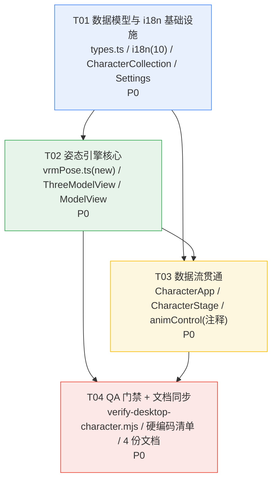

# 念语 Nianyu v3.0.8 增量设计 —— VRM 自然姿态 / 视线跟随 / 动作幅度

> 架构：高见远 ｜ 基线：v3.0.7（Electron 32 + React 18 + TS + Vite，`three@^0.170.0`、`@pixiv/three-vrm@^3.4.0`）｜ 目标版本：**v3.0.8**
> 性质：**只读研究 + 设计输出**，本文及两张 mermaid 是本次唯一落盘产物，不改任何源码。
> 配套图：`docs/vrm-motion-v3.0.8-class.mermaid`、`docs/vrm-motion-v3.0.8-sequence.mermaid`
> 说明：`docs/system_design.md` 是 v2.3.94 历史存档，刻意不覆盖；本次采用版本化文件名。

---

## 0. 结论速览（TL;DR）

| 诉求 | 根因 / 结论 | 方案一句话 |
|---|---|---|
| 手平放 | three-vrm 的 `getNormalizedBoneNode()` 返回的骨骼初始四元数是**单位四元数**，其 rest 就是 **T-pose 基准系**（面朝 +Z、上臂沿 ±X 水平）。现在写的是 `rest + sin()*0.16`，即「水平 ±9°」，永远下垂不了；前臂骨骼根本没抓。 | 新增 **rest / base / delta 三层姿态**：加载时运行时**探测模型真实臂角**（兼容 T-pose 与 A-pose），一次性算出自然站姿偏置（上臂下垂 75°→离竖直 15°、前屈 10°、肘屈 12°），再叠加待机 sine。 |
| 眼神 + 脸跟鼠标 | `eye{x,y}` 已算好但只给了 `PlaceholderCharacter`，`ModelView` 没透传给 `ThreeModelView`。 | 用 `vrm.lookAt.target = Object3D`（**不是** `lookAt(yaw,pitch)`，v3.4.0 的真实签名是 `lookAt(position: Vector3)`）；头部由我们单独按 0.35 倍 yaw/pitch 驱动，因为 three-vrm v3 的 applier **只动眼球、不动头**。 |
| 动作幅度可调 | 无此字段。 | 新增角色级 `motionAmplitude?: number`（0~1，缺省 1），放角色卡片滑块；新增 `character` 分组内两个独立子开关 `animCharacterIdle` / `animCharacterGaze`，修掉「VRM rAF 未接三档门禁」这个既有违规。 |

**关键纠错（给 team-lead）**：`VRMLookAt.lookAt(yaw, pitch)` 在 3.4.0 不存在。真实 API 是 `lookAt(position: THREE.Vector3)`（世界坐标点）、`yaw`/`pitch` 是可读写属性（**度**）、`target`/`autoUpdate` 用于连续跟随。见 `node_modules/@pixiv/three-vrm-core/types/lookAt/VRMLookAt.d.ts`。

---

# Part A：系统设计

## 1. Implementation Approach

### 1.1 根因精确诊断（逐层证据）

#### ①「平放」到底是什么状态

`three-vrm@3.4.0` 的 `VRMHumanoidRig._setupTransforms()`（`node_modules/@pixiv/three-vrm/lib/three-vrm.module.js:1704–1745`）对每个 humanoid 骨骼做的是：

```js
const rigBoneNode = new THREE.Object3D();          // ← 全新对象
rigBoneNode.name = 'Normalized_' + boneNode.name;
parentRigBoneNode.add(rigBoneNode);
rigBoneNode.position.copy(boneWorldPosition);      // ← 只复制世界坐标
// quaternion 从未赋值 ⇒ 单位四元数；scale 也是 (1,1,1)
```

所以 `getNormalizedBoneNode('leftUpperArm')` 的 `rotation` 在加载后恒为 `(0,0,0)`。当前 `ThreeModelView.tsx:484–490` 捕获的 `restPose[key]` 因此**永远是** `{x:0,y:0,z:0,sx:1,sy:1,sz:1}`——所谓「rest」不是模型真正的绑定姿势，而是 VRM 规范的**归一化 T-pose 坐标系**：

- 面朝 **+Z**（VRM1 原生；VRM0 经 `VRMUtils.rotateVRM0()` 把 `vrm.scene.rotation.y = π` 后也朝 +Z）；
- +Y 向上；
- 左右上臂沿 **±X 水平**伸出，前臂继续沿 ±X。

这就是「手平放」的物理定义：**不是动画把臂摆平了，而是基准就是 T-pose，动画从未把它搬下来。**

#### ② 为什么 ±0.16rad 修不了

`ThreeModelView.tsx:337–338`：

```ts
applyBone(armL, 'leftUpperArm', armSwing * VRM_ARM_SWING_ANGLE, 0, armWave * VRM_ARM_SWAY_ANGLE);
applyBone(armR, 'rightUpperArm', -armSwing * VRM_ARM_SWING_ANGLE, 0, -armWave * VRM_ARM_SWAY_ANGLE);
```

`applyBone` 写的是 `bone.rotation = rest + delta`，而 `rest.z = 0`。于是上臂只在 **±0.16rad（±9.2°）** 内绕 Z 摆动，臂干始终与水平线夹角 ≤9°。**缺少的是一个恒定的静态偏置（base pose）**，而不是更大的振幅——把 0.16 调到 0.5 只会让手在水平线上大幅上下扇动，仍然不是下垂。

补充：前臂 `leftLowerArm` / `rightLowerArm` 完全没被 `get()` 抓取（`ThreeModelView.tsx:476–483` 的 `bones` 表只有 upper arm），所以连「微屈」都不存在。

#### ③ VRM0 坐标系是否改变结论

`rotateVRM0()` 只做 `vrm.scene.rotation.y = Math.PI`。规范化骨骼根 `normalizedHumanBonesRoot` 是 `gltf.scene` 的子节点（`three-vrm.module.js:2129/2179`），所以整条规范化链一起旋转。世界坐标下手臂仍然水平。**结论对 VRM0 / VRM1 一致**；但局部轴向会翻号（VRM0 的局部 +Z 指向世界 −Z），这正是必须用**世界坐标探测 + 局部系还原**而不能写死「左臂 −Z 旋转」的原因。

#### ④ 附加违规：VRM rAF 没接动画三档门禁

`ThreeModelView` 的 `useEffect` 依赖只有 `[url, kind]`，`tick()` 内无条件写骨骼 + `vrm.update(dt)`。`applyAnimControl(document, s, 'character')` 只在 CSS 层杀掉 `.dc-svg` / `.dc-bubble` 等（`animControl.ts:446–456`），**管不到 WebGL 里的骨骼**。用户切到「全部关闭」后，桌宠模型仍在呼吸摆手——违反动画受控铁律。本次必须一并补上运行时门控。

### 1.2 技术选型与理由

| 决策点 | 选择 | 理由 |
|---|---|---|
| 视线驱动 API | `vrm.lookAt.target = THREE.Object3D`（`autoUpdate` 保持默认 `true`） | ① three-vrm 自动处理 VRM0 `faceFront=(0,0,−1)` 与 VRM1 `(+Z)` 的差异；② 自动应用四个 `VRMLookAtRangeMap`（内/外/上/下剩余角度），比手写 clamp 自然；③ 同时兼容 bone applier 与 expression applier（模型没眼球骨骼时也能用 `lookLeft/lookUp` 表情）；④ `vrm.update(dt)` 本来就在每帧调用，零额外调度。 |
| 不用 `lookAt(yaw,pitch)` | — | v3.4.0 签名是 `lookAt(position: THREE.Vector3)`；`yaw`/`pitch` 是度单位的属性，写 `lookAt.position` 只是一次性设置且下一帧被 `autoUpdate` 覆盖。用它没有收益。 |
| 头部跟随 | 自己写 head bone（`yaw×0.35` / `pitch×0.35`） | 源码实证：`VRMLookAtBoneApplier.applyYawPitch()`（`:2746–2788`）只 `getRawBoneNode('leftEye'/'rightEye')`，不碰 `head`；expression applier 也只 `setValue('lookUp'…)`。**three-vrm v3 没有 `VRMLookAtHead`**。 |
| 目标对象位置 | 挂在 `scene` 下的独立 `Object3D`，每帧由 head 世界坐标 + `(tan(yaw)·D, tan(pitch)·D, D)` 算出 | `lookAt.update()` 用 `target.getWorldPosition()`；挂 scene 让世界坐标 = local position，最直接。`D=5` 世界单位（模型高 2 单位）。 |
| 姿态层次 | `restPose`（加载快照，只读）→ `basePose`（一次性检测）→ `delta`（每帧重算） | 三层职责单一：rest 绝不污染；base 只算一次，避免每帧探测；delta 纯函数、可单测、幅度缩放只作用在这一层。 |
| 臂角策略 | **运行时探测 + 目标角**，不写死 75° | 用户说「要能识别人物的各种动作」：A-pose 导出的模型若强行减 75° 会把臂压进身体。探测后按 `clamp(15° − 探测角, −80°, 0)` 修正；探测角 <25° 视为「已经自然」不修正。 |
| 幅度参数位置 | `DesktopCharacter.motionAmplitude?`（角色级） | 与 `scale` / `speakRate` / `speakRateUnit` 同构：走 `patchCharacter` 整数组覆盖（HC-8），不同模型不同体型需要不同幅度；老用户 `undefined` ⇒ 1 零影响。 |
| 三档门禁 | 复用 `isGroupEnabled(settings,'character')`（不新增 ANIM_GROUPS 组） | 现有 `character` 组语义正是「桌面角色动画」；新增第 16 组会牵动设置页分组列表 + 多语言 + QA 计数，收益低。改用组内两个子开关实现「可独立开关」。 |
| 舞台窗视线 | `CharacterStage` 用主窗 `window.mousemove`，不改主进程广播 | 主进程 `startCursorBroadcast()` 只遍历 `dcWindows`（`electron/desktopCharacter.ts:315–326`），主窗收不到 `dc:cursor`。主窗本来就是可交互窗口，`mousemove` 直接可用，零 IPC 改动。 |

### 1.3 架构模式

- **渲染层**：保持现有「props → ref → useEffect（只建一次 WebGL）→ rAF tick」模式。所有新增 prop（`eyeX/eyeY/motionAmplitude/motionEnabled/gazeEnabled/gestureHold`）**只写 ref**，绝不进 `useEffect` 依赖，避免改设置就重建 3D 场景（现有 `zoomRef`/`resolutionScaleRef` 已立此范式，见 `ThreeModelView.tsx:154–159`）。
- **姿态层**：纯函数模块 `src/character/vrmPose.ts`，导出 `capturePoseRig` / `detectNaturalBase` / `writeBone` / `applyIdleDeltas` / `applyGazeHead` / `mapEyeToAngles`。`ThreeModelView` 保留全部动画常量与 `tick` 编排（**刻意不迁走**，否则 K15/K17 字面量断言会大面积失效）。
- **设置层**：`AppSettings` 两个全局子开关 + `DesktopCharacter` 一个角色级倍率；设置面板细调区只加两个 checkbox，幅度滑块放角色卡片。

---

## 2. File List

> 行号为 v3.0.7 基线预估，实际以落盘为准。「新」=新增文件。

| # | 路径 | 改动 | 预估行区间 | 说明 |
|---|---|---|---|---|
| 1 | `src/types.ts` | 改 | 617–662（`DesktopCharacter`）、917–930（`animCharacter*`）、1176–1440（`DEFAULT_SETTINGS`） | 新增 `motionAmplitude?: number`、`animCharacterIdle?: boolean`、`animCharacterGaze?: boolean` 及出厂默认 |
| 2 | `src/character/vrmPose.ts` | **新** | 1–160 | `PoseSnapshot` / `ArmRestProbe` / `VRMPoseRig` / `GazeMapper` 纯函数与常量（探测、合成、映射、平滑） |
| 3 | `src/character/ThreeModelView.tsx` | 改 | 10–34（Props）、96–136（常量）、196–210（ref/rig）、281–394（tick）、462–511（loadVRM） | 三层姿态接入、lookAt target、门禁、幅度、gestureHold；保留 K15/K17 断言字面量 |
| 4 | `src/character/ModelView.tsx` | 改 | 15–37（Props）、83–95（ThreeModelView 分支） | 透传 `eyeX/eyeY/motionAmplitude/motionEnabled/gazeEnabled/gestureHold`；修掉「视线只给占位角色」的注释与分发 |
| 5 | `src/character/CharacterApp.tsx` | 改 | 399–421（设置订阅）、645–659（onDcCursor）、864–875（ModelView 调用） | 新增 `settings` state（保留 `settingsRef`）、算 `idleOn/gazeOn`、传幅度与门禁与 `gestureHold={dragging||menuOpen}` |
| 6 | `src/components/CharacterStage.tsx` | 改 | 47–75（state/ref）、91–126（设置订阅）、318–330（ModelView 调用） | 新增主窗 `mousemove` 视线、读 `animCharacter*` 门禁、透传幅度 |
| 7 | `src/components/CharacterCollection.tsx` | 改 | 400–413（卡片变量）、465–541（rate 块之后） | 卡片内新增幅度滑块（0~1，step 0.05），复用 `dc-coll-rate-*` 结构 |
| 8 | `src/components/Settings.tsx` | 改 | 2437–2573（桌宠动画细调块） | 在 fieldset 内加两个 checkbox（待机动作 / 视线跟随）+ 说明；沿用 `charGroupOff` 置灰 |
| 9 | `src/i18n/translations.ts` | 改 | ~1621 附近（zh `characters.*`）、~1043 附近（zh `animCtl.*`）、~3633 / ~2985（en 对应段） | 6 个新键，zh + en 各一份 |
| 10–17 | `src/i18n/locales/{de,es,fr,ja,ko,pt,ru,zh-Hant}.json` | 改 | 平铺键表末尾 | 同 6 个键，占位符 `{v}` 必须逐字一致；无空值 |
| 18 | `scripts/verify-desktop-character.mjs` | 改 | 1475–1517（K17 之后新增 **K18**） | 新增约 12 条字面量断言 + 5 组变异自证；门禁 376 → 约 388 |
| 19 | `src/components/GuideView.tsx` | 改 | 449–470（桌面角色段） | 软件内说明加一条「VRM 自然站姿 / 视线跟随 / 动作幅度」 |
| 20 | `使用说明.md` | 改 | 桌面角色章节 | 同上，面向用户 |
| 21 | `README.md` | 改 | 功能列表 / 桌宠段 | 同上 |
| 22 | `硬编码清单.md` | 改 | 追加「三十四、v3.0.8」 | 编号 282–290，详见 §8.3 |
| 23 | `版本更新记录.md` | 改 | 顶部新增 v3.0.8 节 | 根因、修复、门禁数、i18n 校验结论 |
| 24 | `docs/vrm-motion-v3.0.8-design.md` | 新 | 全文 | 本文 |
| 25 | `docs/vrm-motion-v3.0.8-class.mermaid` | 新 | 全文 | 类图 |
| 26 | `docs/vrm-motion-v3.0.8-sequence.mermaid` | 新 | 全文 | 时序图 |

> `electron/desktopCharacter.ts` / `src/ipc.ts` / `electron/preload.ts` / `src/utils/animControl.ts` **不改**：光标链路与门禁函数已具备全部能力。

---

## 3. Data Structures and Interfaces

完整类图见 `docs/vrm-motion-v3.0.8-class.mermaid`。核心契约如下（伪 TS， Engineer 以此为实现口径）。

### 3.1 数据模型（`src/types.ts`）

```ts
export interface DesktopCharacter {
  // ...既有字段不动
  /**
   * VRM 程序化待机动作幅度倍率（0~1，缺省 1 = 与 v3.0.7 观感一致）。
   * 0 = 停在自然站姿；不缩放眼球 lookAt / 眨眼 / 口型 / 表情。
   * 每角色独立持久化，走 patchCharacter 整数组覆盖（HC-8）。
   */
  motionAmplitude?: number;
}

export interface AppSettings {
  // ...既有字段不动
  /** character 分组内：程序化待机（呼吸/头/臂/重心）独立开关，缺省 true */
  animCharacterIdle?: boolean;
  /** character 分组内：全局光标视线跟随独立开关，缺省 true */
  animCharacterGaze?: boolean;
}
```

`DEFAULT_SETTINGS`：在 `animCharacterBubbleMaxSec: 10` 之后追加 `animCharacterIdle: true, animCharacterGaze: true`；内置角色「小念」（`types.ts:1401` 起）追加 `motionAmplitude: 1`（占位角色用不上但保持字段齐全，便于导入替换后行为一致）。

读取侧一律 `?? true` / `?? 1`，并对 `motionAmplitude` 做 `Math.min(1, Math.max(0, Number(v) || 1))` 清洗，挡住脏数据。

### 3.2 姿态引擎（`src/character/vrmPose.ts`，新增）

```ts
export interface PoseSnapshot {
  x: number; y: number; z: number;
  sx: number; sy: number; sz: number;
}

export interface ArmRestProbe {
  /** 与竖直向下方向的夹角（度）：T-pose≈90°，A-pose≈20~45° */
  armAngleDeg: number;
  /** 臂干在规范化局部系的 X 符号：左/右与 VRM0/VRM1 自动适配 */
  sideSign: number;
  /** 是否已成功探测（缺骨骼 / 异常 → false，走保守默认） */
  detected: boolean;
  /** 需要施加的 Z 旋转（度），已按目标角钳制 */
  correctionDeg: number;
}

export interface VRMPoseRig {
  bones: Record<string, THREE.Object3D | null>;
  restPose: Record<string, PoseSnapshot>;   // 只读快照
  basePose: Record<string, Partial<PoseSnapshot>>; // 一次性算出
  baseBlend: number;                         // 0→1，0.4s 淡入
  armProbes: { left: ArmRestProbe; right: ArmRestProbe };
}

/** 抓取骨骼 + 冻结 rest。注意 normalized rest 恒为 0/0/0/1/1/1，仍逐字记录以便将来兼容。 */
export function capturePoseRig(humanoid: any): VRMPoseRig;

/**
 * 运行时探测模型真实臂角，写入 rig.basePose。
 * 算法（左右各一次）：
 *   upper = hm.getNormalizedBoneNode(side+'UpperArm')
 *   lower = hm.getNormalizedBoneNode(side+'LowerArm')
 *   root.updateWorldMatrix(true, true)
 *   dirWorld = lower.getWorldPosition(v2) - upper.getWorldPosition(v1)  → normalize
 *   invRootQ = root.getWorldQuaternion(q).invert()
 *   dirLocal = dirWorld.applyQuaternion(invRootQ)
 *   armAngleDeg = atan2(|dirLocal.x|, -dirLocal.y) * RAD2DEG
 *   sideSign = Math.sign(dirLocal.x) || (side==='left' ? 1 : -1)
 *   correctionDeg = armAngleDeg < 25 ? 0
 *                 : clamp(15 - armAngleDeg, -80, 0)   // T-pose ⇒ -75°
 *   basePose[side+'UpperArm'].z = sideSign * correctionDeg * DEG2RAD
 *   basePose[side+'UpperArm'].x = -frontSign * 10°      // frontSign = sign(vrm.lookAt?.faceFront?.z ?? 1)
 *   basePose[side+'LowerArm'].x = -frontSign * 12°      // 肘微屈
 * 缺 lower 骨骼 → 只做 upper 的 Z 修正，前屈取 6° 保守值。
 */
export function detectNaturalBase(vrm: any, rig: VRMPoseRig): void;

/**
 * 统一写入口。三层合成，绝不修改 restPose / basePose。
 *   bone.rotation.set(r.x + b.x*blend + dx, r.y + b.y*blend + dy, r.z + b.z*blend + dz)
 *   bone.scale.set(r.sx*s, r.sy*s, r.sz*s)   // s 由呼吸 delta 传入
 */
export function writeBone(
  rig: VRMPoseRig, key: string,
  dx?: number, dy?: number, dz?: number, scaleMul?: number
): void;

/** eye(-1..1) → yaw/pitch（弧度），钳在 ±30° / ±22°；屏幕下方 ⇒ pitch 正 ⇒ 低头 */
export function mapEyeToAngles(eyeX: number, eyeY: number): { yawRad: number; pitchRad: number };

/** 指数平滑：alpha = 1 - exp(-dt / tau)，与帧率无关 */
export function smooth(prev: number, next: number, dt: number, tau: number): number;
```

角度符号推导（写进实现注释，防止后人改错）：

- 规范化骨骼局部系与世界系同轴（VRM1）/ 同绕 Y 翻转（VRM0），臂干左臂 `dirLocal.x>0`、右臂 `<0`；`Rz(θ)` 作用后 `angle' = atan2(|cosθ|, −sinθ)`，故 `θ = sideSign·(target − detected)`。
- `Rx(θ)` 作用于竖直向下 `(0,−1,0)` 得 `(0,−cosθ,−sinθ)`；要朝前（VRM1 局部 +Z）倾斜需 `θ<0`，所以前屈 `x = −frontSign·angle`。`frontSign` 取 `vrm.lookAt?.faceFront?.z` 的符号（VRM0 加载器自动设为 −1，见 `three-vrm.module.js:2895`），天然兼容两版。

### 3.3 组件 Props 透传（`ModelView.tsx`）

```ts
interface Props {
  // 既有...
  /** 视线（原注释「仅原创占位形象有效」需改掉：VRM 也消费） */
  eyeX?: number; eyeY?: number;
  /** VRM 待机动作幅度倍率 0~1，缺省 1 */
  motionAmplitude?: number;
  /** character 动画分组 && animCharacterIdle 的合取结果 */
  motionEnabled?: boolean;
  /** character 动画分组 && animCharacterGaze 的合取结果 */
  gazeEnabled?: boolean;
  /** 拖拽中 / 菜单打开中，用于让位 */
  gestureHold?: boolean;
}
```

`ThreeModelView` 对应 Props 同名；组件内：

```ts
const eyeRef = useRef({ x: eyeX, y: eyeY }); eyeRef.current = { x: eyeX, y: eyeY };
const ampRef = useRef(motionAmplitude);      ampRef.current = motionAmplitude;
const gateRef = useRef({ motion: motionEnabled, gaze: gazeEnabled, hold: gestureHold });
gateRef.current = { motion: motionEnabled, gaze: gazeEnabled, hold: gestureHold };
```

`useEffect` 依赖数组**保持** `[url, kind]`。

### 3.4 tick 编排（`ThreeModelView.tsx`，伪代码）

```ts
const tick = (now: number) => {
  if (disposed) return;
  raf = requestAnimationFrame(tick);
  const dt = Math.min(.05, Math.max(.001, (now - last) / 1000)); last = now;
  try {
    mixer?.update(dt);
    const g = gateRef.current;
    const groupOn = g.motion || g.gaze;          // 三档门禁的运行时兜底
    const k = (g.motion && groupOn) ? clamp01(ampRef.current) * (g.hold ? holdBlend : 1) : 0;
    const { yawRad, pitchRad } = mapEyeToAngles(eyeRef.current.x, eyeRef.current.y);

    // ① 三层姿态：delta 全部 × k；base 由 rig.baseBlend 淡入
    rig.baseBlend = Math.min(1, rig.baseBlend + dt / VRM_BASE_BLEND_SEC);
    applyIdleDeltas(now / 1000, k, rig);          // hips/spine/chest/head/arms，全部 writeBone
    // ② 头部凝视叠加（不覆盖 idle 的 head delta，直接加在 writeBone 的 dx/dy 上）
    const headFollow = g.gaze && groupOn ? VRM_GAZE_HEAD_RATIO * (g.hold ? holdBlend : 1) : 0;
    // ③ 眨眼脉冲：仅 groupOn 时调度；外部 blink prop 恒生效
    // ④ 表情/口型平滑 setValue（不受幅度影响）
    // ⑤ gazeMarker：scene 下独立 Object3D，位置由 head 世界坐标 + tan(yaw/pitch)*D
    // ⑥ vrm.update(dt)  ← humanoid 同步 → lookAt 眼球 → expression → spring → material
    if (!groupOn) vrm.lookAt.autoUpdate = false; else vrm.lookAt.autoUpdate = !!g.gaze;
    vrm?.update?.(dt);
    if (renderer && scene && camera) renderer.render(scene, camera);
  } catch { /* 单帧异常不中断循环 */ }
};
```

`applyIdleDeltas` 内部保持 v3.0.7 的**全部既有常量与骨骼调用字面量**（K15/K17 断言依赖）：

```ts
writeBone(rig, 'hips',  0, 0, bodySway * VRM_BODY_SWAY_ANGLE * k);
writeBone(rig, 'spine', wave(...)*0.03*k, 0, -bodySway*VRM_BODY_SWAY_ANGLE*.6*k);
writeBone(rig, rig.breathBoneKey, -breath*VRM_BREATH_ANGLE*k, 0, 0, 1+breath*VRM_BREATH_SCALE*k);
writeBone(rig, 'head',
  (wave(VRM_HEAD_NOD_PERIOD_SEC)*VRM_HEAD_NOD_ANGLE + gazePitch*headFollow),
  (wave(VRM_HEAD_TURN_PERIOD_SEC)*VRM_HEAD_TURN_ANGLE + gazeYaw*headFollow),
  wave(VRM_HEAD_TILT_PERIOD_SEC)*VRM_HEAD_TILT_ANGLE * k);
writeBone(rig, 'leftUpperArm',  armSwing*VRM_ARM_SWING_ANGLE*k, 0,  armWave*VRM_ARM_SWAY_ANGLE*k);
writeBone(rig, 'rightUpperArm', -armSwing*VRM_ARM_SWING_ANGLE*k, 0, -armWave*VRM_ARM_SWAY_ANGLE*k);
```

⚠️ 注意：`gazePitch*headFollow` / `gazeYaw*headFollow` 已含 k 语义但**不再乘 k**（否则幅度=0 时头部完全不跟，与「眼神仍跟随」的契约冲突）；`headFollow` 自身由 `VRM_GAZE_HEAD_RATIO(0.35)` 控制。呼吸缩放 `scaleMul` 传 `1 + breath*VRM_BREATH_SCALE*k`，`writeBone` 用 `r.sx * scaleMul`，与 K17 断言 `breathBone.scale.set(r.sx * s, ...)` 语义一致（实现时保留该字面量形式以满足断言）。

---

## 4. Program Call Flow

完整时序见 `docs/vrm-motion-v3.0.8-sequence.mermaid`，覆盖 6 个场景：

1. 加载 VRM → `rotateVRM0` → `capturePoseRig` → `detectNaturalBase` → `vrm.lookAt.target = gazeMarker` → `startLoop`（baseBlend 淡入）；
2. rAF tick 全链路（门禁 → 幅度 → 三层合成 → head gaze → 表情 → marker → `vrm.update` → render）；
3. 主进程 30Hz `dc:cursor` → `onDcCursor` → `/170` 归一化 → `eyeRef` → yaw/pitch → lookAt；
4. 设置改动 → `settings` state + `settingsRef` → `applyAnimControl` → `idleOn/gazeOn` → ref（不重建场景）；
5. 拖拽 / 菜单 → `gestureHold` → 0.2s 平滑让位；
6. 舞台窗 `mousemove` → 同构视线链路（不依赖 `dc:cursor`）。

---

## 5. Anything UNCLEAR（假设与待明确）

| # | 事项 | 本次假设 | 需谁拍板 |
|---|---|---|---|
| U1 | 自然站姿目标角 | 离竖直 **15°**（T-pose 需修正 −75°）。想更外张可把 `VRM_BASE_ARM_SLOPE_DEG` 调到 20~25。 | 用户视觉验收 |
| U2 | 幅度=0 时眼神是否也停 | **不停**：眼球 lookAt 恒开，头随幅度归零。设置提示文案会明确写出，避免误解。 | 用户 |
| U3 | 舞台是否跟眼神 | **跟**：用主窗 mousemove，不改主进程广播；代价是舞台多一个 mousemove 监听。 | 用户 |
| U4 | 参数作用范围 | 幅度按**角色**；两个子开关按**全局**。与现有 `scale`/`speakRate` 角色级 + `animGroups` 全局级的分层一致。 | 用户（若想要全局默认幅度，另加字段） |
| U5 | VRM 自带 idle 动画 | 仍**不播**（现实现只给 GLB 分支用 `AnimationMixer`）。因为 normalized 姿态每帧覆盖 raw 骨骼，Mixer 会被冲掉。若用户导入的模型自带高质量待机，需要另做「动画优先」模式。 | 用户（P2） |
| U6 | 样本模型 | 手头无用户实际导入的 VRM，角度用通用 VRM 规范推导；探测算法容错已覆盖 A-pose。 | 建议用户提供 1 个实际模型做 QA |

---

# Part B：任务分解

## 6. Required Packages

**不新增任何依赖。** 全部 API 来自既有包：

```
- three@^0.170.0            : Object3D / Vector3 / Quaternion / Euler / rAF 渲染
- @pixiv/three-vrm@^3.4.0   : VRMLoaderPlugin / VRMUtils.rotateVRM0 / vrm.humanoid.getNormalizedBoneNode / vrm.lookAt.target / vrm.expressionManager
- react@^18.3.1             : props / ref（无新 hook）
```

`package.json` / `package-lock.json` **不改**。

## 7. Task List（按依赖顺序，≤5 个任务）

### T01 · 数据模型与 i18n 基础设施

- **Priority**：P0
- **Dependencies**：无
- **Source Files**：
  - `src/types.ts` —— `DesktopCharacter.motionAmplitude?`、`AppSettings.animCharacterIdle?/animCharacterGaze?`、`DEFAULT_SETTINGS` 默认 1/true/true、内置角色补 `motionAmplitude: 1`
  - `src/i18n/translations.ts` —— 6 新键 zh + en
  - `src/i18n/locales/{de,es,fr,ja,ko,pt,ru,zh-Hant}.json` —— 同 6 键（占位符 `{v}` 逐字一致）
  - `src/components/CharacterCollection.tsx` —— 角色卡片幅度滑块 + `patchCharacter(c.id, { motionAmplitude })`
  - `src/components/Settings.tsx` —— 桌宠动画细调块两个 checkbox（依赖同文件既有 `charGroupOff`）
- **Done 判据**：`tsc --noEmit` 零错误；`verify-i18n-coverage.mjs` 10 处键集合一致、无空值、占位符一致；滑块与 checkbox 在 UI 可见且写盘。

### T02 · 姿态引擎核心

- **Priority**：P0
- **Dependencies**：T01（类型契约）
- **Source Files**：
  - `src/character/vrmPose.ts`（新）—— `capturePoseRig` / `detectNaturalBase` / `writeBone` / `applyIdleDeltas` / `mapEyeToAngles` / `smooth` 及全部新常量
  - `src/character/ThreeModelView.tsx` —— Props 扩 `eyeX/eyeY/motionAmplitude/motionEnabled/gazeEnabled/gestureHold`；新增 ref；`gazeMarker` 创建与 `lookAt.target` 绑定；tick 接入三层姿态与门禁；**保留 K15/K17 全部被断言的字面量**
  - `src/character/ModelView.tsx` —— 6 个新 props 透传给 `ThreeModelView`，修「仅占位角色跟随视线」的注释
- **Done 判据**：导入 VRM 后上臂从水平降到近竖直、肘微屈；`all-off` 档下骨骼停止更新；`eyeRef` 变化不重建 WebGL。

### T03 · 数据流贯通（角色窗 + 舞台窗）

- **Priority**：P0
- **Dependencies**：T01, T02
- **Source Files**：
  - `src/character/CharacterApp.tsx` —— 新增 `settings` state（与既有 `settingsRef` 并存）；`idleOn/gazeOn` 合取；`ModelView` 传 6 个新 props；`gestureHold={dragging || menuOpen}`
  - `src/components/CharacterStage.tsx` —— 主窗 `mousemove` 视线；读 `animCharacterIdle/Gaze` + `isGroupEnabled`；透传幅度与门禁
  - `src/utils/animControl.ts` —— 仅在 `character` 组注释补一句「rAF 骨骼动画由组件读 `isGroupEnabled` 门控，CSS 门禁管不到 WebGL」（零逻辑改动）
- **Done 判据**：移动鼠标 VRM 眼球与头部跟随；角色窗三档开关能停住 3D 动画；舞台窗同样跟随；拖拽/菜单时动作让位。

### T04 · QA 门禁 + 文档同步

- **Priority**：P0
- **Dependencies**：T02, T03
- **Source Files**：
  - `scripts/verify-desktop-character.mjs` —— 新增 K18（约 12 断言 + 5 变异自证），门禁 376 → ~388
  - `硬编码清单.md` —— 追加「三十四、v3.0.8」编号 282–290
  - `src/components/GuideView.tsx` / `使用说明.md` / `README.md` / `版本更新记录.md` —— 功能说明与版本记录
  - `docs/vrm-motion-v3.0.8-*.mermaid` / 本文 —— 设计归档
- **Done 判据**：`node scripts/verify-desktop-character.mjs` 全绿；变异自证 5 组全部「改坏即失败」；文档四处口径一致。

> 发版（v3.0.8 打包 + GitHub）不在本设计范围，由 team-lead 的既有任务 #4 承接。

## 8. Shared Knowledge（跨文件约定）

### 8.1 铁律清单

1. **API 响应**：IPC 沿用既有 `{ ok, ... }` / settings patch 语义；新增字段一律**可选**，读侧 `?? default`。
2. **rest 不可污染**：`restPose` / `basePose` 在加载后只读；每帧 delta 独立重算，禁止 `bone.rotation.x += ...`。这是 v3.0.6 以来的防漂移铁律。
3. **WebGL 不重建**：新增 props 全部走 ref；`ThreeModelView` 的 `useEffect` 依赖**必须**保持 `[url, kind]`（QA K15 有断言）。
4. **三档门禁**：任何新增动画（含 VRM rAF）必须能被 `all-on/all-off/custom` 控制。`character` 组是 CSS + JS 双通道：CSS 由 `applyAnimControl(doc,s,'character')` 注入，JS 由 `isGroupEnabled(s,'character')` 在 tick 内消费。
5. **幅度语义**：只缩放程序化待机 delta（呼吸/重心/头 sine/臂摆）与头部凝视分量；**不缩放** lookAt 眼球、自动眨眼、口型、表情插值、GLB 内嵌 Mixer。
6. **i18n 10 处**：`translations.ts` 的 zh + en 内联 + `locales/` 下 de/es/fr/ja/ko/pt/ru/zh-Hant 8 个 JSON，键集合一致、无空值、占位符一致。

### 8.2 i18n 键清单（6 个，全部平铺键）

| 键 | zh 文案建议 | en 文案建议 | 占位符 |
|---|---|---|---|
| `characters.motionAmplitude` | 动作幅度 | Motion amplitude | — |
| `characters.motionAmplitudeHint` | 仅影响 3D 模型的待机动作；0% 为自然站姿静止，眼神跟随不受影响 | Affects idle motion of 3D models only; 0% freezes the natural stance, eye tracking stays on | — |
| `characters.motionAmplitudeValue` | {v}% | {v}% | `{v}` |
| `animCtl.groupCharacterIdle` | 待机动作（呼吸 / 摇头 / 摆臂） | Idle motion (breathing / head / arms) | — |
| `animCtl.groupCharacterGaze` | 视线跟随鼠标（3D 模型） | Eye tracking (3D models) | — |
| `animCtl.groupCharacterSubHint` | 以上开关仅在「桌面角色动画」分组开启时生效 | These switches apply only when "Desktop character animations" is enabled | — |

> 14 套主题下文字对比度：滑块数值/提示沿用 `dc-coll-rate-value` / `muted` 既有类，已经 WCAG AA 校验；新 checkbox 沿用 `Settings.tsx` 同块既有 `<label>` 样式，不引入新色值。

### 8.3 硬编码清单条目（编号 282–290，追加「三十四、v3.0.8」）

| # | 位置 | 内容 | 说明要点 |
|---|---|---|---|
| 282 | `vrmPose.ts` `VRM_BASE_ARM_SLOPE_DEG=15` | 自然站姿目标：臂干离竖直 15° | T-pose 需修正 −75°；选 15° 避免手臂插进身体 |
| 283 | `vrmPose.ts` `VRM_ARM_NATURAL_THRESHOLD_DEG=25` | 探测角 <25° 视为已自然，不修正 | 兼容坐姿/A-pose 导出模型，防止过度外张 |
| 284 | `vrmPose.ts` `VRM_BASE_ARM_MAX_CORRECT_DEG=80` | 单次修正上限 80° | 挡住极端绑定数据 |
| 285 | `vrmPose.ts` `VRM_BASE_ARM_FORWARD_DEG=10` / `VRM_BASE_ELBOW_BEND_DEG=12` | 上臂前屈 / 肘微屈 | `frontSign = sign(lookAt.faceFront.z)` 自动适配 VRM0/1 |
| 286 | `vrmPose.ts` `VRM_GAZE_MAX_YAW_DEG=30` / `VRM_GAZE_MAX_PITCH_DEG=22` | 眼球最大左右/上下角 | 与 `eye` 的 ±1 饱和值对应；再大眼球会翻白 |
| 287 | `vrmPose.ts` `VRM_GAZE_HEAD_RATIO=0.35` / `VRM_GAZE_SMOOTH_TAU=0.08` | 头部跟随比例 / 平滑时常数 | 眼球全量、头 35% 才自然；30Hz 光标靠 τ 抹平 |
| 288 | `vrmPose.ts` `VRM_GAZE_DISTANCE=5` | 视线目标距头部的世界单位 | 模型高 2 单位，5 单位足够远避免视差抖动 |
| 289 | `ThreeModelView.tsx` `VRM_BASE_BLEND_SEC=0.4` | 自然站姿淡入时长 | 防止从 T-pose 瞬跳 |
| 290 | `CharacterCollection.tsx` `MOTION_AMP_MIN=0 / MAX=1 / STEP=0.05 / DEFAULT=1` | 幅度滑块范围 | 0.05 步长兼顾细腻与可用；缺省 1 保证老用户零感知 |

> 既有硬编码 **#241（`CharacterApp` 眼神除数 170）保持不变**，本次只是把它同时用于舞台窗；不新增条目，只在版本记录里注明复用。

### 8.4 QA 门禁断言要点（K18，追加在 K17 之后）

```
K18-1 三层姿态存在：
  /const restPose/ && /basePose\[/ && /writeBone\(/ && /r\.x \+ .*b\.x/（合成式）
K18-2 自然站姿探测：
  /detectNaturalBase/ && /getNormalizedBoneNode\(.*LowerArm/ && /atan2\(\|dirLocal\.x\|/ && /VRM_BASE_ARM_SLOPE_DEG/
K18-3 lookAt target 接线：
  /vrm\.lookAt\.target = gazeMarker/ && /scene\.add\(gazeMarker\)/ && /autoUpdate/
K18-4 视线 prop 全链路：
  appTsx: /eyeX=\{eye\.x\}/ && /eyeY=\{eye\.y\}/
  modelView: /eyeX = 0/ && /<ThreeModelView[\s\S]{0,500}eyeX=\{eyeX\}/（新断言：不再只给占位）
  stage: /addEventListener\('mousemove'/ && /eyeX=/
K18-5 幅度字段 + UI：
  types: /motionAmplitude\?: number/
  collection: /patchCharacter\(c\.id, \{ motionAmplitude:/
  settings: /animCharacterIdle/ && /animCharacterGaze/
K18-6 三档门禁进入 rAF：
  threeView: /isGroupEnabled|gateRef/ && /autoUpdate = .*g\.gaze/
  appTsx: /isGroupEnabled\(.*'character'\)/
K18-7 i18n 10 处：6 新键在 translations.ts（两次）与 8 JSON 中全部出现，{v} 占位符一致
```

**变异自证（5 组，改坏即失败）**：

| 变异 | 期望失效断言 |
|---|---|
| 把 `vrm.lookAt.target = gazeMarker` 删掉 | K18-3 |
| 把 `detectNaturalBase(vrm, rig)` 调用删掉 | K18-2 |
| 把 `ModelView` 里的 `eyeX={eyeX}` 从 ThreeModelView 分支移除 | K18-4 |
| 把 `motionAmplitude` 默认值从 1 改成 0 | K18-5 |
| 把 tick 内的 `gateRef` 门禁判断改成硬编码 `true` | K18-6 |

> 现有 K15/K17 的变异自证（21/25/26）**必须保持有效**：因此 `VRM_BREATH_ANGLE=0.12`、`applyBone(armL, 'leftUpperArm'…)` 等字面量不要改成别名或拆进 `vrmPose.ts`。

### 8.5 文档同步点

- **软件内**：`src/components/GuideView.tsx` 的「桌面角色（桌宠角色）」条目（L449 起）——加一条说明 3D 模型自然站姿、鼠标视线、幅度滑块的所在位置。
- **软件外**：`使用说明.md`、`README.md` 同步同一口径；`硬编码清单.md` 按 §8.3 追加；`版本更新记录.md` 顶部加 v3.0.8 节（根因 / 修复 / 门禁 376→~388 / i18n 10 处通过）。
- **MiniChat 评估**：`MiniChat` 是聊天小窗，不渲染桌宠模型、不消费 `DesktopCharacter.motionAmplitude`，**本次不涉及**；但 `AppSettings` 新增两个字段会被 `saveSettings` 整对象写回，MiniChat 走同一 settings 管道，无需改动（可选字段缺省 `true` 不影响）。

---

## 9. Task Dependency Graph



> 依赖刻意做成菱形而非长链：T02 与 T03 只有在「类型契约」（T01）上耦合，T03 的组件改动可在 T02 的引擎接口冻结后并行推进；T04 最后统一验收。

---

## 10. 风险与待明确事项

### 10.1 技术风险

| 风险 | 概率 / 影响 | 缓解 |
|---|---|---|
| 某些模型臂骨方向异常（倒置、非标准绑定）导致探测角失真 | 中 / 中 | `detected=false` 时保守回退固定 −70°；`clamp(15−angle,−80,0)` + `<25°`不修正双保险；QA 用至少 2 个不同 VRM 样本 |
| VRM0 局部轴翻转导致修正方向相反 | 中 / 高 | 用世界坐标探测 + `invRootWorldQuat` 还原到局部系，`sideSign = sign(dirLocal.x)` 自动处理；`frontSign` 取 `lookAt.faceFront.z`，不硬编码版本判断 |
| 模型没有 leftEye/rightEye 骨骼 / 无 lookAt 预设 | 高 / 低 | 眼球不动是**可接受降级**；头部跟随由我们独立驱动仍生效；three-vrm 的 expression applier 会在有 `lookLeft` 等预设时自动兜底 |
| `lookAt` 取到滞后一帧的 head.matrixWorld | 高 / 极低 | 16ms 延迟人眼不可察；若 QA 发现抖动，可在写骨后加一次 `root.updateMatrixWorld(true)`（约 100 骨骼，60fps 成本可接受） |
| 幅度滑块改变触发 WebGL 重建（回归） | 中 / 高 | 所有新 props 走 ref；QA K15 已有 `[url, kind]` 依赖断言兜底 |
| 门禁改动误伤表情 / 眨眼 | 中 / 中 | 门禁只 gate 骨骼 delta + autoBlink 调度；外部 `blink` prop 和表情插值恒生效；QA 增加「all-off 下表情仍切换」用例 |
| QA 字面量断言因重构大面积失效 | 中 / 中 | 常量与 `applyBone(armL…)` 调用保留在 `ThreeModelView.tsx` 原位；`vrmPose.ts` 只放新增纯函数 |

### 10.2 需要用户拍板（见 §5）

1. 自然站姿目标角 15° 是否合适（更外张可改 20~25°）；
2. 幅度=0 时是否接受「身体静止但眼神仍跟随」；
3. 舞台窗是否也要视线跟随（方案已备，代价是一个 mousemove 监听）；
4. 幅度按角色 vs 全局（当前选按角色）；
5. 自带 idle 动画的 VRM 是否要支持「动画优先」模式（当前不支持，P2）；
6. 能否提供 1 个实际导入的 VRM 模型供 QA 做视觉验收。

### 10.3 明确不做

- 不改 `electron/desktopCharacter.ts` 的光标广播频率与通道；
- 不新增 `ANIM_GROUPS` 分组；
- 不引入第三方姿态库 / IK 求解器（本需求只需静态基础姿态 + 正弦叠加）；
- 不把 VRM 模型的骨骼/贴图上传或打包（合规红线不变）。

---

**文档结束**。 Engineer 实现时以 §3 的伪代码签名为契约；QA 以 §8.4 的断言与变异自证为验收口径。
